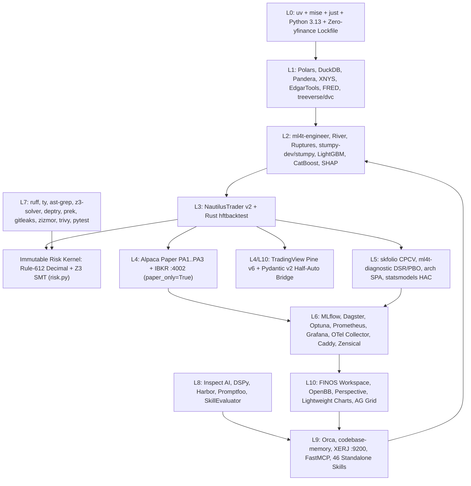

# Tier-0 SOTA Architecture Layer Manifest (`Z:\tier0-sota-clean`)

Standalone clean-room Python 3.13 (`uv` + `mise` + `just`) architecture governed by `AGENTS.md`, `upstream-map.toml`, `SOTA_STARRED_AND_BEYOND_MANIFEST.json`, and programmatically synchronized `ARCHITECTURE_MANIFEST.json` (`scripts/sync_manifest.py`).

Zero Self-Invention and zero legacy coupling are strictly enforced via official upstream gates only (zero arbitrary LOC caps):
1. **`ast-grep` structural rules** (`sgconfig.yml` + `rules/zero_self_invention.yml`, 21 rules) blocking banned libraries, custom trading/shadow engine classes, raw HTTP/socket polling, LLMs on execution/risk hot paths, `float()` in `risk.py`, and live broker endpoints.
2. **Single-winner `uv.lock` (`0` `yfinance`, `0` `quantstats`) + `deptry` + SPDX OSI License Firewall** (`pyproject.toml` + `upstream-map.toml`) organizing dependencies into clean PEP 735 groups (`dev`, `research`, `evals`, `portals`, `observability`) and excluding non-OSI licenses (`BSL-1.1`, `ELv2`, custom).
3. **Immutable pure `Decimal` Rule-612 risk kernel + Z3 SMT proofs** (`src/tier0_sota/risk.py`, SHA-256 `ad8071dcd4196c4c529c02107114ebfdda6692bc9d7c220031f1b19ea3e4d847`, formally verified `UNSAT` in `evals/formal_risk_z3.py`).
4. **Fail-closed Paper-only boundaries + supply-chain security + `Inspect AI`/`DSPy` evals:** `live_execution_enabled = False`, `paper_only = True`, ports `4001`/`7496`/`8798`/`8796` and `api.alpaca.markets` hard-refused; `ruff`, `ty`, `prek`, `gitleaks`, `zizmor`, `trivy`, `syft`, GitHub `CodeQL`/`Dependabot`, `evals/tier0_inspect_eval.py`, and `evals/dspy_self_reflect.py`.

---

## 1. Architecture Flow (`L0`–`L10` + Compounding Loop)

---

## 2. Active Technology Layers (`L0`–`L10`)

| Layer | Domain | Pinned Upstream Winners | Rejected Overlaps | `tier0-sota-clean` Modules & Configs |
|---|---|---|---|---|
| **L0** | Runtime, Lockfile & Provenance | `uv`, `mise`, `just` | `poetry`, `pipenv`, `conda`, `pip-tools` | `pyproject.toml`, `uv.lock`, `.python-version`, `mise.toml`, `justfile`, `scripts/bootstrap_env.*`, `scripts/grand_reset/00_*`, `01_*` |
| **L1** | Data, Schema Validation, Calendars & Causal PIT | `polars`, `duckdb`, `pandera`, `pydantic`, `exchange_calendars`, `edgartools`, `fredapi`, `treeverse/dvc` | `pandas-datareader`, `yfinance`, `clickhouse-local-server` | `src/tier0_sota/discovery.py`, `src/tier0_sota/live/paper_farm.py`, `src/tier0_sota/live/performance.py`, `src/tier0_sota/tv/bridge.py` |
| **L2** | Features, Streaming Drift, Regime Change, Explainability & ML | `ml4t-engineer`, `river`, `ruptures`, `stumpy-dev/stumpy`, `lightgbm`, `catboost`, `shap` | `ta-lib`, `sktime`, `fingpt`, `finrl`, `rd-agent` | `src/tier0_sota/discovery.py` |
| **L3** | Single-Engine `Sim == Paper == Live` Execution | `nautilus_trader` (`2.0.0rc9`), `hftbacktest` (`>=2.4.0`) | `backtrader`, `backtesting`, `zipline-reloaded`, `vectorbt`, `freqtrade`, `lean`, `pybroker` | `src/tier0_sota/engine.py`, `src/tier0_sota/risk.py`, `pine/tier0_omni_sota_24x5.pine`, `pine/tier0_market_regime.pine` |
| **L4** | Paper Broker Adapters & Market Data Feeds | `alpaca-py` (`0.45.0`), `tradermonty/claude-trading-skills` | `custom-rest-polling-loops`, `raw-unfiltered-alpaca-mcp-server`, `nautilus-alpaca` | `src/tier0_sota/live/{scanner,paper_farm}.py`, `scripts/run_live_paper_farm.ps1`, `src/tier0_sota/tv/{bridge,tickets}.py` |
| **L5** | Statistical Falsification & Portfolio Construction | `skfolio`, `ml4t-diagnostic`, `arch`, `statsmodels` | `pyportfolioopt`, `riskfolio-lib`, `alphalens-reloaded`, `mlfinlab`, `quantstats` | `src/tier0_sota/research.py` |
| **L6** | Hosted Research Portals, Orchestration, Observability & ADR Docs | `mlflow`, `dagster`, `dagster-webserver`, `optuna`, `optuna-dashboard`, `zensical`, `prometheus-client`, `opentelemetry-sdk`, `otel-collector-contrib`, `grafana`, `caddy` | `mkdocs`, `mkdocs-material`, `wandb`, `clearml`, `neptune`, `prefect`, `custom-fastapi-html` | `src/tier0_sota/definitions.py`, `docker/compose.sota.yml`, `docker/otel-collector-config.yaml`, `zensical.toml`, `docs/adr/CATALOG.md`, `src/tier0_sota/research.py` |
| **L7** | Static Quality, AST, Formal SMT, Fuzzing & Supply-Chain Security | `ruff`, `ty`, `ast-grep`, `gitleaks`, `hypothesis`, `pytest`, `prek`, `pre-commit`, `z3-solver`, `deptry`, `trivy`, `syft`, `shellcheck`, `zizmor`, `codeql`, `dependabot` | `black`, `isort`, `flake8`, `bandit`, `mypy`, `pyright`, `osv-scanner` | `.github/workflows/{ci,security,docs,release,multi-model-sota}.yml`, `justfile`, `sgconfig.yml`, `rules/zero_self_invention.yml`, `.gitleaks.toml`, `.pre-commit-config.yaml`, `scripts/sync_manifest.py`, `evals/formal_risk_z3.py`, `tests/*.py` |
| **L8** | Agent Evals, Sandboxes & Prompt Optimization | `inspect-ai`, `dspy`, `harbor`, `promptfoo`, `skillevaluator`, `OpenHands`, `aideml` | `deepeval` | `evals/tier0_inspect_eval.py`, `evals/dspy_self_reflect.py`, `scripts/run_compounding_reflection.py`, `pyproject.toml`, `upstream-map.toml` |
| **L9** | Multi-Model Harness, Code Graph, OmniRoute & Upstream MCPs | `orca`, `omniroute`, `codebase-memory-mcp`, `xerj`, `mcp`, `edgartools` | `third-party-agent-wrappers`, `custom-mcp-launchers`, `self-built-agent-buses` | `AGENTS.md`, `CLAUDE.md`, `orca.yaml`, `.mcp.json`, `.claude/mcp-lanes/`, `.claude/skills/` (`46`), `UPSTREAM_SKILLS_LOCK.json`, `scripts/nautilus_mcp_server.py` |
| **L10** | Institutional UI & Visual Analytics | `finos-workspace`, `OpenBB`, `perspective`, `lightweight-charts`, `ag-grid` (watches: `rerun`, `mosaic`, `FDC3`, `evidence`) | `streamlit`, `dash`, `gradio`, `nicegui`, `custom-react-blotter` | `src/tier0_sota/live/performance.py`, `src/tier0_sota/tv/bridge.py`, `docker/compose.sota.yml` |

### Earned-Trigger Frontier (`L11`–`L15`) & SPDX OSI License Firewall
- **`L11`–`L15` Catalog** (full trigger matrix in `SOTA_STARRED_AND_BEYOND_MANIFEST.json`): `vortex`/`lancedb`/`sqlglot`/`dlt` (`L11`); `TabPFN`/`TabICLv2`/`TabM`/`TabArena`/`Chronos-2`/`Toto`/`GIFT-Eval`/`shapiq`/`evidently`/`skchange` (`L12`); `iceoryx2`/`microsoft/MarS`/`LOBS5`/`cvxportfolio`/`Clarabel.rs`/`HiGHS`/`DoubleML`/`BoTorch`/`Ax`/`MAPIE` (`L13`); `marimo`/`Temporal`/`Loki`/`Tempo`/`Pyroscope`/`Alertmanager`/`Langfuse` (`L14`); `CrossHair`/`mutmut`/`semgrep`/`cosign`/`slsa-verifier`/`opa`/`microsoft/PyRIT`/`agentdojo`/`superradcompany/microsandbox`/`pydantic/monty`/`gvisor/gvisor`/`E2B`/`inspect_scout`/`gepa`/`ShinkaEvolve`/`algorithmicsuperintelligence/openevolve`/`snyk/agent-scan`/`agentskills`/`A2A`/`ACP`/`ag-ui`/`fastmcp`/`pydantic-ai`/`context7`/`hindsight`/`alpaca-mcp-server [paper-only]`/`tradingview-mcp [display-only]` (`L15`).
- **SPDX OSI License Firewall:** Excludes non-OSI repositories (`treeverse/lakeFS` [`BSL-1.1`], `restatedev/restate` [`BSL-1.1`], `Arize-ai/phoenix` [`ELv2`], `NX-AI/tirex` [`custom`]).

---

## 3. Repository Layer-by-Layer Map

### Core Production Package (`src/tier0_sota/`)
- `src/tier0_sota/__init__.py` — Package metadata entrypoint.
- `src/tier0_sota/risk.py` (exact SHA-256 `ad8071dcd4196c4c529c02107114ebfdda6692bc9d7c220031f1b19ea3e4d847`) — Immutable `Decimal` Rule-612 inward stop quantization (`<= 2.00%`), latched `-1.50%` daily drawdown fuse, `>= 10%` exit rate reserve.
- `src/tier0_sota/engine.py` — `NautilusTrader v2` 24/5 session protection (`classify_et_hm` + `classify_us_equity_session_et`, `RTH` `STOP_MARKET` vs collared `outside_rth` `STOP_LIMIT`), 4-tier progressive lossless trailing (`BE+fee` + `+1R/+2R/+3R`), `60s` rapid re-entry, flatten-first auto-reverse, and venue rate matrix (`IBKR_PAPER_4002` `3,000 rpm`, `ALPACA_PAPER_200` `200 rpm`, `LIVE` profiles hard-refused `live_execution_enabled = False`).
- `src/tier0_sota/discovery.py` — Parameterized causal PIT (`TIER0_PREWALL_CUTOFF` default `2026-10-15`, `TIER0_DATA_ROOT`, `t_ns + 60s`, `XNYS`), multi-feed regime (`SPY`/`QQQ`/`SOXX`/`VIX`), market-aligned always-short + causal reversal signals (`ml4t-engineer`, `river`, `ruptures`, `stumpy`).
- `src/tier0_sota/research.py` — 6-gate falsification (`hftbacktest` markout, `1x`/`2x` costs, `skfolio` CPCV `MIN_CPCV_SAMPLES = 16`, `ml4t-diagnostic` DSR/PBO, `arch` Hansen SPA, `statsmodels` HAC, `MLflow`).
- `src/tier0_sota/definitions.py` — Upstream-native `Dagster` `Definitions` (`prewall_pit_audit`, `risk_kernel_sha256_attestation`, `paper_farm_performance_snapshot`, `inspect_safety_and_philosophy_eval`, `compounding_self_reflection_snapshot`, and `daily_compounding_reflection_schedule`).

### Live Paper Farm (`src/tier0_sota/live/`) & TradingView Half-Auto (`src/tier0_sota/tv/`, `pine/`)
- `src/tier0_sota/live/{__init__,scanner,paper_farm,performance}.py` — Whole-market extreme-mover scanner (`Alpaca SIP` + `FINRA TRF` + post-selection ETB lookup), 3-lane non-overlapping `ALPACA_PA1..PA3` + `IBKR_DU_4002` Paper Farm (`paper_only = True`, `live_execution_enabled = False`, clean `paper_lane_{pa1,pa2,pa3}.duckdb` primary with parameterized `TIER0_DATA_ROOT`), and FINOS/OpenBB manifest export (`paper_farm_live_performance_manifest.json`).
- `pine/tier0_omni_sota_24x5.pine`, `pine/tier0_market_regime.pine`, `src/tier0_sota/tv/{__init__,bridge,tickets}.py`, `src/tier0_sota/tv/schema_v1.json` — Non-repainting Pine v6 (`barstate.isconfirmed`, `lookahead_off`, `semi_auto_confirmed = false`, `qty = 1`, zero CDP `:9223`) and strict Pydantic v2 (`TvAlertV1`) alert bridge & ticket pipeline.

### Standalone Skills, Evals, Automation, Docker & Zero-Hook Harness
- **Formal SMT & Evals (`evals/`):** `evals/formal_risk_z3.py` (`Z3` `UNSAT` proofs) and `evals/tier0_inspect_eval.py` (`Inspect AI` offline safety suite).
- **Standalone Skills (`.claude/skills/`):** `46/46` vetted skill directories vendored directly inside `.claude/skills/` matching `UPSTREAM_SKILLS_LOCK.json` SHA-256 digests (`0` external repo dependency).
- **Declarative Tooling, CI & SSOT Automation:** `mise.toml` (10 pinned upstream CLIs), `justfile` (cross-platform upstream task runner wrapping `uv`, `ruff`, `ty`, `deptry`, `ast-grep`, `pytest`, `zensical`, `prek`, `gitleaks`, `zizmor`, `trivy`, `preflight`, `resume`, `reflect`, `account-status`), `.pre-commit-config.yaml` (`prek` hooks), `scripts/sync_manifest.py` (`--write`/`--check` programmatic SSOT for `ARCHITECTURE_MANIFEST.json` & `LLM_HARNESS_MANIFEST.json`), `.github/workflows/{ci,security,docs,release,multi-model-sota}.yml` (full SHA-pinned actions, `zizmor --offline --persona=pedantic` `0` findings), `.github/{dependabot.yml,CODEOWNERS,pull_request_template.md}`, `scripts/{bootstrap_env,check}.{ps1,sh}`, and `scripts/grand_reset/*`.
- **Zero-Hook Multi-Runtime MCP Parity (`6` Runtimes):** `zero_self_invented_hooks = true` (`0` custom `"hooks"` blocks; pure native `uv run --no-sync` stdio MCPs) across `.mcp.json`, `.claude/settings.json`, `.codex/config.toml`, `.gemini/settings.json`, `opencode.json`, plus `.claude/mcp-lanes/{sim,paper,tv,gate}.mcp.json`, `.claude/agents/*.md`, `.claude/commands/*.md`, and `.opencode/commands/verify-tier0.md`.
- **Docker, Living ADRs & Tests:** `docker/compose.sota.yml` (official upstream `otel/opentelemetry-collector-contrib` + `caddy` file-server + research stack), `docker/otel-collector-config.yaml`, `zensical.toml`, [`docs/index.md`](index.md), [`docs/adr/CATALOG.md`](adr/CATALOG.md), living ADRs `ADR-0001.md`..`ADR-0018.md+` (`ADR-0011` superseded by [`ADR-0017`](adr/ADR-0017.md)), [`docs/COMPOUNDING_SELF_REFLECTION_LOOP.md`](COMPOUNDING_SELF_REFLECTION_LOOP.md), [`docs/GRAND_RESET_DISK_Z_WSL_RUNBOOK.md`](GRAND_RESET_DISK_Z_WSL_RUNBOOK.md), and `tests/test_*.py`.

---

## 4. Hosted Portals (`15/15`), Safety Boundaries & Standalone Topology

- **15 Hosted Local Portals (`127.0.0.1`):** XERJ (`:9200`), Zensical (`:8010`), MLflow 3 (`:5000`), Dagster (`:3000`), Optuna Dashboard (`:8080`), Inspect AI View (`:7575`), Prometheus (`:9090`), Grafana (`:3001`), OTel Collector Metrics (`:9464/metrics`), Caddy Tearsheets (`:8793`), FINOS Workspace (`:1420`), FINOS API (`:8000/health`), OpenBB Backend (`:6900`), DuckDB SQL UI (`:4213`), and OmniRoute LLM Gateway (`:20128/api/health`).
- **Compounding Loop (`XERJ` + `MLflow` + `DuckDB`):** Pre-wall trials log to `MLflow`; Paper Farm telemetry stores cleanly under `$TIER0_DATA_ROOT\manifests`; verified lessons compound into `XERJ` (`tier0-compounding-lessons`).

| Root Path (`ENV` Override) | Role | Mutability & Data Policy |
|---|---|---|
| `Z:\tier0-sota-clean` (`TIER0_REPO_ROOT`) | Standalone active SOTA repository (`main`, Python 3.13 `uv`, `46` local skills, Docker stack) | Self-contained codebase, zero external repo coupling |
| `Z:\sota-data\manifests` (`TIER0_DATA_ROOT\manifests`) | Active Paper Farm & TV status/manifest/DuckDB state plane | Shared operational state plane (never delete) |
| `Z:\sota-data\prewall-lake` (`TIER0_DATA_ROOT\prewall-lake`) | Immutable pre-wall (`<= 2026-10-15`) market data lake | Read-only PIT dataset (never delete) |
| `Z:\workspaces` (`ORCA_WORKSPACES_DIR`) | Active clean Orca worktree workspace root | Clean active workspace root |
