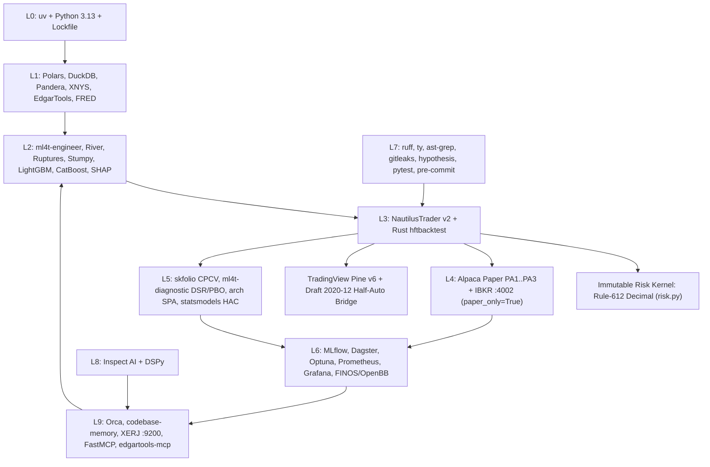

# Tier-0 SOTA Architecture Layer Manifest (`Z:\tier0-sota-clean`)

Clean-room Python 3.13 (`uv`) architecture governed by [`AGENTS.md`](../AGENTS.md), [`upstream-map.toml`](../upstream-map.toml), and the machine-readable SSOT [`ARCHITECTURE_MANIFEST.json`](../ARCHITECTURE_MANIFEST.json).

Zero Self-Invention is strictly enforced by:
1. **`ast-grep` structural rules** ([`sgconfig.yml`](../sgconfig.yml) + [`rules/zero_self_invention.yml`](../rules/zero_self_invention.yml)) blocking banned libraries, custom trading/shadow engine classes, raw HTTP/socket polling, LLMs on execution/risk hot paths, `float()` in `risk.py`, and live broker endpoints.
2. **Single-winner `uv.lock` / banned-package lock** ([`pyproject.toml`](../pyproject.toml) + [`upstream-map.toml`](../upstream-map.toml)).
3. **Immutable pure `Decimal` Rule-612 risk kernel** ([`src/tier0_sota/risk.py`](../src/tier0_sota/risk.py), SHA-256 `ad8071dcd4196c4c529c02107114ebfdda6692bc9d7c220031f1b19ea3e4d847`, `361` LOC).
4. **Fail-closed Paper-only boundaries** (`live_execution_enabled = False`, `paper_only = True`, ports `4001`/`7496`/`8798`/`8796` and `api.alpaca.markets` hard-refused). Module LOC budgets in `upstream-map.toml` (`loc_enforcement = "advisory"`) are advisory telemetry only.

---

## 1. Architecture Flow (`L0`–`L9` + Compounding Loop)

---

## 2. Technology Layers (`L0`–`L9`)

| Layer | Domain | Pinned Upstream Winners | Rejected Overlaps | `tier0-sota-clean` Modules & Configs |
|---|---|---|---|---|
| **L0** | Runtime, Lockfile & Provenance | `uv` | `poetry`, `pipenv`, `conda`, `pip-tools` | `pyproject.toml`, `uv.lock`, `.python-version`, `scripts/bootstrap_env.ps1`, `scripts/bootstrap_env.sh` |
| **L1** | Data, Schema Validation, Calendars & Causal PIT | `polars`, `duckdb`, `pandera`, `exchange_calendars`, `edgartools`, `fredapi`, `dvc` | `pandas-datareader`, `yfinance`, `clickhouse-local-server` | `src/tier0_sota/discovery.py`, `src/tier0_sota/live/paper_farm.py`, `src/tier0_sota/live/performance.py` |
| **L2** | Features, Streaming Drift, Regime Change, Explainability & ML | `ml4t-engineer`, `river`, `ruptures`, `stumpy`, `lightgbm`, `catboost`, `shap` | `ta-lib`, `sktime`, `fingpt`, `finrl`, `rd-agent` | `src/tier0_sota/discovery.py` |
| **L3** | Single-Engine `Sim == Paper == Live` Execution | `nautilus_trader` (`2.0.0rc9`), `hftbacktest` (`>=2.4.0`) | `backtrader`, `backtesting`, `zipline-reloaded`, `vectorbt`, `freqtrade`, `lean`, `pybroker` | `src/tier0_sota/engine.py`, `src/tier0_sota/risk.py`, `pine/tier0_omni_sota_24x5.pine`, `pine/tier0_market_regime.pine` |
| **L4** | Paper Broker Adapters & Market Data Feeds | `alpaca-py` (`0.45.0`) | `custom-rest-polling-loops`, `raw-unfiltered-alpaca-mcp-server`, `nautilus-alpaca` | `src/tier0_sota/live/scanner.py`, `src/tier0_sota/live/paper_farm.py`, `scripts/run_live_paper_farm.ps1`, `src/tier0_sota/tv/bridge.py`, `src/tier0_sota/tv/tickets.py`, `scripts/tv_console.ps1` |
| **L5** | Statistical Falsification & Portfolio Construction | `skfolio`, `ml4t-diagnostic`, `arch`, `statsmodels`, `quantstats` | `pyportfolioopt`, `riskfolio-lib`, `alphalens-reloaded`, `mlfinlab` | `src/tier0_sota/research.py` |
| **L6** | Hosted Research Portals, Observability & Docs | `mlflow`, `dagster`, `dagster-webserver`, `optuna`, `optuna-dashboard`, `zensical`, `prometheus-client`, `opentelemetry-sdk` | `mkdocs`, `mkdocs-material`, `wandb`, `clearml`, `neptune`, `prefect`, `custom-fastapi-html` | `src/tier0_sota/research.py`, `src/tier0_sota/live/performance.py`, `docs/CLEAN_ECOSYSTEM_MANIFEST.md` |
| **L7** | Static Quality, AST, Fuzzing & Supply-Chain Security | `ruff`, `ty`, `ast-grep`, `gitleaks`, `hypothesis`, `pytest`, `pre-commit` | `black`, `isort`, `flake8`, `bandit`, `mypy`, `pyright` | `sgconfig.yml`, `rules/zero_self_invention.yml`, `.gitleaks.toml`, `.pre-commit-config.yaml`, `tests/*.py` |
| **L8** | Agent Evals & Prompt Optimization | `inspect-ai`, `dspy` | `deepeval` | `pyproject.toml`, `upstream-map.toml` |
| **L9** | Multi-Model Harness, Code Graph & Upstream MCPs | `orca`, `codebase-memory-mcp`, `xerj`, `mcp`, `edgartools` | `third-party-agent-wrappers`, `custom-mcp-launchers`, `self-built-agent-buses` | `orca.yaml`, `.mcp.json`, `.claude/settings.json`, `.codex/config.toml`, `.gemini/settings.json`, `opencode.json`, `scripts/nautilus_mcp_server.py` |

---

## 3. Repository Layer-by-Layer Map

### Core Production Package (`src/tier0_sota/`)
- [`src/tier0_sota/__init__.py`](../src/tier0_sota/__init__.py) (`6` LOC) — Package metadata entrypoint.
- [`src/tier0_sota/risk.py`](../src/tier0_sota/risk.py) (`361` LOC, exact SHA-256 `ad8071dcd4196c4c529c02107114ebfdda6692bc9d7c220031f1b19ea3e4d847`) — Immutable `Decimal` Rule-612 inward stop quantization (`<= 2.00%`), latched `-1.50%` daily drawdown fuse, `>= 10%` exit rate reserve.
- [`src/tier0_sota/engine.py`](../src/tier0_sota/engine.py) (`975` LOC advisory) — `NautilusTrader v2` 24/5 session protection (`RTH` `STOP_MARKET` vs collared `outside_rth` `STOP_LIMIT`), 4-tier progressive lossless trailing (`BE+fee` + `+1R/+2R/+3R`), `60s` rapid re-entry, flatten-first auto-reverse, and venue rate matrix (`IBKR_PAPER_4002` `3,000 rpm`, `ALPACA_PAPER_200` `200 rpm`, `LIVE` profiles hard-refused `live_execution_enabled = False`).
- [`src/tier0_sota/discovery.py`](../src/tier0_sota/discovery.py) (`448` LOC advisory) — Pre-wall PIT (`<= 2026-10-15`, `t_ns + 60s`, `XNYS`), multi-feed regime (`SPY`/`QQQ`/`SOXX`/`VIX`), market-aligned always-short + causal reversal signals (`ml4t-engineer`, `river`, `ruptures`, `stumpy`).
- [`src/tier0_sota/research.py`](../src/tier0_sota/research.py) (`263` LOC advisory) — 6-gate falsification (`hftbacktest` markout, `1x`/`2x` costs, `skfolio` CPCV `MIN_CPCV_SAMPLES = 16`, `ml4t-diagnostic` DSR/PBO, `arch` Hansen SPA, `statsmodels` HAC, `MLflow`).

### Live Paper Farm (`src/tier0_sota/live/`)
- [`src/tier0_sota/live/__init__.py`](../src/tier0_sota/live/__init__.py) (`45` LOC) — Live automation exports.
- [`src/tier0_sota/live/scanner.py`](../src/tier0_sota/live/scanner.py) (`307` LOC advisory) — Whole-market extreme-mover scanner (`Alpaca SIP` + `FINRA TRF`) and post-selection `alpaca_paper_asset` ETB borrow lookup.
- [`src/tier0_sota/live/paper_farm.py`](../src/tier0_sota/live/paper_farm.py) (`335` LOC advisory) — 3-lane non-overlapping Alpaca Paper (`ALPACA_PA1..PA3`) + `IBKR_DU_4002` adapter with cross-lane symbol lock, isolated per-account DuckDB, and `SOXS`/`SQQQ` inverse fallback (`paper_only = True`, `live_execution_enabled = False`).
- [`src/tier0_sota/live/performance.py`](../src/tier0_sota/live/performance.py) (`174` LOC advisory) — Paper Farm performance manifest aggregator (`paper_farm_live_performance_manifest.json`) and FINOS/OpenBB JSON export (`finos_paper_farm_performance.json`).

### TradingView Half-Auto Automation (`src/tier0_sota/tv/` & `pine/`)
- [`pine/tier0_omni_sota_24x5.pine`](../pine/tier0_omni_sota_24x5.pine) (`408` LOC) & [`pine/tier0_market_regime.pine`](../pine/tier0_market_regime.pine) (`61` LOC) — Non-repainting Pine v6 indicators (`barstate.isconfirmed`, `lookahead_off`, 4-tier R-lock, `semi_auto_confirmed = false`, `qty = 1`, zero CDP `:9223`).
- [`src/tier0_sota/tv/__init__.py`](../src/tier0_sota/tv/__init__.py) (`29` LOC), [`bridge.py`](../src/tier0_sota/tv/bridge.py) (`339` LOC advisory), [`tickets.py`](../src/tier0_sota/tv/tickets.py) (`418` LOC advisory), [`schema_v1.json`](../src/tier0_sota/tv/schema_v1.json) — Draft 2020-12 bridge and Half-Auto ticket/watchlist builder.

### Scripts, Docker, ADRs, Zero-Hook Multi-Runtime Harness & Tests
- **Bootstrap, Ecosystem & Grand-Reset Kit:** [`scripts/bootstrap_env.ps1`](../scripts/bootstrap_env.ps1), [`scripts/bootstrap_env.sh`](../scripts/bootstrap_env.sh), [`scripts/setup_clean_ecosystem.ps1`](../scripts/setup_clean_ecosystem.ps1), [`scripts/launch_clean_lanes.ps1`](../scripts/launch_clean_lanes.ps1), [`scripts/run_live_paper_farm.ps1`](../scripts/run_live_paper_farm.ps1), [`scripts/tv_console.ps1`](../scripts/tv_console.ps1), [`scripts/nautilus_mcp_server.py`](../scripts/nautilus_mcp_server.py), [`scripts/grand_reset/00_clean_disk_z_and_agy_reset.ps1`](../scripts/grand_reset/00_clean_disk_z_and_agy_reset.ps1), [`scripts/grand_reset/01_disk_z_and_wsl_setup.ps1`](../scripts/grand_reset/01_disk_z_and_wsl_setup.ps1), [`scripts/grand_reset/01_wsl_bootstrap.sh`](../scripts/grand_reset/01_wsl_bootstrap.sh), [`scripts/grand_reset/02_runtimes_agy_orca_setup.ps1`](../scripts/grand_reset/02_runtimes_agy_orca_setup.ps1), [`scripts/grand_reset/03_hosted_stack_tv_paper.ps1`](../scripts/grand_reset/03_hosted_stack_tv_paper.ps1), [`scripts/grand_reset/verify_grand_reset.ps1`](../scripts/grand_reset/verify_grand_reset.ps1).
- **Docker Research & Portal Stack (`docker/`):** [`docker/compose.sota.yml`](../docker/compose.sota.yml), [`docker/prometheus.yml`](../docker/prometheus.yml), [`docker/dagster.yaml`](../docker/dagster.yaml), [`docker/Dockerfile.research`](../docker/Dockerfile.research), [`docker/Dockerfile.sandbox`](../docker/Dockerfile.sandbox), [`docker/Dockerfile.xerj`](../docker/Dockerfile.xerj), [`docker/grafana/dashboards/tier0-sota-observability.json`](../docker/grafana/dashboards/tier0-sota-observability.json), [`docker/grafana/provisioning/dashboards/provider.yml`](../docker/grafana/provisioning/dashboards/provider.yml), [`docker/grafana/provisioning/datasources/prometheus.yml`](../docker/grafana/provisioning/datasources/prometheus.yml).
- **Zero-Hook 4-Runtime MCP Parity, Scoped Lanes & Starred Catalog:** `zero_self_invented_hooks = true` (`0` custom `"hooks"` blocks across `.claude/settings.json`, `.gemini/settings.json`, and `.codex/config.toml`; `.codex/hooks.json` eliminated; static/security checks live strictly in `.pre-commit-config.yaml`, `rules/zero_self_invention.yml`, and `pytest`). Native `uv run --no-sync` stdio MCP parity across [`.mcp.json`](../.mcp.json), [`.claude/settings.json`](../.claude/settings.json), [`.codex/config.toml`](../.codex/config.toml), [`.gemini/settings.json`](../.gemini/settings.json), [`opencode.json`](../opencode.json), plus task-scoped [`.claude/mcp-lanes/`](../.claude/mcp-lanes/sim.mcp.json) (`sim`, `paper`, `tv`, `gate`), few-line `.claude/agents/*.md` (`<= 16` LOC incl. `permissionMode: plan` `paper-gatekeeper.md`), few-line `.claude/commands/*.md` (`<= 10` LOC), [`.opencode/commands/verify-tier0.md`](../.opencode/commands/verify-tier0.md), [`UPSTREAM_SKILLS_LOCK.json`](../UPSTREAM_SKILLS_LOCK.json) (`46` SHA-locked skills), and [`SOTA_STARRED_AND_BEYOND_MANIFEST.json`](../SOTA_STARRED_AND_BEYOND_MANIFEST.json).
- **MADR 4.0 ADRs, Governance & Tests:** [`zensical.toml`](../zensical.toml), [`docs/index.md`](index.md), [`docs/adr/CATALOG.md`](adr/CATALOG.md), `docs/adr/ADR-0001.md`..`ADR-0012.md`, [`AGENTS.md`](../AGENTS.md), [`upstream-map.toml`](../upstream-map.toml), [`orca.yaml`](../orca.yaml), [`sgconfig.yml`](../sgconfig.yml), [`rules/zero_self_invention.yml`](../rules/zero_self_invention.yml), [`docs/TV_AUTOMATION_PLAYBOOK.md`](TV_AUTOMATION_PLAYBOOK.md), [`docs/CLEAN_ECOSYSTEM_MANIFEST.md`](CLEAN_ECOSYSTEM_MANIFEST.md), [`docs/GRAND_RESET_DISK_Z_WSL_RUNBOOK.md`](GRAND_RESET_DISK_Z_WSL_RUNBOOK.md), [`tests/test_core_engine.py`](../tests/test_core_engine.py), [`tests/test_live_automation.py`](../tests/test_live_automation.py), [`tests/test_tv_automation.py`](../tests/test_tv_automation.py), [`tests/test_mcp_server.py`](../tests/test_mcp_server.py), [`tests/test_architecture_manifest.py`](../tests/test_architecture_manifest.py).

---

## 4. Hosted Portals (`13/13`), Safety Boundaries & Compounding Loop

- **13 Hosted Loopback Portals (`127.0.0.1`):** XERJ (`:9200`), Zensical (`:8010`), MLflow 3 (`:5000`), Dagster (`:3000`), Optuna Dashboard (`:8080`), Inspect AI View (`:7575`), Prometheus (`:9090`), Grafana (`:3001`), OTel Exporter (`:9464/metrics`), Tearsheets (`:8793`), FINOS Workspace (`:1420`), FINOS API (`:8000/health`), OpenBB Backend (`:6900`).
- **Fail-Closed Safety Boundaries:** `live_execution_enabled = False`, `paper_only = True`, pre-wall PIT cutoff `<= 2026-10-15`, `IBKR_DU_4002` (`:4002`) + `ALPACA_PA1..PA3` (`https://paper-api.alpaca.markets`) only, and hard refusal of live ports (`:4001`, `:7496`, `:8798`, `:8796`) and `api.alpaca.markets`.
- **Compounding Loop (`XERJ` + `MLflow` + `DuckDB`):** Pre-wall trials log metrics and gate outcomes to `MLflow` (`:5000`); Paper Farm lanes record isolated per-account order/fill telemetry in DuckDB (`Z:\sota-data\manifests\alpaca_pa*_seamless_orders.duckdb`) and aggregate into `paper_farm_live_performance_manifest.json`; verified lessons compound into `XERJ` (`http://127.0.0.1:9200`, `tier0-compounding-lessons`).

---

## 5. Workstation Multi-Repo Topology

| Root Path | Role | Mutability & Data Policy |
|---|---|---|
| `Z:\tier0-sota-clean` | Active clean-room SOTA repository (`main`, Python 3.13 `uv`) | Active codebase, MCP parity, AST/gitleaks gates |
| `Z:\tier0-quant` | Immutable reference stack & Docker compose host (`13/13` portals) | Read-only reference (`0` dirty lines) |
| `Z:\sota-data\manifests` | Shared live Paper Farm & TV status/manifest/DuckDB root | Shared operational state plane (never delete) |
| `Z:\sota-data\prewall-lake` | Immutable pre-wall (`<= 2026-10-15`) market data lake | Read-only PIT dataset (never delete) |
| `Z:\archive\superseded_2026-11-25` | Non-destructive archive for superseded diffs, `.bak-*`, legacy harnesses | Archived artifacts only |
