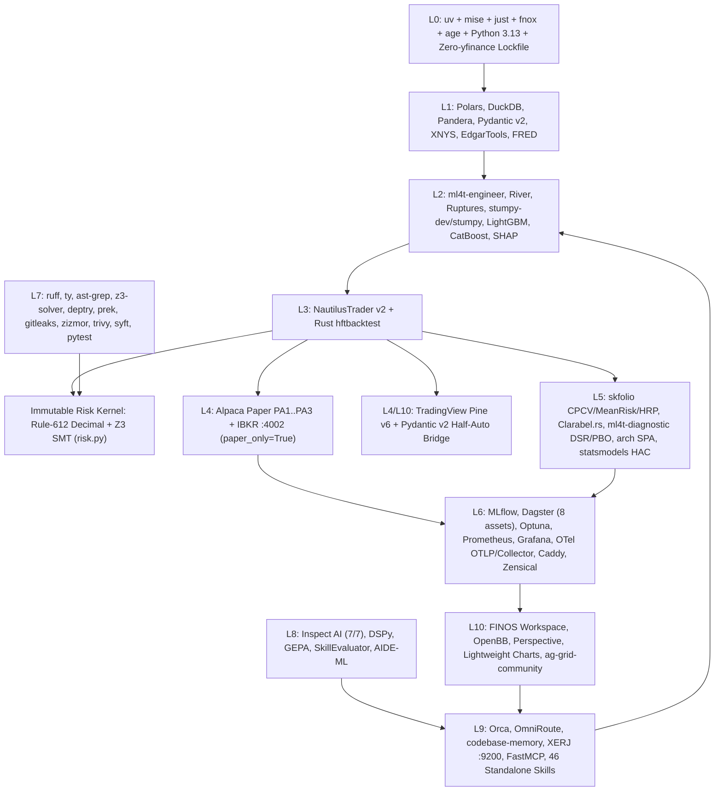

# Tier-0 SOTA Architecture Layer Manifest (`Z:\noesis`)

Standalone clean-room Python 3.13 (`uv` + `mise` + `just` + `fnox` + `age`) architecture governed by `AGENTS.md`, `upstream-map.toml`, `SOTA_STARRED_AND_BEYOND_MANIFEST.json`, and programmatically synchronized `ARCHITECTURE_MANIFEST.json` (`scripts/sync_manifest.py`).

Zero Self-Invention and zero legacy coupling are strictly enforced via official upstream gates only (zero arbitrary LOC caps):
1. **`ast-grep` structural rules** (`sgconfig.yml` + `rules/zero_self_invention.yml`, 21 rules) blocking banned libraries, custom trading/shadow engine classes, raw HTTP/socket polling, LLMs on execution/risk hot paths, `float()` in `risk.py`, and live broker endpoints.
2. **Single-winner `uv.lock` (`0` `yfinance`, `0` `quantstats`, `0` `pre-commit`) + `deptry` + `zero_paper_winners_audit` + 7-Repo SPDX OSI License Firewall** (`pyproject.toml` + `upstream-map.toml`) organizing dependencies into clean PEP 735 groups (`dev`, `research`, `evals`, `portals`, `observability`, plus optional `data-versioning`) and excluding non-OSI/unlicensed/non-commercial-weight repos (`BSL-1.1`, `ELv2`, custom, non-OSI rules, `NOASSERTION`, non-commercial weights).
3. **Immutable pure `Decimal` Rule-612 risk kernel + Z3 SMT proofs** (`src/tier0_sota/risk.py`, SHA-256 `ad8071dcd4196c4c529c02107114ebfdda6692bc9d7c220031f1b19ea3e4d847`, formally verified `UNSAT` in `evals/formal_risk_z3.py`).
4. **Fail-closed Paper-only boundaries + supply-chain security + `Inspect AI` (7/7) + `DSPy`/`dspy.GEPA` evals:** `live_execution_enabled = False`, `paper_only = True`, ports `4001`/`7496`/`8798`/`8796` and `api.alpaca.markets` hard-refused; `ruff`, `ty`, `prek`, `gitleaks`, `zizmor`, `trivy`, `syft`, GitHub `CodeQL`/`Dependabot`, `evals/tier0_inspect_eval.py`, and `evals/dspy_self_reflect.py`.

---

## 1. Architecture Flow (`L0`–`L10` + Compounding Loop)

---

## 2. Active Technology Layers (`L0`–`L10`) — Canonical Repos, Pinned Versions & SPDX Licenses

| Layer | Domain | Canonical Upstream Winners (Pinned/Verified Version · SPDX) | Rejected Overlaps | `noesis` Modules & Configs |
|---|---|---|---|---|
| **L0** | Runtime, Lockfile & Provenance | [`astral-sh/uv`](https://github.com/astral-sh/uv) (`0.13` / `0.13.9` · `Apache-2.0`), [`jdx/mise`](https://github.com/jdx/mise) (`2026.11.x` · `MIT`), [`casey/just`](https://github.com/casey/just) (`1.59.0` · `CC0-1.0`), [`jdx/fnox`](https://github.com/jdx/fnox) (`1.50.0` · `MIT`), [`FiloSottile/age`](https://github.com/FiloSottile/age) (`1.3.2` · `BSD-3-Clause`), base [`python/cpython`](https://github.com/python/cpython) (`3.13` / `3.13.18` · `PSF-2.0`) | `poetry`, `pipenv`, `conda`, `pip-tools`, `custom-env-shell-wrappers` | `pyproject.toml`, `uv.lock`, `.python-version`, `mise.toml`, `justfile`, `fnox.toml`, `scripts/bootstrap_env.*`, `scripts/grand_reset/00_*`, `01_*` |
| **L1** | Data, Schema Validation, Calendars & Causal PIT | [`pola-rs/polars`](https://github.com/pola-rs/polars) (`2.2.0` · `MIT`), [`duckdb/duckdb`](https://github.com/duckdb/duckdb) (`2.0.1` · `MIT`), [`unionai-oss/pandera`](https://github.com/unionai-oss/pandera) (`0.36.0` · `MIT`), [`pydantic/pydantic`](https://github.com/pydantic/pydantic) (`2.14.4` · `MIT`), [`gerrymanoim/exchange_calendars`](https://github.com/gerrymanoim/exchange_calendars) (`4.13.3` · `Apache-2.0`), canonical [`dgunning/edgartools`](https://github.com/dgunning/edgartools) (`6.4.0` · `MIT`), [`mortada/fredapi`](https://github.com/mortada/fredapi) (`0.5.2` · `Apache-2.0`), [`tobymao/sqlglot`](https://github.com/tobymao/sqlglot) (`30.35.0` · `MIT`) | `pandas-datareader`, `yfinance`, `clickhouse-local-server` | `src/tier0_sota/discovery.py`, `src/tier0_sota/live/paper_farm.py`, `src/tier0_sota/live/performance.py`, `src/tier0_sota/tv/bridge.py` |
| **L2** | Features, Streaming Drift, Regime Change, Explainability & ML | [`ml4t/engineer`](https://github.com/ml4t/engineer) (`0.2.1` · `MIT`), [`online-ml/river`](https://github.com/online-ml/river) (`0.27.0` · `BSD-3-Clause`), [`deepcharles/ruptures`](https://github.com/deepcharles/ruptures) (`1.1.10` · `BSD-2-Clause`), [`stumpy-dev/stumpy`](https://github.com/stumpy-dev/stumpy) (`1.14.1` · `BSD-3-Clause`), [`lightgbm-org/LightGBM`](https://github.com/lightgbm-org/LightGBM) (`4.7.0` · `MIT`), [`catboost/catboost`](https://github.com/catboost/catboost) (`1.2.10` · `Apache-2.0`), [`shap/shap`](https://github.com/shap/shap) (`0.54.1` · `MIT`), [`NorskRegnesentral/skchange`](https://github.com/NorskRegnesentral/skchange) (`0.18.0` · `BSD-3-Clause`), [`mmschlk/shapiq`](https://github.com/mmschlk/shapiq) (`1.8.0` · `MIT`) | `ta-lib`, `sktime`, `fingpt`, `finrl`, `rd-agent` | `src/tier0_sota/discovery.py` |
| **L3** | Single-Engine `Sim == Paper == Live` Execution | [`nautechsystems/nautilus_trader`](https://github.com/nautechsystems/nautilus_trader) (`2.0.0rc9` · `LGPL-3.0-only`), [`nkaz001/hftbacktest`](https://github.com/nkaz001/hftbacktest) (`2.4.4` · `MIT`) | `backtrader`, `backtesting`, `zipline-reloaded`, `vectorbt`, `freqtrade`, `lean`, `pybroker` | `src/tier0_sota/engine.py`, `src/tier0_sota/risk.py`, `pine/tier0_omni_sota_24x5.pine`, `pine/tier0_market_regime.pine` |
| **L4** | Paper Broker Adapters & Market Data Feeds | [`alpacahq/alpaca-py`](https://github.com/alpacahq/alpaca-py) (`0.45.0` · `Apache-2.0`), [`tradermonty/claude-trading-skills`](https://github.com/tradermonty/claude-trading-skills) (`4080042a7863`, 20 skills · `MIT`) | `custom-rest-polling-loops`, `raw-unfiltered-alpaca-mcp-server`, `nautilus-alpaca` | `src/tier0_sota/live/{scanner,paper_farm}.py`, `scripts/run_live_paper_farm.ps1`, `src/tier0_sota/tv/{bridge,tickets}.py` |
| **L5** | Statistical Falsification & Portfolio Construction | [`skfolio/skfolio`](https://github.com/skfolio/skfolio) (`1.14.6` · `BSD-3-Clause`), [`ml4t/diagnostic`](https://github.com/ml4t/diagnostic) (`0.2.1` · `MIT`), [`bashtage/arch`](https://github.com/bashtage/arch) (`9.0.0` · `NCSA`), [`statsmodels/statsmodels`](https://github.com/statsmodels/statsmodels) (`0.15.0` · `BSD-3-Clause`), [`oxfordcontrol/Clarabel.rs`](https://github.com/oxfordcontrol/Clarabel.rs) (`clarabel` `0.11.1` · `Apache-2.0`), [`scikit-learn-contrib/MAPIE`](https://github.com/scikit-learn-contrib/MAPIE) (`1.6.0` · `BSD-3-Clause`) | `pyportfolioopt`, `riskfolio-lib`, `alphalens-reloaded`, `mlfinlab`, `quantstats` | `src/tier0_sota/research.py` |
| **L6** | Hosted Research Portals, Orchestration, Observability & ADR Docs | [`mlflow/mlflow`](https://github.com/mlflow/mlflow) (`3.18.0` · `Apache-2.0`), [`dagster-io/dagster`](https://github.com/dagster-io/dagster) (`1.13.31` incl. `dagster-webserver` · `Apache-2.0`), [`optuna/optuna`](https://github.com/optuna/optuna) (`5.1.0` · `MIT`), [`optuna/optuna-dashboard`](https://github.com/optuna/optuna-dashboard) (`0.21.0` · `MIT`), [`zensical/zensical`](https://github.com/zensical/zensical) (`0.1.3` · `MIT`), [`prometheus/prometheus`](https://github.com/prometheus/prometheus) (`3.16.0` · `Apache-2.0`), [`prometheus/client_python`](https://github.com/prometheus/client_python) (`0.26.0` · `Apache-2.0 AND BSD-2-Clause`), [`prometheus/alertmanager`](https://github.com/prometheus/alertmanager) (`0.28.1` profile-gated `:9093` · `Apache-2.0`), [`open-telemetry/opentelemetry-python`](https://github.com/open-telemetry/opentelemetry-python) (`1.45.2` incl. `opentelemetry-exporter-otlp` · `Apache-2.0`), [`open-telemetry/opentelemetry-collector-contrib`](https://github.com/open-telemetry/opentelemetry-collector-contrib) (`0.166.0` · `Apache-2.0`), [`grafana/grafana`](https://github.com/grafana/grafana) (`13.3.1` · `AGPL-3.0-only`), [`caddyserver/caddy`](https://github.com/caddyserver/caddy) (`2.11.9` · `Apache-2.0`), [`allure-framework/allure3`](https://github.com/allure-framework/allure3) (`3.33.0` + `allure-pytest==2.16.2` · `Apache-2.0`) | `mkdocs`, `mkdocs-material`, `wandb`, `clearml`, `neptune`, `prefect`, `custom-fastapi-html`, `reportportal`, `pytest-html` | `src/tier0_sota/definitions.py`, `src/tier0_sota/live/performance.py`, `docker/compose.sota.yml`, `docker/{Caddyfile,alertmanager.yml,prometheus_rules.yml}`, `docker/otel-collector-config.yaml`, `zensical.toml`, `docs/adr/CATALOG.md`, `src/tier0_sota/research.py` |
| **L7** | Static Quality, AST, Formal SMT, Fuzzing & Supply-Chain Security | [`astral-sh/ruff`](https://github.com/astral-sh/ruff) (`0.17.6` · `MIT`), [`astral-sh/ty`](https://github.com/astral-sh/ty) (`0.0.111` · `MIT`), [`ast-grep/ast-grep`](https://github.com/ast-grep/ast-grep) (`0.51.3` · `MIT`), [`gitleaks/gitleaks`](https://github.com/gitleaks/gitleaks) (`8.30.1` · `MIT`), [`HypothesisWorks/hypothesis`](https://github.com/HypothesisWorks/hypothesis) (`6.170.17` · `MPL-2.0`), [`pytest-dev/pytest`](https://github.com/pytest-dev/pytest) (`9.2.0` · `MIT`), [`j178/prek`](https://github.com/j178/prek) (`0.5.11` · `MIT`), [`Z3Prover/z3`](https://github.com/Z3Prover/z3) (`5.4.1.0` · `MIT`), [`pschanely/CrossHair`](https://github.com/pschanely/CrossHair) (`crosshair-tool==0.0.114` isolated `uvx` · `MIT`), [`boxed/mutmut`](https://github.com/boxed/mutmut) (`3.8.1` isolated WSL `mktemp -d` · `BSD-3-Clause`), [`osprey-oss/deptry`](https://github.com/osprey-oss/deptry) (`0.25.1` · `MIT`), [`aquasecurity/trivy`](https://github.com/aquasecurity/trivy) (`0.76.2` · `Apache-2.0`), [`anchore/syft`](https://github.com/anchore/syft) (`1.55.0` · `Apache-2.0`), [`koalaman/shellcheck`](https://github.com/koalaman/shellcheck) (`0.11.0` · `GPL-3.0`), [`zizmorcore/zizmor`](https://github.com/zizmorcore/zizmor) (`1.32.0` · `MIT`), [`github/codeql`](https://github.com/github/codeql) (Default Setup · `MIT`), [`dependabot/dependabot-core`](https://github.com/dependabot/dependabot-core) (`v2` · `MIT`), [`snyk/agent-scan`](https://github.com/snyk/agent-scan) (offline CLI · `Apache-2.0`) | `black`, `isort`, `flake8`, `bandit`, `mypy`, `pyright`, `osv-scanner`, `pre-commit`, `semgrep`, `cosmic-ray` | `.github/workflows/{ci,security,docs,release,multi-model-sota}.yml`, `justfile`, `sgconfig.yml`, `rules/zero_self_invention.yml`, `.gitleaks.toml`, `.pre-commit-config.yaml`, `scripts/sync_manifest.py`, `evals/formal_risk_z3.py`, `evals/symbolic_risk_crosshair.py`, `tests/*.py` |
| **L8** | Agent Evals, Sandboxes & Prompt Optimization | [`UKGovernmentBEIS/inspect_ai`](https://github.com/UKGovernmentBEIS/inspect_ai) (`0.3.292` · `MIT`), [`stanfordnlp/dspy`](https://github.com/stanfordnlp/dspy) (`3.5.0` · `MIT`), [`gepa-ai/gepa`](https://github.com/gepa-ai/gepa) (`0.1.4` · `MIT`), [`NVIDIA/SkillEvaluator`](https://github.com/NVIDIA/SkillEvaluator) (`1.0.1` · `Apache-2.0`, vendored skill), [`WecoAI/aideml`](https://github.com/WecoAI/aideml) (`0.2.2` · `MIT`, isolated Docker sandbox) | `deepeval` | `evals/tier0_inspect_eval.py`, `evals/dspy_self_reflect.py`, `scripts/run_compounding_reflection.py`, `docker/Dockerfile.sandbox`, `pyproject.toml`, `upstream-map.toml` |
| **L9** | Multi-Model Harness, Code Graph, OmniRoute & Upstream MCPs | [`stablyai/orca`](https://github.com/stablyai/orca) (`1.4.271` · `MIT`), [`cheaper-inference/OmniRoute`](https://github.com/cheaper-inference/OmniRoute) (`3.8.54` · `MIT`), [`DeusData/codebase-memory-mcp`](https://github.com/DeusData/codebase-memory-mcp) (`0.12.1` · `MIT`), [`xerj-org/xerj`](https://github.com/xerj-org/xerj) (`1.0.0-rc.104` · `Apache-2.0`), [`modelcontextprotocol/python-sdk`](https://github.com/modelcontextprotocol/python-sdk) (`1.30.0` · `MIT`) *(cross-layer MCP interface `edgartools-mcp` -> canonical `L1` [`dgunning/edgartools`](https://github.com/dgunning/edgartools))*; plus locked skills [`ml4t/skills`](https://github.com/ml4t/skills) (`Apache-2.0`), [`cloudflare/security-audit-skill`](https://github.com/cloudflare/security-audit-skill) (`MIT`), [`obra/superpowers`](https://github.com/obra/superpowers) (`MIT`) | `third-party-agent-wrappers`, `custom-mcp-launchers`, `self-built-agent-buses` | `AGENTS.md`, `CLAUDE.md`, `orca.yaml`, `.mcp.json`, `.agents/skills.json`, `.claude/mcp-lanes/`, `.claude/skills/` (`46`), `UPSTREAM_SKILLS_LOCK.json`, `scripts/nautilus_mcp_server.py` |
| **L10** | Institutional UI & Visual Analytics | [`openbq-org/finos-workspace`](https://github.com/openbq-org/finos-workspace) (`1.0.0` · `Apache-2.0`), [`openbq-org/finos-workspace-plugins`](https://github.com/openbq-org/finos-workspace-plugins) (`ag-grid@2.3.0`, `plotly-charts@2.5.0`, `@finos-workspace/mermaid@1.0.0` · `Apache-2.0`), [`OpenBB-finance/OpenBB`](https://github.com/OpenBB-finance/OpenBB) (`Apache-2.0`), [`openbq-org/backends-for-openbb`](https://github.com/openbq-org/backends-for-openbb) (`a6293707` · `MIT`), [`finos/perspective`](https://github.com/finos/perspective) (`Apache-2.0`), [`tradingview/lightweight-charts`](https://github.com/tradingview/lightweight-charts) (`v5` · `Apache-2.0`), [`ag-grid/ag-grid`](https://github.com/ag-grid/ag-grid) (`ag-grid-community` `32.1.0` · `MIT`); watches: [`rerun-io/rerun`](https://github.com/rerun-io/rerun) (`MIT OR Apache-2.0`), [`uwdata/mosaic`](https://github.com/uwdata/mosaic) (`BSD-3-Clause`), [`finos/FDC3`](https://github.com/finos/FDC3) (`Apache-2.0`), [`evidence-dev/evidence`](https://github.com/evidence-dev/evidence) (`MIT`) | `streamlit`, `dash`, `gradio`, `nicegui`, `custom-react-blotter` | `src/tier0_sota/live/performance.py`, `src/tier0_sota/tv/bridge.py`, `docker/compose.sota.yml` |

### Earned-Trigger Frontier (`L11`–`L15`) & SPDX OSI License Firewall

Full trigger matrix in `SOTA_STARRED_AND_BEYOND_MANIFEST.json`:

- **`L11` (High-Volume Data Lake & Multimodal Watch):** [`treeverse/dvc`](https://github.com/treeverse/dvc) (`Apache-2.0`, optional `[dependency-groups] data-versioning`) · [`vortex-data/vortex`](https://github.com/vortex-data/vortex) (`Apache-2.0`, lake >100 GB/run) · [`apache/iceberg-python`](https://github.com/apache/iceberg-python) [`pyiceberg`] (`Apache-2.0`, multi-writer ACID Parquet) · [`lancedb/lancedb`](https://github.com/lancedb/lancedb) (`Apache-2.0`, multimodal SEC filings) · [`dlt-hub/dlt`](https://github.com/dlt-hub/dlt) (`Apache-2.0`, declarative PIT ingest) *(Note: `sqlglot` graduated to active `L1` per [ADR-0028](adr/ADR-0028.md))*.
- **`L12` (Tabular/TS Foundation & Drift Watch):** [`soda-inria/tabicl`](https://github.com/soda-inria/tabicl) [`TabICLv2`] (`BSD-3-Clause`, replaces firewalled `TabPFN`) · [`yandex-research/tabm`](https://github.com/yandex-research/tabm) [`TabM`] (`Apache-2.0`) · [`autogluon/tabarena`](https://github.com/autogluon/tabarena) [`TabArena`] (`Apache-2.0`) · [`amazon-science/chronos-forecasting`](https://github.com/amazon-science/chronos-forecasting) [`Chronos-2`] (`Apache-2.0`) · [`DataDog/toto`](https://github.com/DataDog/toto) [`Toto`] (`Apache-2.0`) · [`SalesforceAIResearch/gift-eval`](https://github.com/SalesforceAIResearch/gift-eval) [`GIFT-Eval`] (`Apache-2.0`) · [`evidentlyai/evidently`](https://github.com/evidentlyai/evidently) (`Apache-2.0`) *(Note: `skchange` & `shapiq` graduated to active `L2` per [ADR-0028](adr/ADR-0028.md))*.
- **`L13` (Zero-Copy IPC, Generative L2 Sim & Portfolio/Causal Watch):** [`eclipse-iceoryx/iceoryx2`](https://github.com/eclipse-iceoryx/iceoryx2) (`Apache-2.0`) · [`microsoft/MarS`](https://github.com/microsoft/MarS) (`MIT`, replaces firewalled `LOBS5`) · [`cvxgrp/cvxportfolio`](https://github.com/cvxgrp/cvxportfolio) (`GPL-3.0`, reference-only per [ADR-0015](adr/ADR-0015.md)) · [`ERGO-Code/HiGHS`](https://github.com/ERGO-Code/HiGHS) (`MIT`) · [`DoubleML/doubleml-for-py`](https://github.com/DoubleML/doubleml-for-py) (`BSD-3-Clause`) · [`meta-pytorch/botorch`](https://github.com/meta-pytorch/botorch) (`MIT`) · [`meta/Ax`](https://github.com/meta/Ax) (`MIT`) *(Note: `Clarabel.rs` & `MAPIE` graduated to active `L5`)*.
- **`L14` (Interactive Notebooks, Durable Workflows & Trace Scale Watch):** [`marimo-team/marimo`](https://github.com/marimo-team/marimo) (`Apache-2.0`) · [`temporalio/temporal`](https://github.com/temporalio/temporal) (`MIT`) · [`grafana/loki`](https://github.com/grafana/loki) (`AGPL-3.0-only`) · [`grafana/tempo`](https://github.com/grafana/tempo) (`AGPL-3.0-only`) · [`grafana/pyroscope`](https://github.com/grafana/pyroscope) (`AGPL-3.0-only`) · [`langfuse/langfuse`](https://github.com/langfuse/langfuse) (`MIT` core) *(Note: `prometheus/alertmanager` [profile-gated `:9093`] & `allure-framework/allure3` graduated to active `L6`)*.
- **`L15` (Remaining Watch Evals, Sandboxes, Red-Teaming & Agent Protocols):** [`opengrep/opengrep`](https://github.com/opengrep/opengrep) (`LGPL-2.1`, replaces firewalled `semgrep`) · [`sigstore/cosign`](https://github.com/sigstore/cosign) (`Apache-2.0`) · [`slsa-framework/slsa-verifier`](https://github.com/slsa-framework/slsa-verifier) (`Apache-2.0`) · [`open-policy-agent/opa`](https://github.com/open-policy-agent/opa) (`Apache-2.0`) · [`harbor-framework/harbor`](https://github.com/harbor-framework/harbor) (`Apache-2.0`) · [`promptfoo/promptfoo`](https://github.com/promptfoo/promptfoo) (`MIT`) · [`OpenHands/OpenHands`](https://github.com/OpenHands/OpenHands) (`MIT`) · [`microsoft/PyRIT`](https://github.com/microsoft/PyRIT) (`MIT`) · [`ethz-spylab/agentdojo`](https://github.com/ethz-spylab/agentdojo) (`MIT`) · [`superradcompany/microsandbox`](https://github.com/superradcompany/microsandbox) (`Apache-2.0`) · [`pydantic/monty`](https://github.com/pydantic/monty) (`MIT`) · [`gvisor/gvisor`](https://github.com/gvisor/gvisor) (`Apache-2.0`) · [`e2b-dev/E2B`](https://github.com/e2b-dev/E2B) (`Apache-2.0`) · [`meridianlabs-ai/inspect_scout`](https://github.com/meridianlabs-ai/inspect_scout) (`MIT`) · [`SakanaAI/ShinkaEvolve`](https://github.com/SakanaAI/ShinkaEvolve) (`Apache-2.0`) · [`algorithmicsuperintelligence/openevolve`](https://github.com/algorithmicsuperintelligence/openevolve) (`Apache-2.0`) · [`agentskills/agentskills`](https://github.com/agentskills/agentskills) (`Apache-2.0`) · [`a2aproject/A2A`](https://github.com/a2aproject/A2A) (`Apache-2.0`) · [`agentclientprotocol/agent-client-protocol`](https://github.com/agentclientprotocol/agent-client-protocol) [`ACP`] (`Apache-2.0`) · [`ag-ui-protocol/ag-ui`](https://github.com/ag-ui-protocol/ag-ui) (`MIT`) · [`PrefectHQ/fastmcp`](https://github.com/PrefectHQ/fastmcp) (`Apache-2.0`) · [`pydantic/pydantic-ai`](https://github.com/pydantic/pydantic-ai) (`MIT`) · [`upstash/context7`](https://github.com/upstash/context7) (`MIT`) · [`vectorize-io/hindsight`](https://github.com/vectorize-io/hindsight) (`MIT`) *(Note: `CrossHair==0.0.114`, `mutmut==3.8.1`, & `snyk/agent-scan` admitted to active `L7`; `gepa` graduated to active `L8`; off-repo `alpaca-mcp-server`, `pinescript-mcp`, `mcp-official` admitted off-repo/IDE; unofficial CDP-scraping `tradingview-mcp` pruned per [ADR-0018](adr/ADR-0018.md))*.
- **SPDX OSI License Firewall (`7` Excluded Non-OSI Repos):** [`treeverse/lakeFS`](https://github.com/treeverse/lakeFS) (`BSL-1.1`), [`restatedev/restate`](https://github.com/restatedev/restate) (`BSL-1.1`), [`Arize-ai/phoenix`](https://github.com/Arize-ai/phoenix) (`ELv2`), [`NX-AI/tirex`](https://github.com/NX-AI/tirex) (`custom`), [`semgrep/semgrep`](https://github.com/semgrep/semgrep) (`Semgrep-Rules-v1.0-Non-OSI`), [`peernagy/LOBS5`](https://github.com/peernagy/LOBS5) (`NOASSERTION`), [`PriorLabs/TabPFN`](https://github.com/PriorLabs/TabPFN) (`Non-Commercial-Weights`).

---

## 3. Repository Layer-by-Layer Map

### Core Production Package (`src/tier0_sota/`)
- `src/tier0_sota/__init__.py` — Package metadata entrypoint.
- `src/tier0_sota/risk.py` (exact SHA-256 `ad8071dcd4196c4c529c02107114ebfdda6692bc9d7c220031f1b19ea3e4d847`) — Immutable `Decimal` Rule-612 inward stop quantization (`<= 2.00%`), latched `-1.50%` daily drawdown fuse, `>= 10%` exit rate reserve.
- `src/tier0_sota/engine.py` — `NautilusTrader v2` 24/5 session protection (`classify_et_hm` + `classify_us_equity_session_et`, `RTH` `STOP_MARKET` vs collared `outside_rth` `LIMIT` entry & `STOP_LIMIT` protection), 4-tier progressive lossless trailing (`BE+fee` + `+1R/+2R/+3R`), `60s` rapid re-entry, flatten-first auto-reverse, `Decimal` TCA implementation shortfall & borrow-fee accrual ([ADR-0019](adr/ADR-0019.md)), and venue rate matrix (`IBKR_PAPER_4002` `3,000 rpm`, `ALPACA_PAPER_200` `200 rpm`, `LIVE` profiles hard-refused `live_execution_enabled = False`).
- `src/tier0_sota/discovery.py` — Parameterized causal PIT (`TIER0_PREWALL_CUTOFF` default `2026-10-15`, `TIER0_DATA_ROOT`, `t_ns + 60s`, `XNYS`), multi-feed regime (`SPY`/`QQQ`/`SOXX`/`RSP`/`VIX`), market-aligned always-short + causal reversal signals (`ml4t-engineer`, `river`, `ruptures`, `stumpy`), offline-first ALFRED macro vintages (`load_causal_fred_vintages`, `fredapi`), and causal GBDT+SHAP ranker (`fit_causal_gbdt_ranker_with_shap`, `LightGBM`/`CatBoost`/`SHAP`).
- `src/tier0_sota/research.py` — 6-gate falsification (`hftbacktest` markout Gate 1 `min_l1_fills = 16`, `1x`/`2x` costs, `skfolio` `8/3` CPCV `21` OOS paths `>= 16` / `cpcv_min_samples = 48` `DISCARD_INSUFFICIENT_PATHS`, `MAPIE` conformal excursion intervals `<= 2.00%`, `ml4t-diagnostic` DSR/PBO, `arch` Hansen SPA, `statsmodels` HAC vs HLZ-inspired Bonferroni hurdle, `MLflow`) and `skfolio`+`Clarabel.rs` convex/HRP sleeve optimization (`compute_skfolio_portfolio_weights`).
- `src/tier0_sota/definitions.py` — Upstream-native `Dagster` `Definitions` (**8 active assets**: `prewall_pit_audit`, `risk_kernel_sha256_attestation`, `paper_farm_performance_snapshot`, `inspect_safety_and_philosophy_eval`, `adr_governance_and_graph_sync`, `sim_vs_paper_parity_reconciliation`, `frontier_trigger_telemetry`, `compounding_self_reflection_snapshot`, plus `compounding_reflection_job` and `daily_compounding_reflection_schedule`).

### Live Paper Farm (`src/tier0_sota/live/`) & TradingView Half-Auto (`src/tier0_sota/tv/`, `pine/`)
- `src/tier0_sota/live/{__init__,scanner,paper_farm,performance}.py` — Whole-market extreme-mover scanner (`Alpaca SIP` + `FINRA TRF` + post-selection ETB lookup), 3-lane non-overlapping `ALPACA_PA1..PA3` + `IBKR_DU_4002` (`3,000 rpm`) Paper Farm (`paper_only = True`, `live_execution_enabled = False`, `COLLARED_STOP_LIMIT_SUPERVISED`, submit-vs-fill separation, isolated `paper_lane_{pa1,pa2,pa3}.duckdb` with `paper_tca_fills`), live `prometheus_client` + `opentelemetry-exporter-otlp` instrumentation, and FINOS/OpenBB manifest export (`paper_farm_live_performance_manifest.json`).
- `pine/tier0_omni_sota_24x5.pine`, `pine/tier0_market_regime.pine`, `src/tier0_sota/tv/{__init__,bridge,tickets}.py`, `src/tier0_sota/tv/schema_v1.json` — Non-repainting Pine v6 (`barstate.isconfirmed`, `lookahead_off`, `semi_auto_confirmed = false`, `qty = 1`, zero CDP `:9223`) and strict Pydantic v2 (`TvAlertV1`) alert bridge & ticket pipeline.

### Standalone Skills, Evals, Automation, Docker & Zero-Hook Harness
- **Formal SMT & Evals (`evals/`):** `evals/formal_risk_z3.py` (`Z3` `5/5` `UNSAT` proofs), `evals/tier0_inspect_eval.py` (`Inspect AI` `7/7` deterministic invariants), and `evals/dspy_self_reflect.py` (`DSPy 3.5.0` + native `dspy.GEPA`, quantitative `(score, feedback)` metric, live-vs-offline separation).
- **Standalone Skills (`.claude/skills/`):** `46/46` vetted skill directories vendored directly inside `.claude/skills/` matching `UPSTREAM_SKILLS_LOCK.json` SHA-256 digests (`0` external repo dependency).
- **Declarative Tooling, Secret Profiles, CI & SSOT Automation:** `mise.toml` (13 pinned upstream CLIs incl. `node = "24"`, `fnox`, `age`), `fnox.toml` (encrypted `age` secret profiles `default`/`data`/`paper` + isolated dormant `live` per [`ADR-0023`](adr/ADR-0023.md)), `justfile` (cross-platform upstream task runner wrapping `uv`, `adr-check`, `crosshair` [`crosshair-tool==0.0.114`], `test-report`, `mutate-risk` [`mutmut==3.8.1`], `alerting-up`, `fnox-check`, `scan`, `paper-farm`, `ruff`, `ty`, `deptry`, `ast-grep`, `pytest`, `zensical`, `prek`, `gitleaks`, `zizmor`, `trivy`, `preflight`, `resume`, `reflect`, `account-status`, `open-agy`, `open-agy-wsl`), `.pre-commit-config.yaml` (`prek` hooks), `scripts/sync_manifest.py` (`--write`/`--check` programmatic SSOT for `ARCHITECTURE_MANIFEST.json`, `adr_graph`, `clean_sota_harness` & `LLM_HARNESS_MANIFEST.json`), `.github/workflows/{ci,security,docs,release,multi-model-sota}.yml` (full SHA-pinned actions, `zizmor --offline --persona=pedantic` `0` findings), `.github/{dependabot.yml,CODEOWNERS,pull_request_template.md}`, `scripts/{bootstrap_env,check}.{ps1,sh}`, and `scripts/grand_reset/*`.
- **Zero-Hook Multi-Runtime MCP Parity (`6` Runtimes):** `zero_self_invented_hooks = true` (`0` custom `"hooks"` blocks; exact normalized `(command, args, env)` native `uv run --no-sync` stdio MCPs per [`ADR-0025`](adr/ADR-0025.md); AGY zero-copy skills via `.agents/skills.json` + `~/.gemini/config/skills.json` and official Orca hook preservation per [`ADR-0022`](adr/ADR-0022.md)) across `.mcp.json`, `.claude/settings.json`, `.codex/config.toml` (`[features] multi_agent_v2 = true`), `.gemini/settings.json`, `opencode.json`, plus `.claude/mcp-lanes/{sim,paper,tv,gate}.mcp.json`, `.claude/agents/*.md`, `.claude/commands/*.md`, and `.opencode/commands/verify-tier0.md`.
- **Docker, Living ADRs & Tests:** `docker/compose.sota.yml` (official upstream `otel/opentelemetry-collector-contrib:0.166.0` + `prom/prometheus:v3.16.0` [`15` rules] + profile-gated `prom/alertmanager:v0.28.1` `:9093` + `grafana/grafana:13.3.1` + `caddy:2.11.9-alpine` [`:8793` tearsheets & Allure 3 `/test-reports/allure/`, `:4213 -> :4214` DuckDB CSRF proxy] + research stack), `docker/otel-collector-config.yaml`, `zensical.toml`, [`docs/index.md`](index.md), [`docs/adr/CATALOG.md`](adr/CATALOG.md), executable living MADR 4.0 ADRs `ADR-0001.md`..`ADR-0028.md+` (**24 Accepted**, **0 Proposed**, **4 Superseded**; governed by [`ADR-0024`](adr/ADR-0024.md) and [`ADR-0025`](adr/ADR-0025.md)), [`docs/COMPOUNDING_SELF_REFLECTION_LOOP.md`](COMPOUNDING_SELF_REFLECTION_LOOP.md), [`docs/GRAND_RESET_DISK_Z_WSL_RUNBOOK.md`](GRAND_RESET_DISK_Z_WSL_RUNBOOK.md), and `tests/test_*.py`.

---

## 4. Hosted Portals (`15/15` Baseline + `3` Extended = `18` Total), Safety Boundaries & Standalone Topology

- **15 Baseline Local Portals (`127.0.0.1`, gated by `local_portals_15`):** XERJ (`:9200`), Zensical (`:8010`), MLflow 3 (`:5000`), Dagster (`:3000`), Optuna Dashboard (`:8080`), Inspect AI View (`:7575`), Prometheus (`:9090`), Grafana (`:3001`), OTel Collector Metrics (`:9464/metrics`), Caddy Tearsheets (`:8793`), FINOS Workspace (`:1420`), FINOS API (`:8000/health`), OpenBB Backend (`:6900`, `31` live `/widgets.json` endpoints), DuckDB SQL UI (`:4213` -> `:4214` CSRF proxy), and OTel Collector Health (`:13133`).
- **3 Extended Portals (`LLM_HARNESS_MANIFEST.json` `extended_portals`, `18` total):** Alertmanager (`http://127.0.0.1:9093/-/healthy`, profile-gated `--profile alerting`), Allure Report 3 (`http://127.0.0.1:8793/test-reports/allure/` served by Caddy `tearsheets`), and OmniRoute (`http://127.0.0.1:20128/api/health`, also gated separately by `omniroute_local_router`).
- **Compounding Loop (`XERJ` + `MLflow` + `DuckDB` + `codebase-memory`):** Pre-wall trials log to `MLflow`; Paper Farm TCA & fill telemetry stores cleanly under `$TIER0_DATA_ROOT\manifests`; verified lessons and all **28/28 ADRs (`24` accepted + `4` superseded)** compound into `XERJ` (`tier0-compounding-lessons`, `tier0-adrs`) and `codebase-memory` (`manage_adr`).

| Root Path (`ENV` Override) | Role | Mutability & Data Policy |
|---|---|---|
| `Z:\noesis` (`TIER0_REPO_ROOT`) | Standalone active SOTA repository (`main`, Python 3.13 `uv`, `46` local skills, Docker stack) | Self-contained codebase, zero external repo coupling |
| `Z:\sota-data\manifests` (`TIER0_DATA_ROOT\manifests`) | Active Paper Farm & TV status/manifest/DuckDB state plane | Shared operational state plane (never delete) |
| `Z:\sota-data\prewall-lake` (`TIER0_DATA_ROOT\prewall-lake`) | Immutable pre-wall (`<= 2026-10-15`) market data lake | Read-only PIT dataset (never delete) |
| `Z:\workspaces` (`ORCA_WORKSPACES_DIR`) | Active clean Orca worktree workspace root | Clean active workspace root |
