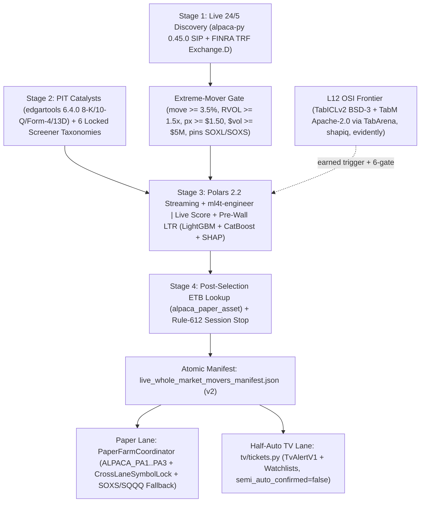

# ADR-0014: Whole-Market 24/5 Extreme-Mover Scanning, Catalyst Filtering & Cross-Sectional Potential Ranking

- **Status:** Accepted
- **Date:** 2026-11-26
- **Evidence Grade:** E4
- **Sole Source of Truth:** SOTA upstream convergence per Core Trading Philosophy

## Context and Problem Statement

Core Trading Philosophy (`PHILOSOPHY_COMPOUNDING_MANIFEST.json`) mandates focusing capital and scarce broker API rate budgets strictly on the **highest-potential extreme movers early** across all 24/5 US equity sessions (`PRE_MARKET`, `RTH`, `AFTER_HOURS`, `OVERNIGHT`) while aligning direction with causal multi-feed market regime (`SPY`, `QQQ`, `SOXX`, `RSP`, `VIX`) and protecting every order with exact `Decimal` Rule-612 stops (`<= 2.00%`). Operational rate ceilings are tight (`200 rpm` per Alpaca Paper lane across `ALPACA_PA1..PA3` and `3,000 rpm` on IBKR Paper `IBKR_DU_4002`, each reserving `>= 10%` capacity strictly for protective exits via `src/tier0_sota/risk.py`).

Static mega-cap watchlists burn API budget on sleepy, low-RVOL tickers (`LOW_MOVE_NOT_EXTREME`, `LOW_RVOL_NOT_EXTREME`), miss Day 1 institutional catalyst revaluations (SEC Form 8-K, earnings/guidance shocks, M&A, FDA approvals, activist 13D filings, and Form 4 insider clusters), and cannot rank cross-sectional opportunity across hundreds of dynamic symbols. Conversely, live execution requires sub-second deterministic scanning (`src/tier0_sota/live/scanner.py`) emitting `tier0.whole-market-movers.v2` manifests for both the 4-account Paper Farm (`src/tier0_sota/live/paper_farm.py`) and TradingView half-auto tickets (`src/tier0_sota/tv/tickets.py`), while pre-wall research (`<= 2026-10-15`, `t_ns + 60s`, `XNYS`) requires streaming columnar feature engineering, listwise Learning-to-Rank (LTR) models, interaction-aware Shapley explainability, covariate-drift telemetry, and SPDX-OSI-screened tabular foundation benchmarks. This ADR specializes [ADR-0008](ADR-0008.md) for the full 24/5 scanning, catalyst, and cross-sectional ranking stack, building on [ADR-0003](ADR-0003.md) and [ADR-0013](ADR-0013.md) and feeding [ADR-0015](ADR-0015.md).

## Decision Drivers

- **Whole-Market 24/5 Extreme-Mover Focus & RPM Stewardship:** Discover dynamic gainers, losers, and high-volume leaders across US equities via typed `alpaca-py` SIP screener, minute bars, and FINRA TRF (`Exchange.D`) off-exchange volume share, keeping minimal default bidirectional pins (`SOXL`, `SOXS`) and filtering out flat large-caps.
- **Causal PIT Catalyst & Setup-Taxonomy Discipline:** Ground catalyst filtering in point-in-time SEC EDGAR filings (`edgartools`, `accepted_ns <= as_of_ns`) and six SHA-256-locked `tradermonty/claude-trading-skills` screening taxonomies (Stockbee EP, Momentum Burst, Exhaustion Hammer, Minervini VCP, PEAD, Qullamaggie Parabolic Short) strictly as structured candidate-quality frameworks without unverified auto-execution or non-PIT scrapers.
- **Out-of-Core Streaming Features & Cross-Sectional LTR Ranking:** Compute whole-market features via `Polars` streaming + `ml4t-engineer`, optimize top-K cross-sectional ordering per timestamp/session via listwise `LightGBM` (`lambdarank`/`rank_xendcg`) and `CatBoost` (`YetiRank`/`QuerySoftMax`) rather than noisy pointwise return regressions, and audit attribution via `SHAP` plus earned-trigger `shapiq`.
- **Fail-Closed Short Borrow, Rule 201 SSR & Session-Aware Risk Binding:** Enforce post-selection `alpaca_paper_asset` shortable/ETB verification, fail closed to inverse ETF hedges (`SOXS`, `SQQQ`, `SPXS`, `SDOW`) whenever borrow is unverified/HTB or during restricted `OVERNIGHT` short windows, bind Rule-612 stops per 24/5 session profile, and enforce `live_execution_enabled = False`, `paper_only = True`, and `semi_auto_confirmed = False`.
- **SPDX OSI License Firewall for L12 Tabular Frontier:** Admit only OSI-approved software **and** model-weight licenses (`MIT`, `Apache-2.0`, `BSD-3-Clause`), explicitly excluding non-commercial or proprietary foundation-model checkpoints from production promotion.

## Considered Options

1. **Static large-cap watchlists + pointwise return regression + ad-hoc retail HTTP screeners** — wastes `200 rpm` Alpaca budgets on flat names, optimizes MSE rather than top-K cross-sectional ordering, risks lookahead contamination from non-PIT endpoints, and omits fail-closed ETB routing.
2. **Monolithic tabular foundation model (`PriorLabs/TabPFN` pre-trained checkpoints) directly on the live scanning path** — although its Python wrapper code is `Apache-2.0`, its v2.5/v3/v3.5 pre-trained model weights carry non-commercial/proprietary Prior Labs weight licenses that fail our SPDX OSI firewall, and synchronous neural inference adds avoidable latency on the live broker path.
3. **Four-stage upstream whole-market scanning, PIT catalyst filtering, cross-sectional LTR & OSI L12 ranking pipeline** — combines typed `alpaca-py` SIP/FINRA TRF live discovery, `EdgarTools` PIT catalysts + 6 locked screener taxonomies, `Polars` 2.2 streaming + `ml4t-engineer` + `LightGBM`/`CatBoost` cross-sectional LTR + `SHAP` (with OSI-clean L12 challengers `TabICLv2`, `TabM`, `TabArena`, `shapiq`, and `evidently`), and fail-closed post-selection ETB + Rule-612 manifest dispatch.

## Decision Outcome

Adopt Option 3 across `src/tier0_sota/live/scanner.py`, `src/tier0_sota/discovery.py`, `src/tier0_sota/tv/tickets.py`, and `src/tier0_sota/live/paper_farm.py`.

- **Stage 1 — Whole-Market 24/5 Live Discovery (`src/tier0_sota/live/scanner.py`):** `ExtremeMoverScanner` queries `ScreenerClient.get_most_actives(top=30, by=MostActivesBy.VOLUME)` and `ScreenerClient.get_market_movers(top=30)` (gainers + losers), merges minimal `DEFAULT_PIN_SYMBOLS = ("SOXL", "SOXS")`, validates ticker syntax (`^[A-Z][A-Z0-9.-]{0,6}$`), and enriches candidates via `StockHistoricalDataClient` using consolidated `DataFeed.SIP` 1-minute bars (6-hour window including `SPY` and `QQQ` regime benchmarks) and SIP trades (4-hour window, up to 25 symbols, limit 2,000) to compute `Exchange.D` off-exchange share (`aggregate_finra_trf_ratios`). Non-pinned symbols failing `abs(session_move_pct) >= 3.5`, `rvol_normalized >= 1.5`, `price >= 1.50`, or `dollar_vol >= 5_000_000.0` are excluded strictly.
- **Stage 2 — Causal Catalyst Filtering & Six-Archetype Setup Taxonomy:** Historical and pre-market catalyst detection routes through `edgartools` (`6.4.0`, `edgartools-mcp` server, strict `accepted_ns <= as_of_ns` for SEC Form 8-K, 10-Q, Form 4 insider clusters, and Schedule 13D/13G). Candidate qualification aligns with six SHA-256-locked `tradermonty/claude-trading-skills` (`MIT`) taxonomies:
  1. `stockbee-episodic-pivot-analyzer`: Day 1 catalyst quality (`EARNINGS_EP`, `GUIDANCE_EP`, `FDA_EP`, `M_AND_A_EP`, `STORY_EP`) separating `ACTIONABLE_DAY1` from `DELAYED_EP_WATCH` and flagging `pead_handoff`.
  2. `stockbee-momentum-burst-screener`: 4% breakout (`close / prev_close >= 1.04`), `$0.90` dollar breakout, and 3-day range expansion with a strict NYSE completed-session freshness gate (`bar_age_sessions == 0`).
  3. `stockbee-exhaustion-hammer-screener`: near-close selling-exhaustion hammer and undercut/reclaim lower-wick geometry in liquid leaders.
  4. `vcp-screener`: Minervini Stage 2 Trend Template + multi-contraction (`T1`/`T2`/`T3`) base tightness (`Pre-breakout`/`Breakout`) with zero-gap price-bar validation (`PriceBarGap` exclusion before ranking).
  5. `pead-screener`: post-earnings weekly red-candle pullback and breakout stages (`MONITORING` -> `SIGNAL_READY` -> `BREAKOUT`), mandating US-equity Mode B handoff over global calendar scans.
  6. `parabolic-short-trade-planner`: Qullamaggie 5-factor blow-off scorer (30/25/20/15/10 weights), Phase 2 Alpaca borrow / SEC Rule 201 SSR / earnings-blackout (`2d` forward) gating, and Phase 3 idempotent 5-minute intraday FSM (`ORL5` break, first-red 5m, `VWAP` fail — causally mirrored in `src/tier0_sota/discovery.py` `step_rth_5m_bar`).
  These vendored skills remain strictly candidate-quality/research specifications; live runtime scanning never executes raw HTTP scripts and uses typed `alpaca-py` + `Polars` + `edgartools` exclusively.
- **Stage 3 — Streaming Columnar Features & Cross-Sectional Potential Ranking:**
  - Live `ExtremeMoverScanner` computes a fast deterministic composite score `abs(mv) * 2.0 + log1p(max(0, rvol)) * 10.0 + darkpool_trf_ratio * 8.0 (+ 20.0 if pinned)` with deterministic `(-score, symbol)` sorting (`top_k = 15`).
  - Offline pre-wall (`<= 2026-10-15`, `t_ns + 60s`, `XNYS`) cross-sectional ranking runs on `Polars` `2.2.0` default streaming `LazyFrame` pipelines and `ml4t-engineer` `0.2.1` (~120 registry features, triple-barrier labeling, train-only `StandardScaler`), training listwise LTR rankers via `LightGBM` `4.7.0` (`lambdarank`, `rank_xendcg`) and `CatBoost` `1.2.10` (`YetiRank`, `QuerySoftMax`) grouped per decision timestamp, with `SHAP` `0.54.1` TreeSHAP feature attribution.
  - Earned-trigger L12 upgrades (`SOTA_STARRED_AND_BEYOND_MANIFEST.json`) admit only OSI-clean candidates: `soda-inria/tabicl` (`TabICLv2`), `yandex-research/tabm` (`TabM`), `autogluon/tabarena` (`TabArena`), `mmschlk/shapiq` (`shapiq`), and `evidentlyai/evidently` (`evidently`).
- **Stage 4 — Post-Selection Borrow Verification, Rule-612 Stop Binding & Multi-Lane Dispatch:** `lookup_alpaca_paper_borrow` verifies `shortable` and `easy_to_borrow` (`AssetBorrowStatus.EASY_TO_BORROW`) strictly post-selection (`<= 10` via `get_asset`; `> 10` via `get_all_assets(ACTIVE)`), defaulting fail-closed to `_UNVERIFIED` (`shortable=False`, `easy_to_borrow=False`, `short_fee_bps=30.0`). Each ranked mover binds its active 24/5 session (`classify_us_equity_session_et`), pooled trailing schedule (`select_pooled_trailing_schedule`), and exact `Decimal` Rule-612 stop (`compute_capped_stop_price` <= `2.00%`) before atomic rename to `Z:\sota-data\manifests\live_whole_market_movers_manifest.json`. Downstream, `PaperFarmCoordinator.dispatch_movers` claims non-overlapping symbols across `ALPACA_PA1..PA3` via `CrossLaneSymbolLock` and `select_short_or_inverse_fallback` (`DIRECT_SHORT_ETB` vs `INVERSE_HEDGE_SOXS`/`INVERSE_HEDGE_SQQQ`, blocking overnight direct shorts), while `tv/tickets.py` validates every staged preset through `TvAlertV1` (Pydantic v2) with `live_execution_enabled = False`, `semi_auto_confirmed = False`, and `qty = 1`.

### Upstream Evidence & Empirical Benchmarks

| Upstream Repository | Version (Status) | SPDX License | Role in Scanning & Ranking Pipeline | Empirical Benchmark / Verification Anchor |
|---|---|---|---|---|
| `alpacahq/alpaca-py` | `0.45.0` (Pinned `uv.lock`) | `Apache-2.0` | `ScreenerClient`, SIP bars/trades, `Exchange.D` TRF, Paper borrow API | `src/tier0_sota/live/scanner.py`, `tests/test_live_automation.py` |
| `pola-rs/polars` | `2.2.0` (Pinned `uv.lock`) | `MIT` | Out-of-core streaming `LazyFrame` engine (default since Polars 2.0, Oct 2026) | `src/tier0_sota/discovery.py`, `ml4t-polars-patterns` skill |
| `ml4t/engineer` | `0.2.1` (Pinned `uv.lock`) | `MIT` | ~120 Polars-native features, `market_regime_classifier`, triple-barrier labels, leak-safe scaler | `src/tier0_sota/discovery.py` (`compute_features`, `StandardScaler`) |
| `dgunning/edgartools` | `6.4.0` (Pinned `uv.lock`) | `MIT` | Fast `lxml`-backed SEC EDGAR parser (8-K, 10-Q, Form 4, 13D/13G) + `edgartools-mcp` | `.mcp.json` (`edgartools`), strict `accepted_ns <= as_of_ns` PIT |
| `microsoft/LightGBM` | `4.7.0` (Pinned `uv.lock`) | `MIT` | Cross-sectional listwise LTR (`lambdarank`, `rank_xendcg` / XE_NDCG) | `pyproject.toml` `[dependency-groups.research]`, Optuna/MLflow LTR |
| `catboost/catboost` | `1.2.10` (Pinned `uv.lock`) | `Apache-2.0` | Oblivious-tree listwise LTR (`YetiRank`, `QuerySoftMax`) + ordered categoricals | `pyproject.toml` `[dependency-groups.research]`, CUDA/CPU parity |
| `shap/shap` | `0.54.1` (Pinned `uv.lock`) | `MIT` | TreeSHAP local & global factor attribution for cross-sectional rankers | `ml4t-shap-analysis` skill, `Caddy` `:8793` tearsheets |
| `tradermonty/claude-trading-skills` | Commit `4080042a` (20 locked skills; 6 screener taxonomies used here) | `MIT` | EP, Momentum Burst, Exhaustion Hammer, VCP, PEAD, Parabolic Short taxonomies | `UPSTREAM_SKILLS_LOCK.json` (`46/46` SHA-256 verified) |
| `soda-inria/tabicl` (`TabICLv2`) | `2.2.0` (L12 Frontier) | `BSD-3-Clause` (code + weights) | Open-weights tabular ICL foundation model (ICML 2026, `arXiv:2602.11139`, Muon + scalable softmax) | Beats tuned GBDTs & RealTabPFN-2.5 out-of-the-box on `TabArena` 51-dataset Elo |
| `yandex-research/tabm` (`TabM`) | `0.0.3` (L12 Frontier) | `Apache-2.0` | Parameter-efficient BatchEnsemble MLP (ICLR 2025) trained on PIT pre-wall data | Closes neural-GBDT gap on tabular benchmarks with zero external weights |
| `autogluon/tabarena` (`TabArena`) | `0.1.0` (L12 Frontier) | `Apache-2.0` | Living 51-dataset Elo/gap benchmark harness (`TabArena-v0.1`, `BeyondArena`) | Standardized model-family comparison before L5 6-gate falsification |
| `mmschlk/shapiq` | `1.8.0` (L12 Frontier) | `MIT` | Exact & PolySHAP-approximated `k`-SII / TreeSHAP-IQ interaction attribution | Audits catalyst x RVOL x TRF pairwise/higher-order interactions |
| `evidentlyai/evidently` | `0.7.23` (L12 Frontier) | `Apache-2.0` | PSI, Wasserstein (Earth Mover's Distance), and Jensen-Shannon drift monitors | Detects covariate shift between pre-wall reference and live scanner features |
| `PriorLabs/TabPFN` | `6.0.6` (Blocked for Prod Weights) | Code `Apache-2.0`; **Weights Non-Commercial** | Evaluated under SPDX firewall only; v2.5/v3/v3.5 checkpoints fail OSI weight requirement | **Not admitted** for production weights; superseded by OSI-clean `TabICLv2` (`BSD-3-Clause`) |

- **Empirical Local Pipeline Verification (`2026-11-26T04:37:31Z`):** Live Disk-Z manifest `Z:\sota-data\manifests\live_whole_market_movers_manifest.json` (`tier0.whole-market-movers.v2`, `feed_sources: ["alpaca_sip", "finra_trf_exchange_d"]`, `macro_regime: {"regime": 1, "spy_session_pct": 0.537}`) ranked `4` extreme/pinned symbols with all `21` schema fields (`darkpool_trf_ratio`, `shortable`, `easy_to_borrow`, `borrow_source`, `short_fee_bps`, `initial_stop_px`), and `tv/tickets.py` emitted `4/4` `TvAlertV1`-validated `OVERNIGHT` `STOP_LIMIT` (`50 bps` collar) presets (`NRSN` `+60.0%` / `2.37x` RVOL, `SOXL`, `SOXS`, `SNXX` `+6.8%` / `1.57x` RVOL) with `upstream_unadmitted_feed_count = 0`, `live_execution_enabled = false`, `semi_auto_confirmed = false`, `qty = 1`, and fail-closed `DIRECT_SHORT_ETB` (`SOXL`) vs `INVERSE_HEDGE_SOXS_SQQQ` (`NRSN`, `SOXS`, `SNXX`).

### Self-Invention Lesson Learned & Mechanical Upstream Gate

- **Lesson Learned:** Earlier ad-hoc scanner prototypes relied on raw HTTP polling (`requests`/`httpx`/`aiohttp`), unofficial retail quote endpoints, static mega-cap lists, and unchecked short eligibility—causing `200 rpm` Paper throttling, HTB short rejections, non-PIT lookahead contamination, and schema drift between Paper Farm and TradingView watchlists. Similarly, inspecting both code **and** model-weight licenses uncovered that `PriorLabs/TabPFN` v2.5/v3/v3.5 checkpoints are non-commercial despite an `Apache-2.0` Python wrapper, proving that SPDX OSI auditing must cover artifacts and weights—not just repository code.
- **Mechanical Upstream Gates:**
  - `rules/zero_self_invention.yml` (`ast-grep`): `no-banned-library-import`, `no-raw-http-broker-polling`, `no-raw-http-socket-in-src`, `no-yahoo-chart-api`, `no-polling-sleep-loop-in-src`, `no-live-broker-endpoint`, and `no-hardcoded-live-execution-true`.
  - Fail-closed credential, feed, and schema guards: `resolve_alpaca_env_creds` refuses `AK*` live key prefixes; `tv/tickets.py` enforces `ADMITTED_FEED_SOURCES`, `refuse_live_endpoints`, and `TvAlertV1` Pydantic v2 validation; `uv.lock` + `deptry .` + `upstream-map.toml` SPDX OSI firewall (`tests/test_architecture_manifest.py`).
  - Automated unit & contract coverage: `tests/test_live_automation.py` (`test_scanner_filters_flat_megacaps_and_enriches_trf_and_borrow`, `test_finra_trf_ratio_aggregation`, `test_paper_farm_non_overlapping_lanes_and_fail_closed_gates`) and `tests/test_tv_automation.py` (`test_tickets_strict_extreme_filter_rungs_and_short_routing`, `test_bridge_live_intake_xnys_and_borrow_gate`).

### Compounding Layer Integration

- **`sim-backtest`:** Streams pre-wall (`<= 2026-10-15`, `t_ns + 60s`, `XNYS`) whole-market features via `Polars` `2.2.0` + `ml4t-engineer` + `EdgarTools` PIT catalysts into `LightGBM` / `CatBoost` cross-sectional LTR training (and earned-trigger `TabICLv2`/`TabM` challengers benchmarked via `TabArena`), logging `Optuna` (`:8080`) trials, `SHAP`/`shapiq` attribution, and independent Long & Short 6-gate falsification dossiers to `MLflow` (`:5000`) and `Caddy` tearsheets (`:8793`).
- **`paper`:** Writes deterministic atomic `Z:\sota-data\manifests\live_whole_market_movers_manifest.json` feeding `PaperFarmCoordinator` across `ALPACA_PA1..PA3` (`L1_ORB_BURST`, `L2_STRUCTURAL_TREND`, `L3_AVWAP_TIGHT_LOCK`) and `IBKR_DU_4002`, persisting per-account fills/markout to isolated `DuckDB` ledgers (`:4213`), `FINOS`/`OpenBB` (`:1420`/`:6900`), and `OTel`/`Prometheus`/`Grafana` (`:9464`/`:9090`/`:3001`), with earned-trigger `evidently` PSI/Wasserstein drift checks against pre-wall references.
- **`half-auto-tv`:** Consumes `live_whole_market_movers_manifest.json` via `src/tier0_sota/tv/tickets.py` to emit `live_half_auto_tickets.json`, `LIVE_HALF_AUTO_ORDER_TICKETS.md`, and `tier0_sota_tv_watchlists_live.txt` (`semi_auto_confirmed = False`, `qty = 1`, zero CDP).
- **`live` & Knowledge Compounding:** Keeps `live_execution_enabled = False` and `paper_only = True` until full Stage-5 cross-leg promotion; indexes verified scanner/ranking lessons into `XERJ` (`:9200`) and hosts this ADR live on `Zensical` (`:8010`).

### Living Evolution & Supersession Policy

- This ADR is a living, evolvable MADR 4.0 engineering decision snapshot governed strictly by **SOTA upstream convergence per Core Trading Philosophy** (`PHILOSOPHY_COMPOUNDING_MANIFEST.json`) — never frozen dogma or capped in count.
- **Evolution & Supersession Triggers:**
  1. Promote learned cross-sectional LTR rankers (`LightGBM`, `CatBoost`, or OSI-clean L12 challengers `TabICLv2`/`TabM`) into `ExtremeMoverScanner` live scoring only after passing independent Long & Short 6-gate falsification ([ADR-0006](ADR-0006.md), [ADR-0016](ADR-0016.md)) and temporal OOS validation with verified OSI-approved code **and** model weights.
  2. Activate earned-trigger `evidently` drift gates and `shapiq` interaction diagnostics automatically once multi-week Paper Farm feature distributions accumulate or feature-drift PSI breaches alert thresholds.
  3. Upgrade Stage 1 whole-market ingestion to `23x5` consolidated SIP and L2/L3 microstructure feeds ([ADR-0013](ADR-0013.md)) upon exchange cutover and earned triggers, and evolve setup taxonomies as locked upstream skills update.
  4. Amend in place for pinned version upgrades or supersede (`Superseded by ADR-XXXX`) when a superior verified OSI upstream better realizes the Core Trading Philosophy; `src/tier0_sota/risk.py` (`SHA-256: ad8071dcd4196c4c529c02107114ebfdda6692bc9d7c220031f1b19ea3e4d847`), fail-closed live broker port isolation (`4001`, `7496`, `8798`, `8796`, `api.alpaca.markets`), and `live_execution_enabled = False` remain non-negotiable mechanical guardrails.
