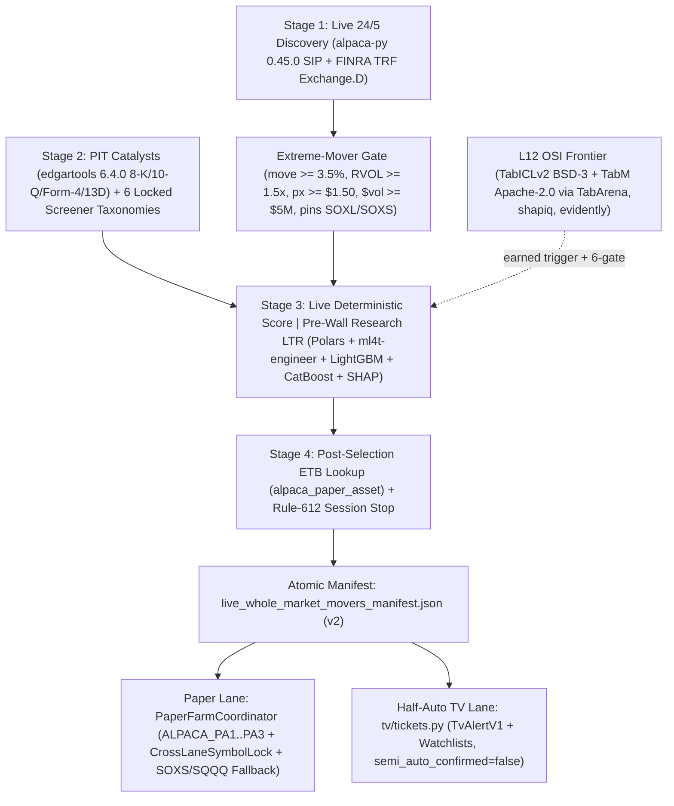

# ADR-0014: Whole-Market 24/5 Extreme-Mover Scanning, Catalyst Filtering & Cross-Sectional Potential Ranking

## Context and Problem Statement

Core Trading Philosophy (`PHILOSOPHY_COMPOUNDING_MANIFEST.json`) mandates focusing capital and scarce broker API rate budgets strictly on the **highest-potential extreme movers early** across all 24/5 US equity sessions (`PRE_MARKET`, `RTH`, `AFTER_HOURS`, `OVERNIGHT`) while aligning direction with causal multi-feed market regime (`SPY`, `QQQ`, `SOXX`, `RSP`, `VIX`) and protecting every order with exact `Decimal` Rule-612 stops (`<= 2.00%`). Operational rate ceilings are tight (`200 rpm` per Alpaca Paper lane across `ALPACA_PA1..PA3` and `3,000 rpm` on IBKR Paper `IBKR_DU_4002`, each reserving `>= 10%` capacity strictly for protective exits via `src/tier0_sota/risk.py`).

Static mega-cap watchlists burn API budget on sleepy, low-RVOL tickers (`LOW_MOVE_NOT_EXTREME`, `LOW_RVOL_NOT_EXTREME`), miss Day 1 institutional catalyst revaluations (SEC Form 8-K, earnings/guidance shocks, M&A, FDA approvals, activist 13D filings, Form 4 insider clusters), and cannot rank cross-sectional opportunity across hundreds of dynamic symbols. Together with [ADR-0015](ADR-0015.md), this ADR **supersedes [ADR-0008](ADR-0008.md) (Superseded)**, taking sole ownership of whole-market 24/5 scanning, PIT catalyst filtering, cross-sectional ranking, and post-selection borrow dispatch, while building on [ADR-0003](ADR-0003.md) and [ADR-0013](ADR-0013.md) and feeding [ADR-0015](ADR-0015.md).

## Decision Drivers

- **Whole-Market 24/5 Extreme-Mover Focus & RPM Stewardship:** Discover dynamic gainers, losers, and high-volume leaders via typed `alpaca-py` SIP screener, minute bars, and FINRA TRF (`Exchange.D`) off-exchange volume share, keeping minimal bidirectional pins (`SOXL`, `SOXS`) and filtering out flat large-caps.
- **Causal PIT Catalyst & Setup-Taxonomy Discipline:** Ground offline catalyst filtering in point-in-time SEC EDGAR filings (`edgartools`, `accepted_ns <= as_of_ns`) and six SHA-256-locked `tradermonty/claude-trading-skills` screening taxonomies without unverified auto-execution or non-PIT scrapers.
- **Honest Separation of Live Deterministic Ranking vs Pre-Wall Research LTR:** Run sub-second deterministic composite ranking in `src/tier0_sota/live/scanner.py` today while developing pre-wall `Polars` streaming + `ml4t-engineer` + listwise `LightGBM`/`CatBoost` LTR + `SHAP` (locked in `[dependency-groups.research]`, 0 live `src/` imports until 6-gate falsified).
- **Fail-Closed Short Borrow, Rule 201 SSR & Session-Aware Risk Binding:** Enforce post-selection `alpaca_paper_asset` shortable/ETB verification, fail closed to inverse ETF hedges (`SOXS`, `SQQQ`, `SPXS`, `SDOW`) whenever borrow is unverified/HTB or during restricted `OVERNIGHT` short windows, bind Rule-612 stops per 24/5 session, and keep `live_execution_enabled = False`, `paper_only = True`, and `semi_auto_confirmed = False`.
- **SPDX OSI License Firewall for `L12` Tabular Frontier:** Admit only OSI-approved software **and** model-weight licenses (`MIT`, `Apache-2.0`, `BSD-3-Clause`), explicitly blocking non-commercial foundation-model weights (`PriorLabs/TabPFN` v2.5/v3 excluded under `spdx_license_firewall`).

## Considered Options

1. **Static large-cap watchlists + pointwise return regression + ad-hoc retail HTTP screeners** — wastes `200 rpm` Alpaca budgets on flat names, optimizes MSE rather than top-K cross-sectional ordering, risks non-PIT lookahead contamination, and omits fail-closed ETB routing.
2. **Monolithic tabular foundation model with non-commercial weights (`PriorLabs/TabPFN`) on the live scanning path** — violates the Tier-0 SPDX OSI firewall (v2.5/v3 pre-trained weights are non-commercial despite an `Apache-2.0` wrapper) and adds neural latency to the live path.
3. **Four-stage upstream whole-market scanning, PIT catalyst filtering, cross-sectional LTR & OSI `L12` ranking pipeline (chosen)** — combines typed `alpaca-py` SIP/FINRA TRF live discovery, `EdgarTools` PIT catalysts + 6 locked screener taxonomies, deterministic live scoring paired with pre-wall `Polars` 2.2 + `ml4t-engineer` + `LightGBM`/`CatBoost` LTR + `SHAP` (and OSI-clean `L12` challengers `TabICLv2`, `TabM`, `TabArena`, `shapiq`, `evidently`), and fail-closed post-selection ETB + Rule-612 manifest dispatch.

## Decision Outcome

Adopt Option 3 across `src/tier0_sota/live/scanner.py`, `src/tier0_sota/discovery.py`, `src/tier0_sota/tv/tickets.py`, and `src/tier0_sota/live/paper_farm.py` (superseding [ADR-0008](ADR-0008.md) (Superseded) alongside [ADR-0015](ADR-0015.md)).

- **Stage 1 — Whole-Market 24/5 Live Discovery (`src/tier0_sota/live/scanner.py`):** `ExtremeMoverScanner` queries `ScreenerClient.get_most_actives(top=30, by=MostActivesBy.VOLUME)` and `ScreenerClient.get_market_movers(top=30)` (gainers + losers), merges `DEFAULT_PIN_SYMBOLS = ("SOXL", "SOXS")`, validates ticker syntax (`^[A-Z][A-Z0-9.-]{0,6}$`), and enriches candidates via `StockHistoricalDataClient` using consolidated `DataFeed.SIP` 1-minute bars (6h including `SPY`/`QQQ`) and SIP trades (4h, up to 25 symbols, limit 2,000) to compute `Exchange.D` off-exchange share (`aggregate_finra_trf_ratios`). Non-pinned symbols failing `abs(session_move_pct) >= 3.5`, `rvol_normalized >= 1.5`, `price >= 1.50`, or `dollar_vol >= 5_000_000.0` are strictly excluded.
- **Stage 2 — Causal Catalyst Filtering & Six-Archetype Setup Taxonomy:** Historical and pre-market catalyst detection routes through `edgartools` (`6.4.0`, `edgartools-mcp` server, strict `accepted_ns <= as_of_ns` for SEC Form 8-K, 10-Q, Form 4, and Schedule 13D/13G). Candidate qualification aligns with six SHA-256-locked `tradermonty/claude-trading-skills` (`MIT`) taxonomies (`stockbee-episodic-pivot-analyzer`, `stockbee-momentum-burst-screener`, `stockbee-exhaustion-hammer-screener`, `vcp-screener`, `pead-screener`, and `parabolic-short-trade-planner` — causally mirrored in `discovery.py` `step_rth_5m_bar`). Vendored skills remain strictly candidate-quality/research specifications; live runtime scanning executes zero raw HTTP scripts.
- **Stage 3 — Live Deterministic Score vs Offline Pre-Wall Cross-Sectional LTR:**
  - **Implemented Live (`scanner.py`):** Fast deterministic composite score `abs(mv) * 2.0 + log1p(max(0, rvol)) * 10.0 + darkpool_trf_ratio * 8.0 (+ 20.0 if pinned)` with deterministic `(-score, symbol)` sorting (`top_k = 15`).
  - **Research-Only Pre-Wall (`<= 2026-10-15`, `[dependency-groups.research]`, 0 `src/` imports today):** Out-of-core `Polars` `2.2.0` + `ml4t-engineer` `0.2.1` pipelines training listwise LTR rankers (`LightGBM` `4.7.0` `lambdarank`/`rank_xendcg` and `CatBoost` `1.2.10` `YetiRank`/`QuerySoftMax`) with `SHAP` `0.54.1` TreeSHAP attribution. Promotion into `scanner.py` requires independent Long & Short 6-gate falsification ([ADR-0016](ADR-0016.md)).
  - **Earned-Trigger `L12` Frontier (`SOTA_STARRED_AND_BEYOND_MANIFEST.json`):** OSI-only candidates `soda-inria/tabicl` (`TabICLv2`, `BSD-3-Clause` code + weights), `yandex-research/tabm` (`TabM`, `Apache-2.0`), `autogluon/tabarena` (`TabArena`, `Apache-2.0`), `mmschlk/shapiq` (`MIT`), and `evidentlyai/evidently` (`Apache-2.0`). `PriorLabs/TabPFN` is permanently blocked under `spdx_license_firewall` due to non-commercial model weights.
- **Stage 4 — Post-Selection Borrow Verification, Rule-612 Stop Binding & Multi-Lane Dispatch:** `lookup_alpaca_paper_borrow` verifies `shortable` and `easy_to_borrow` strictly post-selection, failing closed to `_UNVERIFIED` (`shortable=False`, `easy_to_borrow=False`, `short_fee_bps=30.0`). Each ranked mover binds its active 24/5 session, pooled trailing schedule, and exact `Decimal` Rule-612 stop (`<= 2.00%`) before atomic rename to `Z:\sota-data\manifests\live_whole_market_movers_manifest.json`, feeding `PaperFarmCoordinator` (`CrossLaneSymbolLock`, `DIRECT_SHORT_ETB` vs `INVERSE_HEDGE_SOXS`/`INVERSE_HEDGE_SQQQ`) and `tv/tickets.py` (`TvAlertV1`, `live_execution_enabled = False`, `semi_auto_confirmed = False`, `qty = 1`).

### Confirmation

Confirmed mechanically via:

- `tests/test_live_automation.py::test_scanner_filters_flat_megacaps_and_enriches_trf_and_borrow`, `test_finra_trf_ratio_aggregation`, & `test_paper_farm_non_overlapping_lanes_and_fail_closed_gates`
- `tests/test_tv_automation.py::test_tickets_strict_extreme_filter_rungs_and_short_routing` & `test_bridge_live_intake_xnys_and_borrow_gate`
- `rules/zero_self_invention.yml` (`no-banned-library-import`, `no-raw-http-broker-polling`, `no-raw-http-socket-in-src`, `no-yahoo-chart-api`, `no-polling-sleep-loop-in-src`, `no-live-broker-endpoint`, `no-hardcoded-live-execution-true`)
- `evals/tier0_inspect_eval.py::live_refusal` & `zero_banned_libs`, `just scan`, and `just ast`

## Consequences

- **Positive:** Focuses paper and TV capacity on extreme movers with SEC PIT catalyst taxonomies, `Polars` streaming + research LTR ranking readiness, and SPDX-OSI screening that blocked non-commercial `TabPFN` weights.
- **Negative:** Live scanner ranking stays on the deterministic composite formula (and LTR/EdgarTools catalyst joins have zero unit tests in `tests/` yet) until an offline LTR or OSI `L12` (`TabICLv2`/`TabM`) challenger clears independent Long & Short 6-gate falsification ([ADR-0016](ADR-0016.md)).

## Pros and Cons of the Options

### Option 1: Static watchlists + pointwise regression + retail HTTP scrapers

- Good, because static ticker lists need no screener integration.
- Bad, because it exhausts `200 rpm` budgets on low-volatility names, introduces lookahead bias, and omits ETB verification.

### Option 2: Monolithic non-commercial tabular foundation model (`TabPFN`) on live path

- Good, because zero-shot tabular inference is fast to prototype.
- Bad, because non-commercial model weights fail the SPDX OSI firewall and neural inference adds avoidable latency on the live broker path.

### Option 3: Four-stage upstream SIP/TRF scanner + PIT catalysts + offline LTR/OSI `L12` + fail-closed ETB dispatch

- Good, because live scanning stays sub-second, deterministic, and fail-closed while offline LTR and OSI-clean `TabICLv2`/`TabM` challengers compete strictly under 6-gate falsification.
- Bad, because learned ranker promotion requires full pre-wall feature/catalyst test suites before replacing the live heuristic score.

## More Information

### Upstream Evidence & Empirical Benchmarks

| Upstream Repository | Version (Status) | SPDX License | Role in Scanning & Ranking Pipeline | Verification Anchor |
|---|---|---|---|---|
| `alpacahq/alpaca-py` | `0.45.0` (`uv.lock`, Active) | `Apache-2.0` | `ScreenerClient`, SIP bars/trades, `Exchange.D` TRF, Paper borrow API | `src/tier0_sota/live/scanner.py`, `tests/test_live_automation.py` |
| `pola-rs/polars` | `2.2.0` (`uv.lock`, Active) | `MIT` | Out-of-core streaming `LazyFrame` engine | `src/tier0_sota/discovery.py` |
| `ml4t/engineer` | `0.2.1` (`uv.lock`, Active) | `MIT` | ~120 Polars-native features, regime classifier, leak-safe scaler | `src/tier0_sota/discovery.py` |
| `dgunning/edgartools` | `6.4.0` (`uv.lock`, MCP Active) | `MIT` | Fast `lxml`-backed SEC EDGAR parser + `edgartools-mcp` (`accepted_ns <= as_of_ns`) | `.mcp.json` (`edgartools`) |
| `microsoft/LightGBM` | `4.7.0` (`uv.lock`, `[research]`) | `MIT` | Offline pre-wall cross-sectional LTR (`lambdarank`, `rank_xendcg`) | `pyproject.toml` `[dependency-groups.research]` |
| `catboost/catboost` | `1.2.10` (`uv.lock`, `[research]`) | `Apache-2.0` | Offline pre-wall oblivious-tree LTR (`YetiRank`, `QuerySoftMax`) | `pyproject.toml` `[dependency-groups.research]` |
| `shap/shap` | `0.54.1` (`uv.lock`, `[research]`) | `MIT` | Offline TreeSHAP attribution for cross-sectional rankers | `ml4t-shap-analysis` skill, `Caddy` `:8793` |
| `tradermonty/claude-trading-skills` | Commit `4080042a` (6 screener skills locked) | `MIT` | EP, Momentum Burst, Exhaustion Hammer, VCP, PEAD, Parabolic Short taxonomies | `UPSTREAM_SKILLS_LOCK.json` (`46/46`) |
| `soda-inria/tabicl` (`TabICLv2`) | `L12` Frontier (Watch) | `BSD-3-Clause` (code + weights) | Open-weights tabular ICL challenger superseding firewall-blocked `TabPFN` | `SOTA_STARRED_AND_BEYOND_MANIFEST.json` |
| `yandex-research/tabm` (`TabM`) | `L12` Frontier (Watch) | `Apache-2.0` | Parameter-efficient BatchEnsemble MLP trained on PIT pre-wall data | `SOTA_STARRED_AND_BEYOND_MANIFEST.json` |
| `autogluon/tabarena` (`TabArena`) | `L12` Frontier (Watch) | `Apache-2.0` | Standardized tabular benchmark harness before L5 falsification | `SOTA_STARRED_AND_BEYOND_MANIFEST.json` |
| `mmschlk/shapiq` | `L12` Frontier (Watch) | `MIT` | Exact & PolySHAP `k`-SII interaction attribution | `SOTA_STARRED_AND_BEYOND_MANIFEST.json` |
| `evidentlyai/evidently` | `L12` Frontier (Watch) | `Apache-2.0` | PSI, Wasserstein, and JS covariate-drift monitors | `SOTA_STARRED_AND_BEYOND_MANIFEST.json` |

- **Empirical Local Pipeline Verification (`2026-11-26T04:37:31Z`):** `Z:\sota-data\manifests\live_whole_market_movers_manifest.json` (`tier0.whole-market-movers.v2`, `feed_sources: ["alpaca_sip", "finra_trf_exchange_d"]`, `macro_regime: {"regime": 1, "spy_session_pct": 0.537}`) ranked `4` extreme/pinned symbols with all `21` schema fields, and `tv/tickets.py` emitted `4/4` `TvAlertV1`-validated `OVERNIGHT` `STOP_LIMIT` (`50 bps` collar) presets with `upstream_unadmitted_feed_count = 0`, `live_execution_enabled = false`, `semi_auto_confirmed = false`, `qty = 1`, and fail-closed `DIRECT_SHORT_ETB` vs `INVERSE_HEDGE_SOXS_SQQQ` routing.

### Self-Invention Lesson Learned & Mechanical Upstream Gate

- **Lesson Learned:** Earlier ad-hoc scanner prototypes used raw HTTP polling (`requests`/`httpx`/`aiohttp`), static mega-cap lists, and unchecked short eligibility, exhausting `200 rpm` quotas and risking HTB rejections. Auditing model-weight licenses also proved that SPDX OSI enforcement must inspect both code **and** pre-trained weights (blocking `PriorLabs/TabPFN` under `spdx_license_firewall`).
- **Mechanical Upstream Gates:** `rules/zero_self_invention.yml`, `resolve_alpaca_env_creds` (`AK*` refusal), `tv/tickets.py` (`ADMITTED_FEED_SOURCES`, `refuse_live_endpoints`, `TvAlertV1`), `tests/test_live_automation.py`, `tests/test_tv_automation.py`, and `tests/test_architecture_manifest.py` (`spdx_license_firewall`).

### Compounding Layer Integration

- **`sim-backtest`:** Pre-wall whole-market features + `EdgarTools` PIT catalysts train offline LTR / OSI `L12` challengers logged to `Optuna` (`:8080`) and `MLflow` (`:5000`) under [ADR-0016](ADR-0016.md).
- **`paper` & `half-auto-tv`:** Atomic `live_whole_market_movers_manifest.json` drives `PaperFarmCoordinator` ([ADR-0009](ADR-0009.md)) and `tv/tickets.py` ([ADR-0010](ADR-0010.md), [ADR-0021](ADR-0021.md)).
- **`live`:** Remains `live_execution_enabled = False` and `paper_only = True` under [ADR-0020](ADR-0020.md).

### Living Evolution & Supersession Policy

- Supersedes the scanning/ranking/borrow-routing scope of [ADR-0008](ADR-0008.md) (Superseded) and is itself a living MADR 4.0 snapshot governed by [ADR-0024](ADR-0024.md). Promote learned cross-sectional LTR or OSI `L12` (`TabICLv2`/`TabM`) rankers into live scoring only after independent Long & Short 6-gate falsification ([ADR-0016](ADR-0016.md)) with verified OSI code **and** weights, preserving `risk.py`, live broker port isolation, and `live_execution_enabled = False` until Stage-5 promotion ([ADR-0020](ADR-0020.md)).
