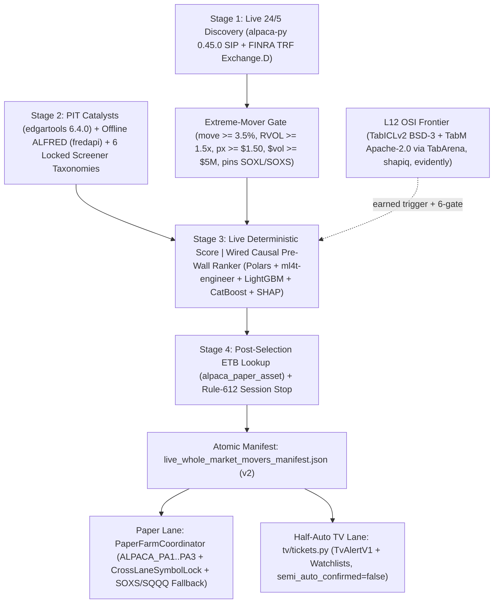

# ADR-0014: Whole-Market 24/5 Extreme-Mover Scanning, Catalyst Filtering & Cross-Sectional Potential Ranking

## Context and Problem Statement

Core Trading Philosophy (`PHILOSOPHY_COMPOUNDING_MANIFEST.json`) mandates focusing capital and scarce broker API rate budgets strictly on the **highest-potential extreme movers early** across all 24/5 US equity sessions (`PRE_MARKET`, `RTH`, `AFTER_HOURS`, `OVERNIGHT`) while aligning direction with causal multi-feed market regime (`SPY`, `QQQ`, `SOXX`, `RSP`, `VIX`) and protecting every order with exact `Decimal` Rule-612 stops (`<= 2.00%`). Operational rate ceilings are tight (`200 rpm` per Alpaca Paper lane across `ALPACA_PA1..PA3` and `3,000 rpm` on IBKR Paper `IBKR_DU_4002`, each reserving `>= 10%` capacity strictly for protective exits via `src/tier0_sota/risk.py`).

Together with [ADR-0015](ADR-0015.md), this ADR **supersedes [ADR-0008](ADR-0008.md) (Superseded)**, taking sole ownership of whole-market 24/5 scanning, PIT catalyst filtering, causal `LightGBM`/`CatBoost`/`SHAP` + offline-first `fredapi` ALFRED discovery (`src/tier0_sota/discovery.py`), and post-selection borrow dispatch, while building on [ADR-0003](ADR-0003.md), [ADR-0013](ADR-0013.md), and [ADR-0025](ADR-0025.md) and feeding [ADR-0015](ADR-0015.md).

## Decision Drivers

- **Whole-Market 24/5 Extreme-Mover Focus & RPM Stewardship:** Discover dynamic gainers, losers, and high-volume leaders via typed `alpaca-py` SIP screener, minute bars, and FINRA TRF (`Exchange.D`) off-exchange volume share, keeping minimal bidirectional pins (`SOXL`, `SOXS`) and filtering out flat large-caps.
- **Causal PIT Catalyst, Macro Vintage & Setup-Taxonomy Discipline:** Ground catalyst and macro filtering in point-in-time SEC EDGAR filings (`edgartools`, `accepted_ns <= as_of_ns`), offline-first ALFRED/FRED vintages (`load_causal_fred_vintages` in `discovery.py`), and six SHA-256-locked `tradermonty/claude-trading-skills` screening taxonomies.
- **Zero-Shelf-Ware Causal GBDT Ranking + Live Deterministic Stability:** Keep sub-second deterministic scoring on `src/tier0_sota/live/scanner.py` while integrating genuine causal pre-wall (`[:split]`, `<= 2026-10-15`, zero lookahead) `LightGBM` + `CatBoost` + `SHAP` (`TreeExplainer`) ranking via `fit_causal_gbdt_ranker_with_shap(...)` in `src/tier0_sota/discovery.py` (tested offline, 0 paper winners).
- **Fail-Closed Short Borrow, Rule 201 SSR & Session-Aware Risk Binding:** Enforce post-selection `alpaca_paper_asset` shortable/ETB verification, fail closed to inverse ETF hedges (`SOXS`, `SQQQ`, `SPXS`, `SDOW`) whenever borrow is unverified/HTB or during restricted `OVERNIGHT` short windows, bind Rule-612 stops per 24/5 session, and keep `live_execution_enabled = False`, `paper_only = True`, and `semi_auto_confirmed = False`.
- **SPDX OSI License Firewall for `L12` Tabular Frontier:** Admit only OSI-approved software **and** model-weight licenses (`MIT`, `Apache-2.0`, `BSD-3-Clause`), explicitly blocking `PriorLabs/TabPFN` non-commercial weights under `spdx_license_firewall`.

## Considered Options

1. **Static large-cap watchlists + pointwise return regression + ad-hoc retail HTTP screeners** — wastes `200 rpm` Alpaca budgets on flat names, optimizes MSE rather than top-K cross-sectional ordering, risks non-PIT lookahead contamination, and omits fail-closed ETB routing.
2. **Monolithic tabular foundation model with non-commercial weights (`PriorLabs/TabPFN`) on the live scanning path** — violates the Tier-0 SPDX OSI firewall and adds neural latency to the live path.
3. **Four-stage upstream whole-market scanning, PIT catalyst/macro filtering, wired causal `LightGBM`/`CatBoost`/`SHAP` discovery + OSI `L12` ranking pipeline (chosen)**.

## Decision Outcome

Adopt Option 3 across `src/tier0_sota/live/scanner.py`, `src/tier0_sota/discovery.py`, `src/tier0_sota/tv/tickets.py`, and `src/tier0_sota/live/paper_farm.py` (superseding [ADR-0008](ADR-0008.md) (Superseded) alongside [ADR-0015](ADR-0015.md)).

- **Stage 1 — Whole-Market 24/5 Live Discovery (`src/tier0_sota/live/scanner.py`):** `ExtremeMoverScanner` queries `ScreenerClient.get_most_actives(top=30, by=MostActivesBy.VOLUME)` and `ScreenerClient.get_market_movers(top=30)`, merges `DEFAULT_PIN_SYMBOLS = ("SOXL", "SOXS")`, validates ticker syntax, and enriches via `DataFeed.SIP` 1-minute bars (6h) and trades (4h, `Exchange.D` off-exchange share via `aggregate_finra_trf_ratios`), filtering strictly on `abs(session_move_pct) >= 3.5`, `rvol_normalized >= 1.5`, `price >= 1.50`, and `dollar_vol >= 5_000_000.0`.
- **Stage 2 — Causal Catalyst, Macro Vintage & Setup Taxonomy:** SEC EDGAR catalyst lookup via `edgartools` (`6.4.0`, `edgartools-mcp`, `accepted_ns <= as_of_ns`), offline-first ALFRED/FRED macro vintages via `load_causal_fred_vintages(...)` (`fredapi.Fred`, `vintage_date <= cutoff_ns` in `discovery.py`), and six SHA-256-locked `tradermonty/claude-trading-skills` (`MIT`) taxonomies (`stockbee-episodic-pivot-analyzer`, `stockbee-momentum-burst-screener`, `stockbee-exhaustion-hammer-screener`, `vcp-screener`, `pead-screener`, `parabolic-short-trade-planner`).
- **Stage 3 — Live Deterministic Score & Wired Causal Pre-Wall GBDT+SHAP Discovery:**
  - **Live Path (`scanner.py`):** Fast deterministic composite score `abs(mv) * 2.0 + log1p(max(0, rvol)) * 10.0 + darkpool_trf_ratio * 8.0 (+ 20.0 if pinned)` (`top_k = 15`).
  - **Wired Causal ML Path (`discovery.py`):** `fit_causal_gbdt_ranker_with_shap(...)` fits `LightGBM` (`4.7.0`) and `CatBoost` (`1.2.10`) strictly on pre-wall `[:split]` causal slices (`<= 2026-10-15`) with `SHAP` (`0.54.1` `TreeExplainer`) feature attribution — eliminating `L2` paper winners while gating live scanner promotion strictly behind independent `LONG`/`SHORT` 6-gate falsification ([ADR-0016](ADR-0016.md)).
  - **Earned-Trigger `L12` Frontier (`SOTA_STARRED_AND_BEYOND_MANIFEST.json`):** OSI-clean `soda-inria/tabicl` (`TabICLv2`, `BSD-3-Clause` code+weights), `yandex-research/tabm` (`TabM`), `autogluon/tabarena` (`TabArena`), `mmschlk/shapiq`, and `evidentlyai/evidently` (`PriorLabs/TabPFN` permanently excluded under `spdx_license_firewall`).
- **Stage 4 — Post-Selection Borrow Verification, Rule-612 Stop Binding & Multi-Lane Dispatch:** `lookup_alpaca_paper_borrow` verifies ETB strictly post-selection (failing closed to `_UNVERIFIED`), binds 24/5 session + exact `Decimal` Rule-612 stop (`<= 2.00%`), and atomically writes `live_whole_market_movers_manifest.json` feeding `PaperFarmCoordinator` ([ADR-0009](ADR-0009.md)) and `tv/tickets.py` (`TvAlertV1`, `semi_auto_confirmed = False`, `qty = 1`, [ADR-0010](ADR-0010.md)).

### Confirmation

Confirmed mechanically via:

- `tests/test_live_automation.py::test_scanner_filters_flat_megacaps_and_enriches_trf_and_borrow`, `test_finra_trf_ratio_aggregation`, & `test_paper_farm_non_overlapping_lanes_and_fail_closed_gates`
- `tests/test_tv_automation.py::test_tickets_strict_extreme_filter_rungs_and_short_routing` & `test_bridge_live_intake_xnys_and_borrow_gate`
- `tests/test_formal_and_evals.py::test_skfolio_clarabel_portfolio_optimization_and_causal_ml_discovery` (verifies `fit_causal_gbdt_ranker_with_shap` with `LightGBM`/`CatBoost`/`SHAP` and offline-first `load_causal_fred_vintages`)
- `rules/zero_self_invention.yml` (`no-banned-library-import`, `no-raw-http-broker-polling`, `no-raw-http-socket-in-src`, `no-yahoo-chart-api`, `no-polling-sleep-loop-in-src`, `no-live-broker-endpoint`, `no-hardcoded-live-execution-true`)
- `evals/tier0_inspect_eval.py::live_refusal` & `zero_banned_libs`, `just scan`, and `just ast`

## Consequences

- **Positive:** Focuses paper and TV capacity on extreme movers with SEC PIT catalysts, genuinely wired causal `LightGBM`/`CatBoost`/`SHAP` + offline-first `fredapi` ALFRED discovery (zero L2 paper winners), and SPDX-OSI screening blocking non-commercial `TabPFN` weights.
- **Negative:** Live scanner ranking stays on the deterministic composite formula until a learned causal GBDT or OSI `L12` (`TabICLv2`/`TabM`) challenger clears independent `LONG`/`SHORT` 6-gate falsification ([ADR-0016](ADR-0016.md)).

## Pros and Cons of the Options

### Option 1: Static watchlists + pointwise regression + retail HTTP scrapers

- Good, because static ticker lists need no screener integration.
- Bad, because it exhausts `200 rpm` budgets on low-volatility names, introduces lookahead bias, and omits ETB verification.

### Option 2: Monolithic non-commercial tabular foundation model (`TabPFN`) on live path

- Good, because zero-shot tabular inference is fast to prototype.
- Bad, because non-commercial model weights fail the SPDX OSI firewall and neural inference adds avoidable latency on the live broker path.

### Option 3: Four-stage upstream SIP/TRF scanner + PIT catalysts/ALFRED + wired causal GBDT+SHAP / OSI `L12` + fail-closed ETB dispatch

- Good, because live scanning stays sub-second and fail-closed while `LightGBM`/`CatBoost`/`SHAP`/`fredapi` are genuinely wired and tested in `discovery.py` with zero lookahead.
- Bad, because promoting a learned ranker into live dispatch still requires full 6-gate falsification across both legs.

## More Information

### Upstream Evidence & Empirical Benchmarks

| Upstream Repository | Version (Status) | SPDX License | Role in Scanning & Discovery Pipeline | Verification Anchor |
|---|---|---|---|---|
| `alpacahq/alpaca-py` | `0.45.0` (`uv.lock`, Active) | `Apache-2.0` | `ScreenerClient`, SIP bars/trades, `Exchange.D` TRF, Paper borrow API | `src/tier0_sota/live/scanner.py` |
| `pola-rs/polars` | `2.2.0` (`uv.lock`, Active) | `MIT` | Out-of-core streaming `LazyFrame` engine | `src/tier0_sota/discovery.py` |
| `ml4t/engineer` | `0.2.1` (`uv.lock`, Active) | `MIT` | ~120 Polars-native features, regime classifier, leak-safe scaler | `src/tier0_sota/discovery.py` |
| `dgunning/edgartools` | `6.4.0` (`uv.lock`, MCP Active) | `MIT` | Fast SEC EDGAR parser + `edgartools-mcp` (`accepted_ns <= as_of_ns`) | `.mcp.json` (`edgartools`) |
| `mortada/fredapi` | `0.5.2` (`uv.lock`, Wired) | `Apache-2.0` | Offline-first ALFRED/FRED causal macro vintage loader | `src/tier0_sota/discovery.py` (`load_causal_fred_vintages`) |
| `microsoft/LightGBM` | `4.7.0` (`uv.lock`, Wired) | `MIT` | Pre-wall causal cross-sectional GBDT ranker (`[:split]`) | `src/tier0_sota/discovery.py` (`fit_causal_gbdt_ranker_with_shap`) |
| `catboost/catboost` | `1.2.10` (`uv.lock`, Wired) | `Apache-2.0` | Pre-wall causal oblivious-tree GBDT ranker (`[:split]`) | `src/tier0_sota/discovery.py` (`fit_causal_gbdt_ranker_with_shap`) |
| `shap/shap` | `0.54.1` (`uv.lock`, Wired) | `MIT` | Causal `TreeExplainer` feature attribution | `src/tier0_sota/discovery.py` (`fit_causal_gbdt_ranker_with_shap`) |
| `tradermonty/claude-trading-skills` | Commit `4080042a` (6 screener skills locked) | `MIT` | EP, Momentum Burst, Exhaustion Hammer, VCP, PEAD, Parabolic Short taxonomies | `UPSTREAM_SKILLS_LOCK.json` (`46/46`) |
| `soda-inria/tabicl` (`TabICLv2`) | `L12` Frontier (Watch) | `BSD-3-Clause` (code + weights) | Open-weights tabular ICL challenger superseding firewall-blocked `TabPFN` | `SOTA_STARRED_AND_BEYOND_MANIFEST.json` |
| `yandex-research/tabm` (`TabM`) | `L12` Frontier (Watch) | `Apache-2.0` | Parameter-efficient BatchEnsemble MLP trained on PIT pre-wall data | `SOTA_STARRED_AND_BEYOND_MANIFEST.json` |
| `autogluon/tabarena` (`TabArena`) | `L12` Frontier (Watch) | `Apache-2.0` | Standardized tabular benchmark harness before L5 falsification | `SOTA_STARRED_AND_BEYOND_MANIFEST.json` |
| `mmschlk/shapiq` | `L12` Frontier (Watch) | `MIT` | Exact & PolySHAP `k`-SII interaction attribution | `SOTA_STARRED_AND_BEYOND_MANIFEST.json` |
| `evidentlyai/evidently` | `L12` Frontier (Watch) | `Apache-2.0` | PSI, Wasserstein, and JS covariate-drift monitors | `SOTA_STARRED_AND_BEYOND_MANIFEST.json` |

- **Empirical Local Pipeline Verification:** `Z:\sota-data\manifests\live_whole_market_movers_manifest.json` (`tier0.whole-market-movers.v2`) verified `4` ranked symbols with all `21` schema fields and `4/4` `TvAlertV1`-validated `OVERNIGHT` `STOP_LIMIT` presets; `test_skfolio_clarabel_portfolio_optimization_and_causal_ml_discovery` verifies causal `LightGBM`/`CatBoost`/`SHAP` and offline-first `fredapi` ALFRED vintages end to end.

### Self-Invention Lesson Learned & Mechanical Upstream Gate

- **Lesson Learned:** Earlier ad-hoc scanner prototypes used raw HTTP polling, and leaving `LightGBM`/`CatBoost`/`SHAP`/`fredapi` locked without real `src/` imports created paper-winner drift. Wiring `fit_causal_gbdt_ranker_with_shap` and `load_causal_fred_vintages` directly in `discovery.py` with offline causal tests closes the gap cleanly.
- **Mechanical Upstream Gates:** `rules/zero_self_invention.yml`, `resolve_alpaca_env_creds`, `tv/tickets.py`, `tests/test_live_automation.py`, `tests/test_tv_automation.py`, `tests/test_formal_and_evals.py`, and `tests/test_architecture_manifest.py` (`spdx_license_firewall`, `zero_paper_winners_audit`).

### Compounding Layer Integration

- Feeds `sim-backtest` (causal pre-wall GBDT+SHAP & ALFRED discovery logged to `Optuna`/`MLflow`), `paper` ([ADR-0009](ADR-0009.md)), `half-auto-tv` ([ADR-0010](ADR-0010.md), [ADR-0021](ADR-0021.md)), and `live` readiness ([ADR-0020](ADR-0020.md), [ADR-0025](ADR-0025.md)).

### Living Evolution & Supersession Policy

- Supersedes the scanning/ranking/borrow-routing scope of [ADR-0008](ADR-0008.md) (Superseded) and is governed by [ADR-0024](ADR-0024.md) and [ADR-0025](ADR-0025.md). Promote learned rankers or OSI `L12` (`TabICLv2`/`TabM`) challengers into live scoring only after independent `LONG`/`SHORT` 6-gate falsification ([ADR-0016](ADR-0016.md)), preserving `risk.py`, live broker port isolation, and `live_execution_enabled = False` until Stage-5 promotion ([ADR-0020](ADR-0020.md)).
