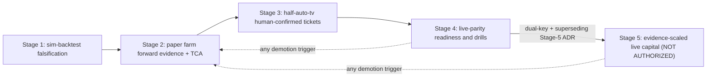

# ADR-0020: Capital Scaling, Stage-1-to-Stage-5 Live Promotion Protocol, Kill-Switch Governance, Operational Compliance & Disaster Recovery

> [!IMPORTANT]
> **Current deployment state is unchanged by this ADR:** `paper_only = True`, `live_execution_enabled = False`, zero live broker ports (`:4001`, `:7496`, `:8798`, `:8796`), zero `api.alpaca.markets` endpoints, dormant `age_live` secret isolation (`fnox.toml`, [ADR-0023](ADR-0023.md)), and `src/tier0_sota/risk.py` byte-identical (SHA-256 `ad8071dcd4196c4c529c02107114ebfdda6692bc9d7c220031f1b19ea3e4d847`). This ADR defines **how** future promotion is governed; it authorizes **no** live order, port, credential, or capital.

## Context and Problem Statement

Earlier ADRs defer real-capital execution to "full Stage-5 promotion" ([ADR-0002](ADR-0002.md), [ADR-0005](ADR-0005.md), [ADR-0007](ADR-0007.md), [ADR-0013](ADR-0013.md), [ADR-0014](ADR-0014.md), [ADR-0015](ADR-0015.md), [ADR-0016](ADR-0016.md)). Without one governing decision record defining the five stages, kill-switch layers, capital ramp, client-side regulatory mirrors (SEC Rule 15c3-5, FINRA Notice 15-09, Reg SHO 201/203, Reg NMS Rule 612, FINRA Rule 4210, MiFID II RTS 6), and fail-closed restart reconciliation, five failure modes remain open: ambiguous promotion criteria, step-function capital risk, kill-switch ambiguity, compliance drift, and disaster-recovery blind spots.

## Decision Drivers

- **Preserve immutable guardrails:** `src/tier0_sota/risk.py` ([ADR-0005](ADR-0005.md)), fail-closed live port isolation, dormant `age_live` key isolation ([ADR-0023](ADR-0023.md)), and `live_execution_enabled = False` until a superseding Stage-5 ADR is accepted.
- **Evidence-gated, staged promotion:** Every stage requires mechanical entry evidence from pinned upstreams (`NautilusTrader v2`, Rust `hftbacktest`, `skfolio` `8/3` CPCV `21` OOS paths `>= 16` / `cpcv_min_samples = 48`, `ml4t-diagnostic`, `arch`, `statsmodels`, `z3-solver`, `inspect-ai`, `MLflow`, `DuckDB`) plus reconciled TCA ([ADR-0019](ADR-0019.md)), evaluated independently per `LONG` and `SHORT` leg.
- **One key to stop, two keys to start:** Any automated trigger or single human operator can halt; resuming or promoting requires both Key A (mechanical CI/preflight evidence) and Key B (human `CODEOWNERS` sign-off). Agents/LLMs never hold Key B (`no-llm-on-execution-hot-path`).
- **Fail-closed recovery:** On restart, broker position reports are authoritative; missing reports never imply flat; any unreconciled difference keeps the engine `HALTED`.
- **SPDX OSI only:** Every cited component carries a verified OSI license (`nautilus-trader` `LGPL-3.0-only`, `hftbacktest` `MIT`, `alpaca-py` `Apache-2.0`, `z3-solver` `MIT`, `inspect-ai` `MIT`, `mlflow` `Apache-2.0`, `duckdb` `MIT`, `dagster` `Apache-2.0`, `prometheus-client` `Apache-2.0 AND BSD-2-Clause`, `grafana` `AGPL-3.0-only`).

## Considered Options

1. **Direct paper-to-live switch on a favorable backtest or paper streak, with ad-hoc manual stops** — creates step-function capital risk with zero formal drills or reconciliation.
2. **Custom in-house promotion service, bespoke kill-switch daemon, and hand-written reconciliation scripts** — violates Zero Self-Invention and duplicates upstream `NautilusTrader` `RiskEngine` and execution reconciliation.
3. **Upstream-anchored five-stage promotion protocol with dual-key human-in-the-loop sign-off, layered K1–K5 kill-switch map over existing upstream controls, evidence-scaled Stage-5 capital ramp, client-side Rule 15c3-5 / RTS 6 mirrors, and fail-closed three-way reconciliation (chosen)**.

## Decision Outcome

Adopt **Option 3**. Stages 1–3 are active today, Stage 4 is readiness-gated, and Stage 5 is **not authorized** by this ADR.

### 1. Stage-1-to-Stage-5 Live Promotion Protocol

| Stage | Lane & Status | Entry Evidence (all mechanical, per leg `LONG` and `SHORT`) | Exit / Demotion Triggers |
|---|---|---|---|
| **Stage 1 — Simulation Falsification** | `sim-backtest`; active, ungated | Pre-wall (`<= 2026-10-15`) `NautilusTrader v2` + `hftbacktest` L1 markout; all 6 gates of [ADR-0016](ADR-0016.md) (`8/3` CPCV `21` OOS paths `>= 16`, `cpcv_min_samples = 48`, Gate 1 `min_l1_fills = 16`); `Z3` `5/5` `UNSAT`; MLflow run recorded | Any gate fails or post-wall data leaks |
| **Stage 2 — Paper Farm Forward Evidence** | `paper`; active, ungated | Stage-1 dossier + forward sessions on `ALPACA_PA1..PA3` & `IBKR_DU_4002` ([ADR-0009](ADR-0009.md)) across > 1 regime state; realized paper slippage & markout reconciled within `2x` cost ([ADR-0019](ADR-0019.md)); zero defect-driven `DailyDrawdownBreaker` trips; `DuckDB` reconciles to broker | Realized cost breaches Stage-1 assumptions; any unreconciled ledger delta |
| **Stage 3 — Half-Auto Human-Confirmed** | `half-auto-tv`; active, paper only | Stage-2 evidence + `TvAlertV1` tickets confirmed by a human (`semi_auto_confirmed = False` on staged payloads, [ADR-0010](ADR-0010.md)); override/rejection rates logged | Schema rejects or unexplained overrides |
| **Stage 4 — Live-Parity Readiness & Drills** | `live`; `stage5_promotion_readiness_gated`, `paper_only = True` | `Sim == Paper` parity witnesses from `NautilusTrader` `LiveNode` ([ADR-0016](ADR-0016.md)); `scripts/preflight_resume.{ps1,sh}` `13/13` PASS; `evals/tier0_inspect_eval.py` **7/7** PASS; automated K1–K5 kill-switch drills and Section 4 DR drill | Any drill, preflight gate, or reconciliation check fails |
| **Stage 5 — Evidence-Scaled Live Capital** | `live`; **NOT AUTHORIZED** | All Stage-4 evidence + Section 3 dual-key sign-off recorded in a **new superseding Stage-5 ADR** naming strategy, leg, venue, and starting capital tier (plus out-of-band `age_live` provisioning per [ADR-0023](ADR-0023.md)) | Any demotion trigger returns strategy to Stage 2 |

**Capital scaling inside Stage 5 (reference pattern pinned only by a future Stage-5 ADR):** micro-live (single-digit percentage of target capacity, single account) -> fractional scale -> target allocation, advancing only after verified live-vs-paper parity with zero critical incidents. Per-trade sizing always flows through `risk.py` `size_position_by_risk` (`<= 2.00%` stop cap, `-1.50%` fuse).

### 2. Layered Kill-Switch Governance (One Key to Stop)

| Layer | Upstream Mechanism | Trigger | Effect |
|---|---|---|---|
| **K1 — Strategy** | Progressive profit-lock tiers, `flatten_first_climax_reverse`, `reentry_cooldown_secs = 60` ([ADR-0007](ADR-0007.md)) | Per-position adverse excursion or climax | Flattens or tightens single position |
| **K2 — Immutable Kernel** | `risk.py` `DailyDrawdownBreaker` (`-1.50%` latch), `ProtectiveExitRateBudget` (`>= 10%`), `compute_capped_stop_price` (`<= 2.00%`) ([ADR-0005](ADR-0005.md)) | Session drawdown or rate exhaustion | Blocks new entries for rest of session; exits preserve capacity (`Z3` `UNSAT`) |
| **K3 — Engine** | `NautilusTrader` `RiskEngine` `TradingState` (`ACTIVE`/`REDUCING`/`HALTED`), `max_order_submit_rate`, `max_notional_per_order` | K2 trip -> `REDUCING`; reconciliation mismatch, `risk.py` digest mismatch, or failed `Z3` -> `HALTED` | `REDUCING` permits reduce-only/cancels; `HALTED` denies all submissions (`OrderDenied`) |
| **K4 — Broker / Account** | `alpaca-py` `cancel_orders()` / `close_all_positions(cancel_orders=True)`; Nautilus IB cancel-all; carrying broker Rule 15c3-5 controls | Operator panic or K3 `HALTED` with open exposure | Cancels resting orders and flattens at venue |
| **K5 — Host & Secret Boundary** | `preflight_resume` `live_broker_ports_zero`, `ast-grep` `no-live-broker-endpoint` / `no-hardcoded-live-execution-true`, absent `~/.config/fnox/live-age.txt` ([ADR-0023](ADR-0023.md)), systemd stop, broker key revocation | Unexpected live port, endpoint, or credential | Severs market access entirely |

- **Authority & Re-Arm:** Any automated trigger or single operator may engage K1–K5 immediately. Re-arming requires (a) verified incident lesson in `XERJ` (`tier0-compounding-lessons`) + MLflow run, (b) green Stage-4 drills covering the failed layer, and (c) dual-key sign-off. The kernel intraday latch never resets manually.

### 3. Dual-Key Human-in-the-Loop Sign-Off

- **Key A — Mechanical evidence:** `just check`, `just adr-check`, `just z3` (`5/5` `UNSAT`), `evals/tier0_inspect_eval.py` **7/7**, per-leg 6-gate MLflow dossier, `preflight_resume` `13/13`, `gitleaks`, `zizmor`, `trivy`, and clean three-way reconciliation.
- **Key B — Human accountability:** Named human operator approves the superseding Stage-5 ADR via a `CODEOWNERS`-protected PR after a cooling-off period. Read-only agent roles (`paper-gatekeeper.md`, `permissionMode: plan`) may prepare advisory dossiers only. Scope is strictly one strategy, one leg, one venue, one capital tier at a time.

### 4. Operational Compliance & Disaster Recovery

- **Client-side mirror of SEC Rule 15c3-5 & MiFID II RTS 6:** Capital thresholds via `size_position_by_risk`, erroneous-order collars (`35`/`50 bps` + `max_notional_per_order`), rate limits (`ProtectiveExitRateBudget` + `max_order_submit_rate`), restricted lists (extreme-mover exclusions + HTB inverse routing, [ADR-0014](ADR-0014.md), [ADR-0015](ADR-0015.md)), and `CODEOWNERS` direct control.
- **Short-sale, pricing & margin rules:** Reg SHO locate/ETB verification (`DIRECT_SHORT_ETB`) + Rule 201 SSR awareness; Reg NMS Rule 612 inside `risk.py`; FINRA Rule 4210 checked at Stage-5 ADR review.
- **Books and records:** Event-sourced `NautilusTrader` cache, per-account `DuckDB` ledgers under `Z:\sota-data\manifests`, `MLflow` runs, `Inspect` `.eval` logs, and git-tracked programmatic manifests synchronized by `scripts/sync_manifest.py` (note: manifests are synchronized via `sync_manifest.py` and git/atomic disk snapshots; `.dvc` files are not used for live manifests today).
- **Broker-side protection & fail-closed restart reconciliation:** Every open position carries a resting broker-side protective stop surviving host outages. On restart (`just resume`, [ADR-0017](ADR-0017.md)), upstream `NautilusTrader` execution reconciliation treats broker reports as authoritative (missing report != flat), followed by three-way broker/engine/DuckDB comparison; any discrepancy holds the engine in `HALTED`.

### Confirmation

Confirmed mechanically today for K2, K3, K4, K5, Stage-4 automated disaster-recovery reconciliation drills, Key A, and safety invariants via:

- `tests/test_architecture_manifest.py::test_risk_kernel_sha256_exact` & `test_philosophy_and_llm_harness_manifests`
- `tests/test_formal_and_evals.py::test_z3_formal_risk_invariants_unsat` & `test_inspect_ai_safety_suite_and_task` (`7/7` invariants)
- `tests/test_grand_reset_kit.py::test_preflight_resume_kit_scripts_and_playbook`
- `tests/test_stage4_drills.py` & `just stage4-drills` (`scripts/run_stage4_drills.py` -> `stage4_drills_receipt.json`, `3/3` **PASS**: K3 `NautilusTrader v2` `RiskEngine` `TradingState` `ACTIVE -> REDUCING -> HALTED` + `-1.50%` latched `DailyDrawdownBreaker`; K4 broker flatten across `ALPACA_PA1..PA3` + `IBKR_DU_4002` with `>= 10%` exit reserve & durable DuckDB audit; 3-way restart reconciliation clean parity, external half-auto Rule-612 auto-adoption, and fail-closed `HALTED` on missing report or discrepancy)
- `rules/zero_self_invention.yml` (`no-live-broker-endpoint`, `no-hardcoded-live-execution-true`, `no-risk-engine-bypass`, `no-llm-on-execution-hot-path`)
- `evals/formal_risk_z3.py` (`just z3`), `just preflight`, and `just check`

*(Stage-4 automated K3/K4/3-way drills are **PASS** in paper-only sandbox mode; **Stage 5 remains explicitly NOT AUTHORIZED** (`paper_only = True`, `live_execution_enabled = False`, `stage5_live_authorized = False`) pending per-leg 6-gate statistical alpha clearance and a Key B human `CODEOWNERS`-approved superseding Stage-5 ADR.)*

## Consequences

- **Positive:** Establishes unambiguous Stage-1-to-Stage-5 gates, K1–K5 kill-switch escalation, dual-key human sign-off, dormant `age_live` credential isolation, and fail-closed three-way restart reconciliation without touching `risk.py` or authorizing live orders.
- **Negative:** Requires implementing automated Stage-4 K3/K4/DR drill tests and completing a `CODEOWNERS`-reviewed superseding Stage-5 ADR before any real capital can be deployed.

## Pros and Cons of the Options

### Option 1: Direct paper-to-live switch with manual stops

- Good, because there is no promotion bureaucracy.
- Bad, because step-function capital jumps and unverified kill switches risk catastrophic runaway losses.

### Option 2: Bespoke promotion service and custom kill-switch daemon

- Good, because custom rules can be scripted arbitrarily.
- Bad, because it violates Zero Self-Invention and duplicates upstream `NautilusTrader` `RiskEngine` and broker controls.

### Option 3: Upstream-anchored 5-stage protocol + K1–K5 map + dual-key sign-off + 3-way reconciliation

- Good, because it introduces zero custom runtime code, reuses `risk.py` / `NautilusTrader` / `alpaca-py` / `fnox`, and enforces human accountability before any live capital.
- Bad, because Stage-4 drill automation must be built and passed before Stage 5 can ever be proposed.

## More Information

### Upstream Evidence & Empirical Benchmarks

- **Regulatory & upstream references:** SEC Rule 15c3-5, FINRA Regulatory Notice 15-09, MiFID II RTS 6 (Delegated Regulation (EU) 2017/589); `NautilusTrader` `RiskEngine` (`TradingState` `ACTIVE`/`REDUCING`/`HALTED`) and execution reconciliation; `alpaca-py` `close_all_positions(cancel_orders=True)`.
- **Empirical workstation receipts (`2026-11-26`–`2026-11-28`):** `evals/formal_risk_z3.py` -> `Z3_FORMAL_RISK_PROOFS_UNSAT_OK=1` (`5/5` `UNSAT`); `evals/tier0_inspect_eval.py` **7/7** invariants `PASS` (`live_refusal`, `zero_banned_libs`, `zero_custom_hooks`, `risk_sha256`, `zero_arbitrary_loc_caps_and_living_adrs`, `upstream_skills_46_parity`, `adr_graph_and_clean_sota_harness_integrity`); `just stage4-drills` -> `STAGE4_DRILLS_OK=1` (`3/3` **PASS**: K3 `NautilusTrader v2` `RiskEngine` `TradingState` `ACTIVE -> REDUCING -> HALTED`, K4 broker flatten across `ALPACA_PA1..PA3` + `IBKR_DU_4002` with durable DuckDB audit, 3-way restart reconciliation clean parity + external half-auto Rule-612 auto-adoption + fail-closed `HALTED` on missing broker report / qty mismatch; receipt persisted at `/mnt/z/sota-data/manifests/stage4_drills_receipt.json`); `src/tier0_sota/risk.py` SHA-256 exact; `PHILOSOPHY_COMPOUNDING_MANIFEST.json` `live` lane -> `paper_only: true`, `live_execution_enabled: false`, `forbidden_live_ports: [4001, 7496, 8798, 8796]` (`0` live or CDP `:9223` ports open). **Stage-5 live capital remains NOT AUTHORIZED.**
- **Staged `ADR-0029` Cross-Reference & Live Readiness Blockers (`2026-11-28`):** Staged Three-Tier Live Operations (`ADR-0029` on `ALPACA_LIVE_PRO_LINE_1000`, `1,000 rpm`) is being developed separately in isolated working copy `Z:\noesis-tier-model`; until merged with full gate clearance, `origin/main` strictly enforces `paper_only = True`, `live_execution_enabled = False`, `stage5_live_authorized = False`, and zero live/CDP ports. Multi-runtime Codex + Claude + OMP audits (`2026-11-28`) confirm four active Stage-3/4 readiness blockers: (1) `IBKR_DU_4002` `:4002` handshake remains unverified; (2) `0` completed end-to-end paper round trips / `$0` realized paper P&L; (3) aggregate paper TCA (`390` fills, `10.9233 bps` mean IS) exceeds the `2x` envelope (`parity_within_2x_envelope=false`, though the liquid `>=$10` cohort `6.8675 bps` notional-weighted IS passes); and (4) `0` strategy legs have yet passed all 6 independent falsification gates (`H109` honest `DISCARD`).

### Self-Invention Lesson Learned & Mechanical Upstream Gate

- **Lesson Learned:** Writing a bespoke "promotion service" or custom kill-switch daemon duplicates `risk.py`, `NautilusTrader` `RiskEngine`, and `alpaca-py` while adding unverified code to the order path. Similarly, claiming `dvc` versions live manifests when no `.dvc` files exist creates documentation drift; books-and-records provenance now truthfully cites `sync_manifest.py`, `DuckDB`, `MLflow`, and `Inspect` logs.
- **Mechanical Upstream Gates:** `evals/tier0_inspect_eval.py` (7/7), `evals/formal_risk_z3.py` (5/5 `UNSAT`), `scripts/preflight_resume.{ps1,sh}`, `rules/zero_self_invention.yml`, `.gitleaks.toml`, `.github/CODEOWNERS`, `fnox.toml` (`age_live` isolation), and `just check`.

### Compounding Layer Integration

- Maps Stages 1–5 directly onto the 4 lanes of [ADR-0002](ADR-0002.md): `sim-backtest` -> Stage 1 ([ADR-0016](ADR-0016.md)), `paper` -> Stage 2 ([ADR-0009](ADR-0009.md), [ADR-0019](ADR-0019.md)), `half-auto-tv` -> Stage 3 ([ADR-0010](ADR-0010.md), [ADR-0021](ADR-0021.md)), `live` -> Stages 4–5 ([ADR-0017](ADR-0017.md), [ADR-0018](ADR-0018.md), [ADR-0023](ADR-0023.md)).

### Living Evolution & Supersession Policy

- Governed by [ADR-0024](ADR-0024.md): amend or supersede when remaining `L14`/`L15` candidates (`temporalio/temporal`, `open-policy-agent/opa`; `prometheus/alertmanager` already admitted profile-gated `:9093`) deliver verified gains. **Stage-5 authorization always requires a new superseding ADR carrying the dual-key record; this ADR alone never enables live trading.** Immutable: `src/tier0_sota/risk.py` SHA-256, `<= 2.00%` stop cap, `-1.50%` fuse, closed live ports, and `live_execution_enabled = False` / `paper_only = True`.
