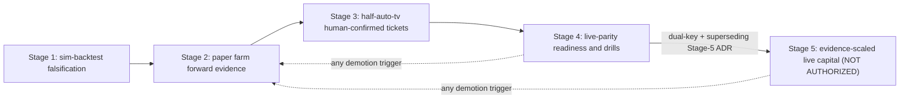

# ADR-0020: Capital Scaling, Stage-1-to-Stage-5 Live Promotion Protocol, Kill-Switch Governance, Operational Compliance & Disaster Recovery

- **Status:** Accepted
- **Date:** 2026-11-26
- **Evidence Grade:** E4
- **Sole Source of Truth:** SOTA upstream convergence per Core Trading Philosophy
- **Related:** [ADR-0002](ADR-0002.md) (Four Compounding Lanes), [ADR-0004](ADR-0004.md) (Single-Engine Parity), [ADR-0005](ADR-0005.md) (Immutable Risk Kernel & Z3), [ADR-0006](ADR-0006.md) (Statistical Falsification), [ADR-0009](ADR-0009.md) (Paper Farm), [ADR-0013](ADR-0013.md) (Data Feeds), [ADR-0016](ADR-0016.md) (Cross-Leg Falsification), [ADR-0017](ADR-0017.md) (Workstation Hosting & Recovery), [ADR-0018](ADR-0018.md) (Agentic Harness & Frontier Governance)

> [!IMPORTANT]
> **Current deployment state is unchanged by this ADR:** `paper_only = True`, `live_execution_enabled = False`, zero live broker ports (`:4001`, `:7496`, `:8798`, `:8796`), zero `api.alpaca.markets` endpoints, and `src/tier0_sota/risk.py` byte-identical (SHA-256 `ad8071dcd4196c4c529c02107114ebfdda6692bc9d7c220031f1b19ea3e4d847`). This ADR defines **how** a future promotion would be governed; it authorizes **no** live order, port, credential, or capital.

## Context and Problem Statement

Earlier ADRs repeatedly defer real-capital execution to "full Stage-5 promotion" ([ADR-0002](ADR-0002.md), [ADR-0005](ADR-0005.md), [ADR-0007](ADR-0007.md), [ADR-0014](ADR-0014.md), [ADR-0015](ADR-0015.md)), and [ADR-0013](ADR-0013.md) explicitly reserves the `live` lane for "a separately governed Stage-5 ADR". No ADR yet defines what the five stages are, what evidence moves a strategy between them, who may engage or re-arm a kill switch, how capital scales once live, or how the engine recovers its true position state after a crash. Without that single governing decision, five failure modes remain open:

1. **Ambiguous promotion criteria:** "Stage-5" is a label without entry/exit evidence, so promotion could be argued from a single favorable backtest or a short paper streak.
2. **Step-function capital risk:** Moving from paper size straight to target size is the classic runaway-algorithm failure (industry reference: the 2012 Knight Capital incident, where an untested deployment path sent unintended orders for roughly 45 minutes without an effective kill switch).
3. **Kill-switch ambiguity:** The kernel already latches a `-1.50%` daily drawdown fuse and reserves `>= 10%` of the broker rate budget for protective exits, but there is no layered map of which control halts what, who may pull it, and who may re-arm it.
4. **Compliance drift:** Market-access controls (SEC Rule 15c3-5), algorithmic-trading supervision (FINRA Regulatory Notice 15-09), short-sale rules (Reg SHO Rules 201/203), minimum pricing increments (Reg NMS Rule 612), and day-trading margin rules (FINRA Rule 4210) must be mirrored client-side before any real order exists.
5. **Disaster-recovery blind spots:** After a host, WSL2, or broker-session failure, the local ledger, the engine cache, and the broker's books can disagree; trading on a stale view of positions turns a recoverable outage into an unprotected exposure.

## Decision Drivers

- **Preserve the immutable guardrails:** `src/tier0_sota/risk.py` (Rule-612 `<= 2.00%` stop cap, latched `-1.50%` fuse, `>= 10%` protective-exit reserve), fail-closed live port isolation, and `live_execution_enabled = False` until a Stage-5 ADR supersedes this clause (per `PHILOSOPHY_COMPOUNDING_MANIFEST.json` `non_negotiable_mechanical_guardrails`).
- **Evidence-gated, staged promotion:** Each stage has mechanical entry evidence produced by existing upstream gates (`NautilusTrader v2`, Rust `hftbacktest`, `skfolio` CPCV with `MIN_CPCV_SAMPLES = 16`, `ml4t-diagnostic`, `arch`, `statsmodels`, `z3-solver`, `inspect-ai`, `MLflow`, `DuckDB`), evaluated independently for the `LONG` and `SHORT` legs.
- **One key to stop, two keys to start:** Any automated trigger or any single operator can halt; resuming or promoting requires both a mechanical-evidence key and a human key. LLMs and agents never hold a key and stay off the execution hot path (`ast-grep` rule `no-llm-on-execution-hot-path`).
- **Mirror regulatory pre-trade controls client-side:** Treat SEC Rule 15c3-5 (credit/capital thresholds, erroneous-order price collars and size limits, restricted lists, direct and exclusive control of thresholds) and MiFID II RTS 6 (Commission Delegated Regulation (EU) 2017/589: pre-deployment testing, kill functionality, annual self-assessment) as the design reference, even though the carrying broker remains the regulated market-access provider.
- **Fail-closed recovery:** On restart the broker's position reports are authoritative, a missing report never means flat, and any unreconciled difference halts trading (upstream `NautilusTrader` execution-reconciliation semantics).
- **SPDX OSI only:** Every component cited is OSI-licensed (`nautilus_trader` `LGPL-3.0-or-later`, `hftbacktest` `MIT`, `alpaca-py` `Apache-2.0`, `z3-solver` `MIT`, `inspect-ai` `MIT`, `mlflow` `Apache-2.0`, `duckdb` `MIT`, `dagster` `Apache-2.0`, `dvc` `Apache-2.0`, `prometheus` `Apache-2.0`, `grafana` `AGPL-3.0-only`); non-OSI source-available licenses are rejected.

## Considered Options

1. **Direct paper-to-live switch on a favorable backtest or paper streak, with ad-hoc manual stops** — no stage evidence, step-function capital risk, single human judgment as the only control, and no recovery protocol. Rejected.
2. **Custom in-house promotion service, bespoke kill-switch daemon, and hand-written reconciliation scripts** — violates Zero Self-Invention, duplicates controls the upstream `NautilusTrader` `RiskEngine` and execution-reconciliation already provide, and creates a new unverified layer between the strategy and `risk.py`. Rejected.
3. **Upstream-anchored five-stage promotion protocol with dual-key human-in-the-loop sign-off, layered kill-switch map over existing upstream controls (`risk.py` + `NautilusTrader` `RiskEngine` `TradingState` + `alpaca-py` broker flatten + host port isolation), evidence-scaled capital ramp inside Stage 5, client-side mirroring of Rule 15c3-5 / RTS 6 controls, and fail-closed three-way ledger/engine/broker reconciliation** — reuses verified upstream mechanisms, keeps the kernel immutable, and keeps the current deployment paper-only. **Chosen.**

## Decision Outcome

Adopt **Option 3**. The five stages map onto the four compounding lanes of [ADR-0002](ADR-0002.md); Stages 1–3 are active today, Stage 4 is readiness-gated, and Stage 5 is **not authorized** by this ADR.

### 1. Stage-1-to-Stage-5 Live Promotion Protocol

| Stage | Lane & Status | Entry Evidence (all mechanical, per leg `LONG` and `SHORT`) | Exit / Demotion Triggers |
|---|---|---|---|
| **Stage 1 — Simulation Falsification** | `sim-backtest`; active, ungated | Pre-wall (`<= 2026-10-15`) `NautilusTrader v2` `BacktestEngine` replay plus Rust `hftbacktest` L1 queue markout; all 6 gates of [ADR-0016](ADR-0016.md) (`1_hftbacktest_l1_markout`, `2_cost_1x_2x_survival`, `3_cpcv_oos_positive`, `4_dsr_pbo_credible`, `5_hansen_spa_significant`, `6_hac_t_stat_significant`) with `MIN_CPCV_SAMPLES = 16`; `Z3` `5/5` `UNSAT`; MLflow run recorded | Any gate fails, or post-wall data leaks into features |
| **Stage 2 — Paper Farm Forward Evidence** | `paper`; active, ungated | Stage-1 dossier plus forward sessions on `ALPACA_PA1..PA3` and `IBKR_DU_4002` ([ADR-0009](ADR-0009.md)) covering more than one causal regime state; realized paper slippage and markout within the Stage-1 cost assumptions (`2x` cost survival); zero `DailyDrawdownBreaker` trips attributable to a defect; isolated `DuckDB` ledgers reconcile to broker paper positions | Paper results fall outside the Stage-1 confidence band; any unreconciled ledger difference |
| **Stage 3 — Half-Auto Human-Confirmed** | `half-auto-tv`; active, paper only | Stage-2 evidence plus `TvAlertV1`-validated tickets confirmed by a human before staging ([ADR-0010](ADR-0010.md)); operator override and rejection rates logged | Ticket schema rejects, unexplained operator overrides |
| **Stage 4 — Live-Parity Readiness & Drills** | `live`; `stage5_promotion_readiness_gated`, still `paper_only = True` | `Sim == Paper` parity witnesses from `NautilusTrader` `LiveNode` against paper/sandbox venues ([ADR-0004](ADR-0004.md)); `scripts/preflight_resume.ps1` all 13 always-on gates PASS (14 with `-CleanLegacyLocked`); `evals/tier0_inspect_eval.py` 6/6 PASS; kill-switch drill at every layer of section 2; disaster-recovery drill of section 4 (kill host mid-session, restart, reconcile, verify broker-side stops survived) | Any drill fails; any preflight gate fails; any reconciliation halt |
| **Stage 5 — Evidence-Scaled Live Capital** | `live`; **NOT AUTHORIZED** | All Stage-4 evidence plus the dual-key sign-off of section 3 recorded in a **new superseding ADR** that names the strategy, leg, venue, and starting capital tier | Any demotion trigger in section 2 returns the strategy to Stage 2 |

**Capital scaling inside Stage 5 (reference pattern, to be pinned only by the future Stage-5 ADR):** industry practice for graduated deployment is micro-live (a small single-digit percentage of target capacity, single account), then fractional scale, then target allocation, advancing only after a clean observation window with live-vs-paper parity and zero critical incidents, and demoting automatically on breach. Per-trade size always flows through `risk.py` `size_position_by_risk` with the unchanged `<= 2.00%` stop cap and `-1.50%` session fuse; a capital tier changes only the account equity the kernel sizes against, never the kernel's limits.

### 2. Layered Kill-Switch Governance (One Key to Stop)

| Layer | Upstream Mechanism | Trigger | Effect |
|---|---|---|---|
| **K1 — Strategy** | Progressive profit-lock tiers (`BE_PLUS_FEE` → `LOCK_AT_3R_OR_CLIMAX`), `flatten_first_climax_reverse`, `reentry_cooldown_secs = 60` | Per-position adverse excursion or climax | Flattens or tightens the single position |
| **K2 — Immutable Kernel** | `risk.py` `DailyDrawdownBreaker` (latched `-1.50%`, realized + unrealized), `ProtectiveExitRateBudget` (`>= 10%` exit reserve), `compute_capped_stop_price` (`<= 2.00%`) | Session drawdown, rate exhaustion | Blocks new entries for the rest of the session; exits always keep reserved capacity (Z3 `drawdown_fuse_latch_150bps`, `exit_reserve_10pct` `UNSAT`) |
| **K3 — Engine** | `NautilusTrader` `RiskEngine` `TradingState` (`ACTIVE` / `REDUCING` / `HALTED`), `max_order_submit_rate`, `max_notional_per_order` | K2 trip → `REDUCING`; reconciliation mismatch, `risk.py` digest mismatch, or non-`UNSAT` proof → `HALTED` | `REDUCING` permits only reduce-only orders and cancels; `HALTED` denies all submissions (`OrderDenied`) |
| **K4 — Broker / Account** | `alpaca-py` `TradingClient.cancel_orders()` and `close_all_positions(cancel_orders=True)`; `NautilusTrader` Interactive Brokers adapter cancel-all; the carrying broker's own Rule 15c3-5 controls | Operator panic action or K3 `HALTED` with open exposure | Cancels resting orders and flattens at the venue |
| **K5 — Host** | `scripts/preflight_resume.ps1` gate `live_broker_ports_zero`, `ast-grep` `no-live-broker-endpoint` / `no-hardcoded-live-execution-true`, systemd service stop, credential revocation at the broker portal | Unexpected live port, endpoint, or credential | Severs market access entirely |

- **Authority:** any automated trigger, and any single named operator, may engage K1–K5 at any time without approval. Engaging a switch is never penalized; disorderly re-toggling is prevented by the re-arm rule below.
- **Re-arm (two keys to start):** a halted strategy resumes only after (a) the root cause is written up as a verified lesson in `XERJ` (`tier0-compounding-lessons`) and an MLflow incident run, (b) the Stage-4 drills that cover the failed layer pass again, and (c) the dual-key sign-off of section 3 is repeated. The kernel's intraday latch is never reset manually; it resets only at the next session by design.

### 3. Dual-Key Human-in-the-Loop Sign-Off

- **Key A — Mechanical evidence:** `just check`, `just z3` (`Z3_FORMAL_RISK_PROOFS_UNSAT_OK=1`), `evals/tier0_inspect_eval.py` 6/6, per-leg 6-gate dossier in MLflow, `scripts/preflight_resume.ps1` 13/13 always-on gates (14/14 with `-CleanLegacyLocked`), `gitleaks`, `zizmor`, `trivy`, and a clean three-way reconciliation. Key A is produced by CI and the local preflight; it can never be overridden by prose.
- **Key B — Human accountability:** a named human operator approves the superseding Stage-5 ADR through a `CODEOWNERS`-protected pull request (the same protection that guards `risk.py`), after a cooling-off period between Key A turning green and the merge. Read-only agent roles (for example `.claude/agents/paper-gatekeeper.md`, `permissionMode: plan`) may prepare an advisory dossier, but no agent or LLM can hold Key B.
- **Scope of a promotion:** one strategy, one leg, one venue, one capital tier at a time. A promotion never flips global defaults; it is a reviewed, reversible, per-strategy decision.

### 4. Operational Compliance & Disaster Recovery

- **Client-side mirror of SEC Rule 15c3-5 controls:** capital threshold = Stage-5 tier equity fed to `size_position_by_risk`; erroneous-order collars = session `limit_collar_bps` (`35` pre/after-hours, `50` overnight) plus `max_notional_per_order`; message-rate control = `ProtectiveExitRateBudget` and `max_order_submit_rate`; restricted list = the extreme-mover exclusions and HTB routing to `INVERSE_HEDGE_SOXS_SQQQ`; direct and exclusive control = thresholds live only in version-controlled, `CODEOWNERS`-protected code.
- **Short-sale, pricing & margin rules:** Reg SHO locate/ETB verification before direct shorts (`DIRECT_SHORT_ETB`, [ADR-0008](ADR-0008.md)) and Rule 201 short-sale-restriction awareness; Reg NMS Rule 612 tick quantization inside `risk.py`; FINRA Rule 4210 day-trading margin requirements, as amended at the time of promotion, checked against the live account type in the Stage-5 ADR.
- **Books and records:** event-sourced `NautilusTrader` cache, per-account `DuckDB` ledgers under `Z:\sota-data\manifests`, MLflow runs, and Inspect `.eval` logs form the immutable audit trail; manifests are versioned with `dvc` and synchronized by `scripts/sync_manifest.py`.
- **Broker-side protection survives the host:** every open position carries a resting broker-side protective stop (`STOP_MARKET` in RTH, `STOP_LIMIT` outside RTH per the session map), so a host, WSL2, or network failure never leaves a position unprotected.
- **Fail-closed restart reconciliation:** on every restart (`just resume`, [ADR-0017](ADR-0017.md)) the engine performs upstream `NautilusTrader` execution reconciliation with broker position reports treated as authoritative; a missing or null report is not treated as flat; then a three-way check compares broker positions (`alpaca-py` `get_all_positions` / IB adapter reports), the engine cache, and the `DuckDB` ledger. Any difference outside tolerance keeps the engine in `HALTED` and pages the operator; strategies never start on an unreconciled book.
- **Recovery objectives:** recovery point = last persisted engine event plus broker reports (no state is reconstructed from memory); recovery time = the `just resume` preflight path. Both are exercised in the Stage-4 drill rather than asserted.

## Consequences

- **Positive:** Establishes unambiguous Stage-1-to-Stage-5 gates, K1–K5 kill-switch escalation, dual-key human sign-off, and fail-closed three-way restart reconciliation without touching `risk.py` or authorizing live orders.
- **Negative:** Adds mandatory Stage-4 kill-switch/DR drills and a `CODEOWNERS`-reviewed superseding ADR requirement before any strategy can reach Stage 5.

### Upstream Evidence & Empirical Benchmarks

- **Regulatory & industry references (2026 search-verified):** SEC Rule 15c3-5 (Market Access Rule) requires documented pre-trade financial controls (credit/capital thresholds, erroneous-order price and size limits), regulatory controls (restricted securities, pre-order requirements), and direct and exclusive control by the broker-dealer, with annual CEO certification; FINRA Regulatory Notice 15-09 sets supervision and control expectations for algorithmic strategies (general risk assessment, software development and testing, change management, kill-switch capability, post-implementation monitoring); MiFID II RTS 6 (Delegated Regulation (EU) 2017/589) mandates pre-deployment testing, kill functionality, and annual self-assessment. These are design references for client-side mirroring; the carrying brokers remain the regulated market-access providers.
- **Upstream engine controls:** `NautilusTrader` `RiskEngine` exposes `TradingState` `ACTIVE`/`REDUCING`/`HALTED`, `max_order_submit_rate`, and `max_notional_per_order`, denying violations with `OrderDenied`; its live execution reconciliation treats venue position reports as authoritative, does not infer flat from a missing report, and fails closed when positions cannot be reconciled. `alpaca-py` `TradingClient.close_all_positions(cancel_orders=True)` cancels open orders before liquidating.
- **Empirical receipts on this workstation (2026-11-26):** `uv run python evals/formal_risk_z3.py` → `Z3_FORMAL_RISK_PROOFS_UNSAT_OK=1` (`5/5` `UNSAT`: `stop_cap_long`, `stop_cap_short`, `stop_cap_integer_ticks`, `exit_reserve_10pct`, `drawdown_fuse_latch_150bps`); `evals/tier0_inspect_eval.py` checks `live_refusal`, `risk_sha256`, and `zero_banned_libs` → `PASS`; `Get-FileHash src/tier0_sota/risk.py` → `AD8071DCD4196C4C529C02107114EBFDDA6692BC9D7C220031F1B19EA3E4D847`; `PHILOSOPHY_COMPOUNDING_MANIFEST.json` `live` lane → `paper_only: true`, `forbidden_live_ports: [4001, 7496, 8798, 8796]`.

### Self-Invention Lesson Learned & Mechanical Upstream Gate

- **Lesson Learned:** The recurring temptation in live-readiness work is to write a bespoke "promotion service", a custom kill-switch daemon, or ad-hoc reconciliation scripts, and to let prose ("promote when it looks good") stand in for evidence. Each would duplicate controls already provided by `risk.py`, the `NautilusTrader` `RiskEngine`, its execution reconciliation, and `alpaca-py`, and would add an unverified layer on the order path. This ADR therefore introduces **no new runtime code**: it binds stages and kill layers to existing upstream mechanisms and existing gates.
- **Mechanical Upstream Gates:** `evals/tier0_inspect_eval.py` (`live_refusal` rejects every live venue profile and every forbidden port; `risk_sha256`), `evals/formal_risk_z3.py` (`5/5` `UNSAT`), `scripts/preflight_resume.ps1` (`live_broker_ports_zero`, `risk_kernel_sha256`, `paper_farm_preflight` asserting `paper_only` and `live_execution_enabled = False`), `rules/zero_self_invention.yml` (`no-live-broker-endpoint`, `no-hardcoded-live-execution-true`, `no-risk-engine-bypass`, `no-llm-on-execution-hot-path`), `.gitleaks.toml` (`tier0-broker-account-id`, `tier0-hardcoded-home-path`), `.github/CODEOWNERS`, and `just check`.

### Compounding Layer Integration

- **`sim-backtest` → Stage 1:** MLflow (`:5000`) and Optuna (`:8080`) runs are the Stage-1 dossier; Caddy tearsheets (`:8793`) render it.
- **`paper` → Stage 2:** `paper_lane_{pa1,pa2,pa3}.duckdb`, `paper_farm_live_performance_manifest.json`, and the Dagster asset `paper_farm_performance_snapshot` supply forward evidence and reconciliation inputs (DuckDB SQL UI `:4213`, FINOS `:1420`, OpenBB `:6900`, Grafana, OTel `:9464`).
- **`half-auto-tv` → Stage 3:** `TvAlertV1` tickets and `staged_tv_presets.json` record human confirmations and overrides.
- **`live` → Stages 4–5:** cross-leg 6-gate promotion dossiers, Z3 attestations, Inspect receipts, and drill results are written by the existing `live` lane outputs; incidents and re-arm write-ups are indexed into `XERJ` (`:9200`) and reviewed by the weekly Orca self-reflection loop ([ADR-0018](ADR-0018.md), [`COMPOUNDING_SELF_REFLECTION_LOOP.md`](../COMPOUNDING_SELF_REFLECTION_LOOP.md)); restart recovery follows [`POST_RESTART_RESUME_PLAYBOOK.md`](../POST_RESTART_RESUME_PLAYBOOK.md).

### Living Evolution & Supersession Policy

- SOTA upstream convergence per our Core Trading Philosophy (`PHILOSOPHY_COMPOUNDING_MANIFEST.json`) is the sole source of truth. This ADR is a living MADR 4.0 decision snapshot (never frozen dogma, never artificially capped in count): amend or supersede it (`Superseded by ADR-XXXX`) when a superior OSI-approved upstream or an earned `L14`/`L15` trigger (for example `prometheus/alertmanager` paging, `temporalio/temporal` durable recovery workflows, or `open-policy-agent/opa` policy-as-code promotion gates) delivers empirically verified gains.
- **Stage-5 authorization requires a new superseding ADR** carrying the dual-key record; this ADR alone can never enable live trading.
- **Immutable across every amendment:** `src/tier0_sota/risk.py` stays byte-identical (`ad8071dcd4196c4c529c02107114ebfdda6692bc9d7c220031f1b19ea3e4d847`), the `<= 2.00%` stop cap and `-1.50%` fuse are never widened, live broker ports (`:4001`, `:7496`, `:8798`, `:8796`) stay closed, and `live_execution_enabled = False` / `paper_only = True` remain in force until a Stage-5 ADR is accepted.
