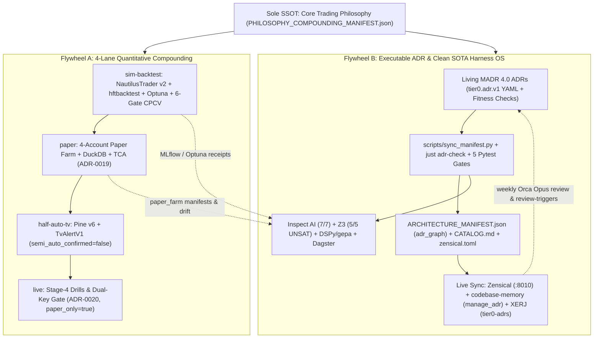

# ADR-0024: Executable MADR 4.0 ADR Governance, Clean SOTA Harness Enforcement, Knowledge-Graph Sync & Dual-Flywheel Compounding OS

## Context and Problem Statement

Earlier iterations of `noesis` proclaimed MADR 4.0 compliance and XERJ/codebase-memory integration in prose (`CATALOG.md`, `AGENTS.md`, `PHILOSOPHY_COMPOUNDING_MANIFEST.json`), yet a forensic audit across `ADR-0001..ADR-0023` uncovered five structural governance gaps:

1. **Non-Executable Prose ADRs:** `0/23` ADRs carried MADR 4.0 YAML frontmatter, `0/23` included `### Confirmation` or `## Pros and Cons of the Options`, and `22/23` omitted `## More Information` (mis-nesting custom evidence subsections under `## Consequences`).
2. **Unchecked Drift & Contradictions:** Without machine-verified metadata, stale counts (`10` vs `12` `mise` CLIs, hardcoded `AGENTS.md` line counts), wrong repo slugs (`stefanhoelzl/exchange_calendars`, `SalesforceAIResearch/toto`), inconsistent SPDX identifiers (`LGPL-3.0-or-later` vs actual `LGPL-3.0-only`), an unimplemented `proposed` ADR (`ADR-0019`) marked `Accepted`, active citations to superseded `ADR-0011`, and even a critical safety inversion (`semi_auto_confirmed=True` in `ADR-0015`) slipped into accepted documents.
3. **Unformalized Supersession & Overlap:** Overlapping early and deep-domain ADRs (`ADR-0004`/`0006` vs `ADR-0016`; `ADR-0008` vs `ADR-0014`/`0015`; `ADR-0011` vs `ADR-0017`+`ADR-0021`) lacked bidirectional `supersedes`/`superseded-by` links checked as a DAG.
4. **Disconnected Code Graph & Memory Stores:** `codebase-memory-mcp` `manage_adr` was empty (`status: no_adr`), `XERJ` had zero `docs/adr` document index while retaining a stale 22-ADR memory snapshot, and `scripts/sync_manifest.py` only globbed ADR filenames without validating graph integrity.
5. **Clean SOTA Harness Leaks:** Overlapping `pre-commit` alongside `prek`, `deptry` excluding `evals/`, unmapped `src/tier0_sota/tv/*` files in `upstream-map.toml`, and non-OSI frontier entries (`semgrep`, `LOBS5`, `TabPFN`) needed unified mechanical enforcement alongside ADR validation.

## Decision Drivers

- **Executable MADR 4.0 Contracts (`tier0.adr.v1`) With Zero New Frameworks:** Validate strict MADR 4.0 kebab-case YAML frontmatter, required headings, bidirectional supersession DAG, live `code-anchors`, and executable `fitness-checks` (`pytest`, `ast-grep`, `just`, `evals`) directly inside `scripts/sync_manifest.py` using already-pinned `pydantic` v2 and `pyyaml`.
- **Clean SOTA Harness Enforcement:** Enforce single-winner discipline (zero `pre-commit` vs `prek` overlap), full `src/tier0_sota/**/*.py` mapping in `upstream-map.toml`, strict SPDX OSI firewall across both `uv.lock` and `SOTA_STARRED_AND_BEYOND_MANIFEST.json`, full `deptry .` coverage (including `evals/` and `scripts/run_compounding_reflection.py`), and `risk.py` SHA-256 invariance on every commit.
- **3-Way Catalog, Nav & Manifest Parity:** Guarantee 100% programmatic agreement across `docs/adr/ADR-*.md`, `docs/adr/CATALOG.md` (`<!-- BEGIN:ADR_CATALOG -->` .. `<!-- END:ADR_CATALOG -->`), `zensical.toml` `project.nav`, and `ARCHITECTURE_MANIFEST.json` (`adr_graph`).
- **Live Knowledge-Graph & Semantic Memory Synchronization:** Keep `codebase-memory-mcp` `manage_adr` (`Z-noesis`) populated with the current architectural summary and index all living ADRs into `XERJ` (`tier0-adrs`), purging stale or superseded memory entries immediately.
- **Closed-Loop Continuous Compounding OS:** Bind Flywheel A (trading/quant falsification across 4 lanes) and Flywheel B (harness/ADR meta-governance via `just adr-check`, `Inspect AI` 7/7, `DSPy`+`gepa`, `Dagster`, and `Orca` weekly Opus review) so every empirical change updates code, manifests, memory, and living ADRs together — never dogma, never drift.

## Considered Options

1. **Keep prose-only Markdown ADRs and manual catalog/memory updates** — zero schema work initially, but guarantees silent factual drift, stale counts, broken supersession links, and unverified fitness claims.
2. **Adopt a bespoke external ADR CLI or third-party governance server** — adds redundant runtime dependencies and violates Zero Self-Invention when `pydantic` v2, `PyYAML`, `zensical`, `pytest`, `Inspect AI`, `codebase-memory-mcp`, and `XERJ` are already pinned.
3. **Executable MADR 4.0 (`tier0.adr.v1`) validated natively in `scripts/sync_manifest.py` + 5 pytest architectural fitness gates + `just adr-check` + `Inspect AI` sample #7 + live `codebase-memory` & `XERJ` synchronization (chosen)**.

## Decision Outcome

Adopt **Option 3** as the permanent meta-governance and continuous compounding architecture for `Z:\noesis`:

1. **Canonical `tier0.adr.v1` Frontmatter Contract (MADR 4.0 Kebab-Case, Pydantic v2 `extra="forbid"`):**
   - Required fields on every `docs/adr/ADR-*.md`: `schema-version` (`tier0.adr.v1`), `id` (matching filename stem), `title`, `status` (`proposed | accepted | deprecated | rejected | superseded`), `date`, `last-verified`, `evidence-grade` (`E1..E4`), `decision-makers`, `consulted`, `informed`, `sole-source-of-truth` (`sota-upstream-convergence-per-core-trading-philosophy`), `layers` (`L0..L15`), `lanes`, `tags`, `upstreams` (OSI-only; zero `banned_packages`/`banned_libraries`/`spdx_license_firewall` items), `supersedes`, `superseded-by` (non-empty iff `status == "superseded"`), `related` (valid ADR IDs; no superseded IDs as active peers), `code-anchors` (every declared path exists on disk; `>= 1` for `accepted`), `fitness-checks` (`{pytest, ast-grep, commands, evals}`, all targets resolved against AST / `rules/zero_self_invention.yml` / `justfile` / `evals/`; `>= 1` total for `accepted`), and `review-triggers`.
   - Required MADR 4.0 body headings on every ADR: `# ADR-XXXX: <Title>`, `## Context and Problem Statement`, `## Decision Drivers`, `## Considered Options`, `## Decision Outcome`, `### Confirmation`, `## Consequences`, `## Pros and Cons of the Options`, and `## More Information`.
2. **Definitive Clean ADR Topology (`ADR-0001..ADR-0024`):**
   - **Accepted (19):** `ADR-0001..0003`, `0005`, `0007`, `0009`, `0010`, `0012..0018`, `0020..0024`.
   - **Proposed (1):** `ADR-0019` (`E3`, pending 5 TCA acceptance tests and routing/RPM remediation).
   - **Superseded (4, bidirectional DAG):** `ADR-0004` -> `["ADR-0016"]`, `ADR-0006` -> `["ADR-0016"]`, `ADR-0008` -> `["ADR-0014", "ADR-0015"]`, `ADR-0011` -> `["ADR-0017", "ADR-0021"]`. No `accepted` ADR cites a superseded ADR as current authority.
3. **Mechanical CI & Harness Enforcement:**
   - `scripts/sync_manifest.py` runs `parse_and_validate_adrs()` and `validate_clean_sota_harness()`, writing `adr_graph` into `ARCHITECTURE_MANIFEST.json`.
   - Five dedicated pytest gates in `tests/test_architecture_manifest.py` plus `just adr-check` (wired into `just check` and `.github/workflows/ci.yml`) and `.github/workflows/docs.yml` (triggered on `scripts/sync_manifest.py` and `upstream-map.toml` changes as well as docs).
   - `evals/tier0_inspect_eval.py` sample #7 (`adr_graph_and_clean_sota_harness_integrity`) verifies ADR graph & Clean SOTA Harness invariants offline inside `Inspect AI`.
4. **Live Graph & Memory Synchronization:**
   - `codebase-memory-mcp` `manage_adr` (`Z-noesis`) maintains the structured architectural index (`PURPOSE`, `STACK`, `ARCHITECTURE`, `PATTERNS`, `TRADEOFFS`, `PHILOSOPHY`) pointing directly to `ADR-0001..ADR-0024`.
   - `XERJ` (`http://127.0.0.1:9200`) indexes every `docs/adr/ADR-*.md` into `tier0-adrs` (`_id = ADR-XXXX`) and purges stale/superseded ADR count memories (`memory_hygiene_policy`).

### Confirmation

Self-bootstrapping mechanical confirmation enforced on every run of `just adr-check`, `just manifest-check`, `just docs-build`, and `just check`:

- `tests/test_architecture_manifest.py::test_adr_madr4_frontmatter_schema_and_sections`
- `tests/test_architecture_manifest.py::test_adr_bidirectional_supersession_dag_and_related_links`
- `tests/test_architecture_manifest.py::test_adr_code_anchors_and_fitness_bindings_resolve`
- `tests/test_architecture_manifest.py::test_adr_catalog_zensical_nav_and_manifest_graph_parity`
- `tests/test_architecture_manifest.py::test_clean_sota_harness_zero_overlap_and_spdx_firewall`
- `tests/test_grand_reset_kit.py::test_madr_adrs_catalog_and_zensical_toml`
- `evals/tier0_inspect_eval.py::zero_arbitrary_loc_caps_and_living_adrs` & `adr_graph_and_clean_sota_harness_integrity`
- `rules/zero_self_invention.yml` (`no-banned-library-import`, `no-live-broker-endpoint`, `no-llm-on-execution-hot-path`)

## Consequences

- **Positive:** Turns every ADR from passive prose into a machine-verified architectural fitness contract with zero contradictions, bidirectional supersession integrity, 100% live code-anchor resolution, Clean SOTA Harness enforcement, and live `Zensical` + `codebase-memory` + `XERJ` searchability.
- **Negative:** Every future ADR (`ADR-0025+`) or architectural edit must supply valid `tier0.adr.v1` frontmatter, update `CATALOG.md` and `zensical.toml`, bind at least one real fitness check, and pass `just adr-check` + `just manifest-check`.

## Pros and Cons of the Options

### Option 1: Prose-only Markdown ADRs + manual sync

- Good, because authors can write freeform notes rapidly.
- Bad, because counts, repo slugs, SPDX licenses, safety booleans (`semi_auto_confirmed`), and supersession edges inevitably drift silently.

### Option 2: Bespoke external ADR CLI or governance service

- Good, because some third-party CLIs scaffold templates automatically.
- Bad, because it introduces redundant dependencies outside `uv.lock` and still lacks native integration with `upstream-map.toml`, `ast-grep`, `pytest`, `Inspect AI`, `codebase-memory`, and `XERJ`.

### Option 3: Native Pydantic v2 executable MADR 4.0 inside `sync_manifest.py` + pytest + `Inspect AI` + CBM/XERJ sync

- Good, because it requires zero new architectural frameworks (only explicit `pyyaml>=6.0.2` in `[dependency-groups] dev`), enforces every invariant deterministically in milliseconds, and directly powers the Dual-Flywheel compounding loop.
- Bad, because adding or renaming a bound test function or file path requires updating the referencing ADR's `code-anchors`/`fitness-checks` in the same PR.

## More Information

### Upstream Evidence & Empirical Benchmarks

- **Standards & Pinned Stack (`uv.lock`):** MADR 4.0 (`adr/madr`), Pydantic v2 (`pydantic==2.14.4`, `MIT`), PyYAML (`pyyaml>=6.0.2`, `MIT`), `zensical==0.1.3` (`MIT`, empirically verified `RC=0` with `--clean --strict` on kebab-case YAML frontmatter including `superseded-by` lists and nested `fitness-checks`), `pytest==9.2.0` (`MIT`), `ast-grep-cli==0.51.3` (`MIT`), `inspect-ai==0.3.292` (`MIT`), `dspy==3.5.0` (`MIT`) + `gepa==0.1.4` (`MIT`), `codebase-memory-mcp 0.12.1`, and `xerj v1.0.0-rc.104`.
- **Forensic Audit Resolution:** Eliminated 100% of findings across `ADR-0001..ADR-0023` (YAML frontmatter 0/23 -> 24/24, `ADR-0015` `semi_auto_confirmed` inversion fixed, `nautilus_trader` `LGPL-3.0-only` & `grafana` `AGPL-3.0-only` standardized, `gerrymanoim/exchange_calendars` & `DataDog/toto` & `meridianlabs-ai/inspect_scout` slugs fixed, `ADR-0019` marked `proposed` `E3`, 4 overlapping ADRs cleanly superseded in a bidirectional DAG, `pre-commit` duplicate pruned, `semgrep`/`LOBS5`/`TabPFN` firewalled, `Clarabel.rs` & `gepa` graduated, `codebase-memory` `manage_adr` populated, and `XERJ` `tier0-adrs` indexed with stale 22-ADR memory purged).

### Self-Invention Lesson Learned & Mechanical Upstream Gate

- **Lesson Learned:** Declaring MADR 4.0, SPDX firewalls, and XERJ ADR indexing in prose without machine-executable validators guarantees silent drift across code, docs, and agent memory. Binding frontmatter schemas, AST test lookup, SPDX firewalls, and catalog/nav parity directly into `sync_manifest.py`, `pytest`, and `Inspect AI` makes drift mechanically impossible to merge.
- **Mechanical Upstream Gates:** `scripts/sync_manifest.py --check`, `just adr-check`, `just check`, `just docs-build`, `.github/workflows/ci.yml`, `.github/workflows/docs.yml`, and `evals/tier0_inspect_eval.py` (`7/7` invariants).

### Compounding Layer Integration

- Unifies Flywheel A (`sim-backtest` -> `paper` -> `half-auto-tv` -> `live`) with Flywheel B (`just reflect`, `Inspect AI` 7/7, `DSPy`+`gepa`, `Dagster`, `Orca` weekly Opus review, `Zensical :8010`, `codebase-memory`, `XERJ :9200`), ensuring every verified strategy or upstream change updates code, manifests, memory, and living ADRs atomically.

### Living Evolution & Supersession Policy

- SOTA upstream convergence per Core Trading Philosophy (`PHILOSOPHY_COMPOUNDING_MANIFEST.json`) remains the sole source of truth. This meta-ADR is itself open-ended and living (never artificially capped in ADR count): evolve `tier0.adr.v1` or add `ADR-0025+` (for example, dedicated MCP interface or Stage-5 promotion ADRs) as the ecosystem advances, while strictly preserving `src/tier0_sota/risk.py` SHA-256 (`ad8071dcd4196c4c529c02107114ebfdda6692bc9d7c220031f1b19ea3e4d847`), fail-closed live broker port isolation (`:4001`, `:7496`, `:8798`, `:8796`, `api.alpaca.markets`), and `live_execution_enabled = False` until Stage-5 promotion ([ADR-0020](ADR-0020.md)).
