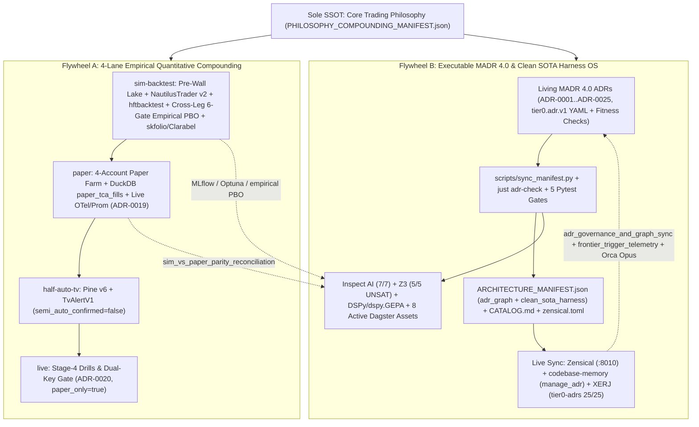

# ADR-0024: Executable MADR 4.0 ADR Governance, Clean SOTA Harness Enforcement, Knowledge-Graph Sync & Dual-Flywheel Compounding OS

## Context and Problem Statement

Prose-only Architecture Decision Records inevitably decay into stale historical essays. An earlier forensic audit across `ADR-0001..ADR-0023` demonstrated this empirically: `0/23` ADRs carried MADR 4.0 YAML frontmatter, `0/23` included `### Confirmation` or `## Pros and Cons of the Options`, `22/23` omitted `## More Information`, unformalized overlaps hid stale counts/SPDX labels/slugs and a critical `semi_auto_confirmed` inversion, `codebase-memory` `manage_adr` was empty, `XERJ` lacked an ADR index, and Flywheel A/B compounding shortcuts (hardcoded `pbo=0.10`, passive Dagster snapshots, unexercised `dspy.GEPA`) weakened empirical feedback.

At the same time, introducing a standalone third-party ADR runtime (`adr-tools` Bash scripts or `log4brains` Node.js SSG) would violate our Zero Self-Invention and single-winner principles when `Pydantic` v2, `PyYAML`, `pytest`, `ast-grep`, `Z3`, `deptry`, `Zensical`, `Inspect AI`, `DSPy`/`gepa`, `Dagster`, `codebase-memory-mcp`, and `XERJ` are already pinned and active.

## Decision Drivers

- **Definitive Zero-Self-Invention ADR Practice Framework:** Ground the ADR practice itself in three mutually reinforcing industry standards — **MADR 4.0** (`https://adr.github.io/madr/`), **ISO/IEC/IEEE 42010:2022** architectural decision provenance, and **Evolutionary Architecture Fitness Functions** (Neal Ford, Rebecca Parsons, Patrick Kua) — executed strictly via existing OSI upstreams with zero bespoke ADR CLIs or overlapping static-site generators.
- **Executable MADR 4.0 Contracts (`tier0.adr.v1`):** Enforce strict kebab-case YAML frontmatter (`extra="forbid"`), all 8 canonical MADR 4.0 headings, bidirectional supersession DAG integrity, live `code-anchors`, and executable `fitness-checks` (`pytest`, `ast-grep`, `just`, `evals`) directly inside `scripts/sync_manifest.py`.
- **Clean SOTA Harness & Zero-Paper-Winner Enforcement:** Enforce single-winner discipline (zero `pre-commit` vs `prek` overlap), 100% `src/tier0_sota/**/*.py` mapping in `upstream-map.toml`, the 7-repo SPDX OSI firewall, full `deptry .` coverage, `zero_paper_winners_audit`, and immutable `risk.py` SHA-256 on every commit (paired with [ADR-0025](ADR-0025.md)).
- **3-Way Catalog, Nav & Manifest Parity + Live Graph/Memory Sync:** Keep `docs/adr/ADR-*.md` <-> `CATALOG.md` <-> `zensical.toml` `project.nav` <-> `ARCHITECTURE_MANIFEST.json` (`adr_graph`) 100% synchronized, mirrored live into `Zensical` (`:8010`), `codebase-memory` (`manage_adr`), and `XERJ` (`tier0-adrs`).
- **Closed-Loop Dual-Flywheel Compounding OS:** Eliminate synthetic shortcuts in Flywheel A (`--mode lake|offline`, real cross-leg `LONG`/`SHORT` empirical PBO, zero hardcoded `pbo=0.10`, `skfolio`+`Clarabel.rs`) and Flywheel B (`Inspect AI` 7/7, quantitative `DSPy`+`dspy.GEPA`, 8 active `Dagster` assets including `adr_governance_and_graph_sync`, `sim_vs_paper_parity_reconciliation`, and `frontier_trigger_telemetry`).

## Considered Options

1. **Keep prose-only Markdown ADRs and manual catalog/memory updates** — zero upfront schema work, but guarantees silent factual drift, stale counts, broken supersession links, and unverified fitness claims.
2. **Adopt standalone third-party ADR tooling (`adr-tools` Bash scripts or `log4brains` Node.js SSG)** — adds redundant Bash/Node.js toolchains overlapping `Zensical`, lacks Python AST/pytest/`ast-grep`/`Z3`/`Inspect AI` integration, and violates single-winner discipline.
3. **Executable MADR 4.0 (`tier0.adr.v1`) grounded in MADR 4.0 + ISO/IEC/IEEE 42010 + Evolutionary Fitness Functions, validated natively in `scripts/sync_manifest.py` + 5 pytest architectural gates + `just adr-check` + `Inspect AI` 7/7 + active 8-asset `Dagster` + live `codebase-memory` & `XERJ` sync (chosen)**.

## Decision Outcome

Adopt **Option 3** as the permanent ADR governance and continuous compounding OS for `Z:\noesis` (complementing [ADR-0025](ADR-0025.md) for research convergence practices and typed MCP tooling):

### Why This ADR Practice Framework Is Definitive Zero-Self-Invention SOTA

| Architectural Governance Pillar | Authoritative Standard / Literature | Realized Exclusively via Pinned OSI Upstreams (Zero Bespoke Runtimes) | Explicitly Rejected Overlap |
|---|---|---|---|
| **Decision Record Structure** | **MADR 4.0** (`adr.github.io/madr`) | Strict kebab-case YAML frontmatter + 8 canonical sections rendered by `Zensical` (`--strict`) | `adr-tools` (Bash scaffold bloat), `log4brains` (Node.js SSG overlapping `Zensical`) |
| **Decision Provenance & Traceability** | **ISO/IEC/IEEE 42010:2022** (rationale, stakeholders, concerns, lifecycles) | `decision-makers`, `consulted`, `informed`, `evidence-grade` (`E1..E4`), `last-verified`, `review-triggers`, bidirectional `supersedes`/`superseded-by` DAG validated by `Pydantic v2` + `PyYAML` | Freeform Wiki pages or unvalidated prose bullets |
| **Continuous Architectural Compliance** | **Evolutionary Architecture Fitness Functions** (Ford, Parsons, Kua) | Every `accepted` ADR binds live `code-anchors` and executable `fitness-checks` (`pytest` AST-resolved node IDs, `ast-grep` rule IDs, `just` recipes, `Z3`/`Inspect AI` checks) enforced in CI + `Dagster` `adr_governance_and_graph_sync` | Passive prose "Verification" sections never executed by CI |
| **Machine-Queryable Memory & Graph** | **Code-Graph + Hybrid Search Synchronization** | `codebase-memory-mcp` (`manage_adr`, 6 structured sections) + `XERJ` (`tier0-adrs` 1:1 indexed corpus with stale memory purging) | Unindexed markdown folders and conflicting agent memory snapshots |

### Concrete Specifications Locked in `Z:\noesis`

1. **Canonical `tier0.adr.v1` Frontmatter Contract (`extra="forbid"`):** Required kebab-case fields (`schema-version`, `id`, `title`, `status`, `date`, `last-verified`, `evidence-grade`, `decision-makers`, `consulted`, `informed`, `sole-source-of-truth`, `layers`, `lanes`, `tags`, `upstreams`, `supersedes`, `superseded-by`, `related`, `code-anchors`, `fitness-checks`, `review-triggers`) + all 8 MADR 4.0 body headings.
2. **Saturated Clean ADR Topology (`ADR-0001..ADR-0025`):** **21 `accepted`**, **0 `proposed`** (`ADR-0019` graduated to `accepted` `E4`), **4 `superseded`** (`ADR-0004`/`0006` -> `ADR-0016`, `ADR-0008` -> `ADR-0014`+`ADR-0015`, `ADR-0011` -> `ADR-0017`+`ADR-0021`), 6 bidirectional DAG edges, 0 active citations to superseded ADRs as current authority.
3. **Saturated Dual-Flywheel Execution:**
   - **Flywheel A (`scripts/run_compounding_reflection.py`):** `--mode lake|offline` loading real `Z:\sota-data\prewall-lake` Parquet slices (`<= 2026-10-15`), zero hardcoded `pbo=0.10`, independent `LONG`/`SHORT`/`COMBINED` 6-gate falsification + empirical `_compute_cpcv_pbo`, and `skfolio`+`Clarabel.rs` sleeve weights.
   - **Flywheel B (`evals/dspy_self_reflect.py`, `evals/tier0_inspect_eval.py`, `src/tier0_sota/definitions.py`):** Quantitative `(score, feedback)` `philosophy_convergence_metric`, live vs offline reflection separation, native `dspy.GEPA` optimizer builder (`build_gepa_reflection_optimizer`), `Inspect AI` 7/7 invariants, and **8 active Dagster assets** adding `adr_governance_and_graph_sync`, `sim_vs_paper_parity_reconciliation`, and `frontier_trigger_telemetry`.
4. **Live Sync:** `codebase-memory` `manage_adr` (`Z-noesis`) + `XERJ` `tier0-adrs` (`25/25` ADRs indexed) + `Zensical` (`:8010`).

### Confirmation

Self-bootstrapping mechanical confirmation enforced on every `just adr-check`, `just manifest-check`, `just docs-build`, and `just check`:

- `tests/test_architecture_manifest.py::test_adr_madr4_frontmatter_schema_and_sections`
- `tests/test_architecture_manifest.py::test_adr_bidirectional_supersession_dag_and_related_links`
- `tests/test_architecture_manifest.py::test_adr_code_anchors_and_fitness_bindings_resolve`
- `tests/test_architecture_manifest.py::test_adr_catalog_zensical_nav_and_manifest_graph_parity`
- `tests/test_architecture_manifest.py::test_clean_sota_harness_zero_overlap_and_spdx_firewall`
- `tests/test_grand_reset_kit.py::test_madr_adrs_catalog_and_zensical_toml`
- `tests/test_formal_and_evals.py::test_compounding_reflection_cross_leg_empirical_pbo_and_no_hardcoded_pbo`
- `tests/test_formal_and_evals.py::test_dspy_gepa_quantitative_metric_and_live_offline_separation`
- `tests/test_definitions.py::test_active_dagster_compounding_assets_and_frontier_telemetry`
- `evals/tier0_inspect_eval.py::zero_arbitrary_loc_caps_and_living_adrs` & `adr_graph_and_clean_sota_harness_integrity`
- `rules/zero_self_invention.yml` (`no-banned-library-import`, `no-live-broker-endpoint`, `no-llm-on-execution-hot-path`)

## Consequences

- **Positive:** Turns every ADR into a machine-verified architectural fitness contract backed by MADR 4.0, ISO/IEC/IEEE 42010 provenance, and Evolutionary Fitness Functions, eliminates synthetic Flywheel A/B shortcuts, guarantees 0 `proposed` backlog across `ADR-0001..ADR-0025`, and keeps `Zensical`, `codebase-memory`, and `XERJ` synchronized.
- **Negative:** Every future ADR (`ADR-0026+`) or refactored anchor/test must update frontmatter, `CATALOG.md`, `zensical.toml`, and `scripts/sync_manifest.py --write` in the same PR.

## Pros and Cons of the Options

### Option 1: Prose-only Markdown ADRs + manual sync

- Good, because authors can write freeform notes rapidly.
- Bad, because counts, repo slugs, SPDX licenses, safety booleans, and supersession links inevitably drift silently.

### Option 2: Standalone external ADR tools (`adr-tools`, `log4brains`)

- Good, because they offer off-the-shelf CLI templates.
- Bad, because they introduce Bash/Node.js overlap with `Zensical` and cannot validate Python AST tests, `ast-grep` rules, `Z3` proofs, or SPDX firewalls.

### Option 3: Native Pydantic v2 executable MADR 4.0 inside `sync_manifest.py` + pytest + `Inspect AI` + active Dagster + CBM/XERJ sync

- Good, because it adds zero bespoke frameworks, enforces every architectural invariant deterministically in milliseconds, and closes the Dual-Flywheel compounding loop.
- Bad, because authors cannot leave unverified prose assertions or broken test pointers in accepted ADRs.

## More Information

### Upstream Evidence & Empirical Benchmarks

- **Authoritative Standards & Pinned Stack (`uv.lock`):**
  - MADR 4.0 (`https://adr.github.io/madr/`), ISO/IEC/IEEE 42010:2022 (`https://www.iso.org/standard/74393.html`, `https://standards.ieee.org/ieee/42010/7293/`), Evolutionary Architecture Fitness Functions (`https://evolutionaryarchitectures.com/`), Linux Foundation AAIF (`https://aaif.io/`, `https://agents.md/`), PEP 735 (`https://peps.python.org/pep-0735/`), SPDX (`https://spdx.org/licenses/`).
  - Pinned OSI execution stack: `pydantic==2.14.4` (`MIT`), `pyyaml>=6.0.2` (`MIT`), `zensical==0.1.3` (`MIT`, `RC=0` `--clean --strict`), `pytest==9.2.0` (`MIT`), `ast-grep-cli==0.51.3` (`MIT`), `inspect-ai==0.3.292` (`MIT`), `dspy==3.5.0` (`MIT`) + `gepa==0.1.4` (`MIT`), `dagster==1.13.31` (`Apache-2.0`), `codebase-memory-mcp 0.12.1`, and `xerj v1.0.0-rc.104`.
- **Full Corpus Saturation:** `ADR-0001..ADR-0025` (`21` accepted, `0` proposed, `4` superseded), `21/21` accepted ADRs fitness-bound, `100%` 3-way catalog/nav/manifest parity, `7/7` Inspect AI checks, `8/8` active Dagster assets, `codebase-memory` `manage_adr` 6/6 sections, and `XERJ` `tier0-adrs` `25/25` indexed.

### Self-Invention Lesson Learned & Mechanical Upstream Gate

- **Lesson Learned:** Prose-only governance and synthetic shortcuts (`pbo=0.10` fallback, passive Dagster stubs, unwired packages) create an illusion of rigor that degrades over time. Embedding MADR 4.0 + ISO 42010 + Fitness Functions natively inside `scripts/sync_manifest.py`, `pytest`, `Dagster`, and `Inspect AI` makes drift mechanically impossible to merge.
- **Mechanical Upstream Gates:** `scripts/sync_manifest.py --check`, `just adr-check`, `just check`, `just docs-build`, `.github/workflows/ci.yml`, `.github/workflows/docs.yml`, `Dagster` `adr_governance_and_graph_sync`, and `evals/tier0_inspect_eval.py` (`7/7`).

### Compounding Layer Integration

- Unifies Flywheel A (`sim-backtest` -> `paper` -> `half-auto-tv` -> `live`) with Flywheel B (`just reflect`, `Inspect AI` 7/7, `DSPy`+`dspy.GEPA`, 8 active `Dagster` assets, `Orca` weekly Opus review, `Zensical :8010`, `codebase-memory`, `XERJ :9200`), paired directly with [ADR-0025](ADR-0025.md).

### Living Evolution & Supersession Policy

- SOTA upstream convergence per Core Trading Philosophy (`PHILOSOPHY_COMPOUNDING_MANIFEST.json`) remains the sole source of truth. This meta-ADR is open-ended and living (`ADR-0026+` as warranted): evolve `tier0.adr.v1` whenever superior OSI practices emerge while preserving `src/tier0_sota/risk.py` SHA-256 (`ad8071dcd4196c4c529c02107114ebfdda6692bc9d7c220031f1b19ea3e4d847`), fail-closed live broker port isolation, and `live_execution_enabled = False` until Stage-5 promotion ([ADR-0020](ADR-0020.md)).
