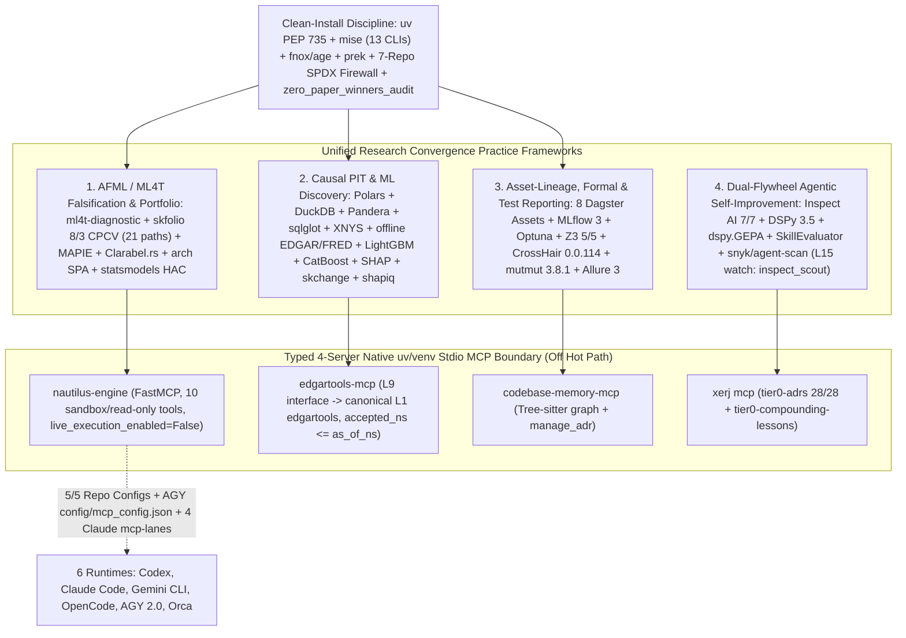

# ADR-0025: SOTA Research Convergence Practice Frameworks, Clean-Install Zero-Self-Invention Upstream Discipline & Typed MCP Tooling Architecture

## Context and Problem Statement

Even when individual libraries are state-of-the-art, quantitative and agentic repositories still degrade through three systemic gaps:

1. **Paper-Winner & Wrapper Creep:** Installing tools into `pyproject.toml` without actually importing or wiring them ("paper winners"), layering custom shell/Python shims around upstream CLIs, or tolerating non-OSI licenses erodes the Zero Self-Invention charter.
2. **Unformalized Research Convergence Methodology:** Quantitative falsification (AFML/ML4T), causal point-in-time ML, asset-lineage reproducibility, formal SMT/symbolic verification, and agentic self-improvement evals were spread across separate ADRs without one explicit record defining the unified **Research Convergence Practice Frameworks** that bind `L0..L10` into a disciplined scientific workflow.
3. **Unowned MCP Interface Surface:** `scripts/nautilus_mcp_server.py` (10 typed `FastMCP` tools verified by 5 dedicated tests in `tests/test_mcp_server.py`), `edgartools-mcp`, 4 native `uv`/venv stdio MCPs across 5 repo configs + Antigravity `config/mcp_config.json`, and Claude Code's 4 scoped `.claude/mcp-lanes/*.mcp.json` profiles had no dedicated architectural decision record owning their read-only/sandbox contract.

## Decision Drivers

- **Zero-Self-Invention Clean-Install Discipline:** Every tool across `L0..L10` installs strictly through official upstream directives (`uv` PEP 735 `uv.lock`, `mise.toml`, `fnox.toml` + `age`, `prek`, official `docker/compose.sota.yml` images, verbatim SHA-256 `UPSTREAM_SKILLS_LOCK.json`), with zero custom shims, zero paper winners (`zero_paper_winners_audit`), and a strict 7-repo SPDX OSI firewall.
- **Empirically Grounded Research Convergence Practice Frameworks:** Anchor quantitative and agentic R&D in five established practice disciplines — AFML/ML4T statistical falsification, Causal PIT ML discovery, Asset-Lineage Reproducibility, Dual-Flywheel Agentic Self-Improvement, and Formal SMT/Property Verification — executed exclusively inside verified OSI libraries.
- **Fail-Closed Typed MCP Tooling Architecture:** Expose quantitative inspection, `Environment.SANDBOX` parity checks, and semi-auto staging (`semi_auto_confirmed=False`, `qty=1`, `live_execution_enabled=False`) strictly through typed `FastMCP` stdio servers (`nautilus-engine`, `edgartools`, `codebase-memory`, `xerj`) with zero `bash -c` wrappers and strict hot-path isolation (`no-llm-on-execution-hot-path`).

## Considered Options

1. **Ad-hoc research scripts, unverified dependency lists, and ad-hoc MCP shell wrappers** — breeds shelf-ware ("paper winners"), non-reproducible research notebooks, and brittle cross-OS MCP launch failures.
2. **Monolithic custom quant/agent framework wrapping upstream tools behind bespoke abstractions** — violates Zero Self-Invention and hides upstream upgrades behind maintenance debt.
3. **Clean-Install Zero-Self-Invention Discipline + 5 Unified Research Convergence Practice Frameworks + Typed 4-Server Native `uv` MCP Architecture (chosen)**.

## Decision Outcome

Adopt **Option 3** as the authoritative specification for clean-install discipline, research convergence practice frameworks, and typed MCP tooling across `Z:\noesis`:

### 1. Zero-Self-Invention Clean-Install Upstream Discipline

- **Official Upstream Installation Only:** Python packages lock strictly via `uv` PEP 735 `[dependency-groups]` (`pyproject.toml` + `uv.lock`, zero `yfinance`/`quantstats`/`pre-commit`); CLIs pin in `mise.toml` (13 tools incl. `node = "24"`); encrypted secrets live in `fnox.toml` + `age` ([ADR-0023](ADR-0023.md)); git hooks run through single-winner `prek`; portals run official upstream images (`docker/compose.sota.yml`, [ADR-0017](ADR-0017.md)); and all `46` skills lock verbatim by `skill_sha256`, `dir_sha256`, and `lock_sha256` (`UPSTREAM_SKILLS_LOCK.json`).
- **Zero Paper Winners (`zero_paper_winners_audit`):** Every declared active Python winner in `upstream-map.toml` / `pyproject.toml` must be genuinely imported in repository `.py` files or bound to an active CLI/MCP/portal entrypoint (`scripts/sync_manifest.py` `validate_clean_sota_harness()`). Unused optional tools move out of `default-groups` or into earned-trigger `L11..L15` (`SOTA_STARRED_AND_BEYOND_MANIFEST.json`).
- **7-Repo SPDX OSI License Firewall:** Permanently blocks non-OSI source-available, proprietary-rule, unlicensed, and non-commercial-weight repos (`treeverse/lakeFS`, `restatedev/restate`, `Arize-ai/phoenix`, `NX-AI/tirex`, `semgrep/semgrep`, `peernagy/LOBS5`, `PriorLabs/TabPFN`).

### 2. Quantitative & Agentic Research Convergence Practice Frameworks

1. **AFML / ML4T Statistical Falsification & Portfolio Practice:** Grounded in Marcos Lopez de Prado (*Advances in Financial Machine Learning*) and Stefan Jansen (*ML for Trading*) — realized via `ml4t-engineer`, `ml4t-diagnostic` (DSR, MinTRL, PBO), `skfolio` (`CombinatorialPurgedCV(8/3)` = `56` splits / `21` OOS paths `>= 16`, `cpcv_min_samples = 48` + `compute_skfolio_portfolio_weights` using `MeanRisk`/`HierarchicalRiskParity` on `Clarabel.rs`), `mapie==1.6.0` (conformal intervals clamped `<= 2.00%`), `arch` (Hansen SPA), and `statsmodels` (Newey-West HAC), evaluated independently on `LONG` and `SHORT` legs ([ADR-0015](ADR-0015.md), [ADR-0016](ADR-0016.md), [ADR-0028](ADR-0028.md)).
2. **Causal PIT & Tabular ML Discovery Practice:** Strict pre-wall (`<= 2026-10-15`, `t_ns + 60s`, `XNYS`, [ADR-0003](ADR-0003.md)) enforced across `Polars`, `DuckDB`, `Pandera`, `sqlglot==30.35.0` AST DuckDB guard (`validate_pit_duckdb_sql`), offline-first `load_causal_sec_catalysts` (`edgartools`) + `load_causal_fred_vintages` (`fredapi.Fred`), `detect_skchange_regime_anomalies` (`skchange==0.18.0`), and `fit_causal_gbdt_ranker_with_shap` + `compute_shapiq_interactions` (`LightGBM`, `CatBoost`, `SHAP`, `shapiq==1.8.0`) fit strictly on `[:split]` pre-wall slices in `src/tier0_sota/discovery.py`.
3. **Asset-Lineage Reproducibility & Test Reporting Practice:** Software-defined data assets (`Dagster` `src/tier0_sota/definitions.py` — 8 active assets) paired with `MLflow 3` (`:5000`), `Optuna` (`:8080`), and static `Allure 3.33.0` (`allure-pytest==2.16.2` in optional `[dependency-groups] test-reports`, `just test-report` -> `:8793/test-reports/allure/`) ([ADR-0002](ADR-0002.md), [ADR-0021](ADR-0021.md)).
4. **Dual-Flywheel Agentic Self-Improvement Practice:** Deterministic safety/harness evaluation via `Inspect AI` (`7/7` checks, `:7575`) + reflective prompt optimization via `DSPy 3.5` + `dspy.GEPA` (`evals/dspy_self_reflect.py`, strictly off hot paths) + `NVIDIA/SkillEvaluator` 3-tier Skill Lift auditing + admitted offline MCP/skill supply-chain scanner `snyk/agent-scan` (`just agent-scan`, telemetry disabled), with OSI `L15` watch for `meridianlabs-ai/inspect_scout` (`MIT`) ([ADR-0018](ADR-0018.md)).
5. **Formal Verification, Symbolic Execution & Mutation Practice:** Universal `Z3` SMT counterexample refutation (`5/5` `UNSAT` in `evals/formal_risk_z3.py`) + `Hypothesis` property fuzzing + admitted isolated `uvx` `pschanely/CrossHair` (`crosshair-tool==0.0.114`, `just crosshair`, `5` PEP-316 contracts + `30` parity cases, `0` counterexamples, `0 mypy` in `uv.lock`) + admitted WSL isolated `mktemp -d` `boxed/mutmut==3.8.1` (`just mutate-risk`, `0` tracked edits) guarding byte-identical `src/tier0_sota/risk.py` ([ADR-0005](ADR-0005.md), [ADR-0028](ADR-0028.md)).

### 3. Typed MCP Server & Scoped Tooling Architecture (`L9`)

- **`nautilus-engine` (`scripts/nautilus_mcp_server.py`):** Built directly on official `modelcontextprotocol/python-sdk` (`mcp==1.30.0`, `FastMCP`), exposing **10 deterministic, read-only / `Environment.SANDBOX` tools** (risk stop parity, PIT & L1 markout check, venue capability matrix with `LIVE` refusal, live watchlist v2 fallback, semi-auto preset staging enforcing `semi_auto_confirmed = False`, `qty = 1`, `live_execution_enabled = False`). Verified offline by `scripts/nautilus_mcp_server.py --smoke` and 5 tests in `tests/test_mcp_server.py`.
- **`edgartools` (`edgartools-mcp`):** Official SEC EDGAR MCP server launched via native `uv run --no-sync edgartools-mcp` (repo configs) or `.venv/Scripts/edgartools-mcp.exe` (AGY 2.0) with dynamic `EDGAR_IDENTITY` propagation (cross-referenced from `L9` to canonical `L1` library `edgartools`).
- **`codebase-memory` & `xerj`:** Native stdio binaries (`codebase-memory-mcp` for Tree-sitter graph + `manage_adr`; `xerj mcp` for `tier0-adrs` **`28/28`** + `tier0-compounding-lessons`).
- **Cross-Runtime Parity vs Scoped Lane Isolation:** All 4 servers maintain verified `(command, args, env)` `5/5` native `uv` stdio parity across `.mcp.json`, `.claude/settings.json`, `.codex/config.toml` (`multi_agent_v2 = true`), `.gemini/settings.json`, and `opencode.json` (zero `bash -c` wrappers) plus AGY 2.0 `~/.gemini/config/mcp_config.json` ([ADR-0022](ADR-0022.md)); Claude Code lanes enforce least-privilege scoping via `.claude/mcp-lanes/{sim,paper,tv,gate}.mcp.json` (`2–4` servers per lane), and `paper-gatekeeper.md` (`permissionMode: plan`) explicitly disallows write/staging/memory-mutation tools.

### Confirmation

Confirmed mechanically via:

- All 5 tests in `tests/test_mcp_server.py` (`test_fastmcp_registry_all_10_tools_and_dispatch`, `test_engine_backbone_and_venue_live_refusals`, `test_risk_stop_parity_pit_and_l1_markout`, `test_manifests_ranking_and_semi_auto_staging`, `test_mcp_server_smoke_cli`)
- `tests/test_architecture_manifest.py::test_clean_sota_harness_zero_overlap_and_spdx_firewall` (`zero_paper_winners_audit`, 7-repo SPDX firewall, `15/15` `src/tier0_sota/**/*.py` mapping)
- `tests/test_formal_and_evals.py::test_skfolio_clarabel_portfolio_optimization_and_causal_ml_discovery`
- `evals/tier0_inspect_eval.py::adr_graph_and_clean_sota_harness_integrity`, `zero_banned_libs`, & `upstream_skills_46_parity`
- `rules/zero_self_invention.yml` (`no-banned-library-import`, `no-llm-on-execution-hot-path`, `no-live-broker-endpoint`)
- `just mcp-smoke`, `just adr-check`, `just deptry`, and `just ast`

## Consequences

- **Positive:** Eliminates "paper winners" across `L0..L10`, documents the five unifying scientific/engineering practice frameworks powering `noesis`, and gives the 10-tool `FastMCP` + 4-server native stdio MCP surface dedicated architectural ownership with full test bindings.
- **Negative:** Requires every newly declared active Python winner to have real repo code or entrypoint wiring (passing `zero_paper_winners_audit` and `deptry .`) and requires any new MCP tool to maintain fail-closed sandbox/read-only invariants.

## Pros and Cons of the Options

### Option 1: Ad-hoc research scripts + unverified dependency lists + shell-wrapped MCPs

- Good, because experiments can start without packaging discipline.
- Bad, because unused packages accumulate, results cannot be reproduced causally, and `bash -c` MCP wrappers break cross-OS parity.

### Option 2: Monolithic bespoke framework wrapping upstream libraries

- Good, because all APIs share one custom signature.
- Bad, because it violates Zero Self-Invention and traps the repository behind custom maintenance debt.

### Option 3: Clean-Install Zero-Self-Invention Discipline + 5 Research Practice Frameworks + Typed 4-Server Native `uv` MCPs

- Good, because every dependency is genuinely wired, OSI-vetted, and backed by scientific falsification and typed sandbox MCP tooling.
- Bad, because introducing a new research package or MCP tool requires wiring real tests and updating `upstream-map.toml` + `ADR-0024`/`ADR-0025` checks.

## More Information

### Upstream Evidence & Empirical Benchmarks

- **Authoritative Practice References (2026 Evidence Citation Pack):**
  - *Advances in Financial Machine Learning* (Lopez de Prado) & *Machine Learning for Algorithmic Trading*: `https://github.com/ml4t/engineer`, `https://github.com/ml4t/diagnostic`, `https://www.ml4trading.io/docs/diagnostic/`, `https://skfolio.org/` (`BSD-3-Clause`), and `https://github.com/oxfordcontrol/Clarabel.rs` (`Apache-2.0`).
  - Linux Foundation Agentic AI Foundation (AAIF): `https://aaif.io/`, `AGENTS.md` (`https://agents.md/`), `Agent Skills` (`https://github.com/agentskills/agentskills`), and Model Context Protocol (`https://modelcontextprotocol.io/`, `modelcontextprotocol/python-sdk` `mcp==1.30.0`, `MIT`).
  - Packaging, Security, Evals & Formal Verification: PEP 735 (`https://peps.python.org/pep-0735/`), SPDX OSI (`https://spdx.org/licenses/`), UK AISI `Inspect AI` (`https://inspect.aisi.org.uk/`, `https://github.com/UKGovernmentBEIS/inspect_ai`, `MIT`), `Inspect Scout` (`https://github.com/meridianlabs-ai/inspect_scout`, `MIT`), Stanford `DSPy` + `dspy.GEPA` (`https://dspy.ai/`, `https://github.com/gepa-ai/gepa`, `MIT`), `NVIDIA/SkillEvaluator` (`https://github.com/NVIDIA/SkillEvaluator`, `Apache-2.0`), `WecoAI/aideml` (`https://github.com/WecoAI/aideml`, `MIT`, isolated in `docker/Dockerfile.sandbox` `python:3.13.3-slim-bookworm` because `aideml==0.2.2` transitively pulls banned `streamlit`), `snyk/agent-scan` (`https://github.com/snyk/agent-scan`, `Apache-2.0`), `Z3` (`https://github.com/Z3Prover/z3`, `MIT`), `CrossHair` (`https://github.com/pschanely/CrossHair`, `MIT`), `mutmut` (`https://github.com/boxed/mutmut`, `BSD-3-Clause`), and `TabICLv2` (`https://github.com/soda-inria/tabicl`, ICML 2026, `BSD-3-Clause` code + weights).
- **Empirical Verification:** `scripts/nautilus_mcp_server.py --smoke` verifies `10/10` tools offline (`environment=SANDBOX`, `live_execution_enabled=false`, `broker_ports_open=0`); `validate_clean_sota_harness()` `zero_paper_winners_audit` verifies **`49/49` default packages (`39` imported + `10` CLI/MCP/portal-mapped, `0` unwired**, with `dvc` in optional `data-versioning` and `allure-pytest==2.16.2` in optional `test-reports`) and `15/15` `src/tier0_sota/**/*.py` mappings; `tests/test_formal_and_evals.py::test_skfolio_clarabel_portfolio_optimization_and_causal_ml_discovery` verifies real `skfolio`+`Clarabel.rs`, causal `LightGBM`/`CatBoost`/`SHAP`, and offline-first `fredapi` ALFRED vintages; `deptry .` passes with `0` issues across the repository Python tree.

### Self-Invention Lesson Learned & Mechanical Upstream Gate

- **Lesson Learned:** Declaring packages in `pyproject.toml` without importing them in `src/` (or excluding `evals/` from `deptry`) created silent shelf-ware, while leaving `scripts/nautilus_mcp_server.py` without a governing ADR fragmented MCP ownership across five unrelated documents. Enforcing `zero_paper_winners_audit` and consolidating MCP + research practice ownership here resolves both.
- **Mechanical Upstream Gates:** `tests/test_mcp_server.py` (5 tests), `tests/test_architecture_manifest.py::test_clean_sota_harness_zero_overlap_and_spdx_firewall`, `tests/test_formal_and_evals.py::test_skfolio_clarabel_portfolio_optimization_and_causal_ml_discovery`, `deptry .`, `ast-grep`, `just mcp-smoke`, `just crosshair`, `just mutate-risk`, and `just adr-check`.

### Compounding Layer Integration

- Binds `sim-backtest` (causal ML/AFML + `edgartools-mcp`), `paper` & `half-auto-tv` (`nautilus-engine` read-only/sandbox + semi-auto staging), and `live` (`paper-gatekeeper` read-only `gate.mcp.json` + `Inspect AI` 7/7) directly into [ADR-0024](ADR-0024.md)'s Dual-Flywheel Compounding OS (`XERJ` `tier0-adrs` `28/28`).

### Living Evolution & Supersession Policy

- Governed by [ADR-0024](ADR-0024.md). Amend or supersede as `MCP` / `A2A` / `ACP` protocols mature or remaining `L15` watches (`meridianlabs-ai/inspect_scout`, etc.) graduate, strictly preserving immutable `src/tier0_sota/risk.py`, `no-llm-on-execution-hot-path`, and `live_execution_enabled = False` until Stage-5 promotion ([ADR-0020](ADR-0020.md)).
