# ADR-0026: Workstation CPU, Memory, 9p I/O, Thread-Bounded Compute & Developer-Loop Performance Governance

## Context and Problem Statement

Running the full Tier-0 SOTA workstation (`Noesis-SOTA` WSL2 on a 48-vCPU host with 78.5 GiB WSL2 RAM, Disk-Z `/mnt/z` 9p mount, 17 Docker containers across `docker` + FINOS `workspace-local`, 4 WSL2 systemd units, 4 MCP servers, and multi-agent developer loops) exposed systemic idle CPU/RAM waste, thread-pool oversubscription, and `/mnt/z` 9p I/O amplification:

1. **Always-On Container & Service Overhead:** `dagster-webserver` and `dagster-daemon` each spawned duplicate in-process `tier0_sota.definitions` code servers (`1,812 MiB` RAM, `99` PIDs, and `No heartbeat received in 20 seconds` warnings); five containers ran `python -c` healthchecks every 30s (`56` execs/min across the stack); `mlflow` ran 2 uvicorn workers (`628 MiB`); `xerj` spawned `156` Tokio/Rayon threads across 48 vCPUs; `tier0-duckdb-ui` spawned `289` threads (`48` DuckDB threads); `zensical` watched and rebuilt `site/` on `/mnt/z` 9p; and the 4 FINOS `workspace-local` containers lacked `cpus`/`mem_limit` caps.
2. **Eager Python Module Import Cascade & Unbounded Compute Pools:** Importing `tier0_sota.definitions` eagerly loaded `8,036` modules in `13.2s` (`710 MiB` RSS), `scripts/nautilus_mcp_server.py` imported `hftbacktest` + `mlflow` + `skfolio` + `statsmodels` (`10.2s` / `636 MiB` idle RSS / `24` threads), and every `duckdb.connect()` defaulted to `48` threads and `62.8 GiB` memory limit with `.tmp` on `/mnt/z` 9p, while `LightGBM` (`n_jobs=-1`) and `CatBoost` (`thread_count=-1`) claimed all 48 vCPUs.
3. **9p I/O & Redundant Pipeline Work:** `_measure_prewall_lake_disk_gb` walked 29,500+ Parquet files via `os.walk` over 9p (`>90s` stall); `scripts/run_compounding_reflection.py` ran redundant `NautilusTrader` backtests (`21` calls), redundant `hftbacktest` Numba L1 replays (`7` calls), and ran all 7 Inspect AI checks twice (`16.6s`); `scripts/sync_manifest.py --check` took `9.2s` due to serial `rglob` hashing across 46 skills and 156 uncached AST file parses; and `just check` ran static/security/smoke gates sequentially (`44.5s` non-test) while placing Ruff/Pytest/Hypothesis caches on `/mnt/z` 9p and running the ADR pytest subset twice.

## Decision Drivers

- **Upstream-Only Mechanical Tuning (Zero Self-Invention):** Realize every optimization exclusively through official upstream flags, configuration files, environment variables, and standard Python static lazy imports — zero custom wrappers, zero new Python dependencies, and zero behavioral drift.
- **Right-Sized Always-On Footprint + High-Throughput Research Burst:** Minimize idle CPU, thread count, and RAM across always-on containers, systemd units, and MCP servers so multi-agent coding, live Paper Farm ticks, and 24/7 `sim-backtest` runs stay responsive without contention.
- **WSL2 ext4 vs `/mnt/z` 9p Locality:** Keep canonical source/data artifacts on Disk-Z (`/mnt/z/noesis`, `/mnt/z/sota-data`) while routing ephemeral tool caches, DuckDB temp spill, and Zensical scratch builds onto native Linux ext4 (`$HOME/.cache/noesis`, `$HOME/.cache/duckdb-tmp`, `$HOME/tier0-sota-state`).
- **Strict Safety & Parity Invariants:** Preserve immutable `src/tier0_sota/risk.py` (SHA-256 `ad8071dcd4196c4c529c02107114ebfdda6692bc9d7c220031f1b19ea3e4d847`), zero live broker ports (`4001`, `7496`, `8798`, `8796`), `paper_only = True`, `live_execution_enabled = False`, 5/5 MCP config parity, and deterministic backtest/falsification outputs.

## Considered Options

1. **Keep unbounded defaults and serial verification loops** — wastes `>2 GiB` container RAM, spawns hundreds of idle threads per process, stalls Dagster asset materialization on 9p walks, and slows every developer check cycle.
2. **Introduce custom caching daemons, custom process supervisors, or dynamic `importlib` shims** — violates Zero Self-Invention ([ADR-0001](ADR-0001.md)) and triggers `ast-grep` dynamic-import rules.
3. **Official Upstream Resource Governance + Static Lazy Imports + Deduplicated Pipelines + ext4 Cache Routing (chosen)** — applies official upstream settings across Docker Compose, Dagster gRPC workspace, systemd drop-ins, DuckDB/Polars/LightGBM/CatBoost/Numba thread caps, static function-scoped imports, batched DuckDB writes, and parallel `just check` / `check.sh` verification.

## Decision Outcome

Adopt **Option 3** across both infrastructure (`L0`, `L6`) and compute/developer workflows (`L1`, `L2`, `L5`, `L7`, `L9`):

```mermaid
flowchart LR
    subgraph INFRA ["Always-On Hosting & Resource Caps (L0 / L6)"]
        D1["Dagster gRPC workspace.yaml (dagster-code-server:4266, 1x code server)"]
        D2["Compose curl 60s Healthchecks + cpus/mem_limit + Thread Env Caps"]
        D3["Systemd Drop-Ins + DuckDB UI (4T/512MB) + Zensical ext4 State"]
    end
    subgraph COMPUTE ["Thread-Bounded Lazy Compute (L1 / L2 / L5 / L9)"]
        C1["Static Lazy Imports (discovery, engine, research, definitions, nautilus_mcp)"]
        C2["open_bounded_duckdb() (TIER0_DUCKDB_THREADS + ext4 temp_directory)"]
        C3["Batched DuckDB Writes (runner markouts + tv/bridge presets) & Lazy scan_parquet"]
        C4["Deduplicated Reflection Loop (Cached 1x/2x Backtests, 2x L1, 1x Inspect)"]
    end
    subgraph DEVLOOP ["ext4-Cached Parallel Verification (L7)"]
        V1["just check & check.sh: Parallel Read-Only Gates -> docs-build -> Single pytest"]
        V2["ext4 Caches: RUFF_CACHE_DIR, pytest cache_dir, HYPOTHESIS_STORAGE_DIRECTORY"]
        V3["Fast sync_manifest.py: Parallel scandir Skills + Shared AST Cache"]
    end
    INFRA --> COMPUTE --> DEVLOOP
```

### 1. Infrastructure, Container & Systemd Resource Governance (`L0`, `L6`)

- **Official Dagster gRPC Code Server (`docker/workspace.yaml`, `docker/compose.sota.yml`):** Run one shared internal `dagster-code-server:4266` (`cpus: 2.0`, `mem_limit: 2g`, `--max-workers 4`) serving `tier0_sota.definitions` to `dagster-webserver` and `dagster-daemon` (`cpus: 1.0`, `mem_limit: 1g` each), eliminating duplicate Python code-server processes and daemon heartbeat stalls.
- **Lightweight Healthchecks, Continuous Upstream Telemetry & Bounded Container Runtimes:** Replace Python 30s healthchecks with `curl -fsS --max-time 3 -o /dev/null` (`interval: 120s` steady-state on 10 stable SOTA containers, `600s` on `dagster-daemon`, `60s` on FINOS services, retaining fast `start_interval: 5s`/`10s`), configure `docker/dagster.yaml` (`auto_materialize.enabled: false`, `freshness.enabled: false`, `run_coordinator.config.dequeue_interval_seconds: 30`, `run_monitoring.poll_interval_seconds: 300`, keeping `max_concurrent_runs: 1`, `max_runtime_seconds: 1800`, `telemetry.enabled: false`), run `mlflow` with `--workers 1`, bind container thread pools (`OPENBLAS`/`MKL`/`NUMEXPR`/`BLIS`/`OMP`/`POLARS`/`RAYON` = `4`, `GOMAXPROCS` = `1..2`, `xerj` `TOKIO_WORKER_THREADS=4`/`RAYON_NUM_THREADS=4`), mount `zensical` scratch site/cache on ext4 (`${TIER0_STATE_ROOT}/zensical-{site,cache}`), add `grafana_data` volume + disable external Grafana pollers & Grafana Live (`GF_LIVE_MAX_CONNECTIONS=0`), set Prometheus `--storage.tsdb.retention.size=2GB` + `30s` scrape interval, enable the canonical unprivileged OTel `host_metrics` receiver (`collection_interval: 30s`, `cpu`/`memory`/`load`, `18` `system_*` series alongside `level: normal` self-scrape) in `docker/otel-collector-config.yaml`, track sustained host CPU/RAM alerts in `docker/prometheus_rules.yml` (`tier0_sota_workstation_alerts`), and auto-provision the declarative 7-panel Grafana workstation telemetry dashboard (`docker/grafana/dashboards/tier0-workstation-telemetry.json`, `uid: tier0-workstation-telemetry`, zero custom HTML/JS).
- **FINOS, DuckDB UI, Systemd, Two-Layer Guard Loop, OS Hygiene & WSLg Next-Launch:** Enforce explicit `cpus`/`mem_limit`, `60s` healthcheck cadence (`start_interval: 5s`), frontend Node/Rayon caps (`UV_THREADPOOL_SIZE=4`, `RAYON_NUM_THREADS=4`, `NODE_OPTIONS=--max-old-space-size=1024`), backend BLAS/Polars/Rayon `=2` caps, MySQL workstation flags (`--performance-schema=OFF --skip-log-bin --mysqlx=OFF --innodb-flush-log-at-trx-commit=2 --innodb-buffer-pool-size=64M --max-connections=50`), and Valkey low-idle flags (`--hz 2 --save "" --appendonly no`) on FINOS `workspace-local` containers; disable unused bundled Grafana plugins (`GF_PLUGINS_DISABLE_PLUGINS` keeping only `prometheus`), disable unused unified alerting (`GF_UNIFIED_ALERTING_ENABLED=false`), silence `search-manifest-watcher:error`, and size `dagster-daemon` at `cpus: "1.5"` (`0` throttles); configure `tier0-duckdb-ui` (`:4213`) with `SET threads=4; SET memory_limit='512MB'`; apply systemd resource drop-ins (`CPUQuota`, `MemoryHigh`/`MemoryMax`, `Nice=5`), enact a permanent two-layer upstream tracking & maintenance loop combining a declarative 30-minute WSL2 `systemd.timer` (`docker/systemd/tier0-workstation-sota-guard.{service,timer}`, `Nice=15`, `IOSchedulingClass=idle`, `CPUQuota=50%`, `MemoryMax=512M`, `Persistent=false`, `0` idle CPU between runs — running fail-closed live-port + `risk.py` SHA-256 `ExecStartPre`, login-sourced conditional `preflight_resume.sh || --reconcile` `ExecStart`, and bounded upstream hygiene `ExecStartPost` for `.ruff_cache`/`.hypothesis`, `/tmp/pytest-of-sota >120m`, dangling `docker image prune -f`, and `codebase-memory-mcp` config enforcement) paired with a standing Antigravity `*/30 * * * *` cron audit loop; disable non-essential WSL2 Ubuntu server timers/daemons (`unattended-upgrades`, `apt-daily*`, `man-db`, `motd-news`, `e2scrub_all`, `landscape-client`, `snapd*`, `rsyslog` with bounded `journald`), set `vm.vfs_cache_pressure=50`, propagate ext4 `RUFF_CACHE_DIR`/`HYPOTHESIS_STORAGE_DIRECTORY`/`NPM_CONFIG_CACHE` and `git` `index.threads=4`, pre-create ext4 state/cache directories in `scripts/grand_reset/01_wsl_bootstrap.sh`, disable unused `codebase-memory-mcp` web UI and background 9p git watcher (`ui_enabled=false`, `watcher_enabled=false`, `auto_watch=false`, persisted in `scripts/grand_reset/01_wsl_bootstrap.sh` to eliminate `10.7%` 9p `git status` polling and `217%` re-index bursts), and configure WSLg D3D12 EGL acceleration on `~/.local/bin/antigravity-desktop` (`--ignore-gpu-blocklist --enable-gpu-rasterization --enable-zero-copy` to override Chromium's WSLg D3D12 `--disable-gpu-compositing` blocklist, with `AGY_OZONE=wayland` opt-in and `AGY_GPU_MODE=cpu` escape hatch).

### 2. Thread-Bounded Compute, Static Lazy Imports & Batched DuckDB (`L1`, `L2`, `L5`, `L9`)

- **Static Function-Scoped Lazy Imports:** Defer heavy libraries (`exchange_calendars`, `pandera.polars`, `ruptures`, `ml4t.engineer`, `river.drift`, `stumpy`, `lightgbm`, `catboost`, `shap`, `fredapi`, `hftbacktest`, `mlflow`, `statsmodels`, `arch`, `ml4t.diagnostic`, `scipy.stats`, `skfolio`, `optuna`, `inspect_ai`, `dspy`) to their call sites using plain static `import` statements (100% compliant with `ast-grep` zero-dynamic-import rules).
- **Bounded DuckDB, Scoped Burst Connections & GBDT Execution:** Route every production `duckdb.connect()` across `paper_farm.py`, `runner.py`, `execution.py`, `performance.py`, `definitions.py`, and `tv/bridge.py` through `open_bounded_duckdb()` (honoring `TIER0_DUCKDB_THREADS`, `TIER0_DUCKDB_MEMORY_LIMIT`, and `DUCKDB_TEMP_DIRECTORY`); scope a single per-lane connection (`AlpacaPaperLane.batch_ledger_conn()`) across `PaperFarmCoordinator.dispatch_high_throughput()` (closed in `finally:` with autocommit pre-submit durability, cutting 1,080 opens to 3); batch `runner.py` markout updates and `tv/tickets.py` preset persistence (`persist_tv_presets_duckdb`) into single transactions; cache `(st_mtime_ns, st_size, st_ino)` on `live_whole_market_movers_manifest.json` and `tca_calibration_manifest.json` (plus DuckDB ledger/WAL fallback) inside `src/tier0_sota/live/execution.py` `refresh()` so the 1Hz supervisor re-reads JSON only on change (`120 -> ~2` 9p reads/min, `-98.3%`) while evaluating `< 90s` `STALE_SCAN` staleness in memory and keeping un-cached fail-closed pre-order checks in `handle()`; parallelize forbidden TCP port probes in `scripts/paper_farm_loop_hidden.pyw` (`0.5s` loopback `:4002` timeout) plus concurrent 3-account polling / shared `data_client` in `runner.py` and concurrent screener/SIP + `CLOSED`-session lightweight pin-only fast path in `scanner.py` (preserving the `< 90s` freshness SLA); bound `LightGBM` (`TIER0_LGBM_THREADS`) and `CatBoost` (`TIER0_CATBOOST_THREAD_COUNT`) threads; bound `nautilus_mcp_server.py` stdio threads (`TIER0_MCP_THREADS`, default `2`); and propagate `NUMBA_NUM_THREADS` / `TIER0_DUCKDB_THREADS` / `TIER0_LGBM_THREADS` / `TIER0_CATBOOST_THREAD_COUNT` via `scripts/bootstrap_env.{sh,ps1}` `sitecustomize.py`.
- **Fast Lake, Inspect & Reflection Pipelines:** Use `PREWALL_LAKE_MANIFEST.json` fast-path (with `os.scandir` fallback and `TIER0_LAKE_DEEP_SCAN=1` override) and shared `upstream_cfg` + `ast_cache` across `parse_and_validate_adrs`/`validate_clean_sota_harness` in `definitions.py`, lazy `pl.scan_parquet(...).head(...).collect()` in `scripts/run_compounding_reflection.py`, cached `1x`/`2x` `NautilusTrader` backtests, `hftbacktest` L1 markouts, and `COMBINED` 6-gate reports on run 1 (via optional `precomputed_bt_1x`/`precomputed_bt_2x`/`precomputed_l1_markout` kwargs in `evaluate_six_gate_falsification`), single-pass Inspect AI sample extraction (`7` checks executed once instead of twice), and shared `ast_cache` + parallel `verify_skills_lock` in `evals/tier0_inspect_eval.py`.

### 3. ext4-Cached Parallel Developer Verification Loop (`L7`)

- **Cross-OS Parallel Static/Security/Smoke Gates, Self-Healing Bootstrap & ext4 Caches:** Route `RUFF_CACHE_DIR`, `HYPOTHESIS_STORAGE_DIRECTORY`, and `pytest -o cache_dir=...` onto `$HOME/.cache/noesis/*` on WSL2/Unix in `justfile` and `scripts/check.sh`, and exclude ephemeral local build/tool caches (`.cache,.ruff_cache,.pytest_cache,.hypothesis`) in `just trivy` / `scripts/sync_manifest.py` `supply_chain_scan` so `just security` never races with concurrent `just docs-build`; execute independent read-only gates (`fmt-check`, `lint`, `typecheck`, `deptry`, `ast`, `manifest-check`, `z3`, `mcp-smoke`, `gitleaks`) in parallel on both Unix (`bash` background jobs) and Windows (`pwsh` `Start-Process` in `justfile` `[windows] check:` and `scripts/check.ps1`) before `docs-build` and a single full `pytest` pass (retaining standalone `just adr-check` and eliminating the redundant second ADR pytest in `just check` and duplicate `docs-build` in `just automate`); harden `scripts/bootstrap_env.ps1` with non-destructive same-volume NTFS lock relocation outside `.venv` (`Z:\sota-cache\venv-stale-scripts` fallback sibling `.venv-stale-scripts`), targeted `$VenvDir\Scripts\*.exe` lock-holder stop + automatic 1x retry on Windows `os error 5`, `sitecustomize.py` generation, and core import smoke checks (`tier0_sota`, `nautilus_trader`, `alpaca`, `pydantic`, `polars`, `duckdb`), while enforcing `UV_PROJECT_ENVIRONMENT="$HOME/noesis/.venv"` in `scripts/bootstrap_env.sh` and `justfile` so WSL2 `uv` never contaminates Windows `.venv` on `/mnt/z`.
- **Developer-Loop Test Baseline & Conditional Parallelization Gate (`2026-11-27`):** Measured serial full-suite baseline on 8-vCPU WSL2 is `210 passed in 298.33s` (`real 5m14s`, with top-8 slowest tests taking `160.8s` / `~54%`). `pytest-xdist` (`MIT`) stays watched and is admitted ONLY if `pytest -n 4 --dist loadfile` passes `3` consecutive runs with ADR-0026 thread caps and isolated DuckDB/MLflow state without flakiness; isolated `mutmut 3.8.1` runs strictly in WSL `mktemp -d` (`--max-children 4`) via `just mutate-risk`, and `ReportPortal` (`>= 6 GB` / ~9 containers) is rejected under these footprint caps.
- **Host-Networked Caddy Loopback Boundary (`docker/Caddyfile`):** Running `tearsheets` (`caddy:2.11.9-alpine`) with `network_mode: host` enables loopback Origin normalization (`:4213 -> 127.0.0.1:4214` DuckDB UI) and `:8793` static tearsheets + Allure 3 (`/test-reports/allure/`) without a custom proxy server, shifting loopback enforcement from Docker port publishing to `docker/Caddyfile` (`admin off` + `bind 127.0.0.1`), which is mechanically pinned by `tests/test_grand_reset_kit.py::test_caddyfile_loopback_binding_and_duckdb_csrf_posture`.
- **Accelerated Manifest Sync (`scripts/sync_manifest.py`):** Hash the 46 locked skills via single-pass `os.scandir` in a bounded `ThreadPoolExecutor(max_workers=8)`, share an AST parse cache across `validate_clean_sota_harness` and `validate_adr_anchors_and_fitness_bindings`, read `.git/HEAD` directly before falling back to `git`, and share loaded config inputs between `build_manifest` and `build_llm_harness_manifest`.

### Confirmation

Confirmed mechanically via:

- `tests/test_architecture_manifest.py::test_workstation_lazy_imports_and_thread_bounds_fitness`
- `tests/test_architecture_manifest.py::test_adr_catalog_zensical_nav_and_manifest_graph_parity`
- `tests/test_definitions.py::test_active_dagster_compounding_assets_and_frontier_telemetry`
- `tests/test_grand_reset_kit.py::test_docker_compose_sota_yaml_mounts_and_no_live_ports`
- `tests/test_mcp_server.py::test_mcp_server_smoke_cli`
- `rules/zero_self_invention.yml` (`no-banned-library-import`, `no-live-broker-endpoint`, `no-custom-dashboard-server`)
- `evals/tier0_inspect_eval.py::adr_graph_and_clean_sota_harness_integrity` & `risk_sha256`
- `just check`, `just adr-check`, `just mcp-smoke`, and `just preflight`

## Consequences

- **Positive:** Cuts total container RAM across all 17 services by `>2.0 GiB` (`-41.7%`), slashes idle thread counts across Dagster, XERJ, DuckDB UI, and MCP processes, eliminates 9p cache thrash and `>90s` lake walk stalls, cuts reflection and manifest-sync runtimes substantially with zero numerical or behavioral change, and keeps the 48-vCPU host responsive for simultaneous multi-agent + Paper Farm + `sim-backtest` execution.
- **Negative:** First invocation of lazy-imported ML/statistical functions pays one-time import latency on first call rather than at module import time; operators editing `docker/compose.sota.yml` must maintain `docker/workspace.yaml` gRPC parity alongside `dagster-code-server`.

## Pros and Cons of the Options

### Option 1: Retain unbounded defaults and serial verification loops

- Good, because zero configuration changes are required.
- Bad, because idle services burn gigabytes of RAM and hundreds of threads, 9p cache/walk overhead stalls Dagster and developer loops, and reflection repeats identical backtests and Inspect runs.

### Option 2: Build custom caching daemons, supervisors, or dynamic `importlib` loaders

- Good, because custom layers can hide tool flags.
- Bad, because it violates Zero Self-Invention ([ADR-0001](ADR-0001.md)), fails `ast-grep` dynamic-import gates, and creates permanent maintenance debt.

### Option 3: Official Upstream Resource Governance + Static Lazy Imports + Deduplicated Pipelines + ext4 Cache Routing

- Good, because every change uses documented upstream mechanisms (`workspace.yaml`, Compose resource limits, systemd drop-ins, DuckDB `config`, Polars `scan_parquet`, Ruff/Pytest/Hypothesis env/flags, static Python imports) and is mechanically verified.
- Bad, because thread-cap environment variables must stay synchronized across `docker/compose.sota.yml`, `scripts/bootstrap_env.{sh,ps1}`, and WSL2 profile defaults.

## More Information

### Upstream Evidence & Empirical Benchmarks

- **Infrastructure & Container Verification (2026-11-26, WSL2 `Noesis-SOTA`):**
  - `scripts/preflight_resume.sh`: **`PASS` (`13/13` gates, `15/15` portals healthy, `docker_compose_stack: running=12/12`, `wsl_systemd_services: active=4/4`, `live_broker_ports_zero: 0`)**.
  - Dagster stack (3 containers with `docker/workspace.yaml` vs 2): RAM **`1,812 MiB -> 385 MiB` (`-78.8%`)**, PIDs **`99 -> 42` (`-57.6%`)**, `tier0_sota.definitions` `LOADED` in `1s`, `0` heartbeat warnings.
  - `docker-mlflow-1`: **`628.5 MiB -> 401.5 MiB` (`-36%`)**; `docker-xerj-1`: PIDs **`156 -> 24` (`-84.6%`)**, RAM **`59.5 MiB -> 13.5 MiB` (`-77%`)**.
  - Total 12 `docker-*` containers: **`3,378 MiB -> 1,475.5 MiB` (`-56.3%`)**; total all 17 containers (including FINOS `workspace-local`): **`4,886 MiB -> 2,856 MiB` (`-41.5%`, `>2.0 GiB` freed)**, total container PIDs **`554 -> 265` (`-52.2%`)**; `docker-grafana-1` **`14 -> 2` procs**, **`111 -> 21` threads (`-81.1%`)**, **`246–285 MiB -> 172.1 MiB`**, `0` `search-manifest-watcher` warnings; `docker-dagster-daemon-1` `cpus: "1.5"` **`nr_throttled=0`**; `system.slice` idle CPU **`23.1% -> 8.65%` (`-62.6%`)**; `containerd + dockerd` CPU **`6.2% -> 0.94%` (`-84.8%`)**.
  - Container healthcheck exec cadence: **`56/min -> 16.5/min` (Wave 1/2) -> `8.1/min` (Wave 3, `-85.5%` cumulative)**, `0` Python healthcheck spawns; Wave 3 10s cgroup v2 idle CPU: all 17 Docker containers **`153.88 mC -> 77.77 mC` (`-49.5%`)**, `dockerd` + `containerd` **`71.85 mC -> 10.81 mC` (`-85.0%`)**, combined Docker stack + runtime **`225.73 mC -> 88.58 mC` (`-60.8%`, `< 0.09` cores)**; Dagster triad **`69.81 mC -> 46.10 mC` (`-34.0%`)** with `FRESHNESS_DAEMON`/`auto_materialize` disabled and `liveness-check` at `600s` (`-80%` burst rate); Grafana **`23.46 mC -> 7.88 mC` (`-66.4%`, `18` PIDs, `GF_LIVE_MAX_CONNECTIONS=0`)**; FINOS MySQL RAM **`366 MiB -> 123 MiB` (`-243 MiB`, `-66.4%`)** and Valkey CPU **`7.22 mC -> 0.61 mC` (`-91.6%`, `hz=2`, zero 5-min RDB `fork()`)**; OTel `:9464/metrics` series **`239 -> 94` (`-60.7%`)**; `tier0-duckdb-ui` threads **`289 -> 61` (`-78.9%`)**, RSS **`168.5 MiB -> 23.8–57 MiB` (`-66%` to `-85.9%`)**; WSL2 OS hygiene (`12/12` non-essential Ubuntu server timers/daemons disabled, `vm.vfs_cache_pressure=50`, `~3 GiB` safe ext4 disk reclaim from 4 unreferenced legacy images + stale venv + apt cache).
  - Continuous workstation telemetry & hygiene (Wave 5, 2026-11-27): unprivileged `docker-telemetry-exporter-1` (`0.10%` CPU, `43.9 MiB`, `6` PIDs, `0` warnings) emits `47` `otelcol_*` lines + `18` `host_metrics` `system_*` series (`8` CPU states, `6` memory states, `3` load avg, `system_cpu_logical_count=48`); Prometheus `:9090/api/v1/rules` loads both `tier0_sota_24x5_paper_alerts` (`4/4`) and `tier0_sota_workstation_alerts` (`2/2`, `promtool check rules: 6 rules`); declarative Grafana `:3001/api/dashboards/uid/tier0-workstation-telemetry` returns `HTTP 200` with `7` panels and `6/6` live PromQL queries returning non-empty frames; `0` zombies, `0` orphans, `0` failed systemd units, `0` dangling Docker images/volumes, and stale pre-Wave-1 9p cache dirs (`.ruff_cache`, `.pytest_cache`, `.hypothesis`) swept.
  - Overnight 5.25h soak & post-restart validation (Wave 6, 2026-11-27 `00:11 -> 05:26 ET`, `n=316` 1m Prometheus `host_metrics` samples): WSL2 CPU busy `avg=4.54%` (`2.18` cores of 48, `min=0.99%`, `p95=10.20%`, `softirq avg=0.28c`), RAM dropped `-4.09 GiB` post-restart to `12.30 GiB` (`66 GiB` avail, `0 B` swap); `19/19` containers running (`0` restarts over 4–9h, `0` OOM, `0` unhealthy, `0 MiB` SOTA core leak: `docker-*` `1,466.6 MiB` vs Wave 5 `1,468.8 MiB`, combined 19-container 10s cgroup CPU `81.73 mC` = `0.17%` of 48 vCPUs); WSLg D3D12 (`libd3d12.so` + NVIDIA `libnvwgf2umx.so`, `0` `llvmpipe`) cut Antigravity GPU threads `74 -> 15` (`-79.7%`) with `--ignore-gpu-blocklist --enable-gpu-rasterization --enable-zero-copy` added to eliminate Chromium's `--disable-gpu-compositing` fallback on next launch; `nautilus_mcp_server.py` dropped `664–688 MiB -> 317.1 MiB` (`-52.2%`); `codebase-memory-mcp` persisted `ui_enabled=false`, `watcher_enabled=false`, `auto_watch=false` (`0` port-9749 retries, eliminating `217%` 9p re-index loops); live `PRE_MARKET` Windows Paper Farm observer tick reached `410 ms` (`0.41s` — `52x` faster than Phase 1 `21.3s`, `exitCode=0`, `ibkrPaperReachable=true`).
  - Permanent two-layer continuous guard loop (Wave 7, 2026-11-27): `docker/systemd/tier0-workstation-sota-guard.{service,timer}` installed to `/etc/systemd/system/` (`SYSTEMD_ANALYZE_VERIFY_OK=1`, LF-only, `0` `%h/`, `0` Trivy findings on `docker/`), enabled on 30m cadence (`Persistent=false`, `RandomizedDelaySec=60s`, `0` idle CPU between runs), and live-executed via `systemctl start tier0-workstation-sota-guard.service` (`Result=success`, `ExecMainStatus=0`, ~9s total, `13/13` preflight gates & `15/15` portals PASS, `workstation_preflight_resume_manifest.json` refreshed, `docker image prune -f` `0B`, `codebase-memory-mcp` flags verified `false`), paired with a standing Antigravity `*/30 * * * *` cron audit loop; post-restart `VizCompositorTh` dropped `94.3% -> 16.8%` (`9.0%` avg) with hardware `antigrav:gdrv0` active, `nautilus_mcp_server.py` settled at `267 MiB / 9T / 0.0%` idle CPU, and `PRE_MARKET` observer ticks hold `421 ms` (`accounts_authenticated=4`, `ibkr_tcp_reachable=true`).
- **Workflow & Compute Verification (2026-11-26 / 2026-11-27, verbatim before -> after measurements):**
  - Cold imports: `tier0_sota.discovery` **`5.661s / 493 MiB / 21T` -> `0.282–0.342s / 125.8 MiB / 11T`** (`-94.0%` to `-95.0%` time, `-74.5%` RSS); `tier0_sota.engine` **`6.642s / 495 MiB` -> `0.365–0.451s / 134.8 MiB`** (`-93.2%` to `-94.5%`); `tier0_sota.research` **`9.628s / 610 MiB` -> `0.393–0.462s / 135.1 MiB`** (`-95.2%` to `-95.9%`, `-77.9%` RSS); `tier0_sota.definitions` **`13.213s / 710 MiB / 21T` -> `0.669–0.780s / 132.2 MiB / 1T`** (`-94.1%` to `-94.9%`, `-81.4%` RSS, `-95.2%` threads); `scripts.nautilus_mcp_server` import **`10.236s / 625 MiB` -> `0.835–0.970s / 166.5 MiB`** (`-90.5%` to `-91.8%`) and live stdio idle **`636 MiB / 24T` -> `168–173 MiB / 6–7T`** (`-72.8%` RSS, `-70.8%` to `-75.0%` threads); `scripts.run_compounding_reflection` import **`10.579s / 681 MiB` -> `0.476s / 135.8 MiB`** (`-95.5%`).
  - Pipelines, Paper Farm & developer gates: `scripts/sync_manifest.py --check` **`9.183s` (`12.30s` baseline) -> `2.00–2.57s`** (`-72%` to `-83.7%`); `just mcp-smoke` **`11.36s` -> `2.21–3.10s`** (`-72.7%` to `-80.5%`); `just adr-check` **`25.87s` -> `7.42s`** (`-71.3%`); `just check` end-to-end **`423.56s` -> `115.61–130.58s`** (`-69.2%` to `-72.7%`); `scripts/run_compounding_reflection.py --offline` end-to-end **`40.47s` -> `22.02s`** (`-45.6%`) with `21 -> 14` Nautilus backtests, `7 -> 2` `hftbacktest` L1 replays, and `2x -> 1x` Inspect AI execution; pre-wall lake disk measurement **`>90s` 9p stall -> `3.63ms`**; `adr_governance_and_graph_sync` shared AST/config validation **`1.137s`**; live `execution.py` 1Hz supervisor 9p manifest reads **`120 reads/min -> ~2 reads/min` (`-98.3%`)** with verified immediate `TCA_RECALIBRATION_REQUIRED` re-read on change and zero-reread in-memory `STALE_SCAN` firing; live Windows Paper Farm 1-minute observer tick (`paper-farm-observer-health.json`) **`21,290 ms -> 7,678 ms` (Wave 1) -> `4,730 ms` (Wave 2B) -> `906–910 ms` (Wave 4/5) -> `410 ms` (Wave 6 `PRE_MARKET` soak, `-98.1%`, `52x`, `exitCode=0`)**; `dispatch_high_throughput` 3,600-rpm burst (`test_high_throughput_order_handle_3600_rpm_burst_and_24x5_parity`) **`39.24s -> 1.47s` (`-96.3%`, `26.7x`)**; `test_standalone_skills_zero_yfinance_and_zero_legacy_refs` **`4.73s -> 0.55s` (`-88.4%`)**.
- **Workstation GPU Note:** WSLg rendering uses D3D12 EGL acceleration on the local discrete NVIDIA GPU with `--ignore-gpu-blocklist --enable-gpu-rasterization --enable-zero-copy` (plus `AGY_OZONE=wayland` opt-in and `AGY_GPU_MODE=cpu` fallback).

### Self-Invention Lesson Learned & Mechanical Upstream Gate

- **Lesson Learned:** Default multi-core thread pools (48 vCPUs) across DuckDB, Tokio/Rayon, OpenBLAS, LightGBM, and CatBoost multiply destructively when 17+ containers, MCP servers, and parallel test workers share one workstation, while routing ephemeral caches and recursive directory walks across WSL2 9p (`/mnt/z`) magnifies latency by an order of magnitude. Official upstream resource caps, static lazy imports, and ext4 cache locality eliminate both failure modes without inventing a single custom framework.
- **Mechanical Upstream Gates:** `tests/test_architecture_manifest.py::test_workstation_lazy_imports_and_thread_bounds_fitness`, `tests/test_grand_reset_kit.py::test_docker_compose_sota_yaml_mounts_and_no_live_ports`, `ast-grep`, `deptry`, `ruff`, `ty`, `shellcheck`, `trivy fs`, `gitleaks`, `just adr-check`, and `just preflight`.

### Compounding Layer Integration

- Directly accelerates all four compounding lanes: `sim-backtest` (deduplicated reflection loop, lazy `scan_parquet`, bounded LightGBM/CatBoost/DuckDB), `paper` (batched markout updates, bounded DuckDB ledgers, leaner 1-minute observer ticks), `half-auto-tv` (batched `persist_tv_presets_duckdb`), and `live` (faster parallel `just check` + `manifest-check` readiness gates), while keeping `src/tier0_sota/risk.py` byte-identical and `live_execution_enabled = False`.

### Living Evolution & Supersession Policy

- Governed by [ADR-0024](ADR-0024.md). Amend thread caps, cache roots, or Compose resource limits as workstation hardware, WSL2 9p/virtiofs performance, or upstream versions evolve, strictly preserving immutable `src/tier0_sota/risk.py`, `paper_only = True`, `live_execution_enabled = False`, and zero live broker ports ([ADR-0017](ADR-0017.md), [ADR-0020](ADR-0020.md)).
