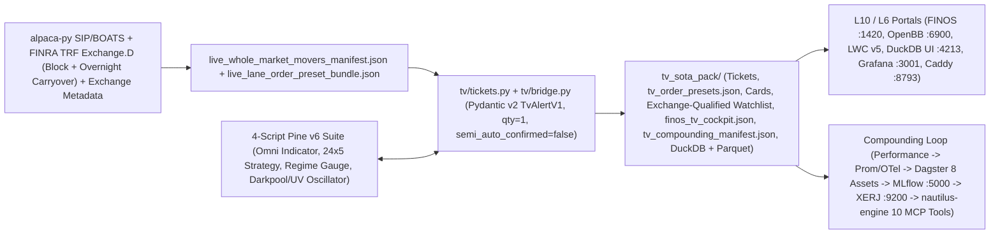

# ADR-0027: Full-Landscape SOTA TradingView 24/5 Practice, Pine v6 Suite, Darkpool/UV Watchlist Sync & Compounding Cockpit

## Context and Problem Statement

While [ADR-0010](ADR-0010.md) established the fail-closed Pydantic v2 `TvAlertV1` bridge and two display-only Pine v6 indicators, real-world 24/5 operator practice in the `half-auto-tv` compounding lane exposed five concrete architectural gaps that prevented full end-to-end landing:

1. **Indicator-Only Pine Surface:** Only two `indicator()` scripts existed (`pine/tier0_omni_sota_24x5.pine`, `pine/tier0_market_regime.pine`), leaving operators without a Strategy Tester-ready `strategy()` script using `//@strategy_alert_message {{strategy.order.alert_message}}`, without a dedicated unusual-volume & hidden-volume absorption oscillator pane, and without copy-ready native TradingView Order Panel preset values on the HUD.
2. **Overnight & FINRA TRF Darkpool Blindness:** During `OVERNIGHT`, `scanner.py` switched to `DataFeed.BOATS` and returned empty TRF maps (`darkpool_trf_ratio: null`), while RTH/extended SIP queries inspected only a 1-minute slice without separating institutional round-lot/block TRF volume from retail wholesaler odd-lots. Requiring illiquid `RSP` overnight bars forced `macro_regime = 0` (`NEUTRAL`), suppressing actionable setups and collapsing watchlists to minimal pinned rows.
3. **Unlanded Order Presets, Bare Watchlist Symbols & Thin Audit Persistence:** `tv_sota_pack/` lacked a structured `tv_order_presets.json` / `TV_ORDER_PRESET_CARDS.md` preset pack, lacked automatic Pine-to-pack SHA-256 synchronization, emitted bare tickers without required `EXCHANGE:` prefixes in `tier0_sota_tv_watchlists_live.txt`, silently dropped validated `TvAlertV1` metadata in `bridge.py`, and persisted only 15 minimal columns into `tv_half_auto_audit.duckdb` with no read-only Parquet snapshot for DuckDB SQL UI (`:4213`).
4. **Disconnected Hosted Engine & Portal Feedback:** `runner.py` omitted `prom_output_path` (leaving `paper_farm_metrics.prom` stale), `performance.py` did not emit `tier0_drawdown_breaker_latched` or TV standby/UV/TRF gauges, no declarative `finos_tv_cockpit.json` existed for FINOS Workspace (`:1420`) / OpenBB (`:6900`) / `tradingview/lightweight-charts` v5, and Dagster (`definitions.py`), MLflow/XERJ (`run_compounding_reflection.py`), Grafana (`:3001`), and `nautilus-engine` MCP lacked full TV darkpool/UV compounding visibility.
5. **Unencoded SOTA TradingView Ecosystem Firewall:** The broader open-source TradingView landscape mixes verified OSI gems (`tradingview/lightweight-charts`, `openbq-org/finos-workspace`, `finos/perspective`, zero-CDP MIT Pine v6 linters/parsers) with proprietary libraries (`tradingview/charting_library`), deprecated EOD services (`tradingview-pine-seeds`), custom non-OSI licenses (`revanthpobala/pinescript-vscode-extension`), ToU-violating scrapers (`tradingview-ta`, `TradingView-Screener`, `tvdatafeed`, `TradingView-API`, `tradingview-scraper`), banned CDP `:9223` MCP forks, and proprietary cloud webhook relays.

This living ADR extends [ADR-0010](ADR-0010.md), [ADR-0014](ADR-0014.md), and [ADR-0021](ADR-0021.md) to converge the entire `half-auto-tv` lane end-to-end under Core Trading Philosophy and the Tier-0 SPDX OSI License Firewall.

## Decision Drivers

- **100% Display-Only & TradingView ToU Compliance:** Zero Chrome DevTools Protocol (`:9223`), zero unofficial scraping (`tradingview_ta`, `TradingView-Screener`, `tvdatafeed`, `TradingView-API`, `tradingview-scraper`), zero external cloud broker relays, and always `qty = 1`, `semi_auto_confirmed = False`, `paper_only = True`, `live_execution_enabled = False`, with immutable `src/tier0_sota/risk.py`.
- **Strict SPDX OSI License Firewall:** Admit only verified OSI-approved repositories (`Apache-2.0`, `MIT`, `BSD-3-Clause`, `MPL-2.0`, `LGPL-3.0-or-later`, loopback-only unmodified `AGPL-3.0-only`); explicitly block proprietary (`tradingview/charting_library`, SaaS webhook relays), deprecated (`tradingview-pine-seeds/docs`), custom non-OSI (`revanthpobala/pinescript-vscode-extension`), and overlapping desktop WebView wrappers (`louisnw01/lightweight-charts-python`).
- **Full 24/5 Strategy/Indicator/Order-Preset Parity:** Mirror exact `NautilusTrader v2` (`src/tier0_sota/engine.py`) and `risk.py` Rule-612 invariants (`<= 2.00%` inward stop, `RTH` `STOP_MARKET` 0bp vs `PRE`/`AH` `STOP_LIMIT` 35bp vs `OVERNIGHT` `STOP_LIMIT` 50bp, 3 NATR schedules, 4-tier progressive R-lock, flatten-first climax auto-reverse, `60s` re-entry, `-1.50%` daily drawdown fuse) across both Pine v6 `indicator()` and `strategy()` scripts and declarative Order Presets.
- **24/5 FINRA TRF Darkpool & Unusual Volume Continuity:** Separate institutional round-lot/block FINRA TRF (`Exchange.D`) prints from retail odd-lots on live SIP sessions, carry forward prior-SIP TRF baselines causally into `OVERNIGHT` (`DataFeed.BOATS`), propagate exchange prefixes (`NASDAQ:`/`NYSE:`/`AMEX:`) from `alpaca-py`, and retain early UV/darkpool buildup candidates in standby/watchlists without relaxing strict fail-closed `extreme_mover_eligible` execution gates.
- **Zero Self-Edit UI & Closed-Loop Compounding:** Emit purely declarative JSON/Markdown/Parquet/DuckDB/Prometheus/OTel artifacts consumed by hosted upstream platforms (FINOS `:1420`, OpenBB `:6900`, `lightweight-charts` v5, DuckDB UI `:4213`, Grafana `:3001`, Prometheus `:9090`, Dagster `:3000`, MLflow `:5000`, XERJ `:9200`, Caddy `:8793`, and `nautilus-engine` MCP).

## Considered Options

1. **Adopt unofficial TradingView scrapers, CDP `:9223` browser MCPs, `tradingview/charting_library`, or proprietary cloud webhook relays** — violates TradingView ToU, fails the SPDX OSI License Firewall, and breaks loopback fail-closed execution isolation.
2. **Keep the two indicator-only Pine scripts and minimal text ticket table without Strategy Tester parity, darkpool/UV carryover, or L10 cockpit export** — leaves operators with unlanded order presets, blank overnight TRF/UV telemetry, bare watchlist symbols, and broken feedback into Paper Farm / MLflow / Grafana.
3. **Full-Landscape Verified OSI Convergence: 4-Script Pine v6 Suite + Expanded Strict `TvAlertV1` / `tv_order_presets.json` / `finos_tv_cockpit.json` / Enriched DuckDB+Parquet + FINRA TRF Block/Carryover Scanner + Hosted Engine/Portal Compounding Sync + Explicit TV Ecosystem Firewall & Zero-CDP MIT Frontier Watches (chosen)**.

## Decision Outcome

Adopt **Option 3** across `L1`, `L3`, `L4`, `L6`, `L9`, `L10`, and earned-trigger `L15`, extending [ADR-0010](ADR-0010.md), [ADR-0014](ADR-0014.md), and [ADR-0021](ADR-0021.md):

### 1. Verified OSI TradingView Ecosystem Matrix & Firewall (`upstream-map.toml`, `SOTA_STARRED_AND_BEYOND_MANIFEST.json`)

| Repository / Official Standard | SPDX License | Classification | Role / Firewall Rationale |
|---|---|---|---|
| `tradingview/lightweight-charts` (+ `tradingview/fancy-canvas`) | `Apache-2.0` (`MIT`) | **Active `L10`** | Official HTML5 Canvas charting v5 (`addSeries`, `createSeriesMarkers`, `UTCTimestamp` sec, `America/New_York` formatters) fed declaratively via `finos_tv_cockpit.json` inside FINOS/OpenBB (retaining TradingView attribution/NOTICE). |
| `openbq-org/finos-workspace`, `finos-workspace-plugins`, `OpenBB`, `backends-for-openbb` | `Apache-2.0` / `MIT` | **Active `L10`** | Hosted institutional cockpit (`:1420`, `:8000`, `:6900`) consuming declarative JSON widgets with zero hand-written HTML/JS in `src/`. |
| `finos/perspective` & `ag-grid-community` | `Apache-2.0` / `MIT` | **Active `L10`** | High-density Arrow pivot & blotters for extreme movers, FINRA TRF, UV buildup & staged tickets (`AG Grid Enterprise` EULA excluded). |
| `alpacahq/alpaca-py` + `pydantic` + `nautilus_trader` + `duckdb` + `tradermonty/claude-trading-skills` | `Apache-2.0` / `MIT` / `LGPL-3.0-or-later` | **Active `L1/L3/L4/L10`** | Official SIP/BOATS + `Exchange.D` FINRA TRF + asset exchange/ETB lookup, strict `TvAlertV1`, 24/5 Rule-612 parity, DuckDB UI (`:4213`), 6 setup taxonomies. |
| Official TradingView Specs (Pine v6, Order Presets UI, `.txt` `###` Watchlist Spec) & FINRA OTC/Reg SHO | Platform Spec / Public Reg Data | **Active Standard** | Non-repainting Pine v6 UDTs + `//@strategy_alert_message`, native Order Panel preset mirror, `###SECTION` + `EXCHANGE:SYMBOL` `.txt` import (color flags remain cloud-UI-only). |
| `paulieb89/pinescript-mcp` | `MIT` | **Frontier Watch `L15`** | Only viable published zero-CDP MIT Pine v6 docs/syntax lookup MCP (PyPI `0.7.7`, optional `uvx` outside `pyproject.toml`); admitted upon authoring-MCP trigger. |
| `trugurpala/pinescriptv6` | `MIT` | **Reference-Only `L15`** | Zero-CDP Pine v6 Markdown reference docs repo (PyPI/npm unpublished); deferred as reference-only. |
| `finos/FDC3` | `Apache-2.0` | **Watch `L10`** | Cross-widget `fdc3.instrument` broadcast inside FINOS Workspace (display-only). |
| `folknor/pine-tools` | `NOASSERTION` (Non-OSI) | **Blocked (Firewall)** | GitHub reports `NOASSERTION` license (fails Tier-0 SPDX OSI firewall) and unpublished on PyPI/npm -> track strict `MIT` `paulieb89/pinescript-mcp`. |
| `tradingview/charting_library` | Proprietary (Non-OSI) | **Blocked (Firewall)** | Proprietary commercial license (examples repo MIT glue only) -> use `tradingview/lightweight-charts`. |
| `revanthpobala/pinescript-vscode-extension` | Custom Modified-MIT (Non-OSI) | **Blocked (Firewall)** | Non-standard modified license fails SPDX OSI gate -> track strict `MIT` `paulieb89/pinescript-mcp` & reference-only `trugurpala/pinescriptv6`. |
| `tradingview-pine-seeds/docs` | Platform ToU / Deprecated | **Rejected (`L4`)** | Suspended by TradingView for new repos and EOD daily-only; unsuitable for 24/5 intraday movers. |
| `python-tradingview-ta`, `TradingView-Screener`, `tvdatafeed`, `TradingView-API`, `tradingview-scraper` | `MIT` / `ISC` | **Banned (ToU Scraping)** | Unofficial TradingView scanner/WebSocket scraping; violates ToU -> use official `alpacahq/alpaca-py`. |
| `atilaahmettaner/tradingview-mcp`, `tradesdontlie/tradingview-mcp`, Moon Dev CDP forks | `MIT` | **Pruned (CDP `:9223`)** | Depend on banned CDP browser automation or undocumented scraping. |
| `louisnw01/lightweight-charts-python` | `MIT` | **Rejected (`L10` Overlap)** | Local desktop WebView/PyQt wrapper duplicating hosted FINOS/OpenBB + `tradingview/lightweight-charts` v5. |
| Proprietary SaaS Webhook Relays (`TradersPost`, `3Commas`, `CrossTrade`, `PickMyTrade`, `Autoview`) | Proprietary SaaS | **Blocked (Firewall)** | Non-OSI cloud relays violating loopback-only, fail-closed `semi_auto_confirmed = False` posture. |

### 2. Four-Script Non-Repainting Pine v6 Suite & Converged 8-Setup Playbook (`pine/*.pine`)

- **`pine/tier0_omni_sota_24x5.pine` (`indicator()`, Pane 0):** Pine v6 `OrderPresetCard` + `VenueOrderHandle` UDTs, `i_venue_profile` (`IBKR_PAPER_4002` `3000 rpm`, `ALPACA_PAPER_1000` `1000 rpm`, `ALPACA_PAPER_200` `200 rpm`, plus Stage-5 display-parity profiles `ALPACA_LIVE_PRO_LINE_1000`, `IBKR_LIVE_3000`, `ALPACA_LIVE_ELITE_SMART_ROUTER`) bit-exact with `engine.build_venue_order_handle_spec()`, exact `engine.py`/`risk.py` Rule-612 stop & collared-limit parity, differentiated 8 Omni presets, all **8 converged multi-situation setups** (`EARLY_EP_MOMENTUM_BURST`, `VCP_BREAKOUT`, `VCP_COIL`, `PEAD_DRIFT`, `EXHAUSTION_HAMMER`, `HIDDEN_VOL_ACCUM`, `PARABOLIC_TOP`/`PEAK_REVERSAL`, `CRASH_ALIGNMENT`) mapped to target Paper Farm lanes (`PA1` Momentum, `PA2` VCP/PEAD/Accum, `PA3` Crash/Rev, `IBKR_4002` 24/5 Overnight), UV velocity/z-score & hidden-volume VWAP-pin absorption proxy, 12-row copy-ready Native TV Order Preset HUD, and `TvAlertV1`-validated `alert()` JSON (`script_kind: "indicator"`, `venue_profile`).
- **`pine/tier0_sota_strategy_24x5.pine` (`strategy()`, Pane 0 Strategy Tester):** Full Strategy Tester & `//@strategy_alert_message {{strategy.order.alert_message}}` execution parity mirroring `VenueOrderHandle`, `i_venue_profile`, all 8 multi-situation setups + `PEAD_DRIFT`, Paper Farm lane targets, 12-row Order Preset HUD, `default_qty_value=1`, 4 bps/side commission, causal bar-close fills, `-1.50%` latched session drawdown fuse, 4-tier progressive R-lock, flatten-first climax auto-reverse, `60s` cooldown, and `TvAlertV1` JSON (`script_kind: "strategy"`, `venue_profile`).
- **`pine/tier0_market_regime.pine` (`indicator()`, Pane 1):** Daily `RSP/SPY` breadth, `na`-guarded 24/5 macro health score, discrete `-1/0/+1` regime plot, and explicit `DIRECT_SHORT_ETB` vs `INVERSE_HEDGE_SOXS_SQQQ` posture.
- **`pine/tier0_darkpool_uv_buildup.pine` (`indicator()`, Pane 2):** Dedicated RVOL + Z-score histogram, 3-bar volume velocity ramp, hidden-volume absorption (`HVR`), session CVD + divergence, and non-repainting `alertcondition()` hooks.

### 3. Unified Bridge, 1000rpm/3000rpm Order Handles, 8-Setup Playbook, DuckDB/Parquet & L10 Cockpit (`src/tier0_sota/tv/`, `scripts/tv_console.{ps1,sh}`)

- **Strict `TvAlertV1` & `schema_v1.json` Lockstep Parity (38 Properties):** Retain `schema_version = "tier0.tv-alert.v1"`, `extra="forbid"`, `qty=1`, `semi_auto_confirmed=False`, `bar_confirmed=True`; add strictly optional fields `darkpool_trf_ratio` (`[0, 1]`), `vol_buildup_ratio` (`>= 0`), `unusual_volume_buildup` (`StrictBool`), `script_kind` (`"indicator" | "strategy"`), `order_preset_id` (`str`, 1..64), and `venue_profile` (`IBKR_PAPER_4002` | `ALPACA_PAPER_200` | `ALPACA_PAPER_1000` | `IBKR_LIVE_3000` | `ALPACA_LIVE_PRO_LINE_1000` | `ALPACA_LIVE_ELITE_SMART_ROUTER`; Stage-5 LIVE profiles refused on `live_intake=True`), preserving all validated fields in staged presets and resolving fallback watchlist paths cleanly.
- **Converged 8-Setup Classifier & Venue Order-Handle Matrix:** `classify_multi_situation_setup()` and `MULTI_SITUATION_SETUP_PLAYBOOK` attach recommended Omni Pine preset, optimal NATR trailing schedule, 4-tier progressive lossless lock rungs, target Paper Farm lane, and exact `engine.build_venue_order_handle_spec()` RPM/RPS/exit-reserve budgets (`IBKR_PAPER_4002` `3000 rpm`/`50 rps`, `ALPACA_PAPER_1000` `1000 rpm`/`25 rps`, `ALPACA_PAPER_200` `200 rpm`/`10 rps`, Stage-5 `ALPACA_LIVE_PRO_LINE_1000` parity; `3,600 rpm` default / `6,000 rpm` Pro-1000 combined Paper Farm budget with `>= 10%` protective exit reserve).
- **Complete Atomic `tv_sota_pack/` Landing:** `refresh_tickets_from_paths()` atomically writes: (1) `live_half_auto_tickets.json` + `LIVE_HALF_AUTO_ORDER_TICKETS.md` (including Active Hosted Engine 24/5 Trailing Positions & Order-Handle Coordination section), (2) `tv_order_presets.json` (`tier0.tv-order-presets.v1` with `venue_order_handles` matrix & per-symbol `symbol_order_cards`) + `TV_ORDER_PRESET_CARDS.md`, (3) exchange-qualified 6-section `tier0_sota_tv_watchlists_live.txt`, (4) `finos_tv_cockpit.json` (`tier0.finos-openbb-tv-cockpit.v1` with `@finos-workspace/plotly-charts@2.5.0`, `openbb_rows`, `venue_order_handles`, active positions, and `lightweight-charts` v5 `UTCTimestamp`-seconds markers/rungs), (5) `tv_compounding_manifest.json` with full 4-script `pine_shas` and auto-synced `pine/*.pine` copies, and (6) idempotently migrated **29-column** `tv_half_auto_audit.duckdb` (`venue_profile` + TRF/UV/archetype/gate/script_kind columns via `sync_tv_audit_duckdb_snapshot` even on 0-ticket cycles) + read-only `tv_staged_presets.parquet` for DuckDB UI (`:4213`).
- **Cross-OS Operator Console & `just tv-land`:** `scripts/tv_console.ps1` (Windows) and `shellcheck`-clean `scripts/tv_console.sh` (WSL2 `Noesis-SOTA`) with `-VenueProfile`/`--venue-profile`, `tv-handles`/`handles`, Pine copy helpers for all 4 scripts, `tv-presets`, `tv-ingest`, `tv-sync-pine`, `tv-land`, `tv-e2e`, and `tv-portals`, backed by one-command `just tv-land`.

### 4. 24/5 Hosted Engine, Bidirectional Coordination, Darkpool/UV Scanner & Zero-Friction Ops (`src/tier0_sota/{engine,live,definitions}.py`, `scripts/`)

- **1000rpm/3000rpm Engine Order-Handle SSOT (`src/tier0_sota/engine.py`, `paper_farm.py`, `execution.py`):** `ALPACA_PAPER_1000` (`ALPACA_PAPER_PRO_LINE_1000`, `1000 rpm`/`25 rps`/`10` trailed pos, `paper_only=True`, `live_execution_enabled=False`) + `build_venue_order_handle_spec()` (`tier0.venue-order-handle.v1`, `1.0s`/`1.33s`/`2.0s` trailing modify cadences, NautilusTrader v2 `RiskEngineConfig` submit/modify rates); `resolve_alpaca_paper_venue_profile()` (`TIER0_ALPACA_RPM`, fail-closed); `Guard.lock_tier` + `Guard.to_position_snapshot()` emitting live `active_positions` and `venue_order_handles` in `paper_farm_execution_status.json`.
- **Bidirectional TV <-> Engine Coordination (`src/tier0_sota/live/runner.py`):** `reconcile_staged_tv_presets_for_engine()` validates staged Pine v6 alerts (`qty=1`, `semi_auto_confirmed=False`) against daily drawdown breakers, `select_situation_lane()`, `CrossLaneSymbolLock`, Alpaca overnight short refusal, Stage-5 LIVE profile refusal, and Nautilus `SANDBOX` + Rule-612 stop parity, atomically writing `tv_sota_pack/tv_engine_coordination_manifest.json` (`tier0.tv-engine-coordination.v1`, `auto_submit_enabled=False`, `live_execution_enabled=False`).
- **Scanner (`src/tier0_sota/live/scanner.py`):** Concurrent per-symbol SIP FINRA TRF (`Exchange.D`) 15-min live window & continuous prior-RTH (`15:40–15:55 ET`) carryover into `OVERNIGHT` (`darkpool_trf_source`) separating institutional round-lot/block prints (`trf_block_ratio`, `darkpool_block_count`) from odd-lots, Alpaca asset `exchange` propagation (`normalize_tv_exchange()`), core-3 (`SPY`/`QQQ`/`SOXX`) overnight regime with optional `RSP`, and `watch_tier` UV/darkpool retention keeping `extreme_mover_eligible` fail-closed.
- **Hosted Portals, Observability & Zero-Friction 24/5 Loop (`performance.py`, `definitions.py`, `run_compounding_reflection.py`, `nautilus_mcp_server.py`, `paper_farm_loop_hidden.pyw`, `run_live_paper_farm.ps1`, `preflight_resume.sh`):** Wire `prom_output_path` in `runner.py`; emit `tier0_drawdown_breaker_latched`, `tier0_tv_half_auto_*`, `tier0_scanner_*`, `tier0_tv_engine_coordination_*`, `tier0_paper_farm_active_trailed_positions`, and `tier0_venue_order_handle_*` across Prometheus (`:9090`), unitless OTel (`:9464`), and 8-panel Grafana (`docker/grafana/dashboards/tier0-sota-observability.json`); serve **11/11 live widgets** on OpenBB (`:6900`, gated by `preflight_resume.sh` `widgets >= 10`); propagate TV coordination & darkpool/UV compounding through the exact 8 Dagster assets, MLflow/XERJ/DSPy reflection loop, and exact 10 `nautilus-engine` FastMCP tools; eliminate Windows observer `ModuleNotFoundError` / `STALE_SCAN` via zero-window WSL2 delegation (`CREATE_NO_WINDOW`, `fcntl.flock`, `35s` freshness dedup) and encrypted `fnox` profiles (`just fnox-check`).

### Confirmation

Confirmed mechanically via:

- `tests/test_tv_automation.py` (4-script Pine v6 non-repainting/balance/JSON-extraction parity, `TvAlertV1` <-> `schema_v1.json` lockstep, Order Presets, `finos_tv_cockpit.json`, DuckDB migration + Parquet snapshot, exchange-qualified watchlists, `tv_console.{ps1,sh}` zero-CDP checks)
- `tests/test_live_automation.py` (FINRA TRF block + overnight carryover, core-3 overnight regime, `watch_tier` retention, Prom/OTel TV & breaker gauges, `runner.py` Prom export)
- `tests/test_definitions.py::test_active_dagster_compounding_assets_and_frontier_telemetry` & `tests/test_mcp_server.py::test_mcp_server_smoke_cli`
- `tests/test_architecture_manifest.py::test_clean_sota_harness_zero_overlap_and_spdx_firewall` & `test_adr_catalog_zensical_nav_and_manifest_graph_parity`
- `rules/zero_self_invention.yml` (`no-banned-library-import`, `no-live-broker-endpoint`, `no-custom-dashboard-server`, `no-raw-http-broker-polling`, `no-raw-http-socket-in-src`, `no-hardcoded-live-execution-true`)
- `evals/tier0_inspect_eval.py` (`live_refusal`, `zero_banned_libs`, `risk_sha256`, `adr_graph_and_clean_sota_harness_integrity`) and `just adr-check`, `just ast`, `just deptry`, `just mcp-smoke`, `just docs-build`

## Consequences

- **Positive:** Turns the `half-auto-tv` lane into a genuinely landed 24/5 institutional cockpit with Strategy Tester parity, copy-ready Order Presets, live + overnight-carryover FINRA TRF darkpool and unusual-volume buildup telemetry, exchange-qualified TradingView watchlists, declarative FINOS/OpenBB/Lightweight-Charts JSON, DuckDB+Parquet audit trails, Grafana/Prometheus/OTel metrics, and closed-loop MLflow/Dagster/XERJ compounding — all 100% OSI-clean and ToU-compliant.
- **Negative:** Requires keeping `TvAlertV1`, `schema_v1.json`, all 4 `pine/*.pine` scripts, and `tv_sota_pack/` SHA-256 digests synchronized through automated tests, while preserving manual human confirmation (`semi_auto_confirmed = False`, `qty = 1`) on every TradingView order ticket.

## Pros and Cons of the Options

### Option 1: Unofficial scrapers, CDP `:9223` MCPs, proprietary `charting_library`, or cloud webhook relays

- Good, because third-party relays advertise one-click browser/cloud wiring.
- Bad, because it violates TradingView ToU, fails the Tier-0 SPDX OSI License Firewall, and compromises loopback fail-closed execution safety.

### Option 2: Minimal two-indicator Pine scripts without Strategy Tester parity, TRF carryover, or cockpit exports

- Good, because fewer schema and manifest artifacts need maintenance.
- Bad, because overnight darkpool/UV telemetry remains blank, operators lack Order Presets and Strategy Tester parity, and hosted portals cannot observe the TV lane.

### Option 3: Full-Landscape OSI Convergence (4 Pine v6 scripts + Order Presets + TRF/UV Scanner + Declarative L10 Cockpit + Compounding Sync)

- Good, because every surface lands deterministically inside verified OSI upstreams with mechanical fitness gates, zero custom HTML/HTTP servers, and 24/5 darkpool/UV continuity.
- Bad, because schema and Pine additions require coordinated lockstep verification across `tv/bridge.py`, `schema_v1.json`, `pine/*.pine`, and `tests/test_tv_automation.py`.

## More Information

### Upstream Evidence & Empirical Benchmarks

- **Verified OSI Active Stack:** `tradingview/lightweight-charts` (`Apache-2.0`), `tradingview/fancy-canvas` (`MIT`), `openbq-org/finos-workspace` & `finos-workspace-plugins` (`Apache-2.0`), `openbq-org/OpenBB` (`Apache-2.0`) & `backends-for-openbb` (`MIT`), `finos/perspective` (`Apache-2.0`), `ag-grid-community` (`MIT`), `alpacahq/alpaca-py` (`Apache-2.0`), `pydantic` (`MIT`), `duckdb` (`MIT`), `nautilus_trader` (`LGPL-3.0-or-later`), `tradermonty/claude-trading-skills` (`MIT`).
- **Verified Zero-CDP `L15` Frontier Watches:** `paulieb89/pinescript-mcp` (`MIT`, PyPI `0.7.7`, only viable published zero-CDP MIT candidate) and `trugurpala/pinescriptv6` (`MIT`, reference-only Markdown docs repo, PyPI/npm 404) — tracked outside `uv.lock` until an earned trigger passes the 4-Gate Admission Protocol ([ADR-0018](ADR-0018.md)); `folknor/pine-tools` is excluded under the SPDX OSI firewall (`NOASSERTION` GitHub license, PyPI/npm 404).
- **TradingView Platform Specifications & Live E2E Receipts Verified:** Pine Script v6 `OrderPresetCard` + `VenueOrderHandle` UDTs + `//@strategy_alert_message {{strategy.order.alert_message}}` + non-repainting `alert()` (6/6 venue order-handle profiles bit-exact vs `engine.build_venue_order_handle_spec()`), native Order Panel presets (`SL`/`TP` bracket templates), `.txt` watchlist import (`###SECTION` dividers + `EXCHANGE:SYMBOL`, 0 bare tickers; color flags are cloud-UI-only), FINRA `Exchange.D` TRF block vs odd-lot microstructure (`11/12` live overnight TRF carryover), **29-column** DuckDB + Parquet audit snapshot, **11/11** live OpenBB `:6900` widgets, **8/8** Grafana `:3001` panels, **70** live Prometheus `:9090` `tier0_*` series, zero-window WSL2 observer delegation (`exitCode: 0`, continuous `SUPERVISING`, zero `STALE_SCAN`), and `just preflight` (`13/13` gates, `15/15` portals) + `just fnox-check` (`4/4` profiles).

### Self-Invention Lesson Learned & Mechanical Upstream Gate

- **Lesson Learned:** Leaving Pine scripts decoupled from `tv_sota_pack/`, dropping validated `TvAlertV1` metadata in `bridge.py`, returning empty FINRA TRF ratios during `OVERNIGHT`, and omitting `prom_output_path` in `runner.py` created an illusion of coverage while producing blank darkpool columns and stale portals. Locking schema parity, Pine SHA sync, TRF carryover, and declarative L10 exports behind automated `pytest`, `ast-grep`, `deptry`, `ruff`, `ty`, and `sync_manifest.py --check` gates eliminates silent drift permanently.
- **Mechanical Upstream Gates:** `tests/test_tv_automation.py`, `tests/test_live_automation.py`, `tests/test_architecture_manifest.py`, `tests/test_definitions.py`, `tests/test_mcp_server.py`, `rules/zero_self_invention.yml`, `shellcheck`, `evals/tier0_inspect_eval.py`, `just adr-check`, and `just check`.

### Compounding Layer Integration

- Directly closes the loop across all four lanes: `half-auto-tv` (`tv_sota_pack/` presets, watchlists, DuckDB+Parquet, `finos_tv_cockpit.json`, `tv_compounding_manifest.json`), `paper` (Paper Farm lane routing, FINRA TRF/UV scanner, `finos_paper_farm_performance.json`, Prometheus/OTel/Grafana), `sim-backtest` (MLflow/Optuna/DSPy/XERJ reflection incorporating TV TRF/UV/standby telemetry), and `live` readiness (immutable `risk.py` SHA-256, `qty = 1`, `semi_auto_confirmed = False`, `live_execution_enabled = False`, zero live broker ports).

### Living Evolution & Supersession Policy

- Living MADR 4.0 decision contract extending [ADR-0010](ADR-0010.md), [ADR-0014](ADR-0014.md), and [ADR-0021](ADR-0021.md), governed by [ADR-0024](ADR-0024.md) and [ADR-0025](ADR-0025.md). Promote zero-CDP MIT Pine v6 linters/parsers (`L15`) or `finos/FDC3` (`L10`) only after quantified triggers pass the 4-Gate Admission Protocol ([ADR-0018](ADR-0018.md)). Immutable guardrails never relax: zero CDP (`:9223`), zero ToU scraping, zero custom HTML/HTTP servers in `src/`/`scripts/`, `qty = 1`, `semi_auto_confirmed = False`, `paper_only = True`, `live_execution_enabled = False`, zero live broker ports, and immutable `src/tier0_sota/risk.py`.
