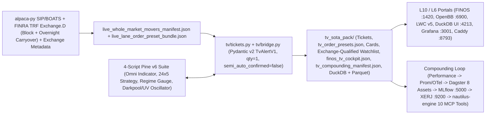

# ADR-0027: Full-Landscape SOTA TradingView 24/5 Practice, Pine v6 Suite, Darkpool/UV Watchlist Sync & Compounding Cockpit

## Context and Problem Statement

While [ADR-0010](ADR-0010.md) established the fail-closed Pydantic v2 `TvAlertV1` bridge and two display-only Pine v6 indicators, real-world 24/5 operator practice in the `half-auto-tv` compounding lane exposed five concrete architectural gaps that prevented full end-to-end landing:

1. **Indicator-Only Pine Surface:** Only two `indicator()` scripts existed (`pine/tier0_omni_sota_24x5.pine`, `pine/tier0_market_regime.pine`), leaving operators without a Strategy Tester-ready `strategy()` script using `//@strategy_alert_message {{strategy.order.alert_message}}`, without a dedicated unusual-volume & hidden-volume absorption oscillator pane, and without copy-ready native TradingView Order Panel preset values on the HUD.
2. **Overnight & FINRA TRF Darkpool Blindness:** During `OVERNIGHT`, `scanner.py` switched to `DataFeed.BOATS` and returned empty TRF maps (`darkpool_trf_ratio: null`), while RTH/extended SIP queries inspected only a 1-minute slice without separating institutional round-lot/block TRF volume from retail wholesaler odd-lots. Requiring illiquid `RSP` overnight bars forced `macro_regime = 0` (`NEUTRAL`), suppressing actionable setups and collapsing watchlists to minimal pinned rows.
3. **Unlanded Order Presets, Bare Watchlist Symbols & Thin Audit Persistence:** `tv_sota_pack/` lacked a structured `tv_order_presets.json` / `TV_ORDER_PRESET_CARDS.md` preset pack, lacked automatic Pine-to-pack SHA-256 synchronization, emitted bare tickers without required `EXCHANGE:` prefixes in `tier0_sota_tv_watchlists_live.txt`, silently dropped validated `TvAlertV1` metadata in `bridge.py`, and persisted only 15 minimal columns into `tv_half_auto_audit.duckdb` with no read-only Parquet snapshot for DuckDB SQL UI (`:4213`).
4. **Disconnected Hosted Engine & Portal Feedback:** `runner.py` omitted `prom_output_path` (leaving `paper_farm_metrics.prom` stale), `performance.py` did not emit `tier0_drawdown_breaker_latched` or TV standby/UV/TRF gauges, no declarative `finos_tv_cockpit.json` existed for FINOS Workspace (`:1420`) / OpenBB (`:6900`) / `tradingview/lightweight-charts` v5, and Dagster (`definitions.py`), MLflow/XERJ (`run_compounding_reflection.py`), Grafana (`:3001`), and `nautilus-engine` MCP lacked full TV darkpool/UV compounding visibility.
5. **Unencoded SOTA TradingView MCP & Ecosystem Firewall:** The broader TradingView landscape mixes official first-party hosted tooling (TradingView's Streamable HTTP + OAuth 2.1 MCP at `https://mcp.tradingview.com/mcp`, zero CDP) and verified OSI gems (`tradingview/lightweight-charts`, `openbq-org/finos-workspace`, `finos/perspective`, zero-CDP MIT Pine v6 local companion MCPs `paulieb89/pinescript-mcp` and `TradersPost/pine-mcp` Pine docs MCP only) with proprietary libraries (`tradingview/charting_library`), deprecated EOD services (`tradingview-pine-seeds`), custom non-OSI licenses (`revanthpobala/pinescript-vscode-extension`, `folknor/pine-tools`), ToU-violating scrapers (`tradingview-ta`, `TradingView-Screener`, `tvdatafeed`, `TradingView-API`, `tradingview-scraper`), banned community CDP `:9223` `tradingview-mcp` forks, and proprietary commercial SaaS cloud webhook relays (including TradersPost's commercial SaaS relay).

This living ADR extends [ADR-0010](ADR-0010.md), [ADR-0014](ADR-0014.md), and [ADR-0021](ADR-0021.md) to converge the entire `half-auto-tv` lane end-to-end under Core Trading Philosophy and the Tier-0 SPDX OSI License Firewall.

## Decision Drivers

- **100% Display-Only & TradingView ToU Compliance:** Zero Chrome DevTools Protocol (`:9223`), zero unofficial scraping (`tradingview_ta`, `TradingView-Screener`, `tvdatafeed`, `TradingView-API`, `tradingview-scraper`), zero external cloud broker relays, and staged tickets that stay `qty = 1` / `semi_auto_confirmed = False` until the operator confirms (`just tv-confirm-paper`, or on the live lane, as tier 2 of [ADR-0029](ADR-0029.md), the planned `just tv-confirm-live`, not yet a recipe), with hash-pinned `src/tier0_sota/risk.py`; `risk.py` invariants and lossless trailing coverage hold in every lane, and `live_execution_enabled = False` means tier 3 is off. Official first-party TradingView MCP (`https://mcp.tradingview.com/mcp`) is admitted strictly as a zero-CDP user/IDE OAuth 2.1 connector (preserving exact `4`-stdio-MCP parity across all 5 repo agent configs) for watchlists, alerts, and Pine v6 compile/backtest — never direct broker execution.
- **Strict SPDX OSI License Firewall:** Admit only verified OSI-approved repositories (`Apache-2.0`, `MIT`, `BSD-3-Clause`, `MPL-2.0`, `LGPL-3.0-or-later`, loopback-only unmodified `AGPL-3.0-only`); explicitly block proprietary (`tradingview/charting_library`, SaaS webhook relays), deprecated (`tradingview-pine-seeds/docs`), custom non-OSI (`revanthpobala/pinescript-vscode-extension`), and overlapping desktop WebView wrappers (`louisnw01/lightweight-charts-python`).
- **Full 24/5 Strategy/Indicator/Order-Preset Parity:** Mirror exact `NautilusTrader v2` (`src/tier0_sota/engine.py`) and `risk.py` Rule-612 invariants (`<= 2.00%` inward stop, `RTH` `STOP_MARKET` 0bp vs `PRE`/`AH` `STOP_LIMIT` 35bp vs `OVERNIGHT` `STOP_LIMIT` 50bp, 3 NATR schedules, 4-tier progressive R-lock, flatten-first climax auto-reverse, `60s` re-entry, `-1.50%` daily drawdown fuse) across both Pine v6 `indicator()` and `strategy()` scripts and declarative Order Presets.
- **24/5 FINRA TRF Darkpool & Unusual Volume Continuity:** Separate institutional round-lot/block FINRA TRF (`Exchange.D`) prints from retail odd-lots on live SIP sessions, carry forward prior-SIP TRF baselines causally into `OVERNIGHT` (`DataFeed.BOATS`), propagate exchange prefixes (`NASDAQ:`/`NYSE:`/`AMEX:`) from `alpaca-py`, and retain early UV/darkpool buildup candidates in standby/watchlists without relaxing strict fail-closed `extreme_mover_eligible` execution gates.
- **Zero Self-Edit UI & Closed-Loop Compounding:** Emit purely declarative JSON/Markdown/Parquet/DuckDB/Prometheus/OTel artifacts consumed by hosted upstream platforms (FINOS `:1420`, OpenBB `:6900`, `lightweight-charts` v5, DuckDB UI `:4213`, Grafana `:3001`, Prometheus `:9090`, Dagster `:3000`, MLflow `:5000`, XERJ `:9200`, Caddy `:8793`, and `nautilus-engine` MCP).

## Considered Options

1. **Adopt unofficial TradingView scrapers, CDP `:9223` browser MCPs, `tradingview/charting_library`, or proprietary cloud webhook relays** — violates TradingView ToU, fails the SPDX OSI License Firewall, and breaks loopback fail-closed execution isolation.
2. **Keep the two indicator-only Pine scripts and minimal text ticket table without Strategy Tester parity, darkpool/UV carryover, or L10 cockpit export** — leaves operators with unlanded order presets, blank overnight TRF/UV telemetry, bare watchlist symbols, and broken feedback into Paper Farm / MLflow / Grafana.
3. **Full-Landscape Verified OSI Convergence: 4-Script Pine v6 Suite + Expanded Strict `TvAlertV1` / `tv_order_presets.json` / `finos_tv_cockpit.json` / Enriched DuckDB+Parquet + FINRA TRF Block/Carryover Scanner + Hosted Engine/Portal Compounding Sync + Explicit TV Ecosystem Firewall & Zero-CDP MIT Frontier Watches (chosen)**.

## Decision Outcome

Adopt **Option 3** across `L1`, `L3`, `L4`, `L6`, `L9`, `L10`, and earned-trigger `L15`, extending [ADR-0010](ADR-0010.md), [ADR-0014](ADR-0014.md), and [ADR-0021](ADR-0021.md):

### 1. Verified OSI TradingView Ecosystem Matrix & Firewall (`upstream-map.toml`, `SOTA_STARRED_AND_BEYOND_MANIFEST.json`)

| Repository / Official Standard | SPDX License | Classification | Role / Firewall Rationale |
|---|---|---|---|
| `tradingview/lightweight-charts` (+ `tradingview/fancy-canvas`) | `Apache-2.0` (`MIT`) | **Active `L10`** | Official HTML5 Canvas charting v5 (`addSeries`, `createSeriesMarkers`, `UTCTimestamp` sec, `America/New_York` formatters) fed declaratively via `finos_tv_cockpit.json` inside FINOS/OpenBB (retaining TradingView attribution/NOTICE). |
| `openbq-org/finos-workspace`, `finos-workspace-plugins`, `OpenBB`, `backends-for-openbb` | `Apache-2.0` / `MIT` | **Active `L10`** | Hosted institutional cockpit (`:1420`, `:8000`, `:6900`) consuming declarative JSON widgets with zero hand-written HTML/JS in `src/`. |
| `finos/perspective` & `ag-grid-community` | `Apache-2.0` / `MIT` | **Active `L10`** | High-density Arrow pivot & blotters for extreme movers, FINRA TRF, UV buildup & staged tickets (`AG Grid Enterprise` EULA excluded). |
| `alpacahq/alpaca-py` + `pydantic` + `nautilus_trader` + `duckdb` + `tradermonty/claude-trading-skills` | `Apache-2.0` / `MIT` / `LGPL-3.0-or-later` | **Active `L1/L3/L4/L10`** | Official SIP/BOATS + `Exchange.D` FINRA TRF + asset exchange/ETB lookup, strict `TvAlertV1`, 24/5 Rule-612 parity, DuckDB UI (`:4213`), 6 setup taxonomies. |
| Official TradingView First-Party MCP (`https://mcp.tradingview.com/mcp`) | Platform Service (Streamable HTTP + OAuth 2.1, Essential+ paid plans) | **Official Hosted Connector (User-Level OAuth, Zero CDP)** | First-party hosted TradingView MCP (zero CDP, zero scraping). Supports Watchlists CRUD (`list_watchlists`, `get_watchlist`, `get_active_watchlist`, `create_watchlist`, `delete_watchlist`, `add_to_watchlist`, `remove_from_watchlist`, `update_watchlist`), Alerts CRUD + logs, and official Pine v6 compiler/backtest lifecycle (`validate_pine_script`, `run_pine_indicator`, `run_pine_backtest` incl. Deep Backtesting, `search_pine_scripts`, `get_pine_script_source`, `create_pine_script`, `update_pine_script`). Does **NOT** expose native Supercharts Order Panel Presets or direct broker order execution — executable multi-situation 24/5 lossless trailing order presets stay inside local `nautilus-engine` + `src/tier0_sota/tv/tickets.py` + `src/tier0_sota/live/execution.py` (staged `qty = 1` / `semi_auto_confirmed = False` until the operator confirms; live operations follow the three tiers of [ADR-0029](ADR-0029.md)). Connected at user/IDE OAuth level (Antigravity / Claude / Cursor) to preserve exact `4`-stdio-MCP parity across all 5 repo configs. |
| Official TradingView Specs (Pine v6, Order Presets UI, `.txt` `###` Watchlist Spec) & FINRA OTC/Reg SHO | Platform Spec / Public Reg Data | **Active Standard** | Non-repainting Pine v6 UDTs + `//@strategy_alert_message`, native Order Panel preset mirror, `###SECTION` + `EXCHANGE:SYMBOL` `.txt` import (color flags remain cloud-UI-only). |
| `paulieb89/pinescript-mcp` | `MIT` | **Frontier Watch `L15` (Local Companion MCP)** | Zero-CDP MIT Python Pine v6 docs/syntax local companion MCP (`PyPI pinescript-mcp==0.7.7`, on-demand `uvx pinescript-mcp` outside `pyproject.toml` and repo 5x5 stdio configs). |
| `TradersPost/pine-mcp` | `MIT` | **Frontier Watch `L15` (Local Companion MCP — Pine Docs ONLY)** | Zero-CDP MIT Node Pine v6 documentation companion MCP (`npx -y pinescript-mcp-server`, on-demand outside repo configs). **Firewall scope:** Pine docs MCP ONLY — TradersPost's proprietary commercial SaaS webhook relay remains explicitly **Blocked** under the SPDX OSI firewall. |
| `trugurpala/pinescriptv6` | `MIT` | **Reference-Only `L15`** | Zero-CDP Pine v6 Markdown reference docs repo (PyPI/npm unpublished); deferred as reference-only. |
| `finos/FDC3` | `Apache-2.0` | **Watch `L10`** | Cross-widget `fdc3.instrument` broadcast inside FINOS Workspace (display-only). |
| `folknor/pine-tools` | `NOASSERTION` (Non-OSI) | **Blocked (Firewall)** | GitHub reports `NOASSERTION` license (fails Tier-0 SPDX OSI firewall) and unpublished on PyPI/npm -> use official `https://mcp.tradingview.com/mcp` or strict `MIT` `paulieb89/pinescript-mcp` / `TradersPost/pine-mcp` (Pine docs MCP only). |
| `tradingview/charting_library` | Proprietary (Non-OSI) | **Blocked (Firewall)** | Proprietary commercial license (examples repo MIT glue only) -> use `tradingview/lightweight-charts`. |
| `revanthpobala/pinescript-vscode-extension` | Custom Modified-MIT (Non-OSI) | **Blocked (Firewall)** | Non-standard modified license fails SPDX OSI gate -> use official `https://mcp.tradingview.com/mcp`, strict `MIT` `paulieb89/pinescript-mcp` / `TradersPost/pine-mcp` (Pine docs MCP only), or reference-only `trugurpala/pinescriptv6`. |
| `tradingview-pine-seeds/docs` | Platform ToU / Deprecated | **Rejected (`L4`)** | Suspended by TradingView for new repos and EOD daily-only; unsuitable for 24/5 intraday movers. |
| `python-tradingview-ta`, `TradingView-Screener`, `tvdatafeed`, `TradingView-API`, `tradingview-scraper` | `MIT` / `ISC` | **Banned (ToU Scraping)** | Unofficial TradingView scanner/WebSocket scraping; violates ToU -> use official `alpacahq/alpaca-py`. |
| `atilaahmettaner/tradingview-mcp`, `tradesdontlie/tradingview-mcp`, Moon Dev CDP forks | `MIT` | **Pruned (Unofficial CDP `:9223` / Scraping Forks)** | Unofficial community `tradingview-mcp` forks depend on banned CDP browser automation (`:9223`) or undocumented scraping; superseded by official `https://mcp.tradingview.com/mcp` + local `nautilus-engine` MCP. |
| `louisnw01/lightweight-charts-python` | `MIT` | **Rejected (`L10` Overlap)** | Local desktop WebView/PyQt wrapper duplicating hosted FINOS/OpenBB + `tradingview/lightweight-charts` v5. |
| Proprietary SaaS Webhook Relays (`TradersPost` commercial SaaS relay, `3Commas`, `CrossTrade`, `PickMyTrade`, `Autoview`) | Proprietary SaaS | **Blocked (Firewall)** | Non-OSI commercial cloud relays violating loopback-only, fail-closed `semi_auto_confirmed = False` posture (distinct from MIT `TradersPost/pine-mcp` local Pine docs MCP). |

**Official TradingView MCP Scope Boundary & Local Execution Lock:** TradingView's official first-party hosted MCP (`https://mcp.tradingview.com/mcp`, Streamable HTTP + OAuth 2.1 on Essential+ paid plans, zero CDP) closes watchlist CRUD, alert CRUD/logs, and official Pine v6 validation/backtest (including Deep Backtesting), but explicitly does **not** expose native Supercharts Order Panel Presets or direct broker order execution. Consequently, executable multi-situation 24/5 lossless trailing order presets remain inside local `nautilus-engine` + `src/tier0_sota/tv/tickets.py` + `src/tier0_sota/live/execution.py`: staged tickets stay `qty = 1` / `semi_auto_confirmed = False` until the operator confirms through `just tv-confirm-paper`, or on the live lane (tier 2 of [ADR-0029](ADR-0029.md)) through the planned `just tv-confirm-live`, not yet a recipe; `live_execution_enabled = False` means tier 3 is off. Connecting `https://mcp.tradingview.com/mcp` via user/IDE OAuth in Antigravity, Claude, or Cursor (see [TV_AUTOMATION_PLAYBOOK.md](../TV_AUTOMATION_PLAYBOOK.md)) leaves `.mcp.json`, `.claude/settings.json`, `.gemini/settings.json`, `opencode.json`, and `.codex/config.toml` untouched at exact `4`-stdio-MCP parity (`codebase-memory`, `edgartools`, `nautilus-engine`, `xerj`), as verified by `tests/test_architecture_manifest.py` and `scripts/preflight_resume.sh`.

### 2. Four-Script Non-Repainting Pine v6 Suite & Converged 8-Setup Playbook (`pine/*.pine`)

- **`pine/tier0_omni_sota_24x5.pine` (`indicator()`, Pane 0):** Pine v6 `OrderPresetCard` + `VenueOrderHandle` UDTs, `i_venue_profile` (`IBKR_PAPER_4002` `3000 rpm`, `ALPACA_PAPER_1000` `1000 rpm`, `ALPACA_PAPER_200` `200 rpm`, plus Stage-5 display-parity profiles `ALPACA_LIVE_PRO_LINE_1000`, `IBKR_LIVE_3000`, `ALPACA_LIVE_ELITE_SMART_ROUTER`) bit-exact with `engine.build_venue_order_handle_spec()`, exact `engine.py`/`risk.py` Rule-612 stop & collared-limit parity, differentiated 8 Omni presets, all **8 converged multi-situation setups** (`EARLY_EP_MOMENTUM_BURST`, `VCP_BREAKOUT`, `VCP_COIL`, `PEAD_DRIFT`, `EXHAUSTION_HAMMER`, `HIDDEN_VOL_ACCUM`, `PARABOLIC_TOP`/`PEAK_REVERSAL`, `CRASH_ALIGNMENT`) mapped to target Paper Farm lanes (`PA1` Momentum, `PA2` VCP/PEAD/Accum, `PA3` Crash/Rev, `IBKR_4002` 24/5 Overnight), UV velocity/z-score & hidden-volume VWAP-pin absorption proxy, 12-row copy-ready Native TV Order Preset HUD, and `TvAlertV1`-validated `alert()` JSON (`script_kind: "indicator"`, `venue_profile`).
- **`pine/tier0_sota_strategy_24x5.pine` (`strategy()`, Pane 0 Strategy Tester):** Full Strategy Tester & `//@strategy_alert_message {{strategy.order.alert_message}}` execution parity mirroring `VenueOrderHandle`, `i_venue_profile`, all 8 multi-situation setups + `PEAD_DRIFT`, Paper Farm lane targets, 12-row Order Preset HUD, `default_qty_value=1`, 4 bps/side commission, causal bar-close fills, `-1.50%` latched session drawdown fuse, 4-tier progressive R-lock, flatten-first climax auto-reverse, `60s` cooldown, and `TvAlertV1` JSON (`script_kind: "strategy"`, `venue_profile`).
- **`pine/tier0_market_regime.pine` (`indicator()`, Pane 1):** Daily `RSP/SPY` breadth, `na`-guarded 24/5 macro health score, discrete `-1/0/+1` regime plot, and explicit `DIRECT_SHORT_ETB` vs `INVERSE_HEDGE_SOXS_SQQQ` posture.
- **`pine/tier0_darkpool_uv_buildup.pine` (`indicator()`, Pane 2):** Dedicated RVOL + Z-score histogram, 3-bar volume velocity ramp, hidden-volume absorption (`HVR`), session CVD + divergence, and non-repainting `alertcondition()` hooks.

### 3. Unified Bridge, 1000rpm/3000rpm Order Handles, 8-Setup Playbook, DuckDB/Parquet & L10 Cockpit (`src/tier0_sota/tv/`, `scripts/tv_console.{ps1,sh}`)

- **Strict `TvAlertV1`, Scoped `refuse_live_endpoints` & `schema_v1.json` Lockstep Parity (38 Properties):** Retain `schema_version = "tier0.tv-alert.v1"`, `extra="forbid"`, `qty=1`, `semi_auto_confirmed=False`, `bar_confirmed=True`; add strictly optional fields `darkpool_trf_ratio` (`[0, 1]`), `vol_buildup_ratio` (`>= 0`), `unusual_volume_buildup` (`StrictBool`), `script_kind` (`"indicator" | "strategy"`), `order_preset_id` (`str`, 1..64), and `venue_profile` (`IBKR_PAPER_4002` | `ALPACA_PAPER_200` | `ALPACA_PAPER_1000` | `IBKR_LIVE_3000` | `ALPACA_LIVE_PRO_LINE_1000` | `ALPACA_LIVE_ELITE_SMART_ROUTER`; Stage-5 LIVE profiles refused on `live_intake=True`), preserving all validated fields in staged presets and resolving fallback watchlist paths cleanly. `refuse_live_endpoints()` enforces `4001`/`7496`/`8798`/`8796`/`9223` + live hosts (`api.alpaca.markets`/`live.alpaca.markets`) strictly across `:PORT` URL/host syntax, labeled port/cdp/endpoint syntax, and endpoint/port/host/url/cdp keys — preventing false-positive tick drops on market decimals (`$74.96`/`$40.01`), timestamps, or hex IDs.
- **Converged 8-Setup Classifier & Venue Order-Handle Matrix:** `classify_multi_situation_setup()` and `MULTI_SITUATION_SETUP_PLAYBOOK` attach recommended Omni Pine preset, optimal NATR trailing schedule, 4-tier progressive lossless lock rungs, target Paper Farm lane, and exact `engine.build_venue_order_handle_spec()` RPM/RPS/exit-reserve budgets (`IBKR_PAPER_4002` `3000 rpm`/`50 rps`, `ALPACA_PAPER_1000` `1000 rpm`/`25 rps`, `ALPACA_PAPER_200` `200 rpm`/`10 rps`, Stage-5 `ALPACA_LIVE_PRO_LINE_1000` parity; `3,600 rpm` default / `6,000 rpm` Pro-1000 combined Paper Farm budget with `>= 10%` protective exit reserve).
- **Complete Atomic `tv_sota_pack/` Landing, Delta-Gated Cloud Sync & Preset Setup Automation (`just tv-preset-setup`):** `run_preset_setup_automation()` + `prune_and_archive_staged_presets()` automatically archive executed (`EXECUTED_ARCHIVED`), legacy/missing-profile (`LEGACY_PRUNED`), and cross-session expired (`EXPIRED_SESSION`) alerts into the idempotently migrated **30-column** `tv_half_auto_audit.duckdb` (`status` + `venue_profile` + TRF/UV/archetype/gate/script_kind columns) + `tv_staged_presets.parquet` (`tv_audit.tv_staged_presets` in DuckDB UI `http://localhost:4213`), skip locked active positions, and stage fresh current-session 4-session presets (`qty=1`, `semi_auto_confirmed=False`, `ALPACA_PAPER_1000`); `refresh_tickets_from_paths()` atomically writes `live_half_auto_tickets.json`/`.md`, `tv_order_presets.json`/`TV_ORDER_PRESET_CARDS.md` (with `Spread (bps)`, `ADV20`, and `Split Adj` microstructure columns), `tv_layout_blueprints.json`/`TV_LAYOUT_AND_PRESET_QUICKSTART.md`, 7-section exchange-qualified `tier0_sota_tv_watchlists_live.txt`, movers-first `tier0_sota_tv_movers_first_live.txt`, `tv_watchlist_sync_payload.json` (with deterministic delta-gated Cloud sync metadata `top10_membership_sha256`, `min_cloud_sync_interval_secs=900`, `sync_policy="delta_gated_15m_max_96_per_day"`), `finos_tv_cockpit.json`, `tv_compounding_manifest.json` + synced `pine/*.pine`, and DuckDB+Parquet snapshots.
- **Cross-OS Operator Console & `just tv-land` / `just tv-preset-setup`:** `scripts/tv_console.ps1` (Windows) and `shellcheck`-clean `scripts/tv_console.sh` (WSL2 `Noesis-SOTA`) with `-VenueProfile`/`--venue-profile`, `preset-setup`/`tv-preset-setup`, `prune-stale`/`tv-prune-stale`, `tv-handles`/`handles`, `tv-layout`/`layout`, `tv-mcp-status`/`mcp-status`, Pine copy helpers for all 4 scripts, `tv-presets`, `tv-ingest`, `tv-sync-pine`, `tv-land`, `tv-e2e`, and `tv-portals`, backed by `just tv-land` and `just tv-preset-setup`.

### 4. 24/5 Hosted Engine, Bidirectional Coordination, Darkpool/UV Scanner & Zero-Friction Ops (`src/tier0_sota/{engine,live,definitions}.py`, `scripts/`)

- **1000rpm/3000rpm Engine Order-Handle SSOT & 24/5 Lossless Self-Handling (`src/tier0_sota/engine.py`, `paper_farm.py`, `execution.py`):** `ALPACA_PAPER_1000` (`ALPACA_PAPER_PRO_LINE_1000`, `1000 rpm`/`25 rps`/`10` trailed pos, `paper_only=True`, `live_execution_enabled=False`) + `build_venue_order_handle_spec()` (`tier0.venue-order-handle.v1`, `1.0s`/`1.33s`/`2.0s` trailing modify cadences, NautilusTrader v2 `RiskEngineConfig` submit/modify rates) + pure-`Decimal` `compute_non_noise_min_trail_spec()` (`tier0.non-noise-min-trail.v1`: per-symbol/per-situation non-noise min-trail floor strictly `<= 2.00%`, `RTH` `NATIVE_BROKER_STOP_MARKET_RATCHET` `STOP_MARKET` / `alpaca-py` `TrailingStopOrderRequest` 0bp vs `PRE_MARKET`/`AFTER_HOURS` `SYNTHETIC_TICK_SUPERVISED_COLLARED_LIMIT` 35bp vs `OVERNIGHT` `SYNTHETIC_BOATS_COLLARED_LIMIT` 50bp, `FLATTEN_FIRST_PEAK_CLIMAX_REVERSE` routing to `DIRECT_SHORT_ETB` or `INVERSE_HEDGE` incl. `NVDA -> NVDS`/`NVD`, and `1000 rpm` `60s` rapid re-entry with `>= 10%` exit reserve); `adopt_unmanaged_broker_positions()` + DuckDB ledger signature tracking provide zero-latency adoption of confirmed half-auto TV orders into live `Guard` supervision across all 4 sessions (inferring monotonic `lock_tier` on restore) and export telemetry across `paper_farm_execution_status.json`, `live_lane_order_preset_bundle.json`, `tv_engine_coordination_manifest.json`, Prometheus, and unitless OTel.
- **Causal Pre-Wall Extreme-Mover Early-Detection Calibration & Non-Stop Compounding Loop (`src/tier0_sota/discovery.py`, `src/tier0_sota/research.py`, `src/tier0_sota/definitions.py`, `scanner.py`, `scripts/run_early_mover_compounding.py`, `scripts/run_nonstop_compounding_loop.py`, `docker/systemd/tier0-compounding-loop.{service,timer}`):** Canonical upstream calibration CLI (`python -m tier0_sota.research --calibrate-extreme-movers --trials 24` using `Polars`, `DuckDB`, `Optuna`, `skfolio` CPCV, `NautilusTrader v2 BacktestEngine`, `MLflow` `:5000`) strictly enforces pre-wall PIT (`<= 2026-10-15`), calibrates the 5-tier extreme-mover taxonomy (`PREMARKET_CATALYST_LEADER`, `SUDDEN_VOLUME_IGNITION`, `EXTREME_MOVER_CONTINUATION`, `PARABOLIC_CLIMAX_SHORT_REVERSAL`, `DARKPOOL_ACCUMULATION_BREAKOUT`) plus `27` per-symbol microstructure `min_trailing_pct` floors (`<= 2.00%`), emits `historical_extreme_mover_calibration_manifest.json` (`tier0.historical-extreme-mover-calibration.v1`) + `historical_extreme_mover_calibration.duckdb` alongside strictly separated post-wall observational `NVDA` Monday (`2026-11-23`) premarket E2E replay (`08:03 EST @ $135.80`, `143m` lead to `$171.50` peak, 5/5 profitable trades in `NautilusTrader v2`), and feeds `scanner.py` + `tv_watchlist_sync_payload.json` + `tv_mcp_sync_receipt.json`. Recurring multi-hour compounding is driven strictly by native `systemd` (`tier0-compounding-loop.timer`) + `Dagster` (`nonstop_compounding_loop_job`) invoking single-tick `scripts/run_nonstop_compounding_loop.py --once` (zero ad-hoc Python sleep loops, passive `/proc/net/tcp` forbidden-port check) emitting `nonstop_compounding_loop_status.json` (`tier0.nonstop-compounding-loop.v1`).
- **Bidirectional TV <-> Engine Coordination & Non-Blocking IBKR Probe (`src/tier0_sota/live/runner.py`):** `run_cycle()` launches `ibkr_health(farm.ibkr)` concurrently on a dedicated `ThreadPoolExecutor(max_workers=1)` so `ExtremeMoverScanner.from_env()`, `refresh_accounts()`, and `scanner.scan()` proceed with `0.00s` IBKR stall while joining before reconciliation and propagating fail-closed `PermissionError` refusals; `reconcile_staged_tv_presets_for_engine()` validates staged Pine v6 alerts (`qty=1`, `semi_auto_confirmed=False`) against daily drawdown breakers, `select_situation_lane()`, `CrossLaneSymbolLock`, Alpaca overnight short refusal, Stage-5 LIVE profile refusal, and Nautilus `SANDBOX` + Rule-612 stop parity, atomically writing `tv_sota_pack/tv_engine_coordination_manifest.json` (`tier0.tv-engine-coordination.v1`, `auto_submit_enabled=False`, `live_execution_enabled=False`).
- **Scanner (`src/tier0_sota/live/scanner.py`):** Full-market **12,005-stock US NMS sweep** (`enable_full_market_sweep`, `_sweep_full_market_movers` via official `alpaca-py` `TradingClient.get_all_assets(ACTIVE, US_EQUITY)` + batched `StockSnapshotRequest`, filtering penny warrants/rights) hardened with four zero-dep institutional guards: (1) daily-cached pre-rank **CorporateActionsClient split/reverse-split adjustment** (`.nms_split_factors_cache.json`, `pdb_day < ex_day` double-adjust guard, winsorized `whole_score`, and low-RVOL artifact demotion), (2) free `snap.latest_quote` **live bid-ask spread gate** (`<= 150 bps` RTH / `<= 300 bps` extended for `EARLY_STAGE_IGNITION`, `> 500 bps` excluded from `full_market_top_movers`), (3) daily-cached **20-day split-adjusted median `ADV_20`** baseline (`.nms_adv20_cache.json`), and (4) calibrated **`PRE_MARKET` (`0.01871` full-day share) & early-close `AFTER_HOURS` (`0.4026 + 0.06 * ah_frac`) ToD RVOL**, **upper VWAP extension cap** (`[-2.5%, +12.0%]` long / `[-12.0%, +2.5%]` short) on `EARLY_STAGE_IGNITION`, and live **`VIXY` macro volatility proxy** (`vix_available=True`), paired with `INTRADAY_GAP_FADE_IN_GREEN_TAPE` guard, concurrent per-symbol SIP FINRA TRF (`Exchange.D`) block/carryover, Alpaca OPRA UOA/GEX + News/CorpActions, exchange propagation (`normalize_tv_exchange()`), core-3 overnight regime, and fail-closed `watch_tier` retention.
- **Hosted Portals, Observability & Momentum Alerting (`performance.py`, `definitions.py`, `run_compounding_reflection.py`, `nautilus_mcp_server.py`, `docker/grafana/dashboards/*.json`, `docker/prometheus_rules.yml`, `docker/alertmanager.yml`, `preflight_resume.sh`, `configure_paper_farm_ui.sh`):** Wire `prom_output_path` in `runner.py`; emit unitless OTel + Prometheus combined equity (`tier0_paper_farm_combined_equity_usd`), TCA (`tier0_paper_farm_combined_tca_{mean,p95}_is_bps`), live sliding-60s broker rate gauges (`tier0_paper_farm_live_used_rpm_60s`, `tier0_paper_farm_live_rpm_utilization_pct` via `rate_budget_live_rpm`), momentum (`tier0_momentum_{top_score,rvol,darkpool_trf_ratio,ignition_count,climax_reversal_count}`), 24/5 trailing (`tier0_position_{profit_lock_tier,fast_sell_armed}`), and staged-alert (`tier0_staged_alert_{active,stale}_count`) gauges alongside breaker/scanner/venue-handle metrics across Prometheus (`:9090`, `--web.external-url=http://127.0.0.1:9090`, `15/15` session-gated rules routed by category `momentum`/`lossless_trailing`/`risk_ops` through Alertmanager `:9093` `v0.28.1`), unitless OTel (`:9464`), and `3/3` provisioned Grafana (`:3001`) dashboards (`tier0-sota-observability.json` [8 panels], `tier0-order-presets-momentum.json` [11 panels], `tier0-workstation-telemetry.json` [7 panels], `0` missing metrics); serve **31/31 live widgets** (`HTTP 200`, `DEAD_REFS=[]`, `UNREF=[]`) on OpenBB (`:6900` `v2.4.3` -> FINOS Workspace `:1420` **`10s` live auto-sync** with loopback CORS, exposing `spread_bps`/`adv_20`/`split_adjusted`, `/tier0/historical-early-mover-timeline` [`45` rows], `/tier0/live-session-lossless-manifest`, read-only `/tier0/live-account-tier1-telemetry`, live Alertmanager/Prometheus momentum alerts, early-stage movers, and 4-session lossless presets); attach read-only `tv_audit.tv_staged_presets` into DuckDB SQL UI (`http://localhost:4213`); serve unmodified official NautilusTrader v2 HTML tearsheets & movers-first `tier0_sota_tv_movers_first_live.txt` on Caddy (`:8793`); propagate compounding telemetry through exact 8 Dagster assets, MLflow/XERJ/DSPy reflection, and exact 10 `nautilus-engine` FastMCP tools with `just preflight` (`13/13` gates, `15/15` portals) and `just fnox-check` (`4/4` profiles).
- **4-Session Order-Type Handling, Supervised Off-Hours Exit Re-Peg & Opposing Inverse-Pair Guard (`src/tier0_sota/live/execution.py`):** Verified 4-session real broker order-type handling (`RTH` `OTO_LIMIT` + `StopLossRequest` + `ReplaceOrderRequest` with HTTP `404`/`422` fill-race tolerance + instant `MarketOrderRequest` fast-sell; off-hours `PRE_MARKET`/`AFTER_HOURS` `35 bps` and `OVERNIGHT` `50 bps` collared `LimitOrderRequest(extended_hours=True)` + `SyntheticLosslessStopRatchet` on live SIP+BOATS feeds), bounded collared-exit re-peg (`EXIT_REPEG_MIN_AGE_SECS=15.0`, `MAX_SUPERVISED_EXIT_ATTEMPTS=12`, cancelling stuck `pending_new`, stale cross-session exits, and out-of-market extended-hours limits while consuming `is_exit=True` rate slots), plus symmetric 9-family `OPPOSING_INVERSE_PAIR_MAP` (`TQQQ<->SQQQ`, `SOXL<->SOXS`, `NVDA/NVDL<->NVDS`, etc.) blocking simultaneous opposing positions until flatten-first completes.

### Confirmation

Confirmed mechanically via:

- `tests/test_tv_automation.py` (4-script Pine v6 non-repainting/balance/JSON-extraction parity, `TvAlertV1` <-> `schema_v1.json` lockstep, Order Presets, `finos_tv_cockpit.json`, DuckDB migration + Parquet snapshot, exchange-qualified watchlists, `tv_console.{ps1,sh}` zero-CDP checks)
- `tests/test_live_automation.py` (FINRA TRF block + overnight carryover, core-3 overnight regime, `watch_tier` retention, Prom/OTel TV & breaker gauges, `runner.py` Prom export)
- `tests/test_definitions.py::test_active_dagster_compounding_assets_and_frontier_telemetry` & `tests/test_mcp_server.py::test_mcp_server_smoke_cli`
- `tests/test_architecture_manifest.py::test_clean_sota_harness_zero_overlap_and_spdx_firewall` & `test_adr_catalog_zensical_nav_and_manifest_graph_parity`
- `rules/zero_self_invention.yml` (`no-banned-library-import`, `no-live-broker-endpoint`, `no-custom-dashboard-server`, `no-raw-http-broker-polling`, `no-raw-http-socket-in-src`, `no-hardcoded-live-execution-true`)
- `evals/tier0_inspect_eval.py` (`live_refusal`, `zero_banned_libs`, `risk_sha256`, `adr_graph_and_clean_sota_harness_integrity`) and `just adr-check`, `just ast`, `just deptry`, `just mcp-smoke`, `just docs-build`

## Consequences

- **Positive:** Turns the `half-auto-tv` lane into a genuinely landed 24/5 institutional cockpit with Strategy Tester parity, copy-ready Order Presets, live + overnight-carryover FINRA TRF darkpool and unusual-volume buildup telemetry, exchange-qualified TradingView watchlists, declarative FINOS/OpenBB/Lightweight-Charts JSON, DuckDB+Parquet audit trails, Grafana/Prometheus/OTel metrics, and closed-loop MLflow/Dagster/XERJ compounding — all 100% OSI-clean and ToU-compliant.
- **Negative:** Requires keeping `TvAlertV1`, `schema_v1.json`, all 4 `pine/*.pine` scripts, and `tv_sota_pack/` SHA-256 digests synchronized through automated tests, while preserving manual human confirmation (`semi_auto_confirmed = False`, `qty = 1`) on every TradingView order ticket.

## Pros and Cons of the Options

### Option 1: Unofficial scrapers, CDP `:9223` MCPs, proprietary `charting_library`, or cloud webhook relays

- Good, because third-party relays advertise one-click browser/cloud wiring.
- Bad, because it violates TradingView ToU, fails the Tier-0 SPDX OSI License Firewall, and compromises loopback fail-closed execution safety.

### Option 2: Minimal two-indicator Pine scripts without Strategy Tester parity, TRF carryover, or cockpit exports

- Good, because fewer schema and manifest artifacts need maintenance.
- Bad, because overnight darkpool/UV telemetry remains blank, operators lack Order Presets and Strategy Tester parity, and hosted portals cannot observe the TV lane.

### Option 3: Full-Landscape OSI Convergence (4 Pine v6 scripts + Order Presets + TRF/UV Scanner + Declarative L10 Cockpit + Compounding Sync)

- Good, because every surface lands deterministically inside verified OSI upstreams with mechanical fitness gates, zero custom HTML/HTTP servers, and 24/5 darkpool/UV continuity.
- Bad, because schema and Pine additions require coordinated lockstep verification across `tv/bridge.py`, `schema_v1.json`, `pine/*.pine`, and `tests/test_tv_automation.py`.

## More Information

### Upstream Evidence & Empirical Benchmarks

- **Verified OSI Active Stack:** `tradingview/lightweight-charts` (`Apache-2.0`), `tradingview/fancy-canvas` (`MIT`), `openbq-org/finos-workspace` & `finos-workspace-plugins` (`Apache-2.0`), `OpenBB-finance/OpenBB` (`Apache-2.0`) & `backends-for-openbb` (`MIT`), `finos/perspective` (`Apache-2.0`), `ag-grid-community` (`MIT`), `alpacahq/alpaca-py==0.45.0` (`Apache-2.0`), `pydantic` (`MIT`), `duckdb` (`MIT`), `nautechsystems/nautilus_trader==2.0.0rc9` (`LGPL-3.0-or-later`), `tradermonty/claude-trading-skills` (`MIT`).
- **Official Upstream Org Landscape Audit (`2026-11-27`, live GitHub API + PyPI verified):**
  - **`alpacahq` (`93` repos / `29` archived):** Active admitted winners are `alpacahq/alpaca-py` (`Apache-2.0`, pinned `0.45.0`) and official first-party `alpacahq/alpaca-mcp-server` (`MIT`, pinned PyPI `2.4.1`, `72` tools) isolated strictly as an **off-repo global paper-only Antigravity plugin** (`~/.gemini/config/plugins/alpaca-sota-mcp/`, `ALPACA_PAPER_TRADE=True`, `LIVE_EXECUTION_ENABLED=false`, runtime `fnox exec --profile paper`, fail-closed exit `78` on `AK*` / `api.alpaca.markets` / `ALPACA_PAPER_TRADE=False` / `LIVE_EXECUTION_ENABLED=true`, live verified in `alpaca_mcp_smoke_receipt.json`, leaving `pyproject.toml`/`uv.lock` and all `5` repo `4`-stdio-MCP configs untouched). Active OSI watches: `alpacahq/alpaca-skills` (`Apache-2.0`) and `alpacahq/cli` (`Apache-2.0`). Explicitly excluded archived/legacy/banned overlaps: `alpacahq/alpaca-trade-api-python` (`archived=True`), `alpacahq/pylivetrader` (legacy `zipline`), `alpacahq/alpaca-backtrader-api` (banned `backtrader`), `alpacahq/alpaca-zipline` (unlicensed `zipline`), `alpacahq/backtrader` (`archived=True`, `GPL-3.0`), `alpacahq/Lean` (`archived=True`), and unlicensed example repos (`example-hftish`, `example-scalping`, `Momentum-Trading-Example`).
  - **`nautechsystems` (`6` repos / `2` archived):** Active L3 winner `nautechsystems/nautilus_trader` (`LGPL-3.0`, pinned `2.0.0rc9`); active OSI watches `nautechsystems/nautilus_agents` (`LGPL-3.0`, strictly off synchronous execution hot path per `no-llm-on-execution-hot-path`) and `nautechsystems/nautilus_engineering` (`LGPL-3.0`); archived/unlicensed exclusions `nautechsystems/nautilus_ibapi` and `nautechsystems/nautilus_experiments`.
  - **`tradingview` (`39` repos) & `pinecoders` (`16` repos) OSI Practice:** Active admitted surfaces are official `https://mcp.tradingview.com/mcp` (OAuth 2.1, zero CDP), `paulieb89/pinescript-mcp==0.7.7` (`MIT`, zero CDP), `tradingview/lightweight-charts` (`Apache-2.0`) + `tradingview/fancy-canvas` (`MIT`), and official Pine v6 libraries `TradingView/ta/10` + `TradingView/TechnicalRating/3` + `STD;VWAP`. Permissive/weak-copyleft PineCoders references (`pinecoders/awesome-pinescript` `MIT`, `pinecoders/pinescript-enums` `MPL-2.0`, `pinecoders/pynescript` `LGPL-3.0`) remain reference/watch only (`pinecoders/pynecore` `Apache-2.0` excluded from `src/` to preserve `NautilusTrader v2` single-engine L3 SSOT). Strictly firewalled: `GPL-2.0`/`GPL-3.0` PineCoders repos (`pine-utils`, `tradingview-pinescript-indicators`, `pinescript-cheatsheet`, `pine-script-mode`, `vim-pine-script`, `sublime-pine`), `NOASSERTION` (`folknor/pine-tools`, archived `pinecoders/pine-script-syntax-highlighting`), proprietary (`tradingview/charting_library`, commercial SaaS webhook relays), CDP `:9223` (`tradingview-mcp` forks), and unofficial ToU scrapers (`tradingview-ta`, `tvdatafeed`, `TradingView-Screener`, `TradingView-API`, `tradingview-scraper`).
- **Official TradingView First-Party MCP & Zero-CDP `L15` Local Companions:** Official TradingView MCP (`https://mcp.tradingview.com/mcp`, hosted Streamable HTTP + OAuth 2.1 on Essential+ paid plans, zero CDP) provides Watchlists CRUD (`list_watchlists`, `get_watchlist`, `get_active_watchlist`, `create_watchlist`, `delete_watchlist`, `add_to_watchlist`, `remove_from_watchlist`, `update_watchlist`), Alerts CRUD + logs, and official Pine v6 validation/backtest (`validate_pine_script`, `run_pine_indicator`, `run_pine_backtest` incl. Deep Backtesting, `search_pine_scripts`, `get_pine_script_source`, `create_pine_script`, `update_pine_script`) without exposing Supercharts Order Panel Presets or direct broker execution (which remain inside local `nautilus-engine` + `src/tier0_sota/tv/tickets.py` + `src/tier0_sota/live/execution.py`, with staged tickets at `qty = 1` / `semi_auto_confirmed = False` until the operator confirms and live operations following the three tiers of [ADR-0029](ADR-0029.md)). Verified zero-CDP MIT local Pine v6 companion MCPs are `paulieb89/pinescript-mcp` (`MIT`, PyPI `pinescript-mcp==0.7.7`, on-demand `uvx pinescript-mcp`) and `TradersPost/pine-mcp` (`MIT`, Node `npx -y pinescript-mcp-server`, Pine docs MCP ONLY — TradersPost's proprietary commercial SaaS webhook relay remains blocked under the SPDX OSI firewall), alongside reference-only `trugurpala/pinescriptv6` (`MIT`, PyPI/npm 404); `folknor/pine-tools` remains excluded (`NOASSERTION`). All stay outside `uv.lock` and the 5 repo stdio-MCP configs (`codebase-memory`, `edgartools`, `nautilus-engine`, `xerj`) unless promoted via the 4-Gate Admission Protocol ([ADR-0018](ADR-0018.md)).
- **TradingView Platform Specifications & Live E2E Receipts Verified (`2026-11-27`):** Pine Script v6 `OrderPresetCard` + `VenueOrderHandle` UDTs + `//@strategy_alert_message {{strategy.order.alert_message}}` + non-repainting `alert()` (6/6 venue order-handle profiles bit-exact vs `engine.build_venue_order_handle_spec()` and `48/48` `pinescript-mcp==0.7.7` built-ins verified PASS), native Order Panel presets (`SL`/`TP` bracket templates), `.txt` watchlist import (`###SECTION` dividers + `EXCHANGE:SYMBOL`, `53` symbols, `0` bare tickers, `INLF`/`FIEE` artifacts eliminated; color flags are cloud-UI-only; delta-gated cloud sync metadata `min_cloud_sync_interval_secs=900`), FINRA `Exchange.D` TRF block vs odd-lot microstructure (`11/12` live overnight TRF carryover), **30-column** DuckDB + Parquet audit snapshot, **31/31** live OpenBB `:6900` `v2.4.3` widgets (`HTTP 200`, `10s` FINOS `:1420` `refetchInterval`, incl. `/tier0/historical-early-mover-timeline` [`45` rows], `/tier0/live-session-lossless-manifest`, and read-only `/tier0/live-account-tier1-telemetry`) across **5** FINOS `:1420` institutional layout tabs, **3/3** Grafana `:3001` dashboards, live sliding-60s `rate_budget_live_rpm` Prometheus/OTel gauges (`tier0_paper_farm_live_used_rpm_60s`, `tier0_paper_farm_live_rpm_utilization_pct` across all `4/4` Paper Farm accounts), zero-window WSL2 observer delegation (`exitCode: 0`, continuous `SUPERVISING`, zero `STALE_SCAN`), and `just preflight` (`13/13` gates, `15/15` portals) + `just fnox-check` (`4/4` profiles).
- **Pre-Rank Ranking Hardening, Historical Pre-Wall & `2026-11-27` Early-Mover Timeline Proof (`2026-11-27`):** Live post-fix scan (`12,005` US NMS equities in `1.12s`, `split_adjusted=7`, `spread_filtered=402`, `adv20_covered=1,317/1,318`, `vix_available=True VIXY -8.68%`) eliminated `INLF` 1-for-16 reverse split (`-6.99%`, NOT `+1449% #1`), adjusted `SPRC` (`+26.49%`, NOT `+567% #2`), excluded `FIEE` (`1,156 bps` dead quote), and capped `GDEV` (`+17%` VWAP) out of Early-Stage Ignition. Verified `historical_early_mover_timeline_and_alert_manifest.json` (`210,340B`, SHA-256 `f0e054e37e9491d1f5ae2787317c82f86cd0b58b374ab5823921880e77f996a2`): pre-wall (`<= 2026-10-15`, `162/162` bar peaks, `71.6%` caught in `PRE_MARKET`, `85.2%` `< 10:30 ET`, `253.0m` median lead before peak, `mean_post_detect_mfe_capture_pct=11.58%` [val `15.76%`]) and `2026-11-27` split-adjusted 1m SIP replay (`14/14` detected, `11/14` `PRE_MARKET`, `13/14` `< 10:30 ET`, `181.5m` median lead: `POM` `04:01 ET` `+1,355.9%` MFE, `AEHL` `10:42 ET` `+99.2%`, `RETO` `06:20 ET` `+90.1%`, `UFG` `07:13 ET` `+53.9%`, `DCX` `09:46 ET` `+51.9%`).
- **Full-Day 4-Account Paper Farm Empirical Proof & Staged ADR-0029 Rollout Note (`2026-11-27`):** Verified all 4 sessions (`OVERNIGHT`, `PRE_MARKET`, `RTH`, `AFTER_HOURS`) live across `ALPACA_PA1..PA3` + `IBKR_DU_4002` (`:4002` healthy, `6,000 rpm` combined): **`53` closed round-trips (`71.7%` win/lossless, `+$640.36` realized)** — `OVERNIGHT` `2` (`-$141.54`), `PRE_MARKET` `19` (`+$34.99`), `RTH` `30` (`+$539.89`), `AFTER_HOURS` `2` (`+$207.03`) — with `389` cumulative TCA fills (`10.95 bps` mean IS), **`100%` extended-hours protection** (`extended_hours_protected_ratio=1.0`, `unprotected_shares_count=0`), HTTP `404`/`422` stop-replace fill-race tolerance verified live on `SNDK`, and WSL2 DrvFS/9p NTFS sharing-violation recovery verified on `paper_lane_pa3.duckdb` (`tier0-paper-farm-execution.service` `SUPERVISING`, `entry_fault=false`, SIP+BOATS connected). **Staged Live Rollout (as of this proof):** `ADR-0029` (Three-Tier Live Operations on `ALPACA_LIVE_PRO_LINE_1000`) was then in staged rollout in `Z:\noesis-tier-model`; meanwhile `/mnt/z/noesis` kept `paper_only = True`, `live_execution_enabled = False`, and strictly read-only sanitized Tier-1 live account telemetry (`live_account_tier1_telemetry_manifest.json`, `read_only = true`, `orders_placed = 0`, `0` secrets/UUIDs/raw IDs). ADR-0029 has since landed in this tree; its Build Status states what the code does today.

### Self-Invention Lesson Learned & Mechanical Upstream Gate

- **Lesson Learned:** Leaving Pine scripts decoupled from `tv_sota_pack/`, dropping validated `TvAlertV1` metadata in `bridge.py`, returning empty FINRA TRF ratios during `OVERNIGHT`, and omitting `prom_output_path` in `runner.py` created an illusion of coverage while producing blank darkpool columns and stale portals. Locking schema parity, Pine SHA sync, TRF carryover, and declarative L10 exports behind automated `pytest`, `ast-grep`, `deptry`, `ruff`, `ty`, and `sync_manifest.py --check` gates eliminates silent drift permanently.
- **Mechanical Upstream Gates:** `tests/test_tv_automation.py`, `tests/test_live_automation.py`, `tests/test_architecture_manifest.py`, `tests/test_definitions.py`, `tests/test_mcp_server.py`, `rules/zero_self_invention.yml`, `shellcheck`, `evals/tier0_inspect_eval.py`, `just adr-check`, and `just check`.

### Compounding Layer Integration

- Directly closes the loop across all four lanes: `half-auto-tv` (`tv_sota_pack/` presets, watchlists, DuckDB+Parquet, `finos_tv_cockpit.json`, `tv_compounding_manifest.json`), `paper` (Paper Farm lane routing, FINRA TRF/UV scanner, `finos_paper_farm_performance.json`, Prometheus/OTel/Grafana), `sim-backtest` (MLflow/Optuna/DSPy/XERJ reflection incorporating TV TRF/UV/standby telemetry), and `live` (hash-pinned `risk.py` SHA-256, staged `qty = 1` / `semi_auto_confirmed = False` tickets to be confirmed through the planned `just tv-confirm-live`, not yet a recipe, as tier 2 of [ADR-0029](ADR-0029.md), `live_execution_enabled = False` meaning tier 3 is off, IBKR live ports not wired).

### Living Evolution & Supersession Policy

- Living MADR 4.0 decision contract extending [ADR-0010](ADR-0010.md), [ADR-0014](ADR-0014.md), and [ADR-0021](ADR-0021.md), governed by [ADR-0024](ADR-0024.md) and [ADR-0025](ADR-0025.md). Promote zero-CDP MIT Pine v6 linters/parsers (`L15`) or `finos/FDC3` (`L10`) only after quantified triggers pass the 4-Gate Admission Protocol ([ADR-0018](ADR-0018.md)). Guardrails that stay: zero CDP (`:9223`), zero ToU scraping, zero custom HTML/HTTP servers in `src/`/`scripts/`, staged tickets at `qty = 1` / `semi_auto_confirmed = False` until the operator confirms (`just tv-confirm-paper`; on the live lane, tier 2, the planned `just tv-confirm-live`, not yet a recipe), unwired IBKR live ports, and hash-pinned `src/tier0_sota/risk.py`. `risk.py` invariants and lossless trailing coverage hold in every lane; live operations follow the three tiers of [ADR-0029](ADR-0029.md) (`live_execution_enabled = False` means tier 3 is off).
