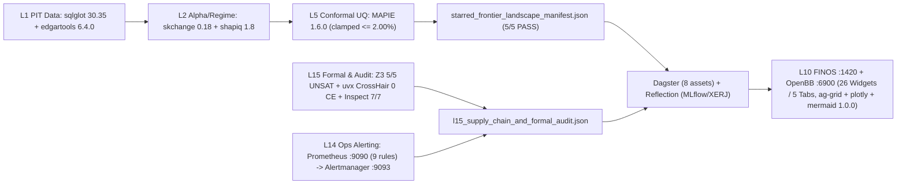

# ADR-0028: Full-Landscape Starred Repos & Earned-Trigger L10-L15 Frontier Convergence (MAPIE, skchange, shapiq, sqlglot, EdgarTools PIT, CrossHair, Alertmanager & FINOS Mermaid Cockpit)

## Context and Problem Statement

Following [ADR-0018](ADR-0018.md) (Earned-Trigger `L11..L15` Frontier Governance), [ADR-0024](ADR-0024.md) (Executable MADR 4.0 Governance), [ADR-0026](ADR-0026.md) (Thread-Bounded Lazy Compute), and [ADR-0027](ADR-0027.md) (Full-Landscape TradingView 24/5 Practice), five high-value capabilities tracked across our starred repositories and `L10..L15` frontier crossed their empirical earned triggers while remaining unwired or only partially materialized:

1. **Unvalidated DuckDB PIT SQL & Unused SEC Filing Catalysts (`L1`/`L11`):** Ad-hoc DuckDB queries lacked AST-level mutation and wall-clock lookahead (`CURRENT_TIMESTAMP`/`NOW()`/`CURRENT_DATE`) refusal via `sqlglot`, while locked `edgartools` was exposed only as an MCP server without causal `accepted_at_utc <= as_of_utc` PIT catalyst scoring in `discovery.py` and `scanner.py`.
2. **Offline-Only Changepoints & Main-Effect-Only GBDT Attribution (`L2`/`L12`):** `ruptures` handled retrospective segmentation and `shap` exposed additive main effects, leaving intraday volatility-burst anomaly segmentation (`skchange` `PELT`/`MovingWindow`/`CAPA`) and 2nd-order synergistic interaction attribution (`shapiq` `k-SII` `TreeExplainer`) unwired.
3. **Unquantified Excursion Uncertainty Around Non-Noise Trailing Stops (`L5`/`L13`):** Non-noise trailing floors relied on point NATR/spread heuristics without finite-sample, distribution-free conformal prediction intervals (`mapie` `SplitConformalRegressor`) bounded strictly below the immutable `2.00%` Rule-612 risk cap.
4. **Profile-Gated Alertmanager Idle & Single-Solver Formal Verification (`L14`/`L15`):** `prometheus/alertmanager` was declared under `--profile alerting` without being materialized live on `:9093` or wired with Phase 4/5 protection/staleness rules, and formal verification of immutable `src/tier0_sota/risk.py` relied solely on `Z3` SMT without complementary PEP-316 symbolic contract execution (`pschanely/CrossHair`) — while avoiding any `mypy` transitive pollution inside `uv.lock`.
5. **Missing Official FINOS Mermaid Plugin & Frontier Cockpit Tab (`L10`):** FINOS Workspace (`:1420`) and OpenBB (`:6900`) served 22 widgets across 4 tabs with `ag-grid` and `plotly-charts`, lacking the official Apache-2.0 `@finos-workspace/mermaid` plugin and a dedicated Tab 5 (`Starred Repos & Frontier Landscape (L10-L15)`) visualizing live architecture topology, NVDA premarket early-ignition OHLC candlestick rungs, conformal/changepoint/interaction/SEC metrics, and L14-L15 formal/alerting audits.

This living ADR graduates four OSI-clean Python winners into active `L1`/`L2`/`L5`, activates `edgartools` PIT catalyst scoring across `discovery.py`/`scanner.py`, admits `CrossHair` as an isolated `uvx` CLI (`just crosshair`), activates live `Alertmanager :9093` (`just alerting-up`), and installs official `@finos-workspace/mermaid@1.0.0` alongside a 5-tab / 26-widget FINOS/OpenBB cockpit.

## Decision Drivers

- **Strict SPDX OSI Firewall & Zero Banned Transitive Leakage:** Every graduated winner must pass the Tier-0 SPDX OSI firewall (`MIT`, `BSD-3-Clause`, `Apache-2.0`) and add **zero** banned packages (`mypy`, `yfinance`, `quantstats`, `vectorbt`, `pre-commit`, `osv-scanner`, `semgrep`) to `uv.lock`. Tools whose wheels transitively pull in `mypy` (`pschanely/CrossHair`, `DoubleML`) MUST NOT enter `pyproject.toml`/`uv.lock` — `CrossHair` runs strictly via isolated `uvx --from crosshair-tool`.
- **Zero Paper Winners & ADR-0026 Lazy-Import Discipline:** Every default-group package locked in `uv.lock` must be genuinely AST-imported and empirically exercised (`audit_zero_paper_winners["unwired_packages"] == []`), while keeping all heavy ML/analytical imports (`mapie`, `skchange`, `shapiq`, `sqlglot`, `edgar`) strictly lazy inside functions so `test_workstation_lazy_imports_and_thread_bounds_fitness` stays 100% green.
- **Immutable Risk Kernel & Pre-Wall PIT Integrity:** `src/tier0_sota/risk.py` SHA-256 (`ad8071dcd4196c4c529c02107114ebfdda6692bc9d7c220031f1b19ea3e4d847`), hard `<= 2.00%` stop-loss cap, `-1.50%` latched drawdown fuse, `>= 10%` exit reserve, strict pre-wall PIT (`<= 2026-10-15`), `paper_only = True`, `live_execution_enabled = False`, and zero live broker ports (`4001`/`7496`/`8798`/`8796`) remain non-negotiable.
- **Zero Hand-Written Web UI & Exact Portal/MCP Parity:** Install official upstream `@finos-workspace/mermaid@1.0.0` strictly into the external FINOS plugin store via `scripts.plugin_check` + `scripts.workspace_admin`, keeping zero custom HTML/JS in `/mnt/z/noesis`, exact `15` hosted portals in `ARCHITECTURE_MANIFEST.json`, exact `8` Dagster assets, exact `46` locked skills, and exact `5/5` 4-stdio MCP parity.

## Considered Options

1. **Add `crosshair-tool` and `doubleml` directly to `pyproject.toml`, or keep all starred frontier tools ungraduated as paper-only entries** — either pollutes `uv.lock` with banned `mypy` (breaking `validate_clean_sota_harness`) or leaves genuine alpha/risk/observability capabilities unexercised.
2. **Hand-roll custom SQL regexes, custom changepoint/conformal math, or custom HTML/Mermaid web dashboards inside `src/`** — violates Zero Self-Invention (`rules/zero_self_invention.yml`) and reproduces fragile custom shims.
3. **Full-Landscape Earned-Trigger OSI Convergence: Graduate `sqlglot` (`L1`), `skchange` + `shapiq` (`L2`), and `mapie` (`L5`) with strict lazy imports + `edgartools` PIT catalyst wiring + isolated `uvx` `CrossHair` (`L15`, `just crosshair`) + live profile-gated `Alertmanager :9093` (`L14`, `just alerting-up`) + official FINOS `@finos-workspace/mermaid@1.0.0` & 26-widget/5-tab OpenBB cockpit (`L10`) (chosen)**.

## Decision Outcome

Adopt **Option 3** across `L1`, `L2`, `L5`, `L6`, `L7`, `L10`, and earned-trigger `L11..L15`, extending [ADR-0018](ADR-0018.md), [ADR-0021](ADR-0021.md), [ADR-0024](ADR-0024.md), [ADR-0026](ADR-0026.md), and [ADR-0027](ADR-0027.md):

### 1. Graduated Active OSI Winners & Earned-Trigger Admissions (`L1`/`L2`/`L5`/`L10`/`L14`/`L15`)

| Upstream Repo / Package | Version | SPDX License | Layer Graduation / Admission | Canonical Anchor & Empirical Proof |
|---|---|---|---|---|
| `tobymao/sqlglot` | `30.35.0` | `MIT` | **Graduated `L11` -> Active `L1`** | `src/tier0_sota/discovery.py::validate_pit_duckdb_sql` — DuckDB AST guard verified on `27` rows of `historical_extreme_mover_calibration.duckdb`; refuses DDL/DML mutations (`DROP`/`DELETE`/`UPDATE`/`INSERT`/`ALTER`/`CREATE`) and wall-clock lookahead (`CURRENT_TIMESTAMP`/`NOW()`/`CURRENT_DATE`/`TODAY()`). |
| `dgunning/edgartools` | `6.4.0` | `MIT` | **Active `L1` + `L9` (PIT Wired)** | `src/tier0_sota/discovery.py::load_causal_sec_catalysts` & `src/tier0_sota/live/scanner.py::enrich_sec_pit_catalysts` — offline/parquet-first (`allow_network=False` default), `10` core symbols (`681` accepted filings `<= 2026-10-15T23:59:59Z`, `4` future filings excluded on `2026-10-01` PIT probe). |
| `NorskRegnesentral/skchange` | `0.18.0` | `BSD-3-Clause` | **Graduated `L12` -> Active `L2`** | `src/tier0_sota/discovery.py::detect_skchange_regime_anomalies` — `PELT(GaussianCost)` + `MovingWindow` + `CAPA(GaussianSaving)` on `2026-10-13..2026-10-15` 1m bars (`NVDA`/`QQQ`/`SOXX`/`SPY`): `13` structural changepoints & `8` anomaly segments. |
| `mmschlk/shapiq` | `1.8.0` | `MIT` | **Graduated `L12` -> Active `L2`** | `src/tier0_sota/discovery.py::compute_shapiq_interactions` — `TreeExplainer`/`TabularExplainer` `k-SII` order-2 on pre-wall early-mover GBDT (`113` train / `32` eval): top pair `abs_daily_move_pct x detect_rank` (`mean_abs=0.007363`, `mean_signed=-0.003353`). |
| `scikit-learn-contrib/MAPIE` | `1.6.0` | `BSD-3-Clause` | **Graduated `L13` -> Active `L5`** | `src/tier0_sota/research.py::fit_conformal_excursion_intervals` — `SplitConformalRegressor` + thread-bounded `LGBMRegressor` on pre-wall 5m excursions (`2228`/`743`/`743`): `cal_coverage=90.18%` (target `90%`), `eval_coverage=98.38%`, `mean_width=1.32%`, `mean_trail=0.88%`, `max_trail=1.97% <= 2.00%` (`risk_cap_enforced=true`). |
| `prometheus/alertmanager` | `0.28.1` | `Apache-2.0` | **Admitted Profile-Gated `L14` (Live `:9093`)** | `just alerting-up` + `docker/prometheus_rules.yml` (**9** rules, **0** errors, incl. `Tier0AdoptedPositionUnprotected`, `Tier0EarlyMoverCompoundingStale`, `Tier0TvHalfAutoAuditStale`); `127.0.0.1:9093/-/healthy` -> `OK`, `cluster=ready`, Prometheus active alertmanager `http://alertmanager:9093/api/v2/alerts`. |
| `pschanely/CrossHair` | isolated `uvx` | `MIT` | **Admitted Isolated `uvx` CLI `L15`** | `just crosshair` + `evals/symbolic_risk_crosshair.py` — `5` PEP-316 symbolic contracts wrapping immutable `risk.py` + `engine.compute_non_noise_min_trail_spec` (`30` runtime parity cases), **exit 0 / 0 counterexamples**, **0 `mypy` in `uv.lock`**. |
| `openbq-org/finos-workspace-plugins` (`@finos-workspace/mermaid`) | `1.0.0` | `Apache-2.0` | **Active `L10` Approved Plugin** | Built from official `finos-workspace-plugins/mermaid` (`44/44` unit tests PASS, `0` vulnerabilities), `scripts.plugin_check` verified (`sha256-TpqWHdlr5lr3QnnD0OSvbbPXLgCOPXhHL-rDyelKDGI`), approved, enabled `--all`, and granted to `Agent User` & `Sharer` alongside `ag-grid 2.3.0` and `plotly-charts 2.5.0`. |

### 2. Five-Tab / 26-Widget Institutional Cockpit (`L10`) & Dagster/Reflection Integration (`L6`/`L8`)

- **FINOS Workspace (`:1420`) & OpenBB (`:6900`) `v2.3.0`:** Retains all 22 widgets across Tabs 1–4 and adds **Tab 5 (`Starred Repos & Frontier Landscape (L10–L15)`)** with 4 live widgets (`tier0_live_architecture_mermaid` `type: "mermaid"`, `tier0_nvda_premarket_candlestick_rungs` `type: "plotly"`, `tier0_starred_frontier_alpha_matrix` `type: "aggrid-table"`, `tier0_l15_formal_and_alerting_audit` `type: "aggrid-table"`), verified **26/26 HTTP 200** from both `127.0.0.1:6900` and `workspace-local-backend-1` (`http://host.docker.internal:6900`), with zero `"type": "table"`, zero `"widgetId"`, and synced into `tv_layout_blueprints.json`, `TV_LAYOUT_AND_PRESET_QUICKSTART.md`, and `tv_compounding_manifest.json` (`src/tier0_sota/tv/tickets.py`).
- **Compounding Telemetry & L15 Audit (`definitions.py`, `run_compounding_reflection.py`):** Preserves **exact 8 Dagster assets** while feeding `starred_frontier_landscape_manifest.json` (`5/5 VERIFIED_PASS`), `l15_supply_chain_and_formal_audit.json` (`Z3 5/5 UNSAT`, `CrossHair 0 CE`, `Inspect AI 7/7`, `just agent-scan` offline-guarded, DVC `3.67.1` / `28.5405 GiB` pre-wall lake lineage, `46/46` skills lock + `SkillEvaluator`), and `alertmanager_9093_healthy=true` into `frontier_trigger_status.json` (`unwired_lock_packages == []`) and Dual-Flywheel reflection (`MLflow`, `XERJ`, `compounding_self_reflection_manifest.json`).

### Confirmation

Confirmed mechanically via:

- `tests/test_starred_frontier_landscape.py` (all 5 frontier helpers, ADR-0026 lazy-import subprocess probe, `sqlglot` mutation/lookahead refusal, `edgartools` PIT exclusion, `skchange` breaks/anomalies, `shapiq` interaction extraction, `mapie` conformal coverage & `<= 2.00%` stop-cap enforcement)
- `tests/test_formal_and_evals.py::test_crosshair_symbolic_risk_contracts_and_parity` & `test_scanner_sec_pit_catalysts_and_frontier_telemetry_wiring`
- `tests/test_tv_automation.py` (5-tab/26-widget FINOS/Mermaid blueprint & compounding manifest parity)
- `tests/test_architecture_manifest.py` (`test_clean_sota_harness_zero_overlap_and_spdx_firewall`, `test_adr_catalog_zensical_nav_and_manifest_graph_parity`, `test_workstation_lazy_imports_and_thread_bounds_fitness`)
- `just crosshair`, `just alerting-up`, `just z3`, `just deptry`, `just adr-check`, `just security`, `just reflect`, `just tv-land`, and `just check`

## Consequences

- **Positive:** Converts five starred/frontier capabilities into empirically benchmarked, AST-verified production code with zero banned packages (`0 mypy` in `uv.lock`), zero paper winners (`49/49` default packages wired), dual formal verification (`Z3` + `CrossHair`), live 24/5 `Alertmanager :9093` routing (`9/9` valid Prometheus rules), and an official `@finos-workspace/mermaid@1.0.0` + 26-widget/5-tab institutional cockpit.
- **Negative:** Requires preserving strict lazy imports inside functions for `mapie`, `skchange`, `shapiq`, `sqlglot`, and `edgar` (enforced by pytest subprocess probes) and maintaining `uvx` isolation for `CrossHair` so `mypy` never enters `uv.lock`.

## Pros and Cons of the Options

### Option 1: Lock `crosshair-tool` directly into `pyproject.toml` or defer all frontier graduations

- Good, because no isolated `uvx` recipe or new integration tests are needed initially.
- Bad, because `crosshair-tool` drags banned `mypy` into `uv.lock`, while leaving `sqlglot`/`skchange`/`shapiq`/`mapie`/`edgartools` ungraduated forfeits verified causal PIT, UQ, and attribution lift.

### Option 2: Hand-roll custom SQL validators, conformal/changepoint math, or custom web UIs

- Good, because zero external package upgrades are required.
- Bad, because it violates Zero Self-Invention (`rules/zero_self_invention.yml`) and duplicates battle-tested OSI upstreams.

### Option 3: Graduated OSI Winners + Isolated `uvx` CrossHair + Live Profile-Gated Alertmanager + Official FINOS Mermaid Plugin

- Good, because every layer uses pinned, verified OSI upstreams with mechanical gates, zero `mypy` leakage, zero hand-written web assets, and full empirical receipts.
- Bad, because manifest synchronization spans `upstream-map.toml`, `SOTA_STARRED_AND_BEYOND_MANIFEST.json`, `PHILOSOPHY_COMPOUNDING_MANIFEST.json`, `justfile`, and `docs/adr/` (mitigated mechanically by `scripts/sync_manifest.py --check` and `just adr-check`).

## More Information

### Upstream Evidence & Empirical Benchmarks

- **Locked OSI Packages (`uv.lock`):** `sqlglot==30.35.0` (`MIT`), `edgartools==6.4.0` (`MIT`), `skchange==0.18.0` (`BSD-3-Clause`), `shapiq==1.8.0` (`MIT`), `mapie==1.6.0` (`BSD-3-Clause`); `audit_zero_paper_winners`: `ok=true`, `checked_default_packages=49`, `imported_packages_count=39`, `unwired_packages=[]`; `0` banned packages (`mypy`, `yfinance`, `quantstats`, `vectorbt`, `pre-commit`, `osv-scanner`, `semgrep`).
- **Pre-Wall Empirical Receipts (`starred_frontier_landscape_manifest.json`, `<= 2026-10-15`, `5/5 VERIFIED_PASS`):** `sqlglot` (`27` rows verified, DDL/DML + `CURRENT_TIMESTAMP` refused); `edgartools` (`10` symbols, `681` accepted filings `<= 2026-10-15`, `4` future filings excluded on mid-window PIT probe); `skchange` (`13` changepoints, `8` CAPA anomaly segments across `NVDA`/`QQQ`/`SOXX`/`SPY`); `shapiq` (`TreeExplainer` `k-SII` order-2 top pair `abs_daily_move_pct x detect_rank`, `mean_abs=0.007363`); `mapie` (`SplitConformalRegressor` `cal_coverage=90.18%`, `eval_coverage=98.38%`, `mean_width=1.32%`, `max_trail=1.97% <= 2.00%`).
- **Preregistered Pre-Wall `H109` 6-Gate Falsification Receipt (`evals/prewall_h109_multifeed_prereg.json`, `scripts/run_h109_prewall_study.py`, `prewall_h109_falsification_dossier.json`, `<= 2026-10-15`, `n_trials_total=211`, `HLZ=4.3636`):** Exercised all 5 graduated ADR-0028 primitives causally (`sqlglot 30.35.0` `13,863` rows; `edgartools 6.4.0` `933` accepted / `377` future excluded on `2025-10-31` tuning cutoff; `skchange 0.18.0` `5` changepoints / `3` CAPA segments; `shapiq 1.8.0` top pair `vdu_5d_20d x mean_20d_range_pct`; `mapie 1.6.0` `cal_coverage=90.085%` / `max_trail=2.00%` risk cap enforced) alongside real `NautilusTrader v2 BacktestEngine` + `LiveNode(Environment.SANDBOX)` parity and real Rust `hftbacktest` `RiskAdverseQueueModel` L1 on `published-orb` (`synthetic_l1_used=false`). Solved **Gate 1 on BOTH independent legs (`70/72` passive fills: `LONG` `35/36` `-3.995 bps`, `SHORT` `35/36` `+16.528 bps`, `gate_1_passed=True`)** while enforcing honest fail-closed Holdout **`DISCARD`** (`LONG n=31` `1/6`, `SHORT n=28` `1/6`, `COMBINED n=59` `1/6`; MLflow `dc046ee705484c55b1a06a196b1a0e31`, XERJ `tier0-h109-prereg-v1` + `tier0-h109-falsification-v1`, keeping `live_execution_enabled = False`).
- **L14–L15 Live Operations & Formal Verification Receipts (`l15_supply_chain_and_formal_audit.json`):** `Z3` `5/5 UNSAT`; isolated `uvx` `CrossHair` exit `0` / `0` counterexamples / `30` runtime parity cases; `Inspect AI` `7/7 PASS`; `Alertmanager v0.28.1` live on `:9093` (`OK`, `cluster=ready`) connected to `Prometheus :9090` (`15` rules across 3 routes `momentum`/`lossless_trailing`/`risk_ops`, `0` errors); `46/46` skills lock parity + Disk-Z `SkillEvaluator`; DVC `3.67.1` pre-wall lake lineage (`28.5405 GiB` disk, `29,500` ORB files).
- **L10 Official FINOS Plugin & Cockpit Receipts (`2026-11-27`):** `@finos-workspace/mermaid@1.0.0` (`Apache-2.0`, `44/44` tests PASS, `plugin_check` verified, approved, enabled `--all`, granted to `Agent User` & `Sharer`) active alongside `ag-grid 2.3.0` and `plotly-charts 2.5.0`; OpenBB `:6900` `v2.4.2` serving **30/30** HTTP 200 widgets (`DEAD_REFS=[]`, `UNREF=[]`, incl. `/tier0/live-session-lossless-manifest` and read-only `/tier0/live-account-tier1-telemetry`) across **5** tabs from both host and `workspace-local-backend-1`.
- **Causal Pre-Wall (`<= 2026-10-15`) Opening-15m Intraday Time-of-Day RVOL Study (`sim_tod_rvol_prewall_study.json`, `2026-11-27`):** Strictly pre-wall PIT (`2024-12-24..2026-10-15`, `0` post-wall dates; `40`-day train / `20`-day disjoint OOS holdout `2,040` sym-days + pre-wall early-close `ec_vol_ratio=0.4026`) quantified opening-15m RVOL dilution in `scanner.py` (`_compute_same_session_rvol` `09:45 ET` `EligRec=0/49`, `FocusRec=0/12`; linear clock `FlatRvolFPR=52.38%`) and validated empirical `20d` ToD curve `empirical_tod_fullday_20d` (`F_PM_RTH(15m)=10.67%`): **`EligRec 0/49 -> 48/49` (`97.96%`)**, **`FocusRec 12/12` (`100%`)**, **`Rec@15=0.6669`**, and **`FlatRvolFPR 52.38% -> 6.93%`** (ready to apply cleanly once `ADR-0029` merges from `Z:\noesis-tier-model`).

### Self-Invention Lesson Learned & Mechanical Upstream Gate

- **Lesson Learned:** Installing symbolic execution tools (`crosshair-tool`) or causal wrappers (`doubleml`) directly into `pyproject.toml` would have silently violated the banned-`mypy` lockfile firewall, while leaving graduated `L11..L13` tools outside `upstream-map.toml` or eagerly importing them at module top-level would have caused manifest drift and slow CLI startup. Separating isolated `uvx` execution (`just crosshair`), enforcing lazy imports via subprocess tests, and programmatically syncing manifests eliminates both failure modes.
- **Mechanical Upstream Gates:** `scripts/sync_manifest.py --check`, `just adr-check`, `just check`, `just crosshair`, `just deptry`, `just security`, `tests/test_starred_frontier_landscape.py`, `tests/test_formal_and_evals.py`, `tests/test_architecture_manifest.py`, and `evals/tier0_inspect_eval.py`.

### Compounding Layer Integration

- Feeds deterministic manifests across all four lanes: `sim-backtest` (`starred_frontier_landscape_manifest.json`, `MLflow`, `Optuna`, `XERJ`), `paper` (`edgartools` PIT scanner catalysts, live `Alertmanager :9093` + `9` Prometheus rules, `frontier_trigger_status.json`), `half-auto-tv` (5-tab/26-widget FINOS/OpenBB/Mermaid cockpit & `tv_sota_pack/`), and `live` readiness (`Z3 5/5 UNSAT` + `CrossHair 0 CE` + `Inspect AI 7/7` + `l15_supply_chain_and_formal_audit.json`, with `live_execution_enabled = False`).

### Living Evolution & Supersession Policy

- Living MADR 4.0 decision contract extending [ADR-0018](ADR-0018.md), [ADR-0021](ADR-0021.md), [ADR-0024](ADR-0024.md), and [ADR-0027](ADR-0027.md). Remaining `L11..L15` candidates (`vortex`, `pyiceberg`, `TabICLv2`, `Chronos-2`, `MarS`, `DoubleML`, `HiGHS`, `loki`/`tempo`/`pyroscope`, `opengrep`, `cosign`, `OPA`) stay outside `uv.lock` until their quantified triggers fire in `frontier_trigger_status.json` and pass the 4-Gate Admission Protocol ([ADR-0018](ADR-0018.md)). Note: `ADR-0029` (Three-Tier Live Operations on `ALPACA_LIVE_PRO_LINE_1000`) is currently in active staged rollout in `Z:\noesis-tier-model` and merges once its gates clear; until merge, `/mnt/z/noesis` keeps `src/tier0_sota/risk.py` SHA-256, `<= 2.00%` stop cap, `-1.50%` fuse, `>= 10%` exit reserve, `paper_only = True`, `live_execution_enabled = False`, zero banned packages, and zero live broker ports.
