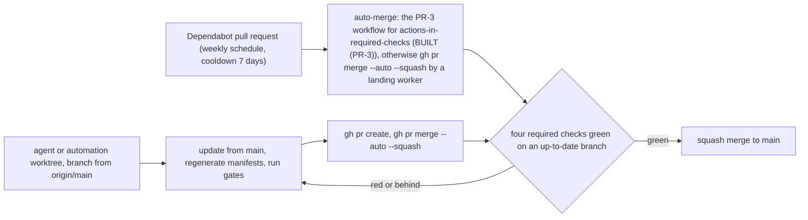

# ADR-0032: Landing Through Pull Requests and Upstream-Native Maintenance on GitHub

## Context and Problem Statement

`github.com/seathatflowsinourveins/noesis` is a public repository owned by a personal account (`owner.type = User`). One owner maintains it; several agents and scheduled automations work on it. Until 2026-11-27 (ET) changes reached `main` by direct push and CI judged them afterwards. The record of that period:

- `main` went red after direct pushes. The first CI run on `main`, on `8465023` (2026-11-26 06:00 UTC), failed, and so did the run on `83066d7` (2026-11-26 20:19 UTC), the runs on `52d6f88` (2026-11-26 23:12 UTC, and its scheduled run on 2026-11-27 11:03 UTC) and the run on `0ebd947` (2026-11-28 00:26 UTC).
- A pull request is tested on its head merged into the current base, so it inherits a red base: Dependabot pull request #2 failed run `45890523494` with the same two failures `main` had at `83066d7` (`tests/test_architecture_manifest.py::test_layers_l0_to_l10_and_spdx_firewall` and `::test_sync_manifest_check_zero_drift`); its earlier run on `de91295` had passed.
- The three Dependabot pull requests opened on 2026-11-26 waited on green or red checks while `main` moved (first read on 2026-11-28 against `main` at `f287fdc`, re-read after `66dedc5`):
  - #1 (`alpine` 3.20 to 3.24 in `docker/Dockerfile.xerj`, head `54d3cfa` of 2026-11-26) passed the four required checks: Quality in CI run `45892675081`, the three security checks in Security run `45892675128` (CodeQL reported neutral). It was 32 commits behind `main` (`f287fdc`). Dependabot last rebased it on 2026-11-26 at 20:39 UTC; since then it had no scheduled run and no conflict (`docker/Dockerfile.xerj` is unchanged from `6921375` to `f287fdc`), and the owner's `@dependabot rebase` comment at 2026-11-28 07:02 UTC started no update job. At 07:36 UTC `main` was merged into the branch from the owner account (`fecdb25`) and auto-merge (squash) was enabled; CI run `46121997566` passed, and #1 landed at 07:43 UTC as `98d884c` (section 4).
  - #2 and #3 are still open after `66dedc5`.
  - #2 (`numpy` 2.2.6 to 2.5.5) rewrites the declared range `numpy>=2.0.0,<2.3` to `numpy>=2.5.5,<2.6`, and its lock change replaces `hftbacktest` 2.4.4 with 2.4.2 and removes ten other packages (`bokeh`, `colorcet`, `holoviews`, `nh3`, `panel`, `panel-material-ui`, `param`, `pyviz-comms`, `tornado`, `xyzservices`; dependency-graph compare API). Dependabot rebased #2 and #3 at 2026-11-28 03:46 UTC (update jobs `46104328161` and `46104330489`, 03:45 UTC), about two and a half minutes after pull request #7, which changed `pyproject.toml` and `uv.lock`, merged at 03:43 UTC. Every check of #2 passed on its new head `72cc3bf` (CodeQL reported neutral), so a green Dependabot pull request still carried the downgrade. It was 7 commits behind `f287fdc` and is 12 behind `66dedc5` (`mergeStateStatus: BEHIND`).
  - #3 (`mcp` 1.30.0 to 2.3.0, head `8fa011c`, 7 commits behind `f287fdc` and 12 behind `66dedc5`) fails `ty` in run `46104413391`: ``error[missing-module-member]: Module `mcp.server.fastmcp` has no member `FastMCP` `` at `scripts/nautilus_mcp_server.py:49:32`.

The owner's decision of 2026-11-27 is recorded in `AGENTS.md` section 1: "`main` accepts changes only through a pull request whose required checks are green (ruleset `protect-main`: no direct push, no bypass)." The owner's direction later on 2026-11-27, as relayed to the authors of this record (the wording, including its spacing, was not re-checked against the session; UNVERIFIED): "you can progross with clean convergence, sota upstream as source of truth,we need always clean upstream fix and maintance.with convergnce, the evidanced adrs , including the sota automation github workflow and runtime frameworks etc itself". This record answers how the repository is built, landed and kept current on GitHub, using only GitHub's own mechanisms and the upstream tools already pinned here, so that `main` stays green, every change is gated, and upstream maintenance does not stall.

## Decision Drivers

- **`main` is always green:** every required check runs on every pull request, on the tree that will be merged.
- **Upstream-native only:** GitHub rulesets, auto-merge, Dependabot, CodeQL default setup, secret scanning, dependency review and artifact attestations, plus the upstream tools already used here: `zizmor`, `gitleaks`, `trivy`, `syft`, `uv` and `prek` (pinned in `mise.toml`), `pytest` (pinned in `uv.lock`) and `mise` itself (not version-pinned). No bespoke bot, and no CI job that commits.
- **One maintainer:** "Pull request authors cannot approve their own pull requests" (GitHub Docs), so a required approval would block the owner's own pull requests. OpenSSF Scorecard (Code-Review check): "Requiring reviews for all changes is infeasible for some projects, such as those with only one active participant."
- **No merge queue:** "Pull request merge queues are available in any public repository owned by an organization, or in private repositories owned by organizations using GitHub Enterprise Cloud." With strict checks, landing is therefore serial.
- **Production tree untouched:** every agent and automation works in its own worktree or clone, "never in the production working tree `Z:\noesis` (services import from it)" (`AGENTS.md` section 1). Three report-only Orca automations of section 3 still run there; this record states what they write and leaves the exception to the owner.
- **Supply chain:** full-SHA action pins, least-privilege tokens, update cooldowns, declared version ranges as the authority, dated holds, signed provenance for releases.
- **Fix upstream, never patch in place.**

## Considered Options

1. **Direct pushes to `main`, CI afterwards** (the practice until 2026-11-27).
2. **Classic branch protection rule** with the same checks.
3. **Repository ruleset `protect-main` (pull request plus four strict required checks, no bypass), auto-merge, serial landing, Dependabot with groups, cooldown and lockfile-only `uv` updates, auto-merge only for action updates that a required check runs, one updater and one written proof per pin class with dated holds, full-SHA pins, least-privilege tokens, dependency review and artifact attestations** (chosen).
4. **Merge queue:** not available to this personally owned repository.
5. **Renovate instead of Dependabot:** Renovate has a `mise` manager and digest pinning (`pinDigests`), but it is a second update bot that needs write access, either as the Renovate GitHub app (Mend) or self-hosted (`renovatebot/github-action`) with a token, while Dependabot covers `uv`, GitHub Actions, Docker, Docker Compose and `.pre-commit-config.yaml` natively.

## Decision Outcome

Adopt **Option 3**. Markers:

- **BUILT** means true on `main` at `66dedc5` (#19, merged 2026-11-28 08:20 UTC; "the cut"), read on 2026-11-28 with read-only `git show`, `git archive` and `gh api` calls, or true in the repository settings or the Orca automation configuration read the same day. File facts first read at `f287fdc` (#15) were checked again at `66dedc5`: #16 to #19 and #1 changed no file under `.github/` and none of `mise.toml`, `.pre-commit-config.yaml`, `docs/adr/CATALOG.md` and `zensical.toml`, and the `AGENTS.md` sentences, `justfile` recipes, `scripts/sync_manifest.py` functions and tests that this record quotes or names are unchanged or still present on the cut. Which GitHub facts were read again is stated under More Information.
- **PR-n** means built by pull request n of the series listed under More Information, and is a plan until that pull request lands. **BUILT (PR-n)** means true on `main` since that pull request merged; it replaces the item's PR-n marker. The series numbers are this record's own; GitHub pull request numbers are written `#n`.
- **With this record** marks `.github/rulesets/protect-main.json` and the first six tests of `tests/test_github_landing_governance.py` (the seventh lands with PR-2, the eighth with PR-3), which are not on the cut and land in the same pull request as this record (PR-1).
- **Owner decision** marks a repository setting or policy that only the owner changes. This record states its current value and changes none.

### 1. `main` accepts changes only through pull requests (BUILT)

- **Ruleset as applied:** `protect-main` (id `28138316`, the repository's only ruleset), target `branch`, enforcement `active`, `bypass_actors: []` (the API reports `current_user_can_bypass: never`), include `refs/heads/main`. Rules: `deletion`, `non_fast_forward`, `pull_request` (`required_approving_review_count: 0`, `require_code_owner_review: false`) and `required_status_checks` with `strict_required_status_checks_policy: true`, `do_not_enforce_on_create: false` and four contexts from the GitHub Actions app (`integration_id: 15368`). The REST endpoint "Get repository ruleset history" returns two versions, of 2026-11-26 01:00 ET and 2026-11-27 20:59 ET.

| Required check (job `name`) | Workflow / job id | Pull request trigger |
|---|---|---|
| `Quality, AST, Formal Risk & Manifest Gate` | `ci.yml` / `sota-quality-and-safety-gate` | `pull_request` to `main`, no path filter |
| `Secret Scan (gitleaks)` | `security.yml` / `gitleaks` | `pull_request` to `main`, no path filter |
| `Filesystem Vulnerability Scan (Trivy)` | `security.yml` / `trivy` | `pull_request` to `main`, no path filter |
| `Workflow Security Audit (zizmor)` | `security.yml` / `zizmor` | `pull_request` to `main`, no path filter |

- The API also returns `required_reviewers: []`, `require_extra_approval_for_unattributed_changes: true` (REST docs: "When Copilot opens a pull request without a human collaborator, require one more approving review if a non-zero approval count is required") and `allowed_merge_methods: ["merge", "squash", "rebase"]`, both in the current ruleset and in history version `60015670`; the snapshot keeps them as returned. There is no classic branch protection (`GET /repos/{owner}/{repo}/branches/main/protection` returns 404). `security.yml` job `trivy-license-audit` (`SPDX License Audit (Trivy)`) and `docs.yml` (`Zensical Strict Build`) also report checks, as do CodeQL default setup (`CodeQL`, `Analyze (actions)`, `Analyze (python)`) and the Socket Security app (two checks, section 5). None of them is required.
- **Snapshot (added with this record):** `.github/rulesets/protect-main.json` holds the ruleset exported the way GitHub's own docs repository exports its rulesets (`gh api repos/{owner}/{repo}/rulesets/{id} --jq '{name, target, enforcement, bypass_actors, conditions, rules}'`), pretty-printed with a two-space indent; it parses to the same JSON as that command's output. GitHub does not apply the file. A ruleset change is made to the file in a pull request first; after it merges, the owner applies it with `gh api -X PUT repos/{owner}/{repo}/rulesets/28138316 --input .github/rulesets/protect-main.json`. Agents follow `AGENTS.md` section 1 (BUILT since `19264fa`): "never change the ruleset or repository settings to get a change in".
- **What a required check must be:** the `name` of exactly one job, in a workflow triggered by `pull_request` (not `pull_request_target`) to `main` without `types`, `paths`, `paths-ignore` or `branches-ignore`. The job has no `if:`, `needs:`, matrix `strategy:` or `continue-on-error`. No step of the job has `continue-on-error`, and no step has an `if:` except the one on the Quality job's step `Upload JUnit XML test report`, `if: ${{ !cancelled() }}`. GitHub Docs, "Handling skipped but required checks":
  - when "A workflow is skipped by path filtering, branch filtering, or a commit message", "Associated checks stay in a "Pending" state and block merging" ("Avoid requiring workflows that can be skipped");
  - when "A job is skipped by a conditional", "The job reports "Success"";
  - when "A job depends on a failed job", "The dependent job is skipped and may not block merging";
  - and, earlier on the same page, "Successful check statuses are `success`, `skipped`, and `neutral`".
- **Matrix and `types`:** a matrix job reports one check per combination, whose name carries the matrix values, so it would not match a required context that names the job alone (UNVERIFIED: no GitHub Docs sentence on matrix check names was found; the test forbids `strategy:` in a required job either way). A `types:` filter that leaves out `opened` or `synchronize` means the check never reports on those events.
- **The one step condition:** GitHub Docs (Expressions): "A default status check of `success()` is applied unless you include one of these functions", and to run a step "regardless of its success or failure, use the recommended alternative: `if: ${{ !cancelled() }}`". That condition is true whenever the default is, so it cannot skip the upload; it only adds a run after a failure. `test_required_checks_are_unfiltered_pull_request_jobs` (added with this record) fails on each structural case above: a required context without exactly one producing job; a `pull_request_target`, `types`, `paths`, `paths-ignore` or `branches-ignore` trigger; a job-level `if:`, `needs:`, `strategy:` or `continue-on-error`; a step `continue-on-error`. It also fails on any other step condition in a required job, and on a change to this one. A file test cannot see a `[skip ci]` commit message on a pull request head; that leaves the required checks Pending, which blocks the merge rather than passing it. The test runs inside the Quality job, so it cannot catch a change that skips or hides that job's own test step (Consequences).
- **Why the docs workflow is not required:** `docs.yml` (`Zensical Strict Build`) is path-filtered. On the cut it lists 14 paths for `push` and `pull_request`; when pull request #5 changed only `AGENTS.md`, which the filter did not then include, it did not run. As a required check it would hold every pull request that does not touch its paths. GitHub's own example of a path-filtered required workflow: "If `build` is required, the pull request is blocked with "Waiting for status to be reported."" Nothing is lost: the required Quality gate runs `scripts/sync_manifest.py --check` and `zensical build --clean --strict` on every pull request; `docs.yml` adds only the uploaded `site/` artifact.
- **Strict:** "The topic branch must be up to date with the base branch before merging", so the tree that merges is the tree that was tested. Each merge leaves the other open pull requests `BEHIND`, so landing is serial.
- **Repository settings (BUILT):** `allow_auto_merge: true`, `delete_branch_on_merge: true`, `allow_update_branch: true`. Merge commits, squash and rebase are all allowed (repository and ruleset); squash title `COMMIT_OR_PR_TITLE`, message `COMMIT_MESSAGES`. The practice is squash only. Restricting the ruleset to `allowed_merge_methods: ["squash"]` is an owner decision, applied from a snapshot pull request; no test asserts the merge methods.
- **Reviews and `CODEOWNERS`:** 0 required approvals (one maintainer). `.github/CODEOWNERS` names the owner for `/src/tier0_sota/risk.py`, `/upstream-map.toml`, `/.github/`, `/rules/`, `/mise.toml` and `/evals/formal_risk_z3.py`. On the owner's own pull request #10, which changed five files under `/.github/`, no review was requested. A request is expected only on a pull request someone else opens under these paths, for example a Dependabot `github-actions` update under `/.github/`; #1 to #3 touch none of them, so none has been observed here. It is not enforced (`require_code_owner_review: false`). On `main`, `src/tier0_sota/risk.py` is protected by the required Quality gate: `tests/test_architecture_manifest.py::test_risk_kernel_sha256_exact` pins SHA-256 `ad8071dcd4196c4c529c02107114ebfdda6692bc9d7c220031f1b19ea3e4d847` and the same job runs `evals/formal_risk_z3.py`. [ADR-0005](ADR-0005.md) is corrected to say this in PR-7.

### 2. Landing practice

- One concern per pull request, one squash commit with a conventional-commit title, on a branch cut from the newest `origin/main` in a clone or worktree of its own (for example the landing integrator's `Z:\noesis-land`).
- After every update from `main`, in a clean tree, regenerate the generated manifests with `uv run --no-sync python scripts/sync_manifest.py --write`. `ARCHITECTURE_MANIFEST.json` embeds the sorted output of `git ls-files --cached --others --exclude-standard`, without `.claude/skills/` and with the two generated manifests added (`repository_files`), and the ADR graph (`adr_graph`, with `corpus_sha256`), so any two pull requests that add files or change records collide there. Generated files are never hand-merged, and the required gate rejects a stale or hand-merged one (`tests/test_architecture_manifest.py::test_sync_manifest_check_zero_drift`). The manifests record the default branch, not the checkout's branch (`::test_sync_manifest_branch_is_default_branch_on_any_checkout`, BUILT since `5a3c0d4`), so the same tree produces the same bytes on any branch or CI merge ref.
- Run `just check` (in parallel `fmt-check`, `lint`, `typecheck`, `deptry`, `ast`, `manifest-check`, `z3`, `mcp-smoke`, `gitleaks`, then `docs-build` and the full `pytest` suite) and quote the result in the pull request body; scan the diff with `gitleaks` before the push.
- `gh pr create`, then `gh pr merge <n> --auto --squash`. "Auto-merge merges a pull request automatically after all required reviews and status checks pass." When `main` moves: merge `main` into the branch (or rebase it), regenerate, re-run the gates, push. "Auto-merge is disabled if someone without write permissions pushes new changes to the head branch or switches the base branch."
- Several workers land, each from its own clone or worktree; with strict checks and no merge queue they land one at a time, and each re-runs its gates after the previous merge.
- Held work is opened with `gh pr create --draft` and gets no auto-merge until it is released.
- Dependent work is a stack of pull requests (GitHub stacked pull requests, through `gh stack` or the website; "Required status checks" are "Evaluated against the stack base"). The bottom lands first; each layer regenerates its manifests after its update. First use is still to be verified.

### 3. Automation boundaries (BUILT unless marked)

The Orca configuration was read with `orca automations list --json`, and the weekly automation's run history with `orca automations runs --json`, on 2026-11-28 (re-read about 03:45 ET); every schedule is in `America/New_York`. What each run writes is read from the scripts that its prompt's commands call on `main` (listed under More Information); what was not read is marked not verified.

| Automation | Runs in | May write | Lands through |
|---|---|---|---|
| Orca `noesis-daily-resume-and-sota-preflight` (06:30 ET daily) | `Z:\noesis` (exception, below) | no tracked file by the scripts themselves; `just resume` runs `scripts/preflight_resume.ps1 -Reconcile`, which writes `workstation_preflight_resume_manifest.json` under `Z:\sota-data\manifests` and may start WSL systemd units, the OmniRoute daemon and `docker compose ... up -d` (seven of its services mount `Z:\noesis` read-write at `/workspace`; whether they write there is not verified); `just account-status` writes `orca_account_failover_status.json` there | report only |
| Orca `noesis-premarket-codex-sentinel` (07:00 ET weekdays) | `Z:\noesis` (exception, below) | no tracked file; `just preflight` writes a manifest under `Z:\sota-data\manifests`; `scripts/run_live_paper_farm.ps1 -Mode preflight` prints a `PREFLIGHT_OK` line | report only |
| Orca `noesis-eod-claude-adversarial-audit` (17:30 ET weekdays) | `Z:\noesis` (exception, below) | no tracked file; untracked build and test outputs in `Z:\noesis` (`just docs-build` deletes and rewrites the git-ignored `site/`; `just check` runs the full `pytest` suite there; `scripts/grand_reset/verify_grand_reset.ps1` runs `zensical build --clean` into `site/` again, `scripts/nautilus_mcp_server.py --smoke`, GET probes of 15 local portals, the paper-farm preflight, `gitleaks detect --no-git`, `evals/formal_risk_z3.py` and the Inspect AI suite check, and whether the smoke test, the Z3 script and the Inspect check write files is not verified); the prompt also runs `zizmor --offline` in WSL | report only |
| Orca `noesis-weekly-compounding-self-reflection` (18:00 ET Fridays) | configured for its own Orca worktree `~\orca\workspaces\noesis\auto-reflect`, branch `reflect/weekly-<YYYYMMDD>` from `origin/main`; not working on 2026-11-28 (below) | files on its branch; `just reflect` also writes the reflection manifest under `Z:\sota-data\manifests`, Optuna and Inspect state and an MLflow run, all outside the repository | its prompt: `sync_manifest.py --write`, the gates, `gh pr create`, `gh pr merge --auto --squash` |
| Landing workers | their own clones (`Z:\noesis-land`, `Z:\noesis-records`, `Z:\noesis-maint`) | their branches | section 2 |
| Dependabot | GitHub | its `dependabot/...` branches | pull requests; auto-merge enabled by the owner or a landing worker (as on #1), and automatically only for the group `actions-in-required-checks` through the PR-3 workflow `dependabot-auto-merge.yml` (BUILT (PR-3)) |
| CodeQL default setup; scheduled CI (weekdays 11:00 UTC) and Security (Mondays 06:17 UTC) runs | GitHub | nothing in the repository | checks and alerts |
| `multi-model-sota.yml` | GitHub, `workflow_dispatch` only | nothing through `GITHUB_TOKEN` (`contents: read`). Its Claude job also holds `id-token: write`, and its two `anthropics/claude-code-action` steps pass no `github_token` input; at the pinned commit the action then exchanges an OIDC token for a Claude GitHub App token, so what that job can write depends on whether the Claude GitHub App is installed on this repository (not verified). In the five dispatch runs so far (all on 2026-11-26; the first three on earlier versions of the workflow, the last two, on `0b7e69b`, on the version on the cut) no action step ran: in every job that got past `Set up job`, the checkout and action steps were skipped; in the first run (`45767604900`) the then-present `Google Gemini CLI` job failed at `Set up job` before any step, and in run `45776816235` the Codex job was skipped as a whole. | nothing |

- The three report-only automations run in the production working tree, which `AGENTS.md` section 1 rules out for every automation. Their prompts forbid changing tracked files, and the scripts they call change none, but they write the outputs listed above; the Compose services that the daily run may start mount the tree read-write, and whether they write there is not verified. Moving them to worktrees of their own, or confirming the exception, is an owner decision.
- The weekly automation's worktree is not usable on 2026-11-28: the folder's `.git` file points at a worktree entry that no longer exists under `Z:\noesis\.git\worktrees`, and neither `git worktree list` nor `orca worktree list` shows it. Orca's record of the automation names both that worktree and a run path of `Z:\noesis`; which one a run uses is not verified. Its only run (scheduled for 2026-11-27 18:00 ET) ran in `Z:\noesis` (the automation's configuration was last updated at 21:11 ET, after that run; the prompt that run used is not recorded) and, by its own report ("I made no repo edits"), changed no repository file; no `reflect/` branch or pull request exists on GitHub. Re-registering the worktree is an owner action in Orca.
- Workflows cannot create or approve pull requests here with `GITHUB_TOKEN` (`can_approve_pull_request_reviews: false`), and that token's default permission is `read`.
- No workflow step on the cut pushes commits with `GITHUB_TOKEN` or regenerates files; the Claude job's app-token path (table above) is the open exception. GitHub Docs (triggering a workflow): "events triggered by the `GITHUB_TOKEN` will not create a new workflow run", and when a workflow using the token creates or updates a pull request, the resulting event "creates workflow runs in an approval-required state", so a bot commit would leave the required checks waiting until a user with write access approves the runs. Manifests are regenerated by the landing workers.
- Write scopes are held only by `release.yml` `draft-release` (`contents: write`), `multi-model-sota.yml` `claude-omniroute-or-anthropic-banked` (`id-token: write`), the `dependabot-auto-merge.yml` `enable-auto-merge` job (`contents: write`, `pull-requests: write`; BUILT (PR-3)) and, planned for PR-5, the `release.yml` `attest` job (`id-token: write`, `attestations: write`). The `actions/attest` README (v4.2.2) also lists `artifact-metadata: write`, "necessary to create the artifact storage record", and ties that record to `push-to-registry: true` ("if the `push-to-registry` option is set to true, the Action will also emit an Artifact Metadata Storage Record"). GitHub's how-to for binaries sets only `id-token: write`, `contents: read` and `attestations: write`, and says the attest action creates storage records "if both" `push-to-registry` is `true` and the workflow "has the `artifact-metadata: write` permission". A wheel attestation is therefore expected not to need it (to confirm when PR-5 runs). `test_workflow_token_permissions_are_least_privilege` (added with this record) lists the current grants exactly (two with this record, three since PR-3 (BUILT (PR-3))); PR-5 adds its job to it. The auto-merge job enables auto-merge and never merges or pushes by itself.

### 4. Upstream maintenance policy

- **Dependabot on the cut (BUILT; replaced by PR-2):** `uv` (`/`), `github-actions` (`/`) and `docker` (`/docker`), weekly on Monday 07:00 UTC, `cooldown: default-days: 7`, `open-pull-requests-limit: 5`, labels, no groups. The configured labels do not exist in the repository, so #1 to #3 carry none. Dependabot security updates and vulnerability alerts are on. The `docker` updater reads Dockerfiles (and Kubernetes manifests or Helm charts, of which there are none under `/docker`), not Compose files: its run on 2026-11-26 checked `python 3.12-slim-bookworm` and `alpine 3.20`, and nothing in `docker/compose.sota.yml`.
- **Dependabot runs so far:** nine update jobs, all successful. Three ran on 2026-11-26 at 06:00 UTC (`uv`, `docker`, `github-actions`), a Thursday, eight to nine seconds after the branch `main` was created; what triggered them is not established. Four single-dependency jobs followed that day (`numpy` at 14:28 and 20:20, `mcp` at 14:28, `alpine` at 20:39 UTC), and two on 2026-11-28 at 03:45 UTC (`numpy`, `mcp`). None came from the Monday schedule; the first scheduled run is due on 2026-11-30.
- **Open alert without a fix:** Dependabot alert #1 (2026-11-26, medium) is `diskcache`, a transitive runtime dependency in `uv.lock`: GHSA-w8v5-vhqr-4h9v / CVE-2025-69872, "DiskCache has unsafe pickle deserialization", vulnerable range `<= 5.6.3`, no patched version. Dependabot security updates cannot open a pull request for it; it is handled by hand in the maintenance pass below.
- **Groups, ranges and coverage (BUILT (PR-2); holds under Holds below):** minor and patch updates are grouped; a major stays its own pull request. `uv` gets two groups, `uv-patch` (`update-types: ["patch"]`) and `uv-minor` (`update-types: ["minor"]`), because `dependabot/fetch-metadata` reports `update-type` as "The highest semver change being made by this PR": one minor in a shared group would turn a patch pull request into a minor. GitHub Actions gets `actions-in-required-checks` and `actions-elsewhere` (see auto-merge); `docker`, `docker-compose` and `pre-commit` get one minor-and-patch group each. `versioning-strategy: lockfile-only` for `uv`: "Only create pull requests to update lockfiles. Ignore any new versions that would require package manifest changes." A declared range in `pyproject.toml` is therefore not rewritten by Dependabot since PR-2 (to verify on the first scheduled run). New ecosystems `docker-compose` (`/docker`; `compose.sota.yml` and `compose.ibkr-paper.yml` match the updater's `FILENAME_REGEX`) and `pre-commit` (`/`; the `.pre-commit-config.yaml` format that `prek` runs; each `rev` comment changes from `# vX.Y.Z` to `# frozen: vX.Y.Z`), with the same schedule and cooldown. PR-2 also removes the `labels` keys: without them Dependabot applies `dependencies` and an ecosystem label and creates them when they are missing (options reference, `labels`), where the configured labels were silently left off. To verify on the first scheduled run: `lockfile-only` with `uv`, and Compose entries that name locally built images (`tier0-sota-research:latest`).
- **Auto-merge (BUILT (PR-3)):** `.github/workflows/dependabot-auto-merge.yml` runs on `pull_request` only for pull requests whose author is `dependabot[bot]`, reads `dependabot/fetch-metadata` with its default verification, and runs `gh pr merge --auto --squash` only for the Dependabot group `actions-in-required-checks`, the patch and minor updates of the actions that `ci.yml` and `security.yml` run in the required jobs (`actions/checkout`, `actions/upload-artifact`, `astral-sh/setup-uv`, `gitleaks/gitleaks-action`, `aquasecurity/trivy-action`, `zizmorcore/zizmor-action`). A pull request runs its own workflow files, so the bump is executed by the required jobs that use those actions. The same pull request also moves their pins in `release.yml` and `multi-model-sota.yml`, which no pull request check runs, and in `docs.yml`, which runs only when its path filter matches. Everything else lands through a landing worker:
  - actions used only by `release.yml`, `docs.yml` or `multi-model-sota.yml` (group `actions-elsewhere`), which no required check runs;
  - `uv` patch and minor updates, after the Python proof below: a passing suite did not reveal the `hftbacktest` downgrade of pull request #2;
  - `docker`, `docker-compose` and `pre-commit` updates, after the image proof and `prek run --all-files`, because no required check builds an image, renders a Compose file or runs `prek`; and a `docker-compose` bump of the caddy, OpenTelemetry collector, Prometheus or Grafana image is red by construction until the exact tags pinned in `tests/test_grand_reset_kit.py` (`test_docker_compose_sota_yaml_mounts_and_no_live_ports`, and for caddy also `test_caddyfile_loopback_binding_and_duckdb_csrf_posture`) are edited in the same pull request (the alertmanager pin is a pattern since #18).
  - a major, which never auto-merges.

  Widening auto-merge to `uv` updates is an owner decision. PR-3 landed after PR-2, because it selects pull requests by PR-2's group names.
- **Bringing Dependabot branches up to date:** with strict checks and no merge queue a green Dependabot pull request waits while `BEHIND`. Dependabot rebases by itself only "when Dependabot detects any changes" (a scheduled run, a reopen, a `target-branch` change, or a pull request "in conflict after a recent push to the target branch"). After each merge, the documented way to ask is a `@dependabot rebase` comment on the next one. Its one use here (#1, 2026-11-28 07:02 UTC) started no Dependabot update job. #1 was instead brought up to date at 07:36 UTC by a merge of `main` into its branch from the owner account (`fecdb25`, committer `GitHub`, GitHub's web-flow identity, consistent with GitHub's update-branch); auto-merge (squash) was enabled at 07:36 UTC and it merged at 07:43 UTC as `98d884c`, with every check green. By default, `dependabot/fetch-metadata` fills its outputs only if the pull request "was opened by Dependabot and contains **only** Dependabot-created commits"; its README adds "To override, see `skip-commit-verification` / `skip-verification`." The code at the pinned v3.1.0 checks less than that: besides the pull request author, `src/dependabot/verified_commits.ts` reads only the pull request's first commit (author `dependabot[bot]` and a verified signature) and takes the metadata from its message. A branch brought up to date by a merge of `main` therefore still gets its outputs, and the auto-merge workflow (BUILT (PR-3), default inputs) still enables auto-merge on it; the required checks then run on the merged head.
- **Majors and range changes:** one upstream per migration pull request, following that upstream's migration guide and release notes (cited in the body), with the gates and the dependency review summary. Under `lockfile-only` Dependabot does not see versions outside a declared range, so the maintenance pass lists them by hand with `uv tree --outdated`. The options reference marks `versioning-strategy` as also applying to security updates, so a security fix that needs a range change is expected to get no Dependabot pull request either (to verify on the first such alert). The same pass reads the open Dependabot alerts and opens that migration pull request, or a dated hold, by hand. Adding these drift commands to a read-only automation is an owner decision; no automation runs them today.
- **Toolchain pins:** the minor pins in `mise.toml` and the tool-version inputs of the workflows (`version:` for `uv` 0.13.9 in four jobs, `trivy` v0.76.2 in three steps and `zizmor` 1.32.0; `syft-version:` v1.55.0; env `GITLEAKS_VERSION` 8.30.1) move together in one hand-made toolchain pull request, which also moves the `ruff`, `gitleaks` and `zizmor` hook revisions in `.pre-commit-config.yaml` when their `mise.toml` minor changes, and the exact on-demand CLI pins of `justfile` and `ci.yml` (pin-class table) when they move. `test_ci_tool_versions_match_mise_pins` and `test_pre_commit_hooks_are_sha_pinned_and_match_mise` (added with this record) fail when a workflow tool version, or the `ruff`, `gitleaks` or `zizmor` hook tag, leaves its `mise.toml` minor; drift at patch level inside a minor passes. Dependabot has no `mise` ecosystem and does not update `with: version:` inputs. A Dependabot `pre-commit` pull request that moves the `ruff`, `gitleaks` or `zizmor` hook past its `mise.toml` minor pin is red by construction and is superseded by the toolchain pull request; those three hooks have their own group, `hooks-with-mise-pins`, which the catch-all hook group excludes (BUILT (PR-2)), so such a pull request does not hold back the other hooks. Every hook revision carries a `# frozen: vX.Y.Z` comment (BUILT (PR-2); on the cut the comments read `# vX.Y.Z`): Dependabot reads it to resolve the tag, and for a revision without one the documented result is "Updated to the HEAD SHA of the default branch."
- **One updater and one written proof per pin class.** A proof is written in the pull request body before it lands.

| Pin class | Pinned in | Updater | Written proof | Built today |
|---|---|---|---|---|
| Python packages | `pyproject.toml` ranges, `uv.lock` | Dependabot `uv` | the gates in an isolated environment built from the lock (a fresh `UV_PROJECT_ENVIRONMENT`, never the shared one; `uv sync --frozen`, then every gate with `--no-sync`), plus a diff of the package-to-version maps of the base and head `uv.lock` that fails on any decrease | Dependabot `uv`; the proof is a plan |
| Container images | `docker/Dockerfile.*`, `docker/compose*.yml` | Dependabot `docker`; `docker-compose` from PR-2 | an image build under a test tag (never `:latest`, which the Compose services use), plus `docker compose -f docker/compose.sota.yml config` and `docker compose -f docker/compose.ibkr-paper.yml config` | Dependabot `docker`, and `docker-compose` (BUILT (PR-2)); the proof is a plan |
| GitHub Actions | the `uses:` SHAs in `.github/workflows/` | Dependabot `github-actions` | the required `zizmor` check (offline, `.github/workflows` only) and `test_every_action_is_pinned_to_a_full_commit_sha` (every remote `uses` value pinned to a 40-hex SHA, on a block-style line with a non-empty comment meant to name the release tag; that the comment names the release tag, and that the SHA equals that tag upstream, are checked by hand) | the required `zizmor` check; the test lands with this record |
| pre-commit hooks | the `rev:` SHAs in `.pre-commit-config.yaml` | Dependabot `pre-commit` from PR-2 | `zizmor` over the repository root, which adds `.github/dependabot.yml` and `.pre-commit-config.yaml` (required from PR-6), and `test_pre_commit_hooks_are_sha_pinned_and_match_mise` | Dependabot `pre-commit` and the `# frozen:` comments (BUILT (PR-2)); the test lands with this record |
| Command-line tools | `mise.toml` minors and the workflow tool-version inputs (hook revisions belong to the pre-commit row) | by hand, in one toolchain pull request: `mise upgrade --bump <tool>` ("Upgrade past the configured range to the newest release, and update the config to match", mise 2026.11.2) rewrites a `mise.toml` minor, and the workflow `version:`, `syft-version:` and `GITLEAKS_VERSION` inputs are edited to match; `mise lock --bump` would only advance a `mise.lock` inside each minor ("`--bump` never modifies config files"), and there is none on the cut | the toolchain pull request with `test_ci_tool_versions_match_mise_pins` and `test_pre_commit_hooks_are_sha_pinned_and_match_mise` | nothing on the cut; the tests land with this record |
| On-demand isolated CLIs | exact `==` and `@` pins in `justfile` (`uvx --from`, `uv run --with`, `npx --yes`: `crosshair-tool`, `snyk-agent-scan`, `allure-pytest`, `mutmut` and the `allure` npm CLI) and `uvx --from crosshair-tool==0.0.114` in the Quality job of `ci.yml` | by hand, in the toolchain pull request (neither the configured Dependabot ecosystems nor those PR-2 adds read them) | `tests/test_grand_reset_kit.py::test_isolated_cli_recipes_pin_versions_and_guards` (every `--from` and `--with` spec in `justfile` carries an exact `==` pin, every `npx --yes` spec an exact `@` version, and `crosshair-tool` one version on both platforms; the `ci.yml` pin is not compared with it) | the test, since #19 |
| Agent skills | `UPSTREAM_SKILLS_LOCK.json`: 42 of 46 entries name an upstream `upstream_repo` and a 40-hex `commit_sha` | re-vetted by hand for each new source commit, then re-locked; the four local `tier0-*` skills (`commit_sha: local`) change in this repository and are re-locked when they change | `verify_skills_lock` in `scripts/sync_manifest.py`, run by `--check`, which checks that the committed skill files match the lock's `skill_sha256`, `dir_sha256` and `lock_sha256`; it does not compare them with the upstream repository | the digest check |

- **Holds:** a hold is a Dependabot `ignore` entry together with the cap or pin it protects. Each hold carries the date, a reason quoted from upstream metadata (a release note, an issue, or a dependency's declared range, with its URL) and the trigger that re-opens it. The options reference marks `ignore`, `groups` and `versioning-strategy` with the icon of the options that "also change how Dependabot creates pull requests for security updates, except where `target-branch` is used", so a hold also suppresses security updates into the held range; the maintenance pass reads the open alerts for that reason. In dependabot-core's security-update jobs only the `versions` ranges of an `ignore` entry are applied and its `update-types` are dropped (`common/lib/dependabot/config/ignore_condition.rb`), so of the PR-2 holds the `numpy` range is expected to hold back a security update into `>=2.3` and the `mcp` and `python` entries are not (to verify on the first such alert). `cooldown` does not: "The `cooldown` option is only available for version updates, not security updates." On the cut `dependabot.yml` has no `ignore` entry, and the caps `numpy>=2.0.0,<2.3` and `mcp>=1.28.1,<2.0.0` in `pyproject.toml` carry no reason yet; the maintenance pull requests add one or remove the cap. PR-2 adds the dated `ignore` entries: `numpy` `versions: [">=2.3"]` and `mcp` `update-types: ["version-update:semver-major"]` for `uv`, and the `python` image `semver-major` and `semver-minor` for `docker` (`requires-python = ">=3.13,<3.14"`) (BUILT (PR-2)). Each comment carries the date, the declared range with its source (the dependency's `requires_dist` in its PyPI JSON, or for the `python` image this repository's own `requires-python`) and its re-open trigger.
- **Planned fitness checks for this section**, each bound here when it lands: every `ignore` in `dependabot.yml` carries a dated reason (BUILT (PR-2), in `test_dependabot_covers_every_pinned_ecosystem`); a `pyproject.toml` cap and the Dependabot hold for the same package agree; no image reference in `docker/*.yml` uses a floating tag other than the locally built `tier0-sota-*` images (this fails on the cut: `docker/compose.ibkr-paper.yml` uses `ghcr.io/gnzsnz/ib-gateway:stable`; the maintenance pull request pins it or records a dated hold).
- **Upstream bugs:** fixed or reported in the upstream project; the dependency is pinned to the last good version with a dated reason next to the pin (`# pinned YYYY-MM-DD: <upstream issue URL>`) and unpinned when the fix ships. Never patched in `site-packages`, vendored or forked silently.

### 5. Supply-chain controls

| Control | Built today | Built by | Source |
|---|---|---|---|
| Actions pinned to full commit SHAs with a comment naming the release tag | all 28 references (11 actions, 6 workflows) since PR-3, 27 (10 actions, 5 workflows) with this record; every SHA equals its tag upstream (checked 2026-11-28, `dependabot/fetch-metadata` v3.1.0 with PR-3); the `anthropics/claude-code-action` comment names the moving tag `v1`, which today resolves to the same commit as `v1.0.290` | `test_every_action_is_pinned_to_a_full_commit_sha` (with this record: every remote `uses` value a 40-hex SHA, on a block-style line with a non-empty comment); the tag in the comment and the SHA-to-tag equality by hand | GitHub secure use; Scorecard Pinned-Dependencies |
| Repository policy "Require actions to be pinned to a full-length commit SHA" | off (`sha_pinning_required: false`, `allowed_actions: all`) | owner decision | GitHub Actions settings |
| Workflow dependency lockfile (`gh actions-lock`) | not used; GitHub's secure-use page calls it "the strongest protection available, and supersedes SHA pinning for repositories that adopt it", and the how-to "Locking action dependencies in a repository's workflows" lists GitHub Enterprise Cloud under "Who can use this feature?" | watch | GitHub workflow dependency lockfiles |
| Least-privilege `GITHUB_TOKEN` | top level `{}` or `contents: read`; every job declares its scopes; write scopes only in `release.yml` `draft-release` (`contents`), `multi-model-sota.yml` `claude-omniroute-or-anthropic-banked` (`id-token`) and `dependabot-auto-merge.yml` `enable-auto-merge` (`contents`, `pull-requests`; BUILT (PR-3)); every checkout sets `persist-credentials: false` | `test_workflow_token_permissions_are_least_privilege` (with this record) | GitHub token docs; Scorecard Token-Permissions |
| `zizmor` | required, offline, `.github/workflows` only; `zizmor` 1.32.0 reports no findings with the regular and pedantic personas, and none over the repository root; the auditor persona reports 12 `secrets-outside-env` findings, all in `multi-model-sota.yml` (moving those secrets into an environment, or retiring the workflow, is an owner decision) | PR-6: the required audit covers `.`; online audits (such as `impostor-commit`) in a scheduled, non-required job whose condition excludes `pull_request` | zizmor docs |
| Secrets | `gitleaks` required; secret scanning and push protection on; non-provider patterns and validity checks off | owner decision | GitHub push protection |
| Trivy | the required `fs` scan passes no `scanners` input, so Trivy v0.76.2 runs its defaults `vuln,secret`; the non-required job `SPDX License Audit (Trivy)` runs the `license` scanner on the tree (`.github/trivy-license-fs.yaml`) and on the installed site-packages (`.github/trivy-license-rootfs.yaml`); `just trivy` runs `misconfig,secret` (no `vuln`); `just license-audit` (part of `just security`) runs the license scans locally; no CI job runs `misconfig` | PR-8 aligns the scanner sets of CI and `just trivy` after a dry run | Trivy CLI reference v0.76.2 (<https://github.com/aquasecurity/trivy/blob/v0.76.2/docs/guide/references/configuration/cli/trivy_filesystem.md>); `trivy-action` v0.36.0 `action.yaml` (`scanners` default `''`; <https://github.com/aquasecurity/trivy-action/blob/ed142fd0673e97e23eac54620cfb913e5ce36c25/action.yaml>) |
| Dependency review | none | PR-4: `actions/dependency-review-action` on every pull request, with `fail-on-severity` set and no `warn-only`; a required check only by owner decision, after it has run clean | GitHub dependency review |
| CodeQL | default setup: `actions` and `python`, default query suite, weekly; `Analyze (actions)` and `Analyze (python)` succeeded on the last heads of #4 to #19 and on every push to `main` from `af8ad36` (pushed 2026-11-26 06:26 UTC; its `Analyze` runs, from the run `CodeQL Setup`, started at 06:27 UTC) to `66dedc5`; the three earlier pushes (`8465023`, `a5ad6c5`, `979bf18`) have no `Analyze` runs (`a5ad6c5` and `979bf18` were scanned, for `actions` and `python`, both successful, by the job `Static Code Analysis (CodeQL)` that the Security workflow then carried; `8465023` by none); on the nine Dependabot-only heads of #1 to #3 they never ran. The three first heads (`2def750`, `8349d40`, `ff8fa92`, pushed at 06:01 UTC, before that run) have no `CodeQL` check; on the six later ones the `CodeQL` check is neutral: "2 configurations not found" (`/language:actions` and `/language:python` on `refs/heads/main`); cause not established (the default-setup API reports `updated_at` 2026-11-26 06:28:52 UTC); after #1's branch got a merge commit from `main` (`fecdb25`), both ran and passed on it | no change; code scanning merge protection does not apply to "Dependabot pull requests analyzed by default setup" | GitHub code scanning docs |
| Releases | tag `v*` only: `ruff`, `ty`, `deptry`, `ast-grep`, `pytest`, `evals/formal_risk_z3.py`, `sync_manifest.py --check` and the MCP smoke test (not the docs build, Inspect AI or CrossHair steps of the Quality gate), then `uv build`, a CycloneDX SBOM (`syft` v1.55.0 through `anchore/sbom-action`), `SHA256SUMS.txt` and a draft release; no attestation; no tag ruleset; immutable releases off | PR-5: `actions/attest` in a separate minimal job (GitHub: "Artifact attestations by itself provides SLSA v1.0 Build Level 2"); immutable releases and a `v*` tag ruleset by owner decision | GitHub artifact attestations; immutable releases; SLSA |
| Security policy | no `SECURITY.md`; private vulnerability reporting off | PR-9, after the owner enables private vulnerability reporting | Scorecard Security-Policy |
| Licence | none: no `LICENSE` file, and the API reports `license: null` for this public repository | owner decision | `GET /repos/{owner}/{repo}` |
| Third-party checks | the Socket Security app posts two non-required checks (`Socket Security: Pull Request Alerts`, `Socket Security: Project Report`), green on all ten heads of #1 to #3 (the nine Dependabot heads and `fecdb25`) and on the last heads of #4 to #19; nothing in this repository configures it | kept; owner decision | observed on pull requests #1 to #19 |

### Confirmation

Confirmed on every pull request by the required Quality gate (`pytest`) and on demand by `just check` (the six `tests/test_github_landing_governance.py` tests from the pull request that adds this record on, the seventh from PR-2 on and the eighth from PR-3 on):

- `tests/test_github_landing_governance.py::test_ruleset_snapshot_states_the_landing_decision`: the snapshot names `protect-main`, target `branch`, `active`, no bypass actors, `include` exactly `refs/heads/main` (the `exclude` list, `[]` in the snapshot, is not asserted); it has the rules `deletion`, `non_fast_forward`, `pull_request` (0 approvals, no code-owner review) and `required_status_checks` (strict, `do_not_enforce_on_create: false`, exactly the four contexts, all from app 15368).
- `tests/test_github_landing_governance.py::test_required_checks_are_unfiltered_pull_request_jobs`: the section 1 rules for a required check, including the one pinned step condition.
- `tests/test_github_landing_governance.py::test_every_action_is_pinned_to_a_full_commit_sha`: every remote `uses` value of every job and step, read from the parsed workflow (block or flow style), is pinned to a 40-hex SHA and none is a `docker://` reference; and every line that holds a `uses:` key is a block-style `uses:` line with a non-empty comment.
- `tests/test_github_landing_governance.py::test_workflow_token_permissions_are_least_privilege`: the write scopes of section 3 (two with this record, three since PR-3), exactly, and `persist-credentials: false` on every checkout.
- `tests/test_github_landing_governance.py::test_ci_tool_versions_match_mise_pins`: the `uv`, `trivy`, `zizmor`, `syft` and `gitleaks` versions of the workflows fall inside the `mise.toml` minors.
- `tests/test_github_landing_governance.py::test_pre_commit_hooks_are_sha_pinned_and_match_mise`: every remote hook `rev` is a 40-hex SHA followed by a `#` comment (optionally `# frozen:`); for the `ruff`, `gitleaks` and `zizmor` hooks, when present, the comment's tag (after an optional `frozen:`, a leading `v` ignored) starts with the `mise.toml` minor (the other hooks' comments are not checked as tags).
- `tests/test_github_landing_governance.py::test_dependabot_covers_every_pinned_ecosystem` (PR-2): `uv`, `github-actions`, `docker`, `docker-compose` and `pre-commit` are covered from their directories (`/`, `/`, `/docker`, `/docker`, `/`), each weekly with a cooldown of at least 7 days and a group; `uv` is `lockfile-only` with a patch-only `uv-patch` group and a `uv-minor` group without `patch`; the `numpy`, `mcp` and `python` holds exist, each `ignore` entry has `versions` or `update-types`, and the comment line above it carries a valid date, the held dependency's name, a source (a URL or `pyproject.toml`) and a `re-open when` trigger; every hook `rev` carries a `# frozen:` comment; the first pre-commit group holds exactly the `ruff`, `gitleaks` and `zizmor` hooks and every other group excludes them; the `actions-in-required-checks` group comes first and names exactly the actions that the four required jobs of `ci.yml` and `security.yml` run.
- `tests/test_github_landing_governance.py::test_dependabot_auto_merge_is_scoped_and_spoof_proof` (PR-3): `dependabot-auto-merge.yml` triggers on `pull_request` only; its one job's condition is a conjunction (no `||`) with the clause that the pull request author is `dependabot[bot]`, and the workflow never reads `github.actor`; the job holds exactly `contents: write` and `pull-requests: write` and has exactly two steps: `dependabot/fetch-metadata` with the id `metadata` and without `skip-commit-verification` or `skip-verification`, then exactly `gh pr merge --auto --squash "$PR_URL"` under exactly the condition group `actions-in-required-checks` and update type `version-update:semver-patch` or `version-update:semver-minor`; that group exists in `dependabot.yml`.
- `tests/test_architecture_manifest.py::test_sync_manifest_check_zero_drift`, `::test_sync_manifest_branch_is_default_branch_on_any_checkout`, `::test_risk_kernel_sha256_exact`
- `tests/test_grand_reset_kit.py::test_orca_account_failover_and_ci_auth_policy`: its part on `multi-model-sota.yml` asserts only that the file names no `GEMINI_API_KEY` and names `anthropic-banked-sota`, `OMNIROUTE_API_KEY` and `OPENAI_API_KEY`; the job's token scopes are checked by `test_workflow_token_permissions_are_least_privilege`.

On demand (the frontmatter `commands`): `just security` (`gitleaks`, `zizmor`, `trivy`, `license-audit`; the recipe is run by neither the Quality gate nor `just check`, though `just check` runs its `gitleaks` part), `just manifest-check` (the `scripts/sync_manifest.py --check` that the Quality gate also runs) and `just check`.

No test asserts the allowed merge methods (an owner decision), the `run:` commands of a required job (Consequences), that an action's comment names its release tag or that the pinned SHA equals that tag upstream (both checked by hand, last on 2026-11-28), or the live ruleset. The live ruleset is compared with the snapshot outside `pytest`, because it needs the network: `gh api repos/{owner}/{repo}/rulesets/28138316 --jq '{name, target, enforcement, bypass_actors, conditions, rules}'` must parse to the same JSON as `.github/rulesets/protect-main.json`.

Bindings appended by later pull requests, each in the same pull request as the change it checks and named here when it lands: PR-2, Dependabot covers every pinned ecosystem (bound above); PR-3, the auto-merge workflow is limited to Dependabot's own pull requests in the group `actions-in-required-checks` (bound above); PR-4, dependency review runs on every pull request with `fail-on-severity` and without `warn-only`; PR-5, a release attests build provenance and the SBOM; PR-6, `zizmor` audits the repository root and the online audits never run on `pull_request`; the other two hold and image checks of section 4 (a `pyproject.toml` cap and its hold agree; no floating image tag).

## Consequences

- **Positive:** `main` changes only through a green pull request tested on an up-to-date branch, so the red-`main` episodes of 2026-11-26 to 2026-11-28 cannot recur through a direct push; every CI push run on `main` from `5a3c0d4` (#4) to `66dedc5` (#19) passed. A renamed, path- or type-filtered, conditional or `continue-on-error` required check, or a new step condition in a required job, fails a test in the Quality gate. The exception is a change to the Quality job itself, which skips or hides the test that would catch it: an `if:` on the job or on its pytest step, or `continue-on-error` on that step, is caught by `just check` run before the push, which runs the same test locally. A change to the `run:` commands of a required job (in the Quality job, dropping or deselecting the test, or appending `|| true`) is caught by no test on the cut or added with this record, neither in the Quality gate nor in `just check`; it rests on reading the `.github/` diff (`CODEOWNERS` names the owner there, not enforced). Since PR-3, updates of the actions the required checks run get auto-merge without review; one that opened before a later merge still needs a branch update (section 4). Since PR-2, Dependabot no longer rewrites a declared range (`versioning-strategy: lockfile-only` for `uv`, to verify on the first scheduled run). Release consumers can verify provenance with `gh attestation verify` once PR-5 lands.
- **Negative:** landing is serial: each merge leaves the others `BEHIND`, and each then needs an update and a full run. The Quality job ran between 219 s and 381 s on the merged heads of #1, #4 to #12 and #14 to #19 (194 s on `54d3cfa`, #1's last head before the merge from `main`; its first head `2def750` failed under the CI workflow then named `Tier-0 SOTA Clean CI`), and between 256 s and 409 s on the pushes of `b51e7e8` to `66dedc5` (timeout 20 minutes). There is no human review on `main`; safety rests on the required checks. `lockfile-only` hides majors and capped versions from Dependabot, and a hold written as a `versions` range also holds back security updates into that range (section 4), so both are listed by hand in the maintenance pass, as is an alert without a patched version. A transitive downgrade is caught only by the lock-map diff of the Python proof, not by any check: dependency review with `fail-on-severity: high` fails on vulnerable versions, not on downgrades, and pull request #2 was green while it downgraded `hftbacktest`; this is why `uv` updates do not auto-merge. Toolchain bumps stay hand-made. Not verified: whether a merge whose auto-merge was enabled by the workflow token starts the push-triggered runs on `main` (GitHub's token rule suggests it may not); the weekday scheduled CI run is the backstop.

## Pros and Cons of the Options

### Option 1: Direct pushes, CI afterwards

- Good, because a change lands in seconds.
- Bad, because CI failed on four `main` pushes in two days (`8465023`, `83066d7`, `52d6f88`, `0ebd947`), and a red base fails the open pull requests that inherit its failing checks.

### Option 2: Classic branch protection rule

- Good, because it offers the same required checks.
- Bad, because the ruleset already in force covers the same rules, and rulesets add import from a JSON file (GitHub Docs) and a version history readable through the REST API ("Get repository ruleset history"); GitHub's own docs repositories keep their rulesets as committed files exported from the live settings, and a weekday drift check in `github/technical-content` alerts when the live rules are weaker than the files.

### Option 3: Ruleset, strict checks, auto-merge, serial landing, grouped Dependabot, per-class proofs and supply-chain controls

- Good, because every mechanism is GitHub-native or an already pinned upstream, and the ruleset snapshot, the required-check rules of section 1 and the token scopes of section 3 have offline fitness tests, added with this record (Confirmation lists what they assert); the merge methods, the repository settings and the automation boundaries are checked by hand.
- Bad, because landing is serial and, without a merge queue, every waiting pull request needs an update round trip (`@dependabot rebase`, or a merge from `main` as on #1).

### Option 4: Merge queue

- Good, because it would test merge groups and remove the `BEHIND` round trips.
- Bad, because it is not available to repositories owned by a personal account.

### Option 5: Renovate

- Good, because it also updates `mise.toml` and can pin image digests.
- Bad, because it adds a second update bot that needs write access (as an app, or self-hosted with a token), overlapping Dependabot.

## More Information

### Upstream Evidence & Empirical Benchmarks

Read-only calls on 2026-11-28. The repository settings, the ruleset and its history, releases and tags, the pull request list and timelines, branch compares, check runs, workflow runs and jobs, Dependabot alerts, action tags and the Orca configuration were read again after `66dedc5` (#19) merged at 08:20 UTC. Pull request ranges stop at #19, the last pull request merged into the cut. At about 11:00 UTC the `multi-model-sota.yml` dispatch runs and their jobs, the check runs of the pushes `8465023`, `a5ad6c5`, `979bf18` and `af8ad36`, the open pull requests, #1's merge (`fecdb25`, `98d884c`), the behind counts of #2 and #3 against the cut, #13's checks and the Actions permissions were read once more. The #4 to #8 auto-merge timeline, #2's dependency-graph compare, #3's `ty` log, run `45890523494`, the Dependabot `docker` run log and #5's docs skip are from the first read against `f287fdc`. Files: `git show` or `git archive` on `main` at `66dedc5` unless noted:

- `GET /repos/{owner}/{repo}`: `visibility: public`, owner type `User`, `license: null`, `allow_auto_merge: true`, `delete_branch_on_merge: true`, `allow_update_branch: true`, all three merge methods allowed, squash title `COMMIT_OR_PR_TITLE` and message `COMMIT_MESSAGES`; `security_and_analysis`: `secret_scanning` enabled, `secret_scanning_push_protection` enabled, `dependabot_security_updates` enabled, `secret_scanning_non_provider_patterns` disabled, `secret_scanning_validity_checks` disabled.
- `GET .../actions/permissions`: `enabled: true`, `allowed_actions: all`, `sha_pinning_required: false`; `GET .../actions/permissions/workflow`: `default_workflow_permissions: read`, `can_approve_pull_request_reviews: false`.
- `GET .../vulnerability-alerts`: 204; `GET .../automated-security-fixes`: `enabled: true`, `paused: false`; `GET .../code-scanning/default-setup`: `state: configured`, `languages: ["actions", "python"]`, `query_suite: default`, `schedule: weekly`; `GET .../private-vulnerability-reporting`: `enabled: false`; `GET .../immutable-releases`: `enabled: false`, `enforced_by_owner: false`.
- `GET .../rulesets/28138316` with the `--jq` projection of section 1 parses to the same JSON as `.github/rulesets/protect-main.json`; `GET .../rulesets/28138316/history` returns two versions; `GET .../branches/main/protection` returns 404.
- Tags `v2.0.0-sota-clean`, `v2.0.1-sota-clean` and `v2.0.2-sota-clean`; one release, the draft `v2.0.2-sota-clean` (2026-11-26), with the wheel and sdist `tier0_sota_clean-0.1.0`, `tier0-sota-clean.sbom.cdx.json` and `SHA256SUMS.txt`; `GET .../attestations/sha256:9084cfb3...` (the wheel's digest) returns 404.
- Pull requests #4 to #8 landed through the ruleset with auto-merge (squash, enabled from the owner account), merge commits `5a3c0d4`, `19264fa`, `0fc961a`, `3034c44` and `f6c9d55`. After #6 merged, the open pull request #7 got a new head (`915b5ac`), a new run and a second auto-merge enablement before it merged: serial landing as described in section 1. Every commit on `main` from `5a3c0d4` (#4) to `66dedc5` (#19, merged 08:20 UTC) is a pull request merge, and the CI push run on each of them passed (from `46098793602` on `5a3c0d4` to `46125318287` on `66dedc5`).
- Workflows on the cut: 27 `uses:` lines (ci 3, docs 3, multi-model-sota 6, release 5, security 10) to 10 actions; the only step condition in a required job is `ci.yml` `if: ${{ !cancelled() }}` on `Upload JUnit XML test report`. `zizmor 1.32.0 --offline` on a copy of `66dedc5`: `.github/workflows` "No findings to report. Good job! (12 suppressed)" with the regular and pedantic personas, the same over `.` with the pedantic persona, and "12 findings: 0 informational, 0 low, 12 medium, 0 high" with the auditor persona, all `secrets-outside-env` in `multi-model-sota.yml`.
- The Dependabot pull requests, the nine update jobs, alert #1 and the CodeQL and Socket check results are as stated in Context, section 4 and section 5 (`GET .../pulls/{n}`, `.../compare/main...{branch}`, `.../commits/{sha}/check-runs`, `.../actions/runs?event=dynamic`, `.../dependabot/alerts`).
- The Orca automations were read with `orca automations list --json` and the weekly automation's run history with `orca automations runs --json` (re-read 2026-11-28 about 03:45 ET; schedules in `America/New_York`); the prompts were read again about 05:00 ET; the writes of section 3 are read from `justfile`, `scripts/preflight_resume.ps1`, `scripts/orca_account_failover.py`, `scripts/run_compounding_reflection.py`, `scripts/run_live_paper_farm.ps1`, `scripts/grand_reset/verify_grand_reset.ps1`, `docker/compose.sota.yml`, `zensical.toml` and `.gitignore` on `main`.

### Pull requests that build this record

PR-1, this record, the ruleset snapshot `.github/rulesets/protect-main.json` and `tests/test_github_landing_governance.py`; PR-2, Dependabot groups, `lockfile-only` for `uv`, `docker-compose` and `pre-commit` coverage, `# frozen:` hook comments, the dated `ignore` holds, the `labels` keys removed and `test_dependabot_covers_every_pinned_ecosystem`; PR-3, the auto-merge workflow for `actions-in-required-checks`; PR-4, dependency review; PR-5, release attestations; PR-6, the `zizmor` scope (the repository root, required) and online audits (scheduled, non-required); PR-7, [ADR-0005](ADR-0005.md) and [ADR-0012](ADR-0012.md) state what GitHub enforces; PR-8, the Trivy scanner sets aligned between CI and `just trivy`; PR-9, `SECURITY.md`. The maintenance pull requests for #1, #2 and #3 (including the `mcp` 2.x migration), the reasons next to the `pyproject.toml` caps, the Python and image proofs and the other two section 4 fitness checks belong to the upstream maintenance series.

### Primary sources

- GitHub Docs: troubleshooting required status checks (<https://docs.github.com/en/pull-requests/how-tos/merge-and-close-pull-requests/troubleshooting-required-status-checks>), available rules for rulesets (<https://docs.github.com/en/repositories/configuring-branches-and-merges-in-your-repository/managing-rulesets/available-rules-for-rulesets>), managing rulesets, importing a ruleset (<https://docs.github.com/en/repositories/configuring-branches-and-merges-in-your-repository/managing-rulesets/managing-rulesets-for-a-repository>), REST rules, "Get repository ruleset history" (<https://docs.github.com/en/rest/repos/rules>), branch protection rule and merge queue availability (<https://docs.github.com/en/repositories/configuring-branches-and-merges-in-your-repository/managing-protected-branches/managing-a-branch-protection-rule>), auto-merge (<https://docs.github.com/en/pull-requests/how-tos/merge-and-close-pull-requests/automatically-merging-a-pull-request>), approving with required reviews (<https://docs.github.com/en/pull-requests/how-tos/review-pull-requests/approving-a-pull-request-with-required-reviews>), stacked pull requests (<https://docs.github.com/en/pull-requests/reference/stacked-pull-requests>).
- GitHub Docs, Dependabot: options reference (<https://docs.github.com/en/code-security/reference/supply-chain-security/dependabot-options-reference>), supported ecosystems (<https://docs.github.com/en/code-security/reference/supply-chain-security/supported-ecosystems-and-repositories>), automating Dependabot with Actions (<https://docs.github.com/en/code-security/tutorials/secure-your-dependencies/automate-dependabot-with-actions>), Dependabot on Actions (<https://docs.github.com/en/code-security/reference/supply-chain-security/troubleshoot-dependabot/dependabot-on-actions>), comment commands (<https://docs.github.com/en/code-security/reference/supply-chain-security/dependabot-pull-request-comment-commands>), dependency review (<https://docs.github.com/en/code-security/concepts/supply-chain-security/dependency-review>).
- GitHub Docs, Actions: expressions and status check functions (<https://docs.github.com/en/actions/reference/workflows-and-actions/expressions>), secure use (<https://docs.github.com/en/actions/reference/security/secure-use>), `GITHUB_TOKEN` permissions (<https://docs.github.com/en/actions/tutorials/authenticate-with-github_token>), triggering a workflow, the source of the two `GITHUB_TOKEN` quotes in section 3 (<https://docs.github.com/en/actions/how-tos/write-workflows/choose-when-workflows-run/trigger-a-workflow>), Actions settings for a repository (<https://docs.github.com/en/repositories/managing-your-repositorys-settings-and-features/enabling-features-for-your-repository/managing-github-actions-settings-for-a-repository>), workflow dependency lockfiles (<https://docs.github.com/en/actions/concepts/security/workflow-dependency-lockfiles>), artifact attestations (<https://docs.github.com/en/actions/how-tos/secure-your-work/use-artifact-attestations/use-artifact-attestations>, <https://docs.github.com/en/actions/concepts/security/artifact-attestations>), skipping workflow runs (<https://docs.github.com/en/actions/how-tos/manage-workflow-runs/skip-workflow-runs>), locking action dependencies in a repository's workflows (<https://docs.github.com/en/actions/how-tos/secure-your-work/lock-workflow-dependencies>).
- GitHub Docs, code security: immutable releases (<https://docs.github.com/en/code-security/concepts/supply-chain-security/immutable-releases>), CodeQL setup types (<https://docs.github.com/en/code-security/concepts/code-scanning/setup-types>), code scanning merge protection (<https://docs.github.com/en/code-security/concepts/code-scanning/merge-protection>), push protection (<https://docs.github.com/en/code-security/concepts/secret-security/push-protection>).
- GitHub's committed ruleset practice: <https://github.com/github/docs/blob/main/.github/rulesets/README.md>.
- OpenSSF Scorecard checks (Code-Review, Pinned-Dependencies, Token-Permissions, Security-Policy): <https://github.com/ossf/scorecard/blob/main/docs/checks.md>. zizmor: <https://docs.zizmor.sh/audits/>, <https://docs.zizmor.sh/usage/>, <https://github.com/zizmorcore/zizmor-action>. Dependabot: <https://github.com/dependabot/fetch-metadata>, the `docker` updater's file selection (<https://github.com/dependabot/dependabot-core/blob/main/docker/lib/dependabot/docker/file_fetcher.rb>, `DOCKER_REGEXP`; <https://github.com/dependabot/dependabot-core/blob/main/docker/lib/dependabot/shared/shared_file_fetcher.rb>, `likely_kubernetes_resource?`; and the Docker section of the supported-ecosystems page above: "Dependabot can update Docker image tags in Kubernetes manifests"), <https://github.com/dependabot/dependabot-core/blob/main/docker/lib/dependabot/docker_compose/file_fetcher.rb>. SLSA build track, current version 1.2 (<https://slsa.dev/spec/v1.2/build-track-basics>); GitHub's own claim names SLSA v1.0. Actions: <https://github.com/actions/attest>, <https://github.com/actions/dependency-review-action>, <https://github.com/anthropics/claude-code-action> (`action.yml` and `src/github/token.ts` at the pinned commit `4411a9e9b0283becf4b924f7bce360fd7756c78c`). `mise lock --help` and `mise upgrade --help` (mise 2026.11.2). Renovate `mise` manager: <https://docs.renovatebot.com/modules/manager/mise/>; self-hosted Renovate: <https://github.com/renovatebot/github-action>; the Mend Renovate app, installing and onboarding: <https://docs.renovatebot.com/getting-started/installing-onboarding/>, and its repository permissions (read and write on Code, Pull Requests, Issues, Checks, Commit statuses and Workflows): <https://docs.renovatebot.com/security-and-permissions/>; `pinDigests`: <https://docs.renovatebot.com/configuration-options/#pindigests>. uv: `uv tree --help` (`--outdated`, "Show the latest available version of each package in the tree", uv 0.13.9) and the environment reference, `UV_PROJECT_ENVIRONMENT` (<https://docs.astral.sh/uv/reference/environment/#uv_project_environment>). prek: <https://github.com/j178/prek> ("fully compatible with pre-commit configurations and hooks").

### Self-Invention Lesson Learned & Mechanical Upstream Gate

- **Lesson Learned:** a required check that a path or type filter, a conditional, `continue-on-error` or a rename can silence is worse than none: it either blocks the pull requests it does not run on, or passes without running or after failing. The gate is the ruleset itself, snapshotted and tested offline against the workflows that produce its checks, plus GitHub's own update and provenance mechanisms instead of bespoke bots. What the tests do not cover (merge methods, the `run:` commands of the required jobs, the tag named in an action's comment and SHA-to-tag equality, the live ruleset, the repository and Actions settings, Dependabot's behaviour on a live run (`lockfile-only`, Compose image resolution), `CODEOWNERS` and the Orca automations) is checked by hand and dated here.
- **Mechanical Upstream Gates:** ruleset `protect-main`, `tests/test_github_landing_governance.py`, `scripts/sync_manifest.py --check`, `zizmor`, `gitleaks`, `trivy`, Dependabot, CodeQL default setup.

### Compounding Layer Integration

- Every pull request landed under this record regenerates `ARCHITECTURE_MANIFEST.json` (`adr_graph`, `repository_files`) with `scripts/sync_manifest.py --write`, and the required Quality gate rejects drift with `--check`. The weekly reflection automation is meant to be the scheduled path by which compounding lessons reach `main` through a pull request; it does not work until its worktree is re-registered (section 3).

### Living Evolution & Supersession Policy

- Governed by [ADR-0024](ADR-0024.md). Amend this record when a GitHub feature closes one of its gaps (a merge queue for personally owned repositories, workflow dependency lockfiles becoming available to this repository) or when the owner changes a ruleset or setting; the snapshot, the fitness tests and this text change in the same pull request. When a pull request of the series lands, it changes its own `PR-n` markers here to BUILT (PR-n) and binds its fitness checks.
