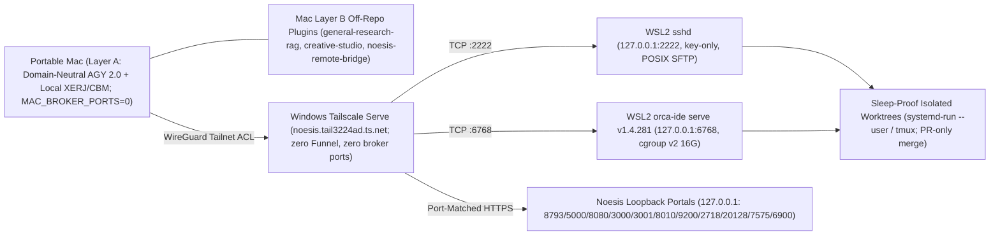

# ADR-0034: Dual-Machine Ecosystem Architecture: Clean Portable Mac AGY 2.0 Harness & Tailscale-Bridged Noesis Heavy-Compute Control Plane

## Context and Problem Statement

The owner operates two distinct machines with non-overlapping roles:

1. **Noesis (Stationary Threadripper / 24 GB CUDA GPU Workstation — Windows + WSL2 `Noesis-SOTA`):** Owns heavy quantitative compute (`sim-backtest`, `NautilusTrader v2`, Rust `hftbacktest`, Optuna/MLflow compounding, multi-runtime parallel workers, and the stationary 4-account Paper Farm + 15-portal upstream observability stack per [ADR-0017](ADR-0017.md)).
2. **Portable Mac (Apple Silicon Coordinator & General/Creative Workstation):** Owns daily portable engineering, general research/RAG, creative TouchDesigner/AV tooling, and remote coordination of Noesis when Noesis is physically inaccessible.

Empirical Phase-1 auditing on `2026-11-28` established four concrete gaps preventing clean, zero-pollution dual-machine operation:

1. **No Remote Shell or Headless Linux Orca Endpoint on Noesis WSL2:** `openssh-server` was absent in `Noesis-SOTA`, `loginctl` lingering was disabled (`Linger=no`), and no Linux `orca-ide serve` daemon existed (only Windows Orca Desktop on `:6770`), leaving Mac unable to dispatch sleep-proof `systemd-run --user` / `tmux` / `orca orchestration --on noesis` workloads into WSL2.
2. **Inactive Tailscale Serve Routes & HTTPS Origin/Host Mismatches:** Windows Tailscale (`noesis.tail3224ad.ts.net`, `100.110.115.22`) mirrored cleanly into WSL2 via `networkingMode=mirrored`, yet zero Tailscale Serve listeners were active. Furthermore, `docker/Caddyfile` (`:8793`) omitted `http://{$TIER0_TAILSCALE_HOST:localhost}:8793`, `docker/compose.sota.yml` set Zensical `--external-origin` to `http://` instead of `https://` and omitted Grafana `GF_SERVER_ROOT_URL=https://...`, and the off-repo OpenBB backend (`~/sota-data/openbb-tier0-backend/main.py`) allowed `http://noesis.tail3224ad.ts.net:1420` without `https://`.
3. **Cross-Domain Contamination Risk on Mac:** Copying Noesis's trading-scoped `~/.gemini/` setup (`nautilus-engine`, `edgartools`, trading plugins, or broker credentials) onto the portable Mac would bloat unrelated creative/general sessions and violate the `MAC_BROKER_PORTS=0` single-broker-host invariant.
4. **Single-Tailscale & Loopback-Only Invariant:** Installing a second `tailscaled` inside WSL2 causes TUN/routing/duplicate-node conflicts under `networkingMode=mirrored`, while publishing containers on `0.0.0.0` or enabling `tailscale funnel` would violate [ADR-0017](ADR-0017.md).

## Decision Drivers

- **Strict Loopback Hosting (`ADR-0017`) & Zero Public Exposure:** Every WSL2 service (`sshd`, `orca-ide serve`, and all 15+ Docker/systemd portals) MUST bind exclusively to `127.0.0.1`. Zero `0.0.0.0` host publishes, zero `tailscale funnel`, and zero Tailscale exposure of broker ports (`4001`, `4002`, `7496`, `7497`, `8796`, `8798`) or CDP (`9223`).
- **Single Tailscale Client Per Windows+WSL2 Host:** Run Tailscale exclusively on the Windows host (`networkingMode=mirrored`) and on the Mac; never install a duplicate `tailscaled` inside `Noesis-SOTA`.
- **Clean 3-Layer Mac Isolation & `MAC_BROKER_PORTS=0`:** Keep Mac Layer A strictly domain-neutral (`codebase-memory` + Mac-local `xerj` on `127.0.0.1:9200`), isolate optional general RAG, creative/TouchDesigner, and Noesis remote-bridge capabilities in toggleable off-repo plugins (`~/.gemini/config/plugins/`), keep per-host memory databases strictly separate (sync decisions through Git + manifests, never live DB copies), and guarantee full Mac offline usability when Noesis sleeps.
- **Sleep-Proof Remote Dispatch & PR-Only Governance (`ADR-0032` / `ADR-0033`):** Heavy workloads dispatched from Mac run on Noesis inside isolated worktrees (`/mnt/z/workspaces/<job-id>` or `/tmp/`), under `loginctl enable-linger` + `systemd-run --user` / `tmux` / `orca-ide serve` (`ORCA_TERMINAL_MEMORY_MAX=16G`), never mutating `/mnt/z/noesis` directly and landing changes exclusively via PRs.
- **Zero Self-Invention & SHA-256 Pinning:** Reuse official `openssh-server`, `tailscale serve`, `stablyai/orca` `v1.4.281` (`orca-server-linux-x64.tar.gz` verified by SHA-256), `caddy:2.11.9-alpine`, `zensical`, and `grafana/grafana:13.3.2` with idempotent, `shellcheck`-clean scripts and zero hardcoded user home paths.

## Considered Options

1. **Install a second `tailscaled` inside WSL2 `Noesis-SOTA` and bind Docker portals to `0.0.0.0` / LAN** — causes WinTun/WSL2 routing conflicts under `networkingMode=mirrored`, breaks [ADR-0017](ADR-0017.md) loopback invariants, and widens attack surface unnecessarily.
2. **Route Mac SSH through Windows OpenSSH with `DefaultShell=wsl.exe` and rely solely on Windows Orca Desktop (`:6770`)** — breaks POSIX SFTP semantics for remote editors/Orca writes, lacks Linux cgroup v2 per-terminal OOM isolation, and lacks `systemd --user` service management.
3. **Single-Tailscale Windows Serve (`:2222` SSH + `:6768` Orca Server + port-matched HTTPS portals) fronting loopback-only WSL2 `sshd` & `orca-ide serve`, paired with a clean 3-Layer portable Mac harness (`MAC_BROKER_PORTS=0`, per-host memory isolation, off-repo toggleable plugins) (chosen)**.

## Decision Outcome

Adopt **Option 3** across Noesis (`docker/Caddyfile`, `docker/compose.sota.yml`, `scripts/remote/*`) and the portable Mac control plane:

### 1. Loopback-Preserving Tailscale Serve Portal Readiness (`docker/Caddyfile`, `docker/compose.sota.yml`)

- **`docker/Caddyfile` (`:8793`):** Add `http://{$TIER0_TAILSCALE_HOST:localhost}:8793` alongside `http://127.0.0.1:8793, http://localhost:8793` while strictly retaining `bind 127.0.0.1` and leaving the DuckDB `:4213 -> 127.0.0.1:4214` loopback-only Origin CSRF proxy completely untouched (interactive DuckDB UI and FINOS Workspace `:1420` remain accessed remotely via `ssh -fN noesis-portals` loopback forwarding).
- **`docker/compose.sota.yml`:**
  - `tearsheets`: pass `TIER0_TAILSCALE_HOST=${TIER0_TAILSCALE_HOST:-localhost}` so Caddy resolves `{$TIER0_TAILSCALE_HOST:localhost}` cleanly at runtime.
  - `zensical`: update `--external-origin` from `http://` to `https://${TIER0_TAILSCALE_HOST:-localhost}:8010`.
  - `grafana`: set `GF_SERVER_ROOT_URL=https://${TIER0_TAILSCALE_HOST:-localhost}:3001` (preserving `127.0.0.1:3001:3000` loopback publish and `AGPL-3.0-only` unmodified container boundary).
- **Off-Repo Operator Follow-Up Recorded (Not Mutated in This PR):** The host-bound OpenBB backend at `~/sota-data/openbb-tier0-backend/main.py` (`CORSMiddleware.allow_origins`, lines 28-35) currently lists `http://noesis.tail3224ad.ts.net:1420` and omits `https://noesis.tail3224ad.ts.net:1420`; operators enabling direct HTTPS `:1420 -> :6900` access add that origin off-repo (or use the zero-patch `noesis-portals` SSH loopback tunnel).

### 2. Idempotent Noesis Remote Control Plane Scripts (`scripts/remote/`)

- **`scripts/remote/setup_noesis_wsl_remote_host.sh`:** Idempotent, `shellcheck`-clean WSL2 bootstrap (zero hardcoded user paths; uses `$USER`/`$HOME` + `--dry-run`):
  - Fails closed if any forbidden live broker/CDP port (`4001`, `7496`, `8798`, `8796`, `9223`) is listening.
  - Installs `openssh-server`, writes `/etc/ssh/sshd_config.d/99-noesis-tailnet.conf` (`ListenAddress 127.0.0.1`, `Port 2222`, `PermitRootLogin no`, `PasswordAuthentication no`, `KbdInteractiveAuthentication no`, `PubkeyAuthentication yes`, `AllowUsers <target_user>`, `AllowAgentForwarding no`, `Subsystem sftp /usr/lib/openssh/sftp-server`), validates with `sshd -t`, and enables `ssh`.
  - Enables `loginctl enable-linger <target_user>` and enforces `${HOME}/.ssh` (`0700`) + `authorized_keys` (`0600`).
  - Downloads and verifies SHA-256 (`5076e46d55d4221e55d2b3eec307be37c1f55a645b6535bb4b2fef378a759620`) of official `stablyai/orca` `v1.4.281` `orca-server-linux-x64.tar.gz` into `${HOME}/.local/opt/orca-server`, symlinks `${HOME}/.local/bin/orca-ide` (refusing GNOME `/usr/bin/orca`), installs user-systemd `orca-ide serve --port 6768 --bind 127.0.0.1 --pairing-address "${TAILSCALE_HOST}:6768" --refuse-public`, and configures cgroup v2 `ORCA_TERMINAL_MEMORY_MAX=16G` (`ORCA_TERMINAL_MEMORY_SWAP_MAX=0`).
- **`scripts/remote/setup_noesis_windows_tailscale_serve.ps1`:** Idempotent Windows Admin PowerShell (`-VerifyOnly` and `-DryRun` supported):
  - Configures tailnet-only TCP proxies (`:2222`, `:6768`) and port-matched HTTPS proxies (`:8793`, `:5000`, `:8080`, `:3000`, `:3001`, `:8010`, `:9200`, `:2718`, `:20128`, `:7575`, `:6900`) strictly targeting `127.0.0.1`.
  - Mechanically asserts `tailscale funnel` is OFF (`AllowFunnel` zero true entries) and zero broker ports (`4001`, `4002`, `7496`, `7497`, `8796`, `8798`) are exposed.
- **`scripts/remote/noesis_remote_doctor.sh`:** Strictly read-only verifier (`--json` supported) checking WSL2 `sshd` (`127.0.0.1:2222`), `Linger=yes`, `orca-ide serve` (`127.0.0.1:6768`), `tmux`, non-interactive login-shell toolchain PATH, `15/15` loopback portals, `0` live broker/CDP ports, and `0` wildcard `0.0.0.0`/`[::]` TCP listeners.

### 3. Clean Portable Mac Architecture Boundary

- **Layer A (Domain-Neutral Global Foundation):** Minimal charter (`<= 30` lines), pinned native Apple Silicon toolchain (`mise`/`uv`/`fnox`), 6-runtime parity (`AGY 2.0`, `Claude Code`, `Codex`, `OpenCode`, `OMP`, `pi`), and strictly two local stdio MCPs (`codebase-memory-mcp` + Mac-local `xerj` on `127.0.0.1:9200`). Zero trading MCPs, zero broker keys, `MAC_BROKER_PORTS=0`.
- **Layer B (Toggleable Off-Repo Plugins):** `agy-sota-practice`, `general-research-rag`, `creative-studio` (`touchdesigner-sota-mcp` / `creative-av-sota-mcp`), and `noesis-remote-bridge` (fast `<= 1.5s` reachability probe, `--no-autostart` remote XERJ, offline manifest mirror, explicit operator-confirmed queue flush).
- **Layer C (Project Overlays):** Per-repo `AGENTS.md` / `.agents/` overlays; heavy `noesis` compute executes remotely on Noesis in isolated worktrees and lands through PRs ([ADR-0032](ADR-0032.md)).

### 4. Sovereign Mac Companion Repository

- **Dedicated Companion Repo (`seathatflowsinourveins/mac-sota-ecosystem`, public):** The portable Apple Silicon ecosystem lives in its own sovereign repository rather than inside `noesis`, keeping both domains decoupled so the Mac retains a clean, domain-neutral engineering and creative perspective (and can serve as an unbiased second-opinion reviewer) with zero inherited broker state or `noesis` runtime bloat.
- **Disjoint Layers & Governance:** Governs disjoint layers `M0–M7` via living MADR 4.0 decisions `ADR-0001..ADR-0008` and deterministic `MAC_SOTA_CONVERGENCE_MANIFEST.json` while mechanically enforcing `MAC_BROKER_PORTS=0` and zero Noesis trading MCPs in the global Mac layer.
- **Plugins, Services, CI & Bootstrap:** Packages 4 toggleable off-repo AGY plugins (`general-research-rag`, `touchdesigner-sota-mcp`, `creative-av-sota-mcp`, and `noesis-remote-bridge`), loopback-only macOS `LaunchAgents`, dual `ubuntu-latest` + `macos-15` GitHub Actions CI, and a single-command `just bootstrap-full` workstation setup.
- **Bidirectional Federation Boundary:** `noesis` records the companion link in `SOTA_STARRED_AND_BEYOND_MANIFEST.json` (`sovereign_mac_companion`, referencing `ADR-0034`); all cross-machine dispatch, read-only portal viewing, and offline manifest mirroring flow exclusively across the opt-in `noesis-remote-bridge` contract over Tailscale + loopback `sshd`/`orca-ide serve`, never through shared working trees or implicit broker credentials.

### Confirmation

Confirmed mechanically via:

- `tests/test_dual_machine_remote.py` (Caddyfile `:8793` Tailscale host + `bind 127.0.0.1` + untouched DuckDB `:4213` CSRF proxy; `docker/compose.sota.yml` Zensical/Grafana HTTPS + `tearsheets` env + `127.0.0.1` port bindings; SHA-256 pin & loopback-only `sshd`/`orca-ide serve` contracts in `setup_noesis_wsl_remote_host.sh`; Funnel-OFF + zero-broker-port assertions in `setup_noesis_windows_tailscale_serve.ps1`; read-only checks & zero hardcoded user home paths in `scripts/remote/*`)
- `tests/test_grand_reset_kit.py::test_caddyfile_loopback_binding_and_duckdb_csrf_posture`
- `shellcheck scripts/remote/setup_noesis_wsl_remote_host.sh scripts/remote/noesis_remote_doctor.sh`
- `just adr-check` and `just check` (including `zensical build --clean --strict`, `gitleaks`, `ast-grep`, `z3`, and full `pytest`)

## Consequences

- **Positive:** Gives the portable Mac reliable, sleep-proof SSH, Orca paired-server orchestration, and HTTPS portal access to Noesis without opening a single public port, without duplicating Tailscale inside WSL2, and without polluting Mac general/creative workflows with trading MCPs or broker state.
- **Negative:** Requires one-time operator elevation on Noesis Windows (`setup_noesis_windows_tailscale_serve.ps1`) and WSL2 (`setup_noesis_wsl_remote_host.sh`) plus Mac tailnet/SSH enrollment; interactive FINOS (`:1420`) and DuckDB UI (`:4213`) use `ssh -fN noesis-portals` to keep CSRF/loopback protections unmodified.

## Pros and Cons of the Options

### Option 1: Duplicate `tailscaled` in WSL2 + `0.0.0.0` Docker binds

- Good, because WSL2 appears as a standalone Linux Tailscale node.
- Bad, because it conflicts with Windows Tailscale under `networkingMode=mirrored` and violates [ADR-0017](ADR-0017.md) loopback-only hosting.

### Option 2: Windows OpenSSH `wsl.exe` wrapper + Windows Orca Desktop only

- Good, because it avoids installing `openssh-server` or `orca-ide` inside WSL2.
- Bad, because Windows SFTP path translation breaks Linux remote editors/Orca writes and forfeits Linux cgroup v2 terminal OOM limits and `systemd --user` persistence.

### Option 3: Windows Tailscale Serve + Loopback WSL2 `sshd`/`orca-ide serve` + 3-Layer Portable Mac (Chosen)

- Good, because every WSL2 socket stays strictly on `127.0.0.1`, requires zero Windows Defender inbound holes, keeps `tailscale funnel` OFF and broker ports blocked, gives native Linux POSIX SFTP + cgroup v2 OOM isolation, and keeps Mac offline-capable and domain-clean.
- Bad, because two thin OS-specific setup scripts (`setup_noesis_wsl_remote_host.sh` and `setup_noesis_windows_tailscale_serve.ps1`) must be maintained in sync with `noesis_remote_doctor.sh` (mitigated mechanically by `tests/test_dual_machine_remote.py`).

## More Information

### Upstream Evidence & Empirical Verification (`2026-11-28`)

- **Noesis Live Baseline:** `Noesis-SOTA` (`Ubuntu 26.04.1 LTS`, `networkingMode=mirrored`, `eth1 100.110.115.22/32`, `noesis.tail3224ad.ts.net`), `15/15` baseline portals + `Alertmanager :9093` + `Allure 3` + `OmniRoute :20128` + `Marimo :2718` healthy on `127.0.0.1`, `0` forbidden live broker ports, `0` wildcard TCP listeners.
- **Pinned Upstream Server Binary:** `stablyai/orca` (`MIT`) release `v1.4.281` `orca-server-linux-x64.tar.gz` verified via GitHub Releases API (`sha256:5076e46d55d4221e55d2b3eec307be37c1f55a645b6535bb4b2fef378a759620`).
- **Safety Invariants Preserved:** Immutable `src/tier0_sota/risk.py` SHA-256 (`ad8071dcd4196c4c529c02107114ebfdda6692bc9d7c220031f1b19ea3e4d847`), `paper_only = True`, `live_execution_enabled = False`, zero live broker ports (`4001`, `7496`, `8798`, `8796`), `MAC_BROKER_PORTS = 0`, and zero custom runtime hooks.
- **Off-Repo Operator Note:** OpenBB backend CORS allowlist lives off-repo at `~/sota-data/openbb-tier0-backend/main.py` (currently includes `http://noesis.tail3224ad.ts.net:1420`; add `https://noesis.tail3224ad.ts.net:1420` if accessing `:6900` directly from HTTPS `:1420` without `ssh -fN noesis-portals`).

### Self-Invention Lesson Learned & Mechanical Upstream Gate

- **Lesson Learned:** Attempting to multiplex SPA portals behind custom subpath proxies or inventing custom remote agent daemons breaks WebSockets, CSRF headers, and security boundaries. Official `tailscale serve` port-matched HTTPS/TCP proxying over loopback-bound `openssh-server` and `orca-ide serve` eliminates custom relay code completely.
- **Mechanical Upstream Gates:** `shellcheck`, `tests/test_dual_machine_remote.py`, `tests/test_grand_reset_kit.py::test_caddyfile_loopback_binding_and_duckdb_csrf_posture`, `scripts/sync_manifest.py --check`, `just adr-check`, `just check`, and `scripts/remote/noesis_remote_doctor.sh`.

### Compounding Layer Integration

- Enables portable Mac coordination across all four Noesis lanes (`sim-backtest`, `paper`, `half-auto-tv`, `live` read-only telemetry) via isolated worktree dispatches and Tailscale-served read-only portals (`MLflow`, `Optuna`, `Dagster`, `Grafana`, `Caddy Tearsheets/Allure`, `Zensical`, `Inspect`, `XERJ`), while preserving PR-only landing ([ADR-0032](ADR-0032.md)) and multi-runtime discipline ([ADR-0033](ADR-0033.md)).

### Living Evolution & Supersession Policy

- Living MADR 4.0 contract governed by [ADR-0024](ADR-0024.md). Update the pinned `stablyai/orca` version/SHA-256 or Tailscale Serve port list in lockstep with `scripts/remote/*` and `tests/test_dual_machine_remote.py` via pull request whenever upstream releases advance, while permanently preserving loopback-only host binds, `tailscale funnel` OFF, zero exposed broker ports, `MAC_BROKER_PORTS = 0`, and immutable `risk.py` invariants.
