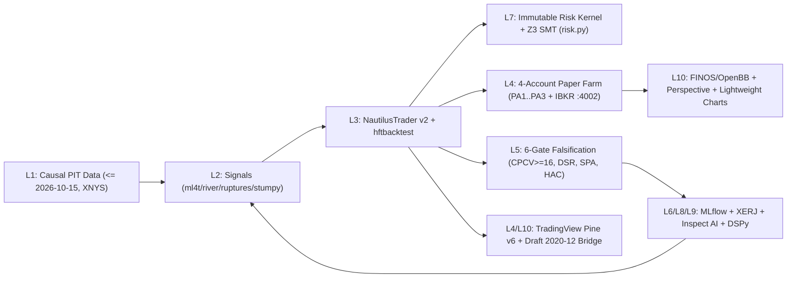

# Tier-0 SOTA Clean Ecosystem (`tier0-sota-clean`)

100% standalone, clean-room Python 3.13 (`uv`) quantitative trading, formal SMT verification, statistical falsification, and multi-runtime agent engineering workspace (`$TIER0_REPO_ROOT`, default `Z:\tier0-sota-clean`).

## Core Charter Pillars

1. **Upstream-Only `L0..L10` Stack & SPDX OSI License Firewall:** Live directly inside OSI-vetted upstream winners (`NautilusTrader v2`, Rust `hftbacktest`, `Polars`, `DuckDB`, `skfolio`, `ml4t-diagnostic`, `arch`, `statsmodels`, `alpaca-py`, `z3-solver`, `inspect_ai`, `finos-workspace`/`OpenBB`), enforced via `ast-grep` (`rules/zero_self_invention.yml`), `deptry`, `spdx_license_firewall`, and `uv.lock` (`0` transitive `yfinance`).
2. **Formal Immutable Risk Kernel & Z3 SMT Proofs:** [`src/tier0_sota/risk.py`](../src/tier0_sota/risk.py) (`361` LOC, SHA-256 `ad8071dcd4196c4c529c02107114ebfdda6692bc9d7c220031f1b19ea3e4d847`) + [`evals/formal_risk_z3.py`](../evals/formal_risk_z3.py) formally prove exact `Decimal` Rule-612 inward stops (`<= 2.00%`), latched `-1.50%` daily drawdown fuse, and `>= 10%` protective exit reserve (`UNSAT` counterexample checks).
3. **Single-Engine Parity (`Sim == Paper == Live`):** Strict pre-wall PIT (`<= 2026-10-15`, `t_ns + 60s`, `XNYS`), market-aligned always-short + causal peak reversal, 24/5 session protection (`RTH` `STOP_MARKET` vs collared `outside_rth` `STOP_LIMIT`), and 4-tier progressive lossless trailing (`BE+` -> `+1R` -> `+2R` -> `+3R/fast-sell`).
4. **Standalone Zero-Hook Multi-Runtime Harness:** `46` vetted skills reside inside `.claude/skills/`, `0` custom runtime `"hooks"` exist across `.claude/`/`.codex/`/`.gemini/`, and [`evals/tier0_inspect_eval.py`](../evals/tier0_inspect_eval.py) gates offline safety (`live_execution_enabled=False`, `paper_only=True`, live ports disabled).

## Navigation Guide

- [Architecture Layer Manifest (`L0..L10`)](ARCHITECTURE_LAYER_MANIFEST.md)
- [Clean Ecosystem Manifest](CLEAN_ECOSYSTEM_MANIFEST.md)
- [Grand-Reset Disk-Z & WSL2 Runbook](GRAND_RESET_DISK_Z_WSL_RUNBOOK.md)
- [TradingView Automation Playbook](TV_AUTOMATION_PLAYBOOK.md)
- [MADR 4.0 ADR Catalog (`ADR-0001..ADR-0012`)](adr/CATALOG.md)
