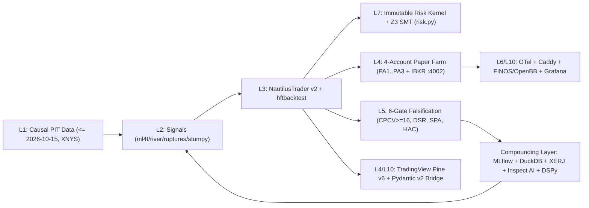

# Tier-0 SOTA Clean Ecosystem (`noesis`)

100% standalone, clean-room Python 3.13 (`uv` + `mise` + `just`) quantitative trading, formal SMT verification, statistical falsification, and 4-lane compounding engineering workspace (`$TIER0_REPO_ROOT`, default `Z:\noesis`).

## Core Charter Pillars

1. **Upstream-Only `L0..L10` Stack & Zero Self-Hallucination:** Live directly inside OSI-vetted upstream winners (`NautilusTrader v2`, Rust `hftbacktest`, `Polars`, `DuckDB`, `Pandera`, `Pydantic` v2, `skfolio`, `ml4t-diagnostic`, `arch`, `statsmodels`, `alpaca-py`, `z3-solver`, `inspect_ai`, `otel-collector-contrib`, `Caddy`, `finos-workspace`, `OpenBB`), enforced strictly via real upstream gates (`ast-grep`, `deptry`, `ruff`, `ty`, `prek`, `zizmor`, `trivy`, `gitleaks`, `scripts/sync_manifest.py`, `uv.lock` `0` `yfinance`/`quantstats`) with zero arbitrary LOC caps.
2. **Formal Immutable Risk Kernel & Z3 SMT Proofs:** `src/tier0_sota/risk.py` (SHA-256 `ad8071dcd4196c4c529c02107114ebfdda6692bc9d7c220031f1b19ea3e4d847`) + `evals/formal_risk_z3.py` formally prove exact `Decimal` Rule-612 inward stops (`<= 2.00%`), latched `-1.50%` daily drawdown fuse, and `>= 10%` protective exit reserve (`UNSAT` counterexample checks).
3. **Core Trading Philosophy & 4 Compounding Harness Lanes:** Capture extreme movers early, align direction with causal market regime (short crashes and verified reversal peaks), and protect every order 24/5 (`BE+fee` + 4-tier progressive profit-lock trailing, flatten-first auto-reverse, `60s` re-entry) across `sim-backtest`, `paper`, `half-auto-tv`, and `live` backed by deterministic compounding manifests (`MLflow`, `DuckDB`, `Z:\sota-data\manifests`, `XERJ`).
4. **AAIF `AGENTS.md` SSOT & Zero-Hook Multi-Runtime Harness:** Canonical `AGENTS.md` (`CLAUDE.md` -> `@AGENTS.md`), `46` SHA-locked standalone skills in `.claude/skills/`, `0` custom runtime `"hooks"` across `.claude/`/`.codex/`/`.gemini/`, and `evals/tier0_inspect_eval.py` offline safety verification (`live_execution_enabled = False`, `paper_only = True`).

## Navigation Guide

- [Architecture Layer Manifest (`L0..L10`)](ARCHITECTURE_LAYER_MANIFEST.md)
- [Clean Ecosystem Manifest](CLEAN_ECOSYSTEM_MANIFEST.md)
- [Compounding Self-Reflection Loop](COMPOUNDING_SELF_REFLECTION_LOOP.md)
- [Grand-Reset Disk-Z & WSL2 Runbook](GRAND_RESET_DISK_Z_WSL_RUNBOOK.md)
- [Post-Restart Seamless Resume Playbook](POST_RESTART_RESUME_PLAYBOOK.md)
- [TradingView Automation Playbook](TV_AUTOMATION_PLAYBOOK.md)
- [Living MADR 4.0 ADR Catalog (`ADR-0001..ADR-0021+`)](adr/CATALOG.md)
