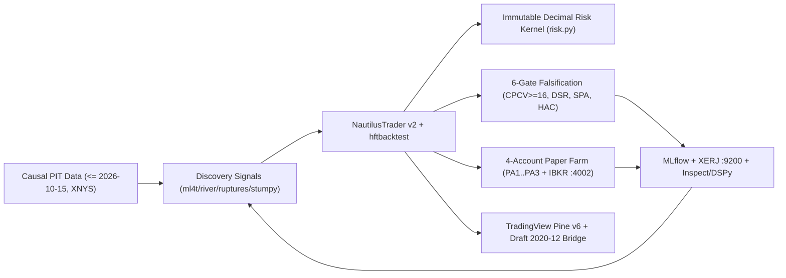

# Tier-0 SOTA Clean Ecosystem (`tier0-sota-clean`)

Clean-room Python 3.13 (`uv`) quantitative trading, statistical falsification, and multi-runtime agent engineering workspace on Disk `Z:\tier0-sota-clean`.

## Core Charter Pillars

1. **Upstream-Only, Native-First Thin Layer:** Live directly inside `NautilusTrader v2`, Rust `hftbacktest`, `Polars`, `DuckDB`, `skfolio`, `ml4t-diagnostic`, `arch`, `statsmodels`, and `alpaca-py`, enforced mechanically via `ast-grep` (`rules/zero_self_invention.yml`) and single-winner `uv.lock` pinning (`upstream-map.toml`).
2. **Formal Immutable Risk Kernel:** [`src/tier0_sota/risk.py`](../src/tier0_sota/risk.py) (`361` LOC, SHA-256 `ad8071dcd4196c4c529c02107114ebfdda6692bc9d7c220031f1b19ea3e4d847`) enforces exact `Decimal` Reg-NMS Rule-612 inward stops (`<= 2.00%`), latched `-1.50%` daily drawdown fuse, and `>= 10%` protective exit reserve.
3. **Single-Engine Parity (`Sim == Paper == Live`):** Strict pre-wall PIT (`<= 2026-10-15`, `t_ns + 60s`, `XNYS`), market-aligned always-short + causal peak reversal, 24/5 session protection (`RTH` `STOP_MARKET` vs collared `outside_rth` `STOP_LIMIT`), and 4-tier progressive lossless trailing (`BE+` -> `+1R` -> `+2R` -> `+3R/fast-sell`).
4. **Ungated Evidence Lanes -> Fail-Closed Live Gate:** `Sim` (`Environment.SANDBOX`), Stationary 4-account `Paper` Farm (`ALPACA_PA1..PA3` + `IBKR_DU_4002`), and TradingView Half-Auto (`semi_auto_confirmed=false`, `qty=1`, zero CDP `:9223`) run continuously (`live_execution_enabled=False`, `paper_only=True`, live ports disabled).

## Navigation Guide

- [Architecture Layer Manifest (`L0..L9`)](ARCHITECTURE_LAYER_MANIFEST.md)
- [Clean Ecosystem Manifest](CLEAN_ECOSYSTEM_MANIFEST.md)
- [Grand-Reset Disk-Z & WSL2 Runbook](GRAND_RESET_DISK_Z_WSL_RUNBOOK.md)
- [TradingView Automation Playbook](TV_AUTOMATION_PLAYBOOK.md)
- [MADR 4.0 ADR Catalog (`ADR-0001..ADR-0012`)](adr/CATALOG.md)
